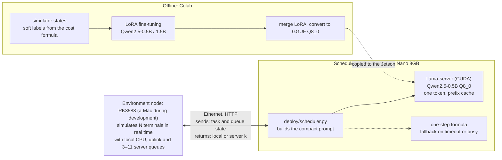

# COMLLM on Jetson: LLM task offloading at the edge

<p align="center">
  <a href="README.md"><kbd>&nbsp;<b>English</b>&nbsp;</kbd></a>
  &nbsp;
  <a href="README.zh-CN.md"><kbd>&nbsp;简体中文&nbsp;</kbd></a>
</p>

Mobile terminals keep producing computing tasks. For each task a scheduler decides whether to run it on
the terminal or to offload it to one of 3 to 11 edge servers. This project puts that scheduler on an
NVIDIA Jetson Orin Nano 8GB, following the open-source paper COMLLM (Yang, Cheng and Zhang,
[arXiv:2604.07148](https://arxiv.org/abs/2604.07148)). Instead of the paper's 7B model, Qwen2.5-0.5B and
1.5B are LoRA-fine-tuned on soft labels from the paper's one-step cost formula and served by llama.cpp
(CUDA) with a compact prompt and a one-token answer. An environment node simulates the terminals, the
uplink and the servers in real time and asks the Jetson for every decision over Ethernet, so the time a
decision takes counts toward the task's delay. Terminals and servers are simulated; the scheduler node
and the network hop are real.

This is an independent project based on the paper, not an official COMLLM release.

## Results

Everything below is measured. "Sim" marks results from the simulator rather than the real-time testbed.
Every value in the figures is listed with its source run in [docs/media/numbers.md](docs/media/numbers.md);
the stage 5 values are in [figures/numbers.md](figures/numbers.md).

| Question | Result | Conditions |
|---|---|---|
| How long does one decision take? | Deployed setup: p50 55.0 ms, p99 72.0 ms. The original-author 1.5B in the paper's prompt format: p50 911.4 ms on the same board | Jetson, end to end as seen by the environment node, 500 requests, 3/7/11 servers in turn. Deployed = 0.5B Q8_0, compact prompt, one token, prefix cache |
| How many terminals can one scheduler serve? | 7 (theory 7.9). With overload shedding, at least 20 with 1.0% of tasks dropped. The paper-format 1.5B drops 93.4% with a single terminal | Real-time closed loop, 3 servers, 3 min per point, 2 seeds |
| Does deciding in batches cause herding? | Yes. Deciding one task at a time with a virtual state update: mean delay 5.11 → 4.19 slots (−18.1%), drops 2.4% → 0.1% | Sim, 11 servers, 80 terminals, one-step formula |
| Server counts never seen in training | Closed loop within −0.1% to +0.5% of the one-step optimum; open-loop accuracy 96.5% on seen counts, 94.4% on unseen | Closed loop: sim, N = 40, 3/4/6/7/8/10/11 servers |
| A teacher closer to the paper's own server model | Formula against formula, the PS-aware one has 9.27% lower mean delay on average (−22.73% to +3.79%). Its 0.5B student: 13.4% / 19.6% / 9.9% lower than the paper-teacher 0.5B at N = 20/40/60, drops 0.1% / 5.9% / 17.3% → 0.0% / 0.0% / 0.9% | Sim, virtual-time closed loop, decisions one at a time. Formulas: 3/7/11 servers × N = 20–80, 3 seeds. Students: 3 servers, seed 0. The simulated servers share capacity as in the paper's eq. 4, which is the assumption this teacher is built on |
| Does that advantage come from simulating processor-sharing servers? | No. With first-come-first-served servers the PS-aware formula has 12.88% lower mean delay than the paper's formula on average (−26.40% to +1.32%) and drops 0.05% of tasks against 4.14% | Sim, formulas only, the same 12 points and 3 seeds, servers switched to FCFS. The trained students were not run on FCFS servers |
| Open loop against a 7B | Our paper-teacher students: PR 99.88–99.99% on all three test sets. The reproduced 7B: 98.85–99.26% on the authors' cleaned set but 71.55–75.32% on our two sets, because it never chooses local execution | The paper's PR (eq. 29); 3010 / 2408 / 245 states |
| Does deployment change the decisions? | Closed loop on Colab (bf16) and Jetson (Q8_0): 17 of 18 student settings within 0.04 slots of mean delay and 0.83 points of drop rate. Same answer per state in the open loop: 97.13–100.00% for the paper-teacher students, 66.53–76.95% for the two PS-teacher soft-label students | Six students, 3 servers, N = 20/40/60, 2 seeds; open loop on 5663 states |
| The reproduced 7B in the closed loop | Never runs a task locally; drops 53.15–55.07% at N = 40 and 83.99–84.10% at N = 60, against 6.26% and 16.66% for our deployed 0.5B | Colab, virtual time, 3 servers, 2 seeds |

### On the board

<p align="center">
  
</p>

The real-time closed loop runs on wall-clock time, so a slow decision delays its task and, once
decisions arrive more slowly than tasks, tasks start to miss their deadlines. The deployed 0.5B holds up
to 7 terminals; at 8 it drops 24.5%. Answering with the one-step formula whenever the LLM takes longer
than 100 ms ("overload shedding") keeps 20 terminals at 1.0%. The original-author 1.5B, which writes its
answer out in the paper's prompt format, already drops 93.4% with one terminal.

<p align="center">
  
</p>

The speed-up comes from the prompt and the answer, not only from model size: at the same 1.5B size the
compact prompt with prefix cache answers in 112–118 ms p50, the paper format in about 911 ms. The
compact prompt averages 278 tokens against 1358 for the paper format. An earlier run of the
original-author SFT model, before the sampling settings were pinned to greedy, measured 945.2 ms p50.

### Open loop: three test sets

<p align="center">
  
</p>

The open loop scores each decision on a fixed state with the paper's cost formula. The three test sets
differ a lot in how often running the task locally is best:

| | Seen server counts (3/5/7/9/11) | Unseen server counts (4/6/8/10) | Authors' cleaned set |
|---|---|---|---|
| States | 3010 | 2408 | 245 |
| Local execution is best | 47.97% | 45.93% | 2.45% (6 states) |
| Best accuracy for a policy that never runs locally | 52.03% | 54.07% | 97.55% |

The authors' cleaned set is their 306-state test file without the 61 states that also appear in their
training data. 41 of those 61 were local-optimal, so what remains hardly tests local execution.

- **The reproduced 7B never chooses local execution** in any of the 5663 states. It started from the
  authors' SFT-7B and was trained with the paper's GRPO recipe at λ = 0.3 and λ = 0
  (`runs/20261108T103821Z_s7_colab_7b`). The SFT model does choose local, but without looking at the
  state: 166 times on the cleaned set, where only 6 states are local-optimal. GRPO dropped the action in
  its first 7 updates. In the λ = 0 run, of 41 local answers sampled there, 35 were on states that should have been
  offloaded and 29 of those were penalised; after update 7 none of 3208 sampled answers was local.
  Answer parsing, reward computation and λ were ruled out.
- On the states where a server is best, the 7B picks the right server 62–67% of the time, against
  89–94% for our students.
- This is the paper's method on the authors' data, not the original COMLLM-7B, whose weights are not
  available; the paper's 96.86% is not compared with these numbers. Our students and the 7B differ in
  training data, method, prompt format and size, so this is not a size-only comparison. Our two larger
  test sets also come from our own simulator, the one the students were trained on.
- **Why the authors' setting may lean towards offloading.** One reading, which this project did not
  test: on a real terminal the SoC is already busy with whatever the device is doing, and running an
  offloadable task there slows that work down, so a designer may want most tasks sent to the edge. The
  authors' data fit that picture. Local execution is best in 2.45% of the cleaned test states and in 49
  of the 830 GRPO training prompts (5.9%), so a model trained on them has little reason to keep the local
  action. But neither the paper's cost formula nor our simulator charges anything for that interference:
  both count only the task's own delay. On our two test sets, where local execution is best in nearly
  half the states, never running locally therefore costs PR, and in the closed loop it costs dropped
  tasks. Capturing the idea would take an explicit cost for running a task on the terminal.
  The same reading cuts against our test sets: if real workloads seldom make local execution the best
  choice, our two sets overstate how much the missing local action matters. Their share of local-optimal
  states comes from load, 21.6% at N = 5 rising to 72.8% at N = 80 on the seen server counts, and from
  counting delay only. The paper is about offloading, and a regime where most tasks are better kept on
  the terminal is outside what it set out to study; our heavier loads put the models in that regime.
  We have no real workload to check either side against.

Full tables with local recall and precision, per server count and per N: [evidence/G6/open_loop.md](evidence/G6/open_loop.md)
(Colab) and [evidence/G6/jetson_open/comparison.md](evidence/G6/jetson_open/comparison.md) (Jetson).

### Closed loop: Colab and Jetson

<p align="center">
  
</p>

The virtual-time closed loop waits for every decision before the simulation moves on, so decision time
does not count and heavy loads (N = 20–80) can be compared. Each decision changes the queues that later
tasks see.

- **Deployment.** The six students ran the same 36 points on Colab (merged LoRA, bf16, A100) and on the
  Jetson (GGUF Q8_0, llama.cpp), with identical task streams and no fallback to the formula on either
  side. 17 of the 18 student settings agree within 0.04 slots of mean delay and 0.83 points of drop
  rate. Close totals are not identical decisions: in the open loop the two PS-teacher soft-label
  students give the same answer on Colab and the Jetson for only 66.53–76.95% of the states.
- **The exception** is the PS-teacher hard-label 1.5B at N = 60. In 3 of its 4 runs (both Colab seeds,
  Jetson seed 0) it stopped sending tasks to server 3 and dropped 26–29%; Jetson seed 1 used all three
  servers and dropped 2.0%. The unquantised model does it too. The cause has not been investigated.
- **The reproduced 7B** never runs a task locally in the closed loop either, and drops 84% at N = 60.
  Its lower mean delay at high load only counts the tasks that were completed.
- **Two teachers.** The paper assumes processor-sharing servers (eq. 4), but its delay formula counts
  the existing backlog twice ([derivation](docs/paper-delay-formula.md)) and does not subtract what a
  server finishes during the upload, so it is
  pessimistic at high load. A PS-aware formula derived from eq. 4 is a second teacher. It is about as
  good as the paper's formula at light load and better as the load grows (22.73% lower mean delay at 7
  servers, N = 80). Its students score only 65.57–75.80% PR in the open loop (Colab), because the
  open-loop ruler is the paper's formula.
- **Is that an artefact of the simulator?** The PS-aware formula was derived from the same server model
  the simulator uses. A control with first-come-first-served servers, where a server works on one task at
  a time, says no: the PS-aware formula has 12.88% lower mean delay than the paper's formula there, against
  9.27% on processor-sharing servers, and is faster in 11 of the 12 points. A formula written for FCFS servers gives
  the same results as the PS-aware one in 48 of 72 runs. So the gain does not come from modelling how
  capacity is shared. It comes from what those two formulas have in common: they subtract the work a
  server finishes during the upload and do not multiply the backlog by the number of active tasks. The
  paper's formula overestimates server delay and keeps 58.3% of tasks on the terminal; the other two keep
  about 28%. This is formulas only (`runs/20261114T120231Z_s6_fcfs_control`).

Per-point results: `runs/20261112T064150Z_s6_colab_loop` (students on Colab),
`runs/20261107T071637Z_s5_virtual_e4a+e4b+e5`, `runs/20261108T044444Z_s5_virtual_e4ps_a` and
`runs/20261108T094747Z_s5_virtual_e4ps_b` (Jetson), and the report in `runs/20261113T104604Z_s7_colab_closed_loop`
(the 7B).

### Do the students still handle ordinary language?

The students were trained only on scheduling prompts with a one-letter answer, so they could have lost
their general language ability. A check on Colab compares each untrained base model with the students
made from it (`runs/20261115T123413Z_s8_language_check`; merged LoRA, bf16):

| Model | wikitext-2 perplexity | Ordinary chat questions answered with a single letter | MMLU, answer read as a letter | MMLU, answer read as option text |
|---|---|---|---|---|
| untrained 0.5B | 18.1 | 0/20 | 46.5% | 41.0% |
| our 0.5B (deployed) | 19.8 | 0/20 | 31.5% | 42.5% |
| our 0.5B, PS teacher | 19.3 | 0/20 | 30.5% | 40.0% |
| untrained 1.5B | 11.7 | 0/20 | 56.0% | 41.0% |
| our 1.5B soft labels | 11.9 | 0/20 | 53.5% | 44.5% |
| our 1.5B hard labels | 12.2 | 0/20 | 54.0% | 45.5% |
| our 1.5B soft labels, PS teacher | 11.8 | 0/20 | 54.0% | 43.0% |
| our 1.5B hard labels, PS teacher | 12.1 | 0/20 | 50.0% | 46.5% |

- **They still write.** Every student answers all 20 ordinary questions in sentences, and perplexity on
  plain text rises by 7–9% for the 0.5B students and 1–4% for the 1.5B students.
- **The 0.5B students lost the letter as an answer.** Asked to answer a multiple-choice question with a
  letter, they fall from 46.5% to 31.5% and 30.5% on the same 200 MMLU questions (p < 0.001). The deployed
  one picks A 106 times out of 200 and the PS-teacher one picks B 113 times; in the scheduling prompt A is
  local execution and B is server 1. Read by the likelihood of the option text instead, both score like
  the base (42.5% and 40.0% against 41.0%), so the knowledge is still there. The 1.5B students show no
  significant drop by letter (50.0–54.0% against 56.0%).
- This is a small check: 200 MMLU questions, 20 chat questions classified by form and not by correctness,
  full-precision PyTorch on Colab and not the Q8_0 models on the Jetson. Per-item analysis:
  `runs/20261115T123413Z_s8_language_check/analysis.md`.

### Known limits

- The terminals, uplink and servers are simulated; only the scheduler node and the network hop are real.
  The simulated servers share capacity as in the paper's eq. 4. A formula-only control shows the PS-aware
  formula keeps its advantage on FCFS servers, but the trained students were not run there.
- Both teachers are one-step formulas and a student's ceiling is its teacher.
- Closed-loop points have 2 seeds; the PS-teacher 0.5B comparison in the results table used seed 0 only. The hard-label
  PS 1.5B at N = 60 shows that 2 seeds are not always enough. Differences under 1% are reported as "not
  separable".
- Mean delay counts completed tasks only; always read it with the drop rate.
- The reproduced 7B is not the original COMLLM-7B and ran on Colab only. Its closed loop decoded with
  `max_new_tokens = 16` and `repetition_penalty = 1.05`, its open loop with 15 and 1.0. Whether a 7B
  beats a small model on the same data was not tested.
- Matching totals on Colab and the Jetson do not establish that the Q8_0 models are equivalent to the
  PyTorch ones; that investigation is on hold.
- One Jetson Orin Nano 8GB (MAXN_SUPER, llama.cpp 5aeac37a3). The environment node has been a Mac so
  far; the RK3588 two-board retest is still to come.

## How it works



- **Environment node.** Advances the simulation in 0.1 s slots; each terminal produces a task with
  probability 0.3 per slot. For every task it sends the task size and the queue states to the Jetson
  and puts the task in a queue only when the decision comes back. All timestamps are taken on this side,
  so the two boards need no clock sync.
- **Scheduler node.** Only decides. If the LLM takes longer than 100 ms, or the previous LLM request is
  still running, it answers with the one-step formula on the spot and logs why.
- **Training.** Our simulator generates states with 3/5/7/9/11 servers; each action gets a cost from the
  paper's one-step formula and the soft label is softmax(−cost / T). 40,000 states per run, LoRA on
  Qwen2.5-0.5B and 1.5B, KL loss on the single answer token. The paper's 7B weights are not available,
  so the teacher is the formula. 0.5B and 1.5B score almost the same, so the 0.5B is deployed.
- **Speed.** One line of numbers per server in the prompt and a single letter as the answer.
  llama-server computes one token and the scheduler takes the most likely legal letter among the top 20,
  with no generation and no grammar. The static instructions sit in the prefix with the KV cache on.
  With one token INT4 is no faster than Q8_0, so Q8_0 is used.
- **GRPO from the original-author 1.5B.** Its bias towards server 1 is already in the SFT model and
  greedy decoding amplifies it. GRPO raises accuracy on the authors' cleaned set from 13.5% to 81.2%
  (corrected reward) and 87.8% (the authors' reward), but on 1000 seen-count states (N = 5/10/20) the two
  reach only 44.3% and 52.1%. Our hard-label 1.5B is already at the formula ceiling and GRPO lowers it
  slightly (96.0% → 92.9% on seen counts).

## Stages

| Stage | What was settled | Evidence |
|---|---|---|
| 0 | repository skeleton, pinned versions | `evidence/G0/` |
| 1 | simulator, baseline policies, the two prompt renderers | `evidence/G1/` |
| 2 | Jetson scheduler service, latency benchmark, real-time closed loop | `evidence/G2/` |
| 3 | training data, LoRA training on Colab, open-loop scoring, GGUF checks | `evidence/G3/` |
| 4 | GRPO from the original-author 1.5B and from our hard-label 1.5B | `evidence/G4/` |
| 5 | closed-loop experiments: capacity, latency, herding, server-count generalization, ablation, LACS | `evidence/G5/`, `figures/` |
| 6 | the PS-aware teacher and its FCFS control, open loop per test set, Colab against Jetson in both loops | `evidence/G6/`, `runs/*_s6_*` |
| 7 | the 7B reproduction with the paper's GRPO recipe, open and closed loop on Colab | `evidence/S7/`, `runs/*_s7_*` |
| 8 | whether the students keep their ordinary language ability | `runs/*_s8_*` |

Commands, parameters and full results for every stage are in [docs/stages.md](docs/stages.md),
including the 10 places where the simulation, training or evaluation differs from the paper.

## Repository layout

| Path | What |
|---|---|
| `sim/` | simulator, baseline policies, the compact and paper prompt renderers |
| `deploy/` | scheduler service for the Jetson, prompts, testbed configuration `testbed.json` |
| `train/` | training data generation and the Colab notebooks (LoRA, GRPO, 7B reproduction, GGUF conversion) |
| `eval/` | real-time and virtual-time closed loops, latency benchmark, open-loop scoring, Colab closed loop, FCFS control, figures |
| `runs/` | raw results of every run, one folder per run named by UTC time |
| `evidence/` | acceptance evidence per stage |
| `figures/` | the seven stage 5 figures (labels in Chinese) and `numbers.md` |
| `docs/` | stage notes `stages.md`, versions `versions.md`, old and new commit ids `commit-map.md`, README figures in `media/` |
| `tests/` | unit tests |

## Running it

```bash
git clone https://github.com/Baro7ue/comllm-edge-scheduler.git
cd comllm-edge-scheduler
python3 -m venv .venv
source .venv/bin/activate
pip install -r requirements.txt
python -m unittest discover -s tests
python -m eval.readme_figures            # the four README figures in English and Chinese
python -m eval.figures                   # the seven stage 5 figures and figures/numbers.md
```

- `runs/` holds the raw results of every experiment, so all figures can be redrawn and every number
  checked without a Jetson.
- Commands for training on Colab, deploying on the Jetson and each experiment are in
  [docs/stages.md](docs/stages.md); hardware, JetPack, llama.cpp commit and Qwen revisions in
  [docs/versions.md](docs/versions.md).
- The original authors' models and dataset are not distributed with this repository. Tests that need
  them skip themselves when the files are missing.

## Credits, licence and citation

- Paper: Ning Yang, Chuangxin Cheng, Haijun Zhang. *Multi-Turn Reasoning LLMs for Task Offloading in
  Mobile Edge Computing*. arXiv:2604.07148. Code:
  [Cassandra-Cheng/COMLLM-MEC-Task-Offloading](https://github.com/Cassandra-Cheng/COMLLM-MEC-Task-Offloading).
- Thanks to the authors for sharing the paper's 1.5B models and dataset for comparison; they are not
  distributed here.
- The queueing model of the simulator follows Tang and Wong ([arXiv:2005.02459](https://arxiv.org/abs/2005.02459)).
- Models: [Qwen2.5](https://github.com/QwenLM/Qwen2.5). Inference: [llama.cpp](https://github.com/ggml-org/llama.cpp).

The project's own code, documents and results are under the Apache License 2.0 ([LICENSE](LICENSE)).
Third-party material keeps its own terms, listed in [THIRD_PARTY_NOTICES.md](THIRD_PARTY_NOTICES.md); the
paper-format prompt template is the original authors', under the MIT licence of their repository.

```bibtex
@article{yang2026comllm,
  title   = {Multi-Turn Reasoning LLMs for Task Offloading in Mobile Edge Computing},
  author  = {Yang, Ning and Cheng, Chuangxin and Zhang, Haijun},
  journal = {arXiv preprint arXiv:2604.07148},
  year    = {2026}
}
```
