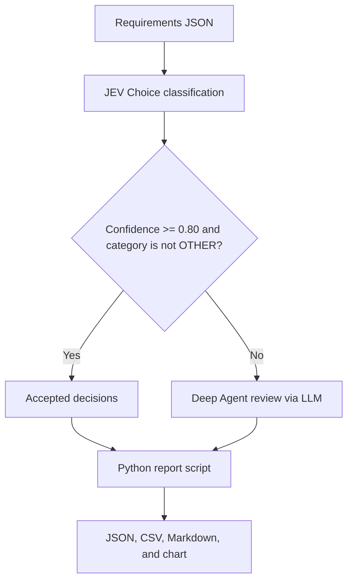

# Security Requirements Analysis with JEV and Deep Agents

A small Python demo that classifies software requirements by cybersecurity relevance. JEV handles the initial classification, a Deep Agent reviews ambiguous results via an LLM, and Python scripts generate the reports.

The goal is to reduce unnecessary LLM reasoning and make the mechanical parts of the workflow predictable. Cost and accuracy improvements are hypotheses to evaluate, rather than measured results of this demo.

## How it works



1. `agent.py` starts a Deep Agent with two filesystem skills.
2. The classifier calls JEV through `langchain_typesafe.TypeSafeClassifier.invoke()` once per requirement. It records the selected category, confidence, and probability distribution.
3. Python routes results with confidence below `0.80`, or category `OTHER`, to the review queue. All other results are accepted directly.
4. The agent is instructed to review only queued requirements and write its decisions to `work/review_decisions.json`.
5. The report script merges by requirement ID, sorts, counts, and formats the results without model calls. A reviewed decision supersedes an accepted decision with the same ID and counts only as Deep Agent review. Duplicate IDs within either input are rejected.

JEV classification and agent review are model decisions. Threshold routing and report generation are deterministic code. The Deep Agent still orchestrates every full run, even when no requirement needs review.

## Setup

Use Python 3.11 or newer and run the commands below from the project root. You need TypeSafe and OpenAI API credentials, plus access to the OpenAI model you select.

### Windows PowerShell

```powershell
python -m venv .venv
.\.venv\Scripts\Activate.ps1
python -m pip install -r requirements.txt
Copy-Item .env.example .env
```

### macOS / Linux

```bash
python3 -m venv .venv
source .venv/bin/activate
python -m pip install -r requirements.txt
cp .env.example .env
```

If `.env` already exists, keep it rather than copying over it. Fill in these values:

```dotenv
TYPESAFE_API_KEY="your-typesafe-api-key"
OPENAI_API_KEY="your-openai-api-key"
DEEP_AGENT_MODEL="openai:YOUR_MODEL"
```

Replace `YOUR_MODEL` with a model identifier available to your account that supports tool calling. `DEEP_AGENT_MODEL` selects the orchestration and review model; the classifier uses `jev-latest` separately.

Both `agent.py` and `classify.py` load the project root `.env` with `python-dotenv`. Existing process environment variables take precedence. `.env` is excluded from Git; `.env.example` contains placeholders only.

## Run the workflow

With the virtual environment active, run from the project root:

```bash
python agent.py
```

The supplied dataset contains 10 example requirements. Replace or extend `data/requirements.json` using unique IDs and this structure:

```json
[
  {
    "id": "REQ-001",
    "text": "Administrators shall authenticate using multi-factor authentication."
  }
]
```

The terminal displays a short English summary. Only text blocks from the final agent message are printed; reasoning and encrypted response blocks are excluded.

Before analyzing a different dataset, clear previous generated files from `work/` and `output/`, keeping their `.gitkeep` files. The demo reuses fixed paths, so stale review decisions or charts can otherwise remain from earlier runs.

## Run the scripts separately

Run JEV classification with only `TYPESAFE_API_KEY` configured:

```bash
python skills/jev-requirement-classifier/scripts/classify.py --input data/requirements.json --accepted work/accepted.json --review work/review_queue.json
```

This command creates accepted decisions and a review queue; it does not invoke the Deep Agent. If the queue is nonempty, complete every review before building the report. The review decision schema and allowed categories are documented in the [classifier skill](skills/jev-requirement-classifier/SKILL.md).

Generate reports from completed decisions, without API calls:

```bash
python skills/requirement-report/scripts/build_report.py --accepted work/accepted.json --reviews work/review_decisions.json --output output
```

When no review is needed, `review_decisions.json` may contain `[]` or be absent. Do not reuse a review file from a previous dataset.

## Files and outputs

| Path | Purpose |
| --- | --- |
| `agent.py` | Agent setup, workflow instructions, and concise terminal output |
| `data/requirements.json` | Example input dataset |
| `skills/jev-requirement-classifier/` | JEV classification instructions and script |
| `skills/requirement-report/` | Deterministic reporting instructions and script |
| `work/accepted.json` | Decisions accepted directly from JEV |
| `work/review_queue.json` | Low-confidence or `OTHER` decisions requiring review |
| `work/review_decisions.json` | Decisions produced by the agent after review |
| `output/final.json` | Combined classifications with source attribution |
| `output/requirements.csv` | Tabular classifications |
| `output/summary.json` | Counts and the direct JEV acceptance percentage |
| `output/report.md` | Human-readable report |
| `output/categories.png` | Category chart, generated when security-related results exist |

Runtime files in `work/` and `output/` are ignored by Git. Their `.gitkeep` files preserve the directories in a fresh checkout.

## Interpreting the results

`llm_avoidance_rate_percent` is calculated as:

```text
requirements accepted directly by JEV / total reported requirements * 100
```

It measures the share of reported requirements that bypassed individual Deep Agent review via LLM. It does **not** measure token savings, total cost reduction, accuracy, or the absence of LLM calls: orchestration still uses the agent, and JEV calls also have a cost.

For a blog benchmark, compare this workflow with an LLM-only baseline on the same labeled dataset. Record classification quality, review rate, latency, token usage, and actual provider charges. The current scripts do not collect that benchmark automatically.

## Current limitations

- The `0.80` threshold is an application policy, not a calibrated accuracy guarantee for this dataset.
- A single primary category is selected, even when a requirement spans multiple security concerns.
- Review scope and category rules are agent instructions, not fully enforced validation constraints. `OTHER` triggers review, but the final review taxonomy has no `OTHER` option.
- The report script treats missing input files as empty lists. It counts each merged ID once and rejects duplicate IDs within either input, but does not verify completeness or consistency against the original input and review queue. Stale reviews can still override current accepted decisions; clear previous run files before classification.
- `jev-latest` can change over time. The LangChain integration is pinned to `0.0.1a3`, while the other dependencies are unpinned; this is not a fully locked environment.
- `LocalShellBackend` executes commands on the host and inherits the environment. This demo is intended for trusted local execution, not as an isolated sandbox.

## Development

See [AGENTS.md](AGENTS.md) for repository conventions and validation guidance. Keep code, comments, documentation, and generated prose in English.

## License

This project is licensed under the [MIT License](LICENSE).
