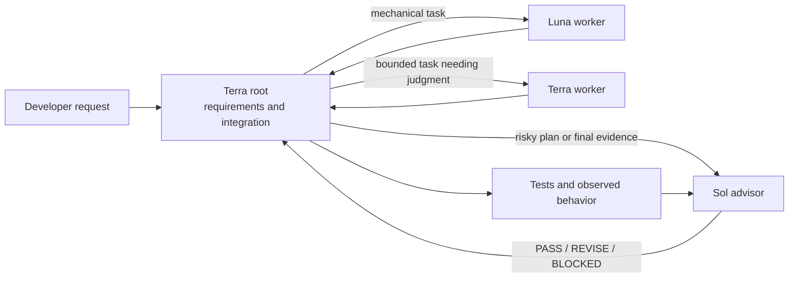

# Sol-Governed Codex

<p align="center">
  
</p>

[](https://github.com/BusyBee3333/sol-governed-codex/actions/workflows/validate.yml)
[](LICENSE)

Get stronger review where it matters without running the most capable model for every edit. Sol-Governed Codex is an installable toolkit for **OpenAI Codex** that pairs Terra and Luna workers with a bounded **Sol advisor**. It turns cost-conscious delegation into a repeatable **multi-agent coding workflow**, with structured **AI code review** gates and practical **LLM cost optimization**.

Sol advises; workers implement. The root agent retains requirements, integration, and final communication, while deterministic validation supplies evidence for the final verdict.

## Architecture



The included configuration template limits delegation to one level and three concurrent threads. Workers cannot create descendants.

## Quick start

Requirements: Git, Bash, Python 3.11 or later, and an OpenAI Codex installation with access to the configured models.

### Codex plugin marketplace

Current Codex builds can install the skill from this Git marketplace:

```bash
codex plugin marketplace add BusyBee3333/sol-governed-codex
codex plugin add sol-governed-codex@sol-governed-codex
```

Start a new Codex thread and say: `Use $sol-governed-workers to install and validate this workflow.` Plugin installation exposes the skill; the skill's guarded setup script then installs the custom agents and named profiles after you approve that local change.

### Direct install

```bash
git clone https://github.com/BusyBee3333/sol-governed-codex.git
cd sol-governed-codex
bash skills/sol-governed-workers/scripts/install_global_infra.sh
```

That installer copies the complete skill, all three agent profiles, and both named profiles into `${CODEX_HOME:-$HOME/.codex}`. The default `sol-governed` profile uses Terra Medium at the root; `sol-governed-high` uses Terra High for harder work.

Validate the global setup without spending a model call:

```bash
bash skills/sol-governed-workers/scripts/validate_setup.sh
```

To prove that the current Codex runtime exposes all three custom roles, explicitly opt into one small live call from a logged-in Codex home:

```bash
bash skills/sol-governed-workers/scripts/validate_setup.sh --live-probe
```

To add the optional governed-workflow contract to a project next, run:

```bash
bash skills/sol-governed-workers/scripts/install_project_contract.sh /absolute/path/to/your-project
bash skills/sol-governed-workers/scripts/validate_setup.sh /absolute/path/to/your-project
```

If `sol-governed-workers` already exists in your Codex skills directory and differs from this checkout, the installer refuses to replace it. Compare the directories before using `--force`.

The project installer refuses to replace an existing `AGENTS.md`. Review that file and, only when the instructions are compatible, append the managed contract:

```bash
bash skills/sol-governed-workers/scripts/install_project_contract.sh --append /absolute/path/to/your-project
```

If a previously installed managed block is stale, review the change and replace only that bounded block with `--update`.

## Manual installation

The global installer copies the complete skill directory, three agent profiles, and two named configuration profiles into `${CODEX_HOME:-$HOME/.codex}`:

| Repository source | Destination |
| --- | --- |
| `skills/sol-governed-workers/` | `skills/sol-governed-workers/` |
| `skills/sol-governed-workers/assets/agents/sol-advisor.toml` | `agents/sol-advisor.toml` |
| `skills/sol-governed-workers/assets/agents/terra-worker.toml` | `agents/terra-worker.toml` |
| `skills/sol-governed-workers/assets/agents/luna-worker.toml` | `agents/luna-worker.toml` |
| `skills/sol-governed-workers/assets/sol-governed.config.toml` | `sol-governed.config.toml` |
| `skills/sol-governed-workers/assets/sol-governed-high.config.toml` | `sol-governed-high.config.toml` |

To install manually, copy the table entries beneath your Codex home while preserving their destination names. Then, if wanted, copy `skills/sol-governed-workers/assets/AGENTS.sol-governed.md` to `AGENTS.md` in a project that has no existing contract. If a project already has instructions, merge only after reviewing both sets for conflicts.

For safety, the installer does not edit an existing `config.toml`. Codex activates the separately installed profiles with `codex --profile sol-governed` or `codex --profile sol-governed-high`. Review the profile before installation and adjust model identifiers if required by your account. Static validation can be forced with `--offline`, but normal validation requires Codex so it can confirm profile parsing, model availability, and supported reasoning levels. The base `config.toml` remains untouched; only the separately managed files listed above are in scope for explicit `--force` replacement.

The installer is idempotent for unchanged files. It will not overwrite modified managed files unless you pass `--force`; inspect the diff before doing so.

## Example workflow

1. Start Codex with `codex --profile sol-governed`; reserve `sol-governed-high` for unusually hard root-level reasoning.
2. Give the root agent the outcome, constraints, and observable acceptance criteria.
3. Let Luna handle tightly bounded mechanical edits and Terra handle bounded work that needs judgment.
4. Ask the user directly for missing product intent. Ask Sol to review plans involving architecture, authentication, security, billing, migrations, destructive operations, public interfaces, or a concrete unresolved technical risk.
5. Inspect the actual diff and run relevant tests.
6. Send Sol final evidence for runtime behavior, dependencies/configuration, persistent data, security, or public interfaces. Verified docs, comments, formatting, and generated output can skip that call.

The complete agent-facing workflow is in [`skills/sol-governed-workers/SKILL.md`](skills/sol-governed-workers/SKILL.md). Review packets are defined in [`skills/sol-governed-workers/references/review-protocol.md`](skills/sol-governed-workers/references/review-protocol.md).

### Structured Sol verdicts

Sol returns a machine-scannable decision rather than a vague approval:

```text
VERDICT: PASS | REVISE | BLOCKED

BLOCKING FINDINGS:
- <specific finding with evidence>

NONBLOCKING NOTES:
- <short optional improvement>

REQUIRED VERIFICATION:
- <missing command or evidence>
```

- `PASS` means the acceptance criteria are met and the evidence supports them.
- `REVISE` means specific deficiencies can be corrected and resubmitted.
- `BLOCKED` means a decision, access, or required proof is missing.

## Roles and cost tradeoffs

| Role | Best use | Tradeoff |
| --- | --- | --- |
| Terra root | Requirements, decisions, integration, user communication | Medium by default; High is an explicit opt-in profile |
| `luna_worker` | Inventory, mechanical edits, and targeted tests | Low-reasoning lane; unsuitable for unsettled decisions |
| `terra_worker` | Independent bounded implementation requiring judgment | More capable than Luna, but delegation still adds coordination cost |
| `sol_advisor` | Risky plan gates and final evidence review | Highest-cost lane; deliberately brief and intermittent |

A Terra root with Sol as a reviewer is the recommended balance. A Sol-led task can delegate implementation to workers when explicitly requested, but is usually more expensive.

## Configuration

The agent TOML files define `sol_advisor`, `terra_worker`, and `luna_worker`. Both named profiles set `max_depth = 1`, `max_threads = 3`, and a Sol review fallback. They also expose custom-role metadata for Codex's multi-agent v2 routing surface; `validate_setup.sh --live-probe` checks the result instead of assuming that a parseable profile is correctly routed. The agent profiles currently reference `gpt-5.6-sol`, `gpt-5.6-terra`, and `gpt-5.6-luna`.

Model names and availability depend on your Codex account and current configuration. Review the TOML files before installation if your account uses different model identifiers. Set `CODEX_HOME` to install and validate against a non-default Codex home. Setup validation confirms the installed skill, agent files, named profiles, and expected values without modifying your base `config.toml`.

## Token efficiency

Version 1.1 reduced the validator-measured core instruction footprint from 1,502 to 893 words, about 41%, while preserving routing, escalation, evidence, and verdict rules. The repository enforces a 1,100-word ceiling so future edits cannot quietly turn every task into a large prompt. The optional project contract is intentionally separate; install it only when every task in that project needs these gates.

## Limitations

- This repository provides local configuration, instructions, and validators—not a hosted orchestration service.
- Governance improves review discipline; it cannot guarantee correctness or replace human approval for high-impact changes.
- Sol verdict quality depends on concise acceptance criteria, relevant diffs, and real verification evidence.
- Parallel agents can create merge conflicts or cost more than a focused single-agent task; delegate only bounded, independent work.
- The project contract must be reconciled manually with existing `AGENTS.md` instructions.
- Agent `sandbox_mode` values are defense in depth. Parent/session permissions still govern what a run can do; launch Codex with permissions appropriate to the repository and task.
- The custom-role compatibility keys target a current under-development Codex routing surface and may need adjustment as the CLI stabilizes; validation is designed to fail visibly when that happens.

## Troubleshooting

**The installer refuses to overwrite a file.** The destination differs from the managed source. Compare them first, then rerun the global installer with `--force` only if replacement is intentional.

**The project installer refuses an existing `AGENTS.md`.** Review it for conflicts. If compatible, rerun with `--append`; otherwise merge the contract manually.

**Validation reports a missing model or profile.** Confirm `CODEX_HOME`, rerun the global installer, and check that your Codex account supports the configured model identifiers.

**Codex rejects the profile.** Inspect `skills/sol-governed-workers/assets/sol-governed.config.toml`, verify your installed Codex version supports its fields, and update model/profile settings for your environment.

**Only built-in worker roles appear.** Reinstall the current profiles and run `validate_setup.sh --live-probe`. A normal parse smoke test cannot detect hidden custom-role metadata.

**Validation says a managed contract is stale.** Review the bounded block in `AGENTS.md`, then run `install_project_contract.sh --update /path/to/project`. Malformed or duplicate markers require manual repair.

For repository development checks, run:

```bash
bash scripts/validate_repo.sh
```

## FAQ

### Is this an OpenAI product?

No. It is an independent toolkit designed for use with OpenAI Codex.

### Does Sol write the code?

No. Sol is intentionally bounded to plan and evidence review. Terra or Luna implements, and the root agent integrates.

### When should I skip multi-agent delegation?

Use one agent for small, tightly coupled work where coordination would cost more than implementation. This workflow is most useful when tasks can be bounded and review quality matters.

### Does this guarantee lower spend?

No. It is an LLM cost optimization strategy, not a billing guarantee. Savings depend on task shape, model pricing, retries, and how selectively you use Sol.

### Can I change the models?

Yes. Edit the agent and profile TOML sources before installation, then run the setup validator. Keep the role boundaries and evidence gates intact.

## Contributing

Bug reports, focused improvements, and documentation corrections are welcome. Read [`CONTRIBUTING.md`](CONTRIBUTING.md), follow [`CODE_OF_CONDUCT.md`](CODE_OF_CONDUCT.md), review the [`CHANGELOG.md`](CHANGELOG.md), and run `bash scripts/validate_repo.sh` before opening a pull request.

## Security

Please do not disclose vulnerabilities in a public issue. Follow [`SECURITY.md`](SECURITY.md) to report them privately through GitHub Security Advisories.

## License

Released under the [MIT License](LICENSE).
