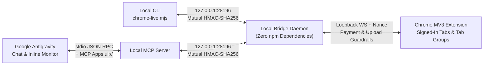

<div align="center">


# chrome-live-for-antigravity

Let **Google Antigravity** operate your **everyday signed-in Chrome or Edge browser** directly.  
Stop re-entering passwords, scanning QR codes, or repeating 2FA inside the isolated built-in browser sandbox. Share any logged-in tab with `Alt+Shift+L`, run background lookups in auto-collapsed tab groups without stealing focus, and watch a 0-token live preview right inside chat.

<sub>Works with Antigravity Stable & Insiders · Antigravity IDE · Official VS Code Extension · Windows, macOS & Linux · Zero npm Dependencies</sub>

<p>
  <b>English</b> ·
  <a href="./README.zh-CN.md">简体中文</a>
</p>

<p>
  
  
  <a href="https://github.com/CHANPAJN/chrome-live-for-antigravity/actions/workflows/ci.yml"></a>
  <a href="./LICENSE"></a>
  <a href="https://nodejs.org"></a>
  <a href="https://linux.do"></a>
</p>


<sub>Independent community project. Not affiliated with or endorsed by Google LLC.</sub>

</div>

## What Problem Does It Solve?

Antigravity's built-in side browser runs in an isolated sandbox — every site you already signed into in Chrome (GitHub, internal dashboards, developer forums, cloud consoles) asks you to log in and pass verification all over again. Classic step-by-step browser tools also burn 7–8 chat turns and hundreds of thousands of tokens just to fill a single form while stealing your window focus.

`chrome-live-for-antigravity` bridges Antigravity directly to your own Chrome or Edge browser:

- **Reuse Signed-In Tabs Instantly**: Open any logged-in page in Chrome and press `Alt+Shift+L` (`Option+Shift+L` on macOS) to hand that tab to Antigravity. When finished, `done` detaches the debugger and leaves your tab open.
- **Background Tab Groups & Zero Focus Stealing**: Pages opened by the agent stay neatly tucked inside an auto-collapsed background tab group instead of popping windows over your editor. Controlled pages wear an anti-misclick shield — **hold left-click for 3 seconds** or press **`Esc`** anytime to take back manual control immediately, or click **Popout** when a page needs manual 2FA / QR login.
- **0-Token Live Preview in Chat**: Embeds a live preview card right inside the chat stream (via the official MCP Apps `ui://` standard) with multi-tab switching, direct remote click/scroll, and drag-to-pick DOM extraction — streaming locally at 0 model token cost.
- **5.5× Faster Single-Roundtrip `batch`**: Combines `open -> type -> click -> wait -> snapshot` into 1 turn (`13s` vs `71s`, `-88%` non-cached tokens). Written purely with built-in `Node.js >= 20` modules and plain MV3 JavaScript — zero `npm install` dependencies.

## Quick Install

Requires `Node.js >= 20`.

### Option 1: One-Prompt Setup via Antigravity (Recommended)

Paste this prompt into Antigravity (see [AI_INSTALL.md](./AI_INSTALL.md)):

```text
Read https://github.com/CHANPAJN/chrome-live-for-antigravity/blob/main/AI_INSTALL.md and follow it step by step to clone and configure chrome-live-for-antigravity, generate the local pairing token, start the bridge daemon, and return the local extension/ folder path for me to load in chrome://extensions.
```

### Option 2: Manual Setup (3 Steps)

**1. Clone & generate local pairing token**

```bash
git clone https://github.com/CHANPAJN/chrome-live-for-antigravity.git
cd chrome-live-for-antigravity
node ./bin/chrome-live.mjs setup
```

**2. Load the extension in Chrome / Edge / Brave**

Open `chrome://extensions` (or `edge://extensions`), enable **Developer mode**, click **Load unpacked**, select this repo's `extension/` folder, then verify connection:

```bash
node ./bin/chrome-live.mjs health
```

**3. Connect to Antigravity**

```bash
# Install the Antigravity plugin (SKILL.md + inline live monitor)
node ./bin/chrome-live.mjs install --with-plugin
```

> **Seamless updates**: Run `git pull && node ./bin/chrome-live.mjs reload` (or `git pull && node ./bin/chrome-live.mjs install --with-plugin`) to restart the local daemon and hot-reload the Chrome extension in background.

<details>
<summary>Mount manually as a standalone stdio MCP Server (optional)</summary>

```json
{
  "mcpServers": {
    "chrome-live": {
      "command": "node",
      "args": ["/absolute/path/to/chrome-live-for-antigravity/bin/chrome-live.mjs", "mcp"]
    }
  }
}
```
</details>

<details>
<summary>Optional Tip: Hide Chrome's "started debugging this browser" banner</summary>

Chrome shows a top infobar while `chrome.debugger` is attached (it disappears automatically on `done` or after 18s of idle time). To hide it permanently, fully quit Chrome and add Chromium's official `--silent-debugger-extension-api` flag:

- **Windows**: Right-click your Chrome shortcut → **Properties** → append `--silent-debugger-extension-api` outside the closing quote in **Target**:
  ```text
  "C:\Program Files\Google\Chrome\Application\chrome.exe" --silent-debugger-extension-api
  ```
- **macOS**: Quit Chrome (`Cmd + Q`), then run `open -b com.google.Chrome --args --silent-debugger-extension-api`
- **Linux**: Launch with `google-chrome --silent-debugger-extension-api` or add it to your `.desktop` file.
</details>

## Visual Overview & Benchmarks

<p align="center">
  
</p>

<p align="center">
  
</p>

<details>
<summary>View raw 1:1 Chrome window + live CLI capture</summary>
<p align="center">
  
</p>
</details>

Measured on a real `pypi.org` search workflow (`open -> type -> submit -> wait -> extract -> cleanup`):

| Mode | Agent Turns | Wall Time | Total Token Throughput | Non-Cached Tokens |
| :--- | :---: | :---: | :---: | :---: |
| Classic step-by-step loop | 7 | 71.0s | 419,162 | 20,360 |
| Single-roundtrip `batch --compact` | **1 (-85.7%)** | **13.0s (5.5× faster)** | **67,365 (-83.9%)** | **2,445 (-88.0%)** |
| Repeat visit with `playbook on` (off by default) | **1** | **10.0s** | Skips landing page discovery | — |

1-hour continuous soak test (562 rounds / 6,714 mixed live web operations): `100%` pass rate, `0` leaked tabs, `~30–46 MB` daemon RSS, `< 0.01%` idle CPU.

## CLI Reference

Antigravity invokes MCP tools automatically, or you can drive the bridge directly from your shell:

```bash
node ./bin/chrome-live.mjs health                           # Check daemon & extension status
node ./bin/chrome-live.mjs reload                           # Hot-reload unpacked Chrome extension
node ./bin/chrome-live.mjs open "https://example.com"       # Open URL in collapsed background tab group
node ./bin/chrome-live.mjs snapshot                         # Read visible text & indexed elements [0],[1]...
node ./bin/chrome-live.mjs click 0                          # Click by element index, CSS selector, or label
node ./bin/chrome-live.mjs type "Search" "query" --submit   # Fill input and submit
node ./bin/chrome-live.mjs upload "~/.chrome-live-antigravity/uploads/demo.png" # Upload staged file via CDP
node ./bin/chrome-live.mjs batch - --compact                # Execute multi-step JSON pipeline in 1 roundtrip
node ./bin/chrome-live.mjs extract "https://a.com"          # Concurrently extract clean text & image URLs
node ./bin/chrome-live.mjs relay popout                     # Pop tab into standalone window for manual login/2FA
node ./bin/chrome-live.mjs relay merge                      # Merge popout window back to main window
node ./bin/chrome-live.mjs release                          # Detach control without closing tab
node ./bin/chrome-live.mjs done "Task complete"             # Detach debugger & close temporary worker tabs
```

## How It Works & Operational Transparency

Connecting an agent to your daily browser requires clear local boundaries:



- **On-Demand Debugger & Instant Takeover**: `chrome.debugger` attaches only during active commands or live preview and detaches after 18s of idle time. Holding left-click for 3s, clicking the `LIVE` badge, pressing `Esc`, clicking **Cancel** on Chrome's debug banner, or popping out a relay window immediately halts streaming, detaches the debugger, and aborts in-flight steps. Existing signed-in tabs are never attached unless explicitly shared in Chrome.
- **Loopback Isolation & Mutual HMAC Auth**: The daemon binds strictly to `127.0.0.1:28196`, rejects web `Origin` headers (`403`), and authenticates every local client (extension, CLI, MCP server, sidecar) with JSON-tuple `HMAC-SHA256` request/response signatures + replay nonces (zero plaintext tokens over loopback). Whether to type into login/OTP forms is governed by the user and their chosen model's safety policies, while **read-side credential values are strictly redacted** (snapshots never read back `.value` fields, password inputs, masked text, or editor drafts, and scrub sensitive URL tokens).
- **Payment & Upload Guardrails (and Honest Scope)**: Blocks major payment gateways (Stripe, PayPal, Alipay, WeChat Pay, online banking), `chrome://` / `edge://`, and common `/checkout`, `/pay`, `/payment`, `/billing` routes across all commands. File uploads are restricted to `~/.chrome-live-antigravity/uploads` (rejecting symlinks and credential paths like `.ssh` or `.env`), and local Site Playbooks (`playbook`) default to `false`. Route heuristics cannot interpret custom business buttons inside regular admin panels (e.g., refunds or price edits) — use a separate Chrome profile for high-risk accounts.
- **Zero Client Patching & Clean Uninstall**: Modifies zero Antigravity files. Test or uninstall anytime:

```bash
npm test                                                    # Run security, guardrail & protocol tests
node ./bin/chrome-live.mjs stop                             # Stop daemon, then remove extension & ~/.chrome-live-antigravity
```

## License

Released under the [GNU General Public License v3.0 (GPL-3.0)](./LICENSE). Community discussion & feedback: [LINUX DO](https://linux.do).
