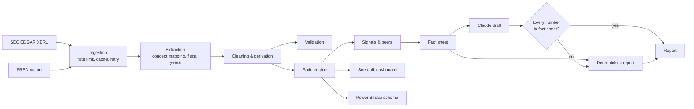

# AI-Powered Financial Intelligence Platform

[](https://github.com/Cesium1377/ai-financial-intelligence-platform/actions/workflows/tests.yml)

**See how financially healthy 17 well-known US companies are (Apple, Microsoft, Amazon, Walmart,
Coca-Cola and more) using the numbers from their official annual reports.**

The project downloads each company's yearly results from the US government's public filing
database (SEC EDGAR), checks them for errors, and turns them into easy-to-read measures of growth,
profit, debt and cash. You can explore everything in an interactive dashboard, compare companies
side by side, and get a short written report on any company.


## What it does, in 30 seconds

1. **Collects the official numbers.** Revenue, profit, debt, cash and more, straight from each
   company's annual report filed with the SEC, plus economic data such as interest rates and
   inflation from the Federal Reserve (FRED).
2. **Checks them for mistakes.** Companies label the same item in different ways, and figures
   sometimes get corrected in later years. The project handles this and flags anything that
   doesn't add up instead of hiding it.
3. **Turns them into simple health measures.** For example: how fast sales are growing, how much
   of each dollar of sales becomes profit, how much debt the company carries, and how much real
   cash it generates.
4. **Shows the results in a dashboard.** Pick a company, see its trends over up to 15 years, and
   compare it with similar companies.
5. **Writes a short report.** It covers strengths, weaknesses and what changed this year. An
   optional AI writer can draft the commentary. Every number it uses is checked against the real
   data, and if the AI makes up a number, its draft is thrown away.

## Why I built it

Comparing companies properly takes hours of collecting, cleaning and double-checking numbers
before any real analysis starts, and AI tools that summarize companies often invent figures. This
project automates the careful groundwork: every number can be traced back to the exact report it
came from, so the analysis can be trusted.

## What you can see in the dashboard

| Tab | Question it answers |
|---|---|
| Overview | How is the company doing this year, and what changed? |
| Profitability | How much profit does it make from its sales, and why? |
| Liquidity & leverage | Can it pay its bills? How much debt does it carry? |
| Cash flow | Does it generate real cash, or only accounting profit? |
| Peer comparison | Is it better or worse than similar companies? |
| Analyst report | A written summary of strengths, weaknesses and changes |
| Macro context | What were interest rates, inflation and growth doing at the time? |
| Data quality | Where did each number come from, and were there any problems? |

## What the data shows (examples)

Using each company's latest annual report:

| Company | Yearly sales | Sales growth | Profit kept from each $1 of sales* |
|---|---|---|---|
| NVIDIA | $215.9B | +65.5% | 60 cents |
| Microsoft | $331.8B | +17.8% | 47 cents |
| Alphabet (Google) | $402.8B | +15.1% | 32 cents |
| Amazon | $716.9B | +12.4% | 11 cents |
| Walmart | $713.2B | +4.7% | 4 cents |
| Coca-Cola | $47.9B | +1.9% | 29 cents |

\*Operating margin: profit from the core business before interest and taxes.

* **Size isn't the same as profitability.** Walmart and Amazon sell the most, but Microsoft and
  NVIDIA keep far more of each dollar as profit.
* **Profit isn't the same as cash.** Some companies' cash inflow is well below their reported
  profit (Coca-Cola's operating cash was only 57% of its profit last year), which the dashboard
  flags for a closer look.
* **Investment shows up in cash.** Microsoft's spending on data centers ($115.9B last year) is why
  its free cash flow fell even though sales grew 17.8%.

## Key terms in plain English

| Term | Meaning |
|---|---|
| Revenue / sales | Total money received from customers |
| Operating margin | Share of sales left as profit from the core business |
| Return on equity (ROE) | Profit earned for every dollar the owners have invested |
| Current ratio | Short-term assets divided by bills due within a year (above 1 = can cover them) |
| Debt-to-equity | Borrowed money compared with the owners' money |
| Free cash flow | Cash left after running the business and paying for new equipment and buildings |
| SEC EDGAR / XBRL | The US government's public database of company reports, and the format the numbers are stored in |

## Try it yourself

```bash
pip install -r requirements.txt
streamlit run app/streamlit_app.py
```

That opens the dashboard in your browser using the included data. No account or API key needed.

---

## For technical reviewers

The rest of this page covers how it works under the hood: data pipeline, formulas, testing and
design decisions.

## Key features

| Area | What it does |
|---|---|
| **Ingestion** | SEC companyfacts and submissions APIs, FRED CSV; declared User-Agent, rate limiting (5 req/s), retries with backoff, 7-day disk cache |
| **XBRL mapping** | 31 standardized line items mapped to 64 US-GAAP concepts, chosen per period, with full lineage (concept, accession, filing date) |
| **Cleaning & validation** | Annual-only filtering, fiscal-year labelling, restatement flags, duplicate removal, 9 data-quality checks (balance-sheet identity, gross-profit consistency, gaps, and more) |
| **Analytics** | Growth, margins, ROA/ROE (average balances), DuPont, liquidity, leverage, cash conversion, FCF, payout; peer percentiles; rule-based signals and z-score outliers |
| **Dashboard** | 8 tabs: overview KPIs, profitability, liquidity & leverage, cash flow, peer comparison, AI report, macro context, data quality & lineage |
| **Reporting** | Deterministic Markdown report (no API key needed) and optional Claude commentary with a number-by-number grounding check |
| **Power BI** | Star-schema CSV export, 37 DAX measures, theme, and build guide ([dashboards/powerbi](dashboards/powerbi/README.md)) |
| **Quality** | 32 automated tests, Ruff linting, GitHub Actions CI |

## Technologies

Python 3.12+, pandas, NumPy, Requests, Streamlit, Plotly, pytest, Ruff, Playwright (screenshots),
Anthropic Claude API (optional), Power BI / DAX (kit), GitHub Actions.

## Architecture



More detail: [docs/architecture.md](docs/architecture.md) · [docs/data_pipeline.md](docs/data_pipeline.md) ·
[docs/metrics.md](docs/metrics.md)

## Screenshots

All screenshots were captured from the running app with `scripts/capture_screenshots.py`, using
the committed sample dataset (Microsoft selected, large-cap technology peer group).

| | |
|---|---|
|  Profitability and DuPont decomposition |  Liquidity and leverage |
|  Cash flow and earnings quality |  Peer ranking, growth vs. margin, percentile table |
|  Analyst report (deterministic mode shown) |  Validation results and value lineage |

## Methodology

1. **Collect.** Map tickers to CIKs, download each company's XBRL facts and profile, and download
   five FRED series.
2. **Extract.** Keep 10-K values only. Flow items must span about a year; balance-sheet items are
   taken at the fiscal year-end. Fiscal years use the company's own labelling convention.
3. **Map.** For each line item, use the first candidate concept that has a value for the period.
   Revenue takes the largest total-revenue concept, because some filers tag a single revenue stream
   with the generic `Revenues` tag. This rule corrected BlackRock's 2022-2024 revenue and Procter &
   Gamble's 2012-2014 revenue during development.
4. **Clean, derive and validate.** Remove duplicates, derive gross profit, total debt, FCF and
   EBITDA, and run the checks. Issues are reported, not patched.
5. **Analyze.** Compute ratios and peer percentiles, and run the screening rules.
6. **Report.** Build a fact sheet. The deterministic writer or the verified AI writer turns it into
   a report.

### Important assumptions

* Ratios use as-reported GAAP figures; no non-GAAP adjustments.
* ROA and ROE use average balances (closing balance in a company's first year).
* ROE and debt-to-equity are n/a when equity is not positive (e.g. after large buybacks).
* Total financial debt excludes operating leases.
* Peer comparisons use each company's latest fiscal year, so period ends differ.

## Results from the sample dataset

The committed snapshot (`data/sample/`, built 2026-10-31) covers **17 companies, 233 company-years
(FY2012-FY2026), 7,100+ line-item values**. The pipeline flagged 1 balance-sheet error (Costco
FY2014), 7 warnings, and 114 informational notes, most of them restatements.

Latest fiscal year, selected companies (from `data/sample/metrics.csv`):

| Company | FY | Revenue | Growth | Operating margin | ROE | FCF margin | OCF / NI |
|---|---|---|---|---|---|---|---|
| NVIDIA | 2026 | $215.9B | 65.5% | 60.4% | 101.5% | 44.8% | 0.86x |
| Microsoft | 2026 | $331.8B | 17.8% | 46.8% | 34.0% | 20.2% | 1.37x |
| Alphabet | 2025 | $402.8B | 15.1% | 32.0% | 35.7% | 18.2% | 1.25x |
| Amazon | 2025 | $716.9B | 12.4% | 11.2% | 22.3% | 1.1% | 1.80x |
| Walmart | 2026 | $713.2B | 4.7% | 4.2% | 23.0% | 2.1% | 1.90x |
| Coca-Cola | 2025 | $47.9B | 1.9% | 28.7% | 46.0% | 11.0% | 0.57x |

What the data shows (descriptive only; causes are in each company's MD&A):

* **Margin structure dominates the comparison.** Walmart and Amazon book the largest revenue in the
  sample at operating margins of 4.2% and 11.2%. Microsoft and NVIDIA convert more than 45% of
  revenue into operating income.
* **Cash conversion separates business models.** The retailers' operating cash flow is 1.7-1.9x net
  income. NVIDIA's is 0.86x and Coca-Cola's 0.57x, which the platform flags as "weak cash
  conversion" for an analyst to investigate.
* **Capital intensity compresses free cash flow.** Amazon's 12.4% revenue growth comes with a 1.1%
  FCF margin. Microsoft's FY2026 capex reached $115.9B, 34.9% of revenue, and its FCF fell 6.5%
  while revenue grew 17.8%.
* **Very high ROE often reflects a small equity base.** Apple (171%) and Home Depot (146%) both
  have debt-to-equity above 1.3x. The DuPont tab separates the margin, turnover and leverage effects.

## Limitations

* **No `.pbix` file.** Power BI Desktop was not available to build one, so the repository ships the
  data model, DAX and theme, plus a build guide.
* XBRL coverage varies: CVX and NKE do not tag operating income, so their operating margin is n/a.
  BlackRock's SEC history starts in FY2022 because of its 2024 re-registration. XOM was excluded
  because its companyfacts file was incomplete at build time.
* The AI writer was tested with injected writers (grounded, fabricated and failing cases). A live
  Claude call needs your own `ANTHROPIC_API_KEY` and was not run for the screenshots.
* Signals use generic thresholds. A current ratio below 1.0 is normal for many retailers, for example.
* Financial companies (banks, insurers) need different line items. Only BlackRock is included, as
  a test of missing-data handling.
* This is an analytical tool, not investment advice.

## Installation

```bash
git clone https://github.com/Cesium1377/ai-financial-intelligence-platform.git
cd ai-financial-intelligence-platform
python -m venv .venv
.venv\Scripts\activate          # macOS/Linux: source .venv/bin/activate
pip install -r requirements.txt
```

## Running it

```bash
# 1. Dashboard on the committed sample (no keys needed)
streamlit run app/streamlit_app.py

# 2. Rebuild from SEC + FRED (set SEC_USER_AGENT in .env first, see .env.example)
python scripts/build_dataset.py                       # 17 default companies -> data/processed/
python scripts/build_dataset.py --tickers AAPL MSFT   # custom universe

# 3. Reports to reports/ (add --ai with ANTHROPIC_API_KEY set for Claude commentary)
python scripts/generate_reports.py --tickers MSFT WMT KO

# 4. Tests and lint
pytest
ruff check src app scripts tests

# 5. Screenshots (needs `pip install playwright` and Edge/Chrome)
python scripts/capture_screenshots.py
```

**Expected output:** the dashboard opens on Microsoft with eight tabs. `build_dataset.py` logs one
line per company and a validation summary. `pytest` reports 32 passed. Sample reports are in
[reports/](reports/).

## Project structure

```
ai-financial-intelligence-platform/
├── app/                    Streamlit dashboard (app, charts, theme)
├── src/fintel/
│   ├── data/               SEC/FRED clients, XBRL mapping, extraction, cleaning, validation
│   ├── analytics/          ratio engine, peer comparison, signals
│   ├── reporting/          fact sheet, deterministic report, AI report with number checks
│   ├── pipeline.py         end-to-end dataset build
│   └── powerbi.py          star-schema export
├── scripts/                build dataset, generate reports, capture screenshots
├── data/sample/            committed demo dataset (CSV)
├── dashboards/powerbi/     star-schema CSVs, DAX measures, theme, build guide
├── reports/                sample generated reports
├── docs/                   architecture, data pipeline, metric definitions
├── tests/                  32 automated tests
├── screenshots/            images captured from the running app
├── .github/workflows/      CI: lint and tests on Python 3.12 and 3.13
├── .env.example            configuration template (no secrets)
├── requirements.txt
└── pyproject.toml
```

## Future improvements

* Quarterly (10-Q) data with trailing-twelve-month ratios.
* Segment-level revenue from XBRL dimensions.
* Industry-aware thresholds for signals and bank/insurer line-item mappings.
* Retrieval of MD&A text so the AI can cite management's own explanations, with citations.
* A built `.pbix` report and scheduled refresh.

## Data sources and disclaimer

SEC EDGAR data is public and free to use under SEC's fair-access policy
(<https://www.sec.gov/os/accessing-edgar-data>). Macro series come from FRED, Federal Reserve Bank
of St. Louis (<https://fred.stlouisfed.org>). Figures are as reported by the companies and
transformed as documented. This project is for analysis and education and is not investment
advice.
