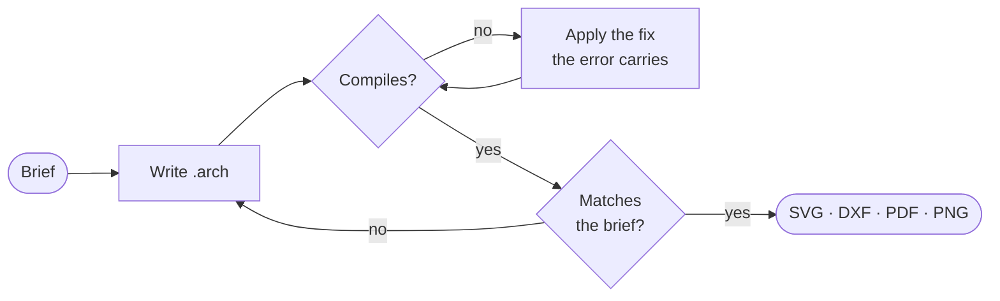

<div align="center">

<picture>
  <source media="(prefers-color-scheme: dark)" srcset="./brand/archlang-wordmark.svg" />
  
</picture>

### Floor plans as code.

Write a floor plan as text. Get a precise, dimensioned drawing back.

<a href="https://playground.archlang.uk"></a> <a href="https://archlang.uk"></a> <a href="https://archlang.uk/gallery"></a> <a href="https://www.npmjs.com/package/@chanmeng666/archlang"></a>

</div>

<br>

## Send this to your agent
Paste this into any coding agent. The skills are listed on skills.sh: https://skills.sh/ChanMeng666/archlang
```text
1. Run: npx -y skills add ChanMeng666/archlang --yes
2. Run: npx -y @chanmeng666/archlang spec   (read it before writing anything)
3. Write my floor plan as plan.arch from this brief: <describe rooms, areas, adjacencies>
4. Run: npx -y @chanmeng666/archlang compile plan.arch -o plan.svg --json
   then describe plan.arch --json, validate plan.arch --strict --json (same prefix); fix, recompile
5. Run: npx -y @chanmeng666/archlang finish plan.arch, then compile again to export.
```
For MCP clients: `claude mcp add archlang -- npx -y @chanmeng666/archlang-mcp`.

<a href="https://playground.archlang.uk"></a>

<br>


https://github.com/user-attachments/assets/a60f3174-6a8c-4a42-b24a-fac030d39627


## Try it

```bash
npx skills add ChanMeng666/archlang
```

Then ask your coding agent:

> *Design a one-bedroom flat of about 54 m², with the front door on the north wall.*

It writes the plan, compiles it and checks it. This one is 57 lines of text:

<div align="center">
<a href="https://playground.archlang.uk/#z=jVZdbhs3EH7fU3yQXhxAdmjZ8k-bBEjbAAVipEWaIOiTd1YcaVmvSIGkvHIDA3nqAYqeoQfoEXqUnKQYcvVnO073icud-eab350-XsJZ3q9Ye-dmaMhySzcYuxhpyvj86S8cn2P27z-INUV4Jh1AQZQw927qaXZQ9Is-3rhYGztFzZ5hAuYumGicZY3qBjVZfYBX1-xv4OZsRVKEjBWB6EDwCwttQiQ7ZlDj7BRU9GFpxhotNQ32SmfxTI4vQBHP5i68KJ8MwAl2YpZx4Rmeg2uuOYCmZGyIAi2uOQ9KOEUfe6WxeCbXL0B2XDuPz5_-LgcoV0rJoNw9GYCsRqwZFcX66SpSczJeXGjIaLhFRHVT9FGG6M28PEAZTGR8RIieOcI6H2vclsmdkNBi6zChMenufd6QRVx4K8H9Jl1p53zRF6lORtIzSKdpQyFsfZmS12wPioTSu-jS-KNbBO7hYwEsrIkBs1kBTL3RGClsPX3MyceUsADyjEOlEGszvhogSHbKSbMIdbmOckNWC1GQRGmkCnQ-LuYFoM0sgBaS16YpgAeDURTIYTb6eXsprgHgZWRvnEe2bjkEDJXCR-ypgXqCvdORSofbHW2mEB_XXunlw8lI3cPIIXycQdb7MkbLX-ORSTysXcsJm1RsaR9m7eNh50U6PIQhRfo_MIZbjgw7mAK5U4x-7i8bc83SZZlwML8zRHEpNtFQxQ16F-ZaGvkpXps4rtn2sAgc0OTrq3wp6ZemgHatTYgrJ6Y0h0JrdKxxdCTkCqnFDYfkSzI93LL6HcW6J4LJmMjcVWONjrHaUsuN23Hs2rhA9ls6TZT15cQ7GyGV3dUkRQwlcpnnuVKQOcewTB4hko8IbZpnNjrkwO0gdnUVGqNFLCF3d4J9usY-PFMqiTEansQdkORTRyuVCUWMTtaqZ2taorlLqGJdSIeXWbOUqdVSc8U6zZPPf_yZ2aROL7N9b6Z1LBFYujxNJ7Lc5BTKa3CNyVM5QVfcuDZ9-I1m1bcrFOFSonWLRoPMDCYm2kphNstTVeqi_HD580_fv3717vLt-zflwa7bXTW78RXHXe_Pd5zfop3mirHatVmh60mJ9fEm1kOl7shtciIpWcmpR-RGZ6M13sk9uW4mUcThaG1XxApgsvDWpEE68UZPuRvDO3-fjrmbTAJHKWXA2E2BbSBCdNcrhMcgxOcvQHS9ehmMvXoMYqi-CDF2CxvZf5XF8OwORB_vaoZfpI2ALN6_-eHV24uXvw6gPbUWFU-c51yFhvMPj6K0ntUSaROlcHNVTkjqKoFGqhqWPw-uTTBVcyOy0c3hKdbsBcSizj1pYtp08iqQFxLBkwkxQGOuMs20Z-Qth5vAadUZwMo1CGPnvDaWIh_sxEUc28rcat-oXIxutp_a1dhVhvOwO1NqeXScCmqDk_3ZAhqzxJt1Vjo8Ump5vhl370S8t1snEp6vUEm_-Y7QcNQROldqmTK_Av_FTWgXu5tPCTudd7FTYz4MLs2R0TeDehfbu4ofwo5unknLs4O9iqRM1OXJFvEP5LXA3QlM7Vr2nQGZOFsGMvO1gXU8zu-kpx3vFH4GOsjur0r_dOXzsVLL0zsAFQVjcZ_EAxFMGCdKLY9HaZpEExvZr-be_cbjeG__S310Wd2g99KP6wuy0x40RUZvqIYn--ps__Ckh9vitvgP"></a>

<sub>Click the drawing to open this exact plan in the playground. Change a number and it redraws.</sub>
</div>

## Why text

- **Change one number, and one thing moves.** Nothing else is redrawn.
- **The same source gives the same drawing**, byte for byte.
- **An agent can check its own plan** without ever looking at an image.



## For your agent

This page is all a person needs. Everything else is written for agents: clone the repo and point yours at [`AGENTS.md`](AGENTS.md), or give it the whole language in one call:

```bash
npx -y @chanmeng666/archlang context
```

<sub>[Full overview](docs/overview.md) · [Language reference](docs/language-reference.md) · [Release notes](https://github.com/ChanMeng666/archlang/blob/main/CHANGELOG.md) (installed: `node_modules/@chanmeng666/archlang/CHANGELOG.md`) · [Contributing](CONTRIBUTING.md) · [MIT](LICENSE)</sub>

<sub>ArchLang is the engine behind [ArchCanvas](https://github.com/archcanvas/archcanvas). Built by [Chan Meng](https://github.com/ChanMeng666).</sub>
