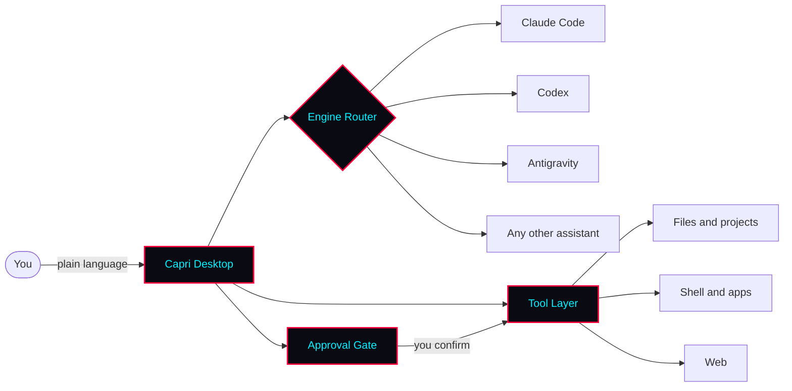

🌃 Capri — a cyberpunk AI agent for your desktop. One app for Claude Code, Codex, Antigravity &amp; any AI assistant.


<div align="center">

  <br><br>
  
  

</div>

<br/>

[](https://github.com/ChannelCooperStart/capri-ai/releases/latest)
[](https://github.com/ChannelCooperStart/capri-ai/stargazers)


<br/>

[](https://github.com/ChannelCooperStart/capri-ai/releases/latest)

**[Features](#-features)** · **[Quick Start](#-quick-start)** · **[What You Can Ask](#-what-you-can-ask)** · **[How It Works](#-how-it-works)** · **[Roadmap](#-roadmap)** · **[FAQ](#-faq)**

</div>

<br/>

---

## 🌃 What is Capri?

**Capri is a cyberpunk AI agent that lives on your Windows desktop.** Think of it as your own JARVIS-style assistant: you describe what you want in plain language, and Capri plans the steps, uses the right tools and gets it done on your machine.

Under the hood, Capri is a desktop interface and agent layer on top of the AI assistants you already use. It works with **Claude Code**, **Codex**, **Antigravity** and other AI assistants, so you pick the brain and Capri provides the body.

Capri is a Cyberpunk-inspired project. Its name and neon style nod to the AI construct from *Cyberpunk: Edgerunners 2*, and it is made for anyone who wants an edgerunner-grade AI sidekick on their PC.


### Why Capri?

|  | Terminal-only AI assistants | **Capri** |
|---|---|---|
| **Interface** | Command line | Native desktop app |
| **Setup** | Install runtimes, edit configs by hand | Download, sign in, go |
| **Choice of AI** | One assistant per tool | Switch between Claude Code, Codex, Antigravity and more |
| **Scope** | Usually focused on coding in a project folder | Your whole desktop: files, projects, apps and tasks |
| **Who it's for** | Developers | Everyone, developers included |


---

## 🔴 Inspired by Cyberpunk: Edgerunners

Capri is built for people who like their tech with an edge. The project takes its look and spirit from the **cyberpunk** genre and from *Cyberpunk: Edgerunners*, where a mysterious AI construct named Capri appears in season 2.

- 🌃 **Cyberpunk aesthetic:** neon red and cyan on near-black, sharp edges and glitchy details.
- 🧑‍💻 **Netrunner energy:** you give the order, your AI operator handles the rest.
- 🔴 **Edgerunner attitude:** fast, independent and on your side.


---

## ⚡ Features


| | Feature | What it means for you |
|:---:|---|---|
| 🧠 | **Bring any brain** | Plug in Claude Code, Codex, Antigravity or another assistant and switch between them at any time. |
| 🖥️ | **Desktop-native** | A real app with a clean interface. No terminal required. |
| 📂 | **Files and projects** | Ask Capri to find, read, organize and edit files and whole project folders. |
| ⚙️ | **Full agent toolkit** | Capri plans a task, uses tools, checks the result and reports back. |
| 💻 | **Code on demand** | Write, refactor, debug and run code through the engine you prefer. |
| 🔁 | **Automations** | Turn repeated chores into a single sentence. |
| 🛡️ | **You stay in control** | Review what Capri is about to do and approve or deny it. |
| 🎨 | **Cyberpunk interface** | A dark neon, Edgerunners-inspired theme that makes your desktop feel like a netrunner's deck. |

---

## 🚀 Quick Start

### 1. Download

Capri is currently available for **Windows** in two formats:

| Format | Download | Best for |
|---|---|---|
| 🪟 **Installer** | [`Capri-Setup.exe`](https://github.com/ChannelCooperStart/capri-ai/releases/latest) | Regular installation with a Start menu shortcut |
| 🎒 **Portable** | [`Capri-Portable.zip`](https://github.com/ChannelCooperStart/capri-ai/releases/latest) | Running Capri from any folder, no installation needed |

Requires Windows 10 or newer. macOS and Linux versions are on the [roadmap](#%EF%B8%8F-roadmap).


### 2. Install and launch

- **Installer:** run `Capri-Setup.exe`, follow the wizard, then open **Capri** from the Start menu.
- **Portable:** put the portable build in any folder and run it. No installation needed.

<details>
<summary><b>Windows shows a SmartScreen warning?</b></summary>

<br/>

New apps that are not yet widely downloaded can trigger a SmartScreen prompt. If you downloaded Capri from this repository's [Releases](https://github.com/ChannelCooperStart/capri-ai/releases/latest) page, click **More info → Run anyway**.


</details>

### 3. Connect your AI

On first launch, Capri asks which assistant to use. Sign in to your account or paste your API key for **Claude Code**, **Codex**, **Antigravity** or another supported assistant.

---

## 💬 What You Can Ask

| You say | Capri does |
|---|---|
| *"Clean up my Downloads folder and group everything by type."* | Scans the folder, proposes a plan and moves files after your approval. |
| *"Find the bug in this project and fix it."* | Reads the code, locates the issue, patches it and runs the checks. |
| *"Summarize every PDF in this folder into one document."* | Reads each file and writes a single combined summary. |
| *"Set up a new web app and start it."* | Scaffolds the project, installs dependencies and launches it. |
| *"Every Monday, back up my Documents folder."* | Creates a recurring automation for the task. |


---

## 🧬 How It Works



1. **You describe the goal** in plain language.
2. **Capri routes it** to the AI engine you selected.
3. **The engine plans the steps** and asks Capri to use tools.
4. **You approve sensitive actions**, and Capri carries them out on your desktop.


### Supported engines

| Engine | Status |
|---|:---:|
| Claude Code | ✅ Supported |
| Codex | ✅ Supported |
| Antigravity | ✅ Supported |
| Other assistants | 🧩 Via custom adapter |


---

## ⚙️ Configuration


```yaml
# Example config
engine: claude-code        # claude-code | codex | antigravity | custom

permissions:
  mode: ask                # ask before acting | auto | read-only
  allowed_folders:
    - ~/Documents
    - ~/Projects

interface:
  theme: cyberpunk
```

---

## 🛡️ Safety

An agent that works on your desktop is powerful, so treat it with care:

- **Review before you approve.** Read what Capri is about to do, especially for deleting, moving or overwriting files.
- **Limit the scope.** Give Capri access only to the folders it needs.
- **Keep backups.** Back up important data before running large automated tasks.
- **Protect your keys.** Never share your API keys or account tokens with anyone.


---

## 🗺️ Roadmap


- [x] Windows app (installer and portable)
- [x] Multiple AI engines
- [x] Voice control
- [ ] macOS version
- [ ] Linux version
- [ ] Plugin system
- [ ] Task scheduler
- [ ] Mobile companion
- [ ] Community cyberpunk theme gallery

Have an idea? [Open an issue](https://github.com/ChannelCooperStart/capri-ai/issues/new) and tell us what Capri should learn next.

---

## ❓ FAQ

<details>
<summary><b>Does Capri work on macOS or Linux?</b></summary>

<br/>

Not yet. Capri is currently available for Windows as an installer (`.exe`) and a portable build. macOS and Linux versions are planned, so star the repo to follow the progress.

</details>

<details>
<summary><b>Do I need to know how to code?</b></summary>

<br/>

No. Download the app, connect your AI and describe what you need in plain language.

</details>

<details>
<summary><b>Which AI assistants does Capri support?</b></summary>

<br/>

Claude Code, Codex and Antigravity out of the box, plus other assistants through custom adapters.

</details>

<details>
<summary><b>Is it safe to let an AI control my desktop?</b></summary>

<br/>

Capri is designed so you can review actions before they run, but no tool is risk-free. Limit folder access, keep backups and read the [Safety](#%EF%B8%8F-safety) section.

</details>

<details>
<summary><b>Where does my data go?</b></summary>

<br/>

Your requests are processed by the AI assistant you connect, under that provider's terms and privacy policy. <!-- TODO: describe exactly what Capri itself stores or sends -->

</details>

<details>
<summary><b>Is Capri an official Cyberpunk or Edgerunners product?</b></summary>

<br/>

No. Capri is an independent, unofficial fan project with a cyberpunk aesthetic, inspired by *Cyberpunk: Edgerunners*. It is not affiliated with or endorsed by CD PROJEKT RED, Studio Trigger, Netflix or any other rights holder.

</details>

---

<div align="center">

**If Capri saves you time, drop a ⭐ and share it with a friend.**

*Stay sharp, edgerunner.*


</div>
