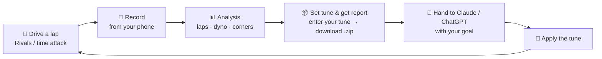

# Forza Horizon 6 Telemetry


Turn your phone into a **live pit instrument** for **Forza Horizon 6**, turn
each lap into a **readable telemetry report**, and hand that report to an AI to
get a **real, competitive tune** — no spreadsheets, no physics textbooks.

This is a free, open-source, self-hosted tool. It listens to the telemetry
Forza already broadcasts (the built-in **Data Out** feature), shows a live
dashboard on your phone, records every drive, and breaks each session into
**laps, a measured power curve, and corner-by-corner evidence**. Everything
stays on your own Wi-Fi — **no cloud, no account, no subscription**.

> **The tool never tunes your car and never invents a setting value.** It
> produces honest evidence — labelled telemetry / estimated / user-entered —
> and packages it so *an AI* can do the tuning and *you* make the call. Want to
> skip the AI entirely? [Just read the report.](docs/example-report.md) The
> numbers and the decisions are always yours.

---

## The loop

The whole point is a tight iteration loop: **drive → export → tune → drive
again**. Each new export automatically diffs against your last run for the same
car, so the AI can see whether your change actually worked.



### 1 · Drive and record

Open the dashboard on your phone (same Wi-Fi), mount it in landscape, and drive
a clean lap — a **Rivals** lap or a free-roam time attack gives the best data.
Recording is a tap on the Live page, or set it to arm automatically when you
stage. Free-roam events send no lap data at all; the app times your runs anyway
by detecting the staged start-line signature.

| Live · built like an instrument | Every session, saved on the phone |
| --- | --- |
|  |  |

### 2 · Read the analysis

The Analysis page turns the raw stream into evidence: **laps** (timed even when
the game sends no lap data), a **speed-coloured route map**, a **measured dyno**,
corner-by-corner sections, balance by corner phase, tyre temps, and every
detected event — all computed on your machine, nothing uploaded.

| Laps & route | Power delivery (measured dyno) | The evidence, auto-detected |
| --- | --- | --- |
|  |  |  |

The **dyno** is reconstructed from your own full-throttle frames (max power per
RPM bin, shift transients excluded) — it shows peak power/torque, the usable
power band, and the share of full throttle you spend *below* it. That last
number is the gearing signal: a high value means your ratios are dropping the
engine out of its powerband. It's measured from your driving, honestly labelled,
and never extrapolated past the RPM you actually reached.

### 3 · Set your tune and get the report

Tap **Set tune & get report** on Analysis. Enter your car's name (once — it's
remembered), add a session note (track, tune version, conditions), and dial in
your current setup on the **thumb-wheels** — no fiddly typing, and the gear
dials warn you if a ratio slips out of order. Then **Download package for AI
analysis** (or copy a plain-text report to your clipboard).

| Enter your tune on the dials, then download the package |
| --- |
|  |

The dials go to the game's real granularity (ARB and springs step by 0.1),
scroll freely where Forza never tells us the slider range, and leave a field
honestly **unset** rather than inventing a value.

### 4 · Hand it to an AI

Upload the `.zip` to Claude or ChatGPT with one line about your goal. You don't
need a clever prompt — the package includes a `START-HERE.md` that tells the AI
to do its own analysis on the raw data, not just read a summary.

**Two ways to work:**

| One-and-done — "give me a full tune" | Progressive — "did my change work?" |
| --- | --- |
|  |  |

- **One-and-done:** *"B class front-wheel-drive, full tune please."* The AI
  reads the whole package and returns a competitive tune, changes in priority
  order with the evidence for each. (Left — a real Claude reply: it analysed the
  raw capture independently, confirmed the digest's numbers held up, and
  diagnosed a **traction and roll-couple problem, not a balance problem**.)
- **Progressive:** apply one change, drive again, then ask *"insights?"* The new
  package carries `vs-previous.md` — the tune diff and per-phase deltas versus
  your last run — so the AI judges the change from data, not guesswork. (Right —
  *"−1.374 s on the best lap, five of your six laps beat the old best… the diff
  worked, that's confirmed, not inferred."*)

### 5 · Apply, drive, repeat

Make the change in-game, save the new tune on the dials, and drive again. Because
each export auto-diffs against the previous same-car session — and only claims a
delta when it can **confirm the route matched** — the loop tightens from minutes
of manual cross-checking to essentially zero.

Every car you drive or name lands in the **Garage** — searchable, with its
sessions, saved tune versions and best lap — so a multi-car night stays organised.


---

## What's in the package

The AI hand-off is deliberately **raw data + a curated digest + explicit
provenance** — a capable model tunes better with the evidence and a free hand
than with a summary to parrot. Every package is a single `.zip`:

| File | What it is |
| --- | --- |
| `START-HERE.md` | The ask and a manifest — tells the AI to analyse the data itself |
| `report.md` | The evidence digest: balance, tyres, traction, suspension, gearing, **power delivery** |
| `vs-previous.md` | *(when a prior same-car session exists)* the tune diff + per-phase metric deltas since last time |
| `dyno.json` | *(when you did full-throttle pulls)* the measured power/torque curve and usable band |
| `baseline.md` | *(when you entered the car's weight + power)* a physics-derived starting setup — ride-frequency target and front:rear ratios, range-relative since Forza's slider ranges are unknown |
| `baseline.json` | the same physics baseline as structured data |
| `data-dictionary.md` | Raw-CSV units (tyre temps are °F!), axis signs, channel quirks — so nothing is guessed |
| `corner-events.json` | Every detected corner by shape, with channels and ranked samples |
| `laps.csv` | One row per lap/run |
| `session-info.json` | Car identity, lap validity, timed windows |
| `your-tune.json` | The setup values you entered |
| `raw-telemetry.csv` | The complete ~60 Hz capture, every channel |

The digest never fabricates: it states plainly what Forza's Data Out does **not**
broadcast (tyre pressures, weather, per-tyre-zone temps, slider ranges) and marks
every value's provenance. Verdicts (understeer/oversteer) are
computed from **grip-driving frames only** — sustained drifting and opposite-lock
are excluded and reported separately, so a skid-pan session never reads as
"understeer". Thresholds live in [`app/laps.py`](app/laps.py) as documented
constants; calibration PRs welcome.

> **Power user?** Claude Desktop / Claude Code can query your sessions directly
> instead of copy-paste, over MCP — see [docs/CLAUDE-MCP.md](docs/CLAUDE-MCP.md).

---

## Getting the most out of it

- **Clean laps beat messy ones.** The tool flags junk and rewind-affected laps,
  but a tidy run gives the balance read and the dyno the least noise to fight.
- **Put your tune version in the session note.** It rides into every export and
  the lineage table, so the AI always knows which tune produced which result.
- **Enter your tune accurately.** Garbage in, garbage out — the dials and the
  gear-order check help, but the AI reasons from what you type.
- **Same route for a clean before/after.** The tool route-matches within 5% and
  refuses to compare across routes, so keep iterations on one circuit.
- **Note your assists.** ABS/TCS on or off changes what the braking and
  wheelspin numbers *mean*; the report accounts for it if you tell it.
- **One clean full-throttle pull** (low gear, ~2k RPM to redline) gives the dyno
  a full curve to draw.

---

## Features

- **Live pit instrument** — installable PWA with portrait, landscape-mount and
  desktop layouts, auto-reconnecting WebSocket, Wake Lock. Fixed-width numerals
  (zero layout shift), per-channel smoothing, a drift-corrected lap clock, tyre
  pods coloured by the temperature window, and pedal ribbons on the screen edges
  for peripheral vision. Respects `prefers-reduced-motion`.
- **Recording, three modes** — **Manual** (default, nothing written until you
  press ● Record), **Auto: events** (arms when a timed event begins, ends with
  it), **Auto: any driving**. Sessions close after 30 s stationary or in menus;
  ■ Stop is instant. Raw frames as portable CSV, metadata in SQLite.
- **Measured dyno** — power/torque vs RPM reconstructed from your full-throttle
  frames, with the usable band and the % of full throttle spent below it — the
  gearing signal, computed natively, not inferred.
- **Laps & tuning stats** — per-lap tyre temps (°C), drift-aware understeer index
  **split by corner phase** (entry / mid / exit / lift), per-axle slide times,
  wheelspin split inside/outside and by throttle state, brake-lock via wheel-speed
  deficit, suspension travel and bottom-outs, and the **on-power shift point**.
- **Corner-by-corner section evidence** — every cornering event classified by
  shape (hairpin, turn, sweeper, chicane, straight, launch) with entry/min/exit
  speeds, slip, throttle-reapplication and wheelspin, and timestamped samples.
- **Cross-session diff** — each export auto-includes `vs-previous.md`: the tune
  diff and per-phase deltas versus the last same-car run, **only** when the route
  match is confirmed (timed-loop length within 5%), else it says so.
- **Garage** — every car you've driven or named, searchable, with session and
  tune counts, best lap, and jump-straight-to buttons for its sessions or tune.
- **Never fabricates** — every number labelled telemetry / estimated /
  user-entered; the report states what Forza's Data Out doesn't broadcast and
  never invents it. The setup dials leave unknown fields honestly unset.
- **Solid plumbing** — asyncio UDP receiver that never crashes on malformed
  input, `/health` + `/api/status`, structured logging, a packet-debug page with
  a live physics cross-check, automatic **v1.0.x recording rescue**, and a
  synthetic generator so you can try everything without the game.

---

## Get started (Windows, 5 minutes)

**[⬇️ Download fh6-telemetry.exe](https://github.com/ClickClickMedia/Forza-6-telemetry/releases/latest/download/fh6-telemetry.exe)** — one file, no install.

1. **Put the exe in its own folder** (e.g. `Documents\FH6`) and
   **double-click it**. Your recordings will be saved to a `data\` folder
   next to it.
   - Windows may show *"Windows protected your PC"* because the app isn't
     code-signed — click **More info → Run anyway**. (It's open source; you
     can read every line in this repo.)
   - If Windows shows a **firewall prompt**, tick **Private networks** and
     click **Allow access**.
2. A console window opens and prints your addresses, for example:

   ```
   Dashboard (phone)   : http://192.168.1.50:8080
   Forza Data Out      : send UDP to 192.168.1.50 : 9876
   ```

3. **In Forza Horizon 6**, go to **Settings → HUD and Gameplay** and scroll
   to the **Data Out** section:
   - **Data Out** → **ON**
   - **Data Out IP Address** → the IP the console printed (e.g. `192.168.1.50`)
   - **Data Out IP Port** → `9876`
4. **Drive.** On your phone (same Wi-Fi), open the dashboard address from
   step 2 and use your browser's **"Add to Home Screen"** to install it as
   an app. Rotate to landscape for the mounted-instrument view.
5. **To stop**, close the console window. Your recordings stay in `data\`.

> **Want to see it working before launching the game?** Open PowerShell in
> the exe's folder and run:
> ```powershell
> $env:FH6_SYNTHETIC = "1"; .\fh6-telemetry.exe
> ```
> A simulated car drives the dashboard. Close it and double-click normally
> when you're ready for real telemetry.

**Already use SimHub or another telemetry tool?** Forza only allows one
Data Out target — point the game at this app, then open **Debug → Forward
packets** and mirror the raw stream to your other tool's `ip:port`. Both
get identical 60 Hz data; nobody has to choose.

**Linux, home server, or prefer containers?** → [docs/DOCKER.md](docs/DOCKER.md)

---

## The FH6 packet (324 bytes)

**Forza Horizon 6 emits the same 324-byte "Horizon" packet as FH4/FH5** —
confirmed empirically against live game captures, not assumed. Every offset is
covered by unit tests ([`tests/test_packet.py`](tests/test_packet.py)):

| Property | FM7 "Dash" | Forza Motorsport (2023) | **FH4 / FH5 / FH6 (this app)** |
| --- | --- | --- | --- |
| Packet size | 311 | 331 | **324** |
| `TireWear` (4×f32) | absent | present | **absent** |
| `TrackOrdinal` (s32) | absent | present | **absent** |
| Horizon 12-byte block after `NumCylinders` | absent | absent | **present** |

The Horizon layout is the FM7 structure with two additions:

- **12 bytes inserted at offsets 232–243** (between `NumCylinders` and
  `PositionX`): the officially documented FH6 fields `CarGroup` (s32, a
  stable per-car category value), `SmashableVelDiff` and `SmashableMass`
  (f32 impact metadata, 0.0 outside collisions). Most FH5-era parsers still
  label these bytes "unknown".
- **1 trailing byte at offset 323** (`Unknown3`, always observed 0).

So: **232-byte sled + 12-byte Horizon block + 79-byte dash tail (at 244) +
1 trailing byte = 324**. See the module docstring in
[`app/packet.py`](app/packet.py) for the authoritative field table and the
full validation story.

Wire units worth knowing: `Speed` m/s · `Power` watts · `TireTemp*`
**Fahrenheit** (the dashboard converts to °C) · `Boost` PSI · lap times
seconds. All scalars are decoded **little-endian**, validated by round-trip
and explicit endianness unit tests.

The strongest validation is physics, not vibes: the dash `Speed` field must
equal the sled `|VelocityX,Y,Z|` magnitude on every moving frame — a
one-byte layout error breaks that instantly. The **`/debug`** page shows
this cross-check live; if it ever fails on your setup,
[open an issue](../../issues/new/choose) with a screenshot.

> **Recorded sessions with v1.0.0?** v1.0.x used a mis-specified layout that
> corrupted the dash-tail columns (speed, temps, laps, inputs) in
> recordings. This version detects those files at startup and **rescues
> them automatically** — losslessly re-decoding the original bytes
> (originals kept as `*.v1bak`) and validating every frame with the same
> physics cross-check. Or run it manually:
> `python -m app.rescue --data-dir ./data`.

---

## Pages & API

| Path | Purpose |
| --- | --- |
| `/` | Live dashboard |
| `/sessions` | Session list, rename, notes, delete, clear-all |
| `/garage` | Every car you've driven or named — sessions, tunes, best lap |
| `/analysis?session=ID` | Verdicts, laps, route, dyno, coach's read, per-session analysis |
| `/compare` | Two-session comparison + overlaid route |
| `/debug` | Live parsed packet field table + physics check |

| Method | Path | Purpose |
| --- | --- | --- |
| GET | `/health` | Liveness + basic config |
| GET | `/api/status` | Receiver stats, recording state, version |
| WS | `/ws/live` | Live telemetry (~18 Hz JSON frames) |
| GET | `/api/sessions` | List sessions |
| GET | `/api/sessions/{id}` | Session detail + markers |
| PATCH | `/api/sessions/{id}` | Rename / edit notes |
| DELETE | `/api/sessions/{id}` | Delete session + raw file |
| GET | `/api/sessions/{id}/analysis` | Full analysis |
| GET | `/api/sessions/{id}/laps` | Lap breakdown + tuning aggregates + verdicts |
| GET | `/api/sessions/{id}/coach` | Deterministic coach's read |
| GET | `/api/sessions/{id}/pulse` | Clipboard-sized iteration pulse (⚡ Copy pulse) |
| GET | `/api/sessions/{id}/dyno` | Measured power/torque curve |
| GET | `/api/garage` | Per-car rollup (sessions, tune versions, best lap) |
| GET | `/api/sessions/{id}/tuning.md` | Evidence report (`?mode=data`, `?style=compact`, `?setup_id=N`, `?download=1`) |
| GET | `/api/sessions/{id}/sections.json` | Structured corner-section evidence |
| GET | `/api/sessions/{id}/package.zip` | AI package (see [What's in the package](#whats-in-the-package)) |
| GET | `/api/sessions/{id}/laps.csv` | Per-lap summary CSV |
| GET | `/api/sessions/{id}/route?colour_by=speed\|rear_slip` | Route trace |
| GET | `/api/sessions/{id}/download.csv` | Raw frames CSV |
| GET | `/api/setups?ordinal=N` · POST `/api/setups` | Saved tunes per car |
| DELETE | `/api/sessions` | Delete all sessions (keeps cars/setups/settings) |
| POST | `/api/recording/start` \| `/stop` \| `/marker` | Manual recording control |
| GET | `/api/compare?a=ID&b=ID&colour_by=...` | Compare two sessions |
| POST | `/api/update-check` | The only outbound call: query GitHub releases, on click |

## Configuration

All configuration is via environment variables:

| Variable | Default | Description |
| --- | --- | --- |
| `FH6_UDP_HOST` | `0.0.0.0` | UDP bind address |
| `FH6_UDP_PORT` | `9876` | UDP telemetry port |
| `FH6_FORWARD` | *(off)* | Mirror raw packets to `ip:port` (SimHub etc.); also settable on `/debug` |
| `FH6_HTTP_HOST` | `0.0.0.0` | Dashboard bind address |
| `FH6_HTTP_PORT` | `8080` | Dashboard/API port |
| `FH6_PUSH_HZ` | `18` | Browser live-update rate (Hz) |
| `FH6_SESSION_IDLE_TIMEOUT` | `30` | Auto-end session after N s of stream silence (menus) |
| `FH6_RECORD_MODE` | `manual` | Initial auto-record mode: `manual` / `event` / `motion` (UI setting overrides) |
| `FH6_STATIONARY_TIMEOUT` | `30` | Auto-end any session after N s stationary (staging exempt) |
| `FH6_KEEP_MIN_S` | `5` | Discard auto-recorded sessions shorter than this |
| `FH6_MAX_DATA_MB` | `0` (off) | Optional cap: prune oldest disposable sessions past this size |
| `FH6_RAW_FORMAT` | `csv` | Raw storage: `csv` (or `parquet`, Docker only) |
| `FH6_DATA_DIR` | next to exe / `./data` | Data directory (SQLite + raw files) |
| `FH6_SYNTHETIC` | `0` | `1` to enable the synthetic generator |
| `FH6_LOG_JSON` | exe: `0` · other: `1` | `1` = JSON logs, `0` = human-readable console |
| `FH6_LOG_LEVEL` | `INFO` | Log level |

### Data layout

```
data/
  sessions.db                  SQLite: session metadata + markers + car names + tunes
  sessions/
    session_000001.csv         raw frames (t_mono, t_wall, + all FH6 fields)
```

Raw files are portable CSV — open them in Excel, pandas, or any tool.

### Your disk, respected

Everything this app stores lives in that **one visible `data\` folder** next
to the exe — no AppData, no registry, no log files, no services, no cloud.
Uninstalling is deleting the folder.

What to expect and the safeguards in place:

- Raw 60 Hz telemetry is ~**250 MB per hour of driving**. The Sessions page
  shows each session's size and the folder total, so growth is never
  invisible.
- **Blip sessions are discarded automatically** (auto-recordings under 5 s —
  rolling out of a menu, a stationary timeout) so junk doesn't accumulate.
- Deleting a session in the UI deletes its raw file too.
- Want a hard ceiling? Set `FH6_MAX_DATA_MB` (e.g. `4000`) and the oldest
  *auto-recorded, un-renamed, un-annotated* sessions are pruned after each
  session closes. Renamed or annotated sessions are never touched, and the
  cap is **off by default** — nothing is ever deleted without you opting in.
- The exe unpacks itself to `%TEMP%` while running (normal for one-file
  apps) and cleans up on exit; if Windows kills it mid-run, the next launch
  removes any of its own stale leftovers older than 48 h.

## Troubleshooting

- **Packet rate stays 0 with Data Out on** → wrong IP in the game's Data Out
  settings, a missing firewall rule, or a guest Wi-Fi with "AP isolation".
  Everything must be on the same normal network. To open the ports manually
  (PowerShell as Administrator):

  ```powershell
  New-NetFirewallRule -DisplayName "FH6 Telemetry UDP" -Direction Inbound -Protocol UDP -LocalPort 9876 -Action Allow
  New-NetFirewallRule -DisplayName "FH6 Dashboard TCP" -Direction Inbound -Protocol TCP -LocalPort 8080 -Action Allow
  ```

- **Phone can't load the dashboard** → use the PC's LAN IP (printed in the
  console), not `localhost`, and check the TCP rule above.
- **Values look wrong** → open `/debug` and check the **Speed vs |V|**
  physics indicator; if it fails, screenshot and open an issue.
- **Stream goes silent mid-session** → Xbox sleep or app-switching stops
  Data Out until Forza is restarted.
- **"Windows protected your PC" / antivirus flags the exe** → the build is
  an unsigned open-source executable (code-signing certificates cost money
  this free tool doesn't have), and one-file Python apps are a common
  false-positive pattern. You can verify your download: run
  `Get-FileHash fh6-telemetry.exe` in PowerShell and compare it to the
  **SHA-256** printed in the release notes — or skip the exe entirely and
  run from [Docker](docs/DOCKER.md) or source.

## Development

```bash
python -m venv .venv && source .venv/bin/activate
pip install -r requirements-dev.txt
pytest                                   # packet offsets, rescue, laps, dyno, MCP

# Run locally with the synthetic generator:
FH6_SYNTHETIC=1 uvicorn app.main:app --host 0.0.0.0 --port 8080
```

Project layout, packet-validation workflow and conventions:
[CONTRIBUTING.md](CONTRIBUTING.md).

## Security & scope

This is a **LAN tool with no authentication** — anyone who can reach port
8080 can view the dashboard and manage recordings. That's fine on a home
network, but:

- **Do not expose ports 8080/9876 to the internet** (no port-forwarding, no
  public reverse proxy). Keep it on your local Wi-Fi/LAN.
- The UDP receiver accepts telemetry from any source on the network; it only
  ever *reads* 324-byte packets and never executes anything from them.
- All data stays local — recordings live in `./data` on your machine.
  There is no telemetry or analytics anywhere in this project, and the
  **only network request it can ever make** is the user-initiated "Check
  for updates" button (one query to GitHub's public releases API, only when
  you click it).

## Contributing

Contributions welcome — especially **real-game packet captures** and tuning
threshold calibration. See [CONTRIBUTING.md](CONTRIBUTING.md); bug reports
and packet-mismatch reports have [issue templates](.github/ISSUE_TEMPLATE).

## License

Released under the [MIT License](LICENSE) © 2026 ClickClickMedia — free to
use, modify, and share.

Not affiliated with, endorsed by, or sponsored by Microsoft, Turn 10
Studios, or Playground Games. "Forza" and "Forza Horizon" are trademarks of
Microsoft. This project reads only the telemetry the game voluntarily
broadcasts via its built-in **Data Out** feature; it contains no game code
or assets.
