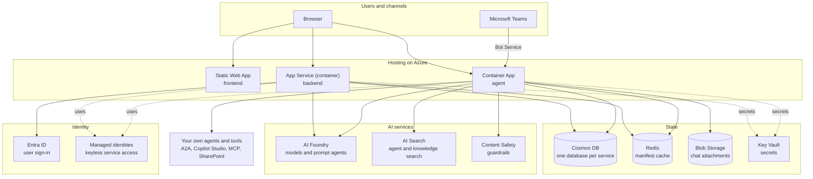
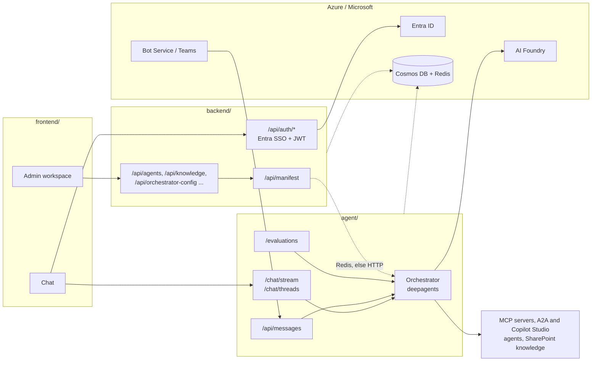

# Ductien Hub

Ask once, see who did the work. Ductien Hub is an SSO-protected workspace where an **orchestrator** finds the right
specialist agent for a question, hands the task over, shows who worked on it and asks you when it needs more details.
The agents can be built in, **A2A** agents, Copilot Studio agents or prompt agents built on Azure AI Foundry; they can
use MCP tools and search your SharePoint documents.

[](frontend/public/videos/hub-tour.en.mp4)

https://github.com/user-attachments/assets/6f828cfd-0b3b-45f4-9191-ffa9817c312f

**[Watch the two-minute tour](frontend/public/videos/hub-tour.en.mp4)** (English narration, captions in the
[WebVTT track](frontend/public/videos/hub-tour.en.vtt)). The same film plays on the landing page.
## What you get

- **Chat.** Streaming answers with the steps behind them, an agent flow panel, `ask_user` questions, attachments, answer
  ratings and copy, one conversation per user and agent, in English, Vietnamese and Japanese.
- **Admin workspace.** Agents in a tree of domains with a draft test beside the form, Foundry agents with model, tools and
  connections, MCP servers, knowledge bases on SharePoint, orchestrator settings and guardrails, users and groups.
- **Evaluation and dashboard.** Test cases judged by a model, and conversations, tokens, latency and busiest agents.
- **Teams.** The same agent answers in Microsoft Teams through Azure Bot Service (`/api/messages`).

## Architecture

Three deployables sit between the users and the Azure services. The **backend** owns configuration (who the users are,
which agents exist, how the orchestrator is set up) and signs people in. The **agent** is the hot path: it runs the
orchestrator, keeps the conversations and talks to the AI services. The **frontend** is a static single-page app that
calls both. A chat turn never needs the backend at run time.



| Part | Runs as | Owns |
| --- | --- | --- |
| `frontend` | Azure Static Web App | Nothing: it calls the backend and the agent with the user's token. |
| `backend` | Container image on an App Service (Linux Web App) | Users, groups, agents, MCP servers, orchestrator settings (Cosmos database `orchestrator`), the manifest. |
| `agent` | Azure Container App | Conversations, messages, model state, turn metrics, evaluation cases (Cosmos database `agent`), attachments. |

Two rules keep the parts apart: a service reads and writes only its own database, and what it needs from another it asks
for once (the agent reads the backend's manifest from Redis, else over HTTP). Details are in
[docs/data-architecture.md](docs/data-architecture.md).

## Cloud on Azure

Everything runs on Azure, provisioned by Terraform in [infra/](infra/README.md) and deployed by Azure DevOps pipelines.
Services reach Azure with their **managed identity** and `DefaultAzureCredential` (no keys in code or `.env`); people sign
in with their company Microsoft account through **Entra ID**.

| Azure service | What Ductien Hub uses it for | Created by |
| --- | --- | --- |
| Static Web App | Serves the frontend. | Terraform `static_web_app` |
| App Service (Linux, container) | Runs the backend. | Terraform `app_service_plan`, `backend_app_service` |
| Container Apps | Runs the agent in a Container Apps Environment. | Terraform `container_app_env`, `agent_container_app` |
| Container Registry | Holds the backend and agent images (immutable tags). | Terraform `container_registry` |
| AI Foundry | The chat models, the prompt agents the admin builds, and their connections and toolboxes. | Terraform `ai_foundry` |
| Key Vault | Runtime secrets and the credentials of external agents and MCP servers. | Terraform `key_vault` |
| Storage account | The `chat-attachments` container for uploaded files. | Terraform `storage` |
| Log Analytics | Logs and diagnostics of the hosted services. | Terraform `log`, `diagnostic_backend` |
| VNet, private endpoints, private DNS | Optional private mode (`public_access_enabled = false`). | Terraform `network` |
| Cosmos DB | One account, one database per service. | `infra/scripts/provision-cosmos.sh` |
| Redis | Caches the manifest the backend publishes. | Outside this repo; optional |
| AI Search | Finds the right agent and searches knowledge bases (Foundry IQ). | Existing resource, referenced by `search_service_id` |
| Content Safety, Prompt Shields | Guardrails on every message. | The Foundry resource |
| Entra ID, Bot Service | User sign-in; the Teams channel. | App registrations outside Terraform |

**Access.** Each runtime gets only the roles it needs: `AcrPull` on the registry, `Key Vault Secrets User` on the vault,
`Storage Blob Data Contributor` on the uploads, Search roles for the agent, `Azure AI User` on Foundry, and Cosmos
data-plane roles on its own database only. Only `DEBUG`, `KEYVAULT_URL` and `PORT` live in a local `.env`; everything else
comes from Key Vault.

**Environments.** One tfvars file per environment (`dev`, `test`, `stg`, `prod`). Pushing a branch releases it to its
environment, and production sits behind an approval (see [Branch to Release Mapping](#branch-to-release-mapping)).
Images are built once in the release stage and tagged `<branch>-<BuildId>-<CommitSha>`; production deploys the tag staging
built.

**Cost.** The root Terraform module describes the full base. Keep only what your use case needs
([Apply The Base To A Use Case](#apply-the-base-to-a-use-case)) and call out cost-impacting resources before `apply`.
The resource map, with each caller and role, is in [docs/source-base-infra-resource-map.md](docs/source-base-infra-resource-map.md).

## Workspace Structure

```text
.
├── frontend/      # React 19, Vite, Tailwind, shadcn/ui web client (chat, admin, landing page)
├── backend/       # FastAPI: Microsoft Entra SSO, JWT, admin APIs, the manifest the agent builds from
├── agent/         # FastAPI + deepagents: the orchestrator, conversations, evaluation, Teams bot host
├── infra/         # Terraform modules, environment tfvars, backend state config
├── manifest/      # Teams app manifest package/deploy pipeline
├── docs/          # Architecture, conventions, DevOps and release guidance
└── scripts/       # Bootstrap scripts for self-hosted agents and SonarQube
```

| Component | Purpose | Pipeline |
| --- | --- | --- |
| `frontend` | Browser UI: landing page, chat, admin workspace | `frontend/pipeline.yaml` |
| `backend` | SSO, user/session APIs, admin APIs, `/api/manifest`, dashboard | `backend/pipeline.yaml` |
| `agent` | Foundry-backed orchestrator, chat and conversation APIs, evaluation, Teams bot | `agent/pipeline.yaml` |
| `infra` | Azure resource provisioning with Terraform | `infra/pipeline.yaml` |
| `manifest` | Teams manifest package/deployment workflow | `manifest/pipeline.yaml` |

Each component keeps its own README with local setup, environment variables, folder structure and conventions.
The coding rules are in [docs/coding-convention.md](docs/coding-convention.md) and [docs/strategy.md](docs/strategy.md).

## How a Chat Turn Flows

The agent is the hot path: it verifies the user's token itself, builds the orchestrator from the backend's manifest
(cached in Redis) and keeps the conversation in its own Cosmos database, so a turn makes no call to the backend.


1. The browser sends the question to the agent (`POST /chat/stream`) with the user's token.
2. The agent verifies the token, checks the message with Content Safety and loads the conversation from Cosmos DB.
3. The orchestrator (built from the manifest) searches its agents and hands the task to the best one: a built-in agent,
   a Foundry prompt agent, an A2A or Copilot Studio agent, or a tool on an MCP server.
4. Steps and answer tokens stream back as server-sent events; if the agent needs more details, the stream ends with
   questions and the answers arrive as the next message.
5. After the answer, the agent saves the turn and its metrics in the background.



Data ownership is in [docs/data-architecture.md](docs/data-architecture.md); what each feature does and why is in
[docs/feature-notes.md](docs/feature-notes.md); how to plug in your own agent is in
[docs/external-agents.md](docs/external-agents.md) ([Tiếng Việt](docs/external-agents.vi.md)).

## Run Locally

Each Python service uses its own virtualenv and `.env` copied from `.env.example`; pip must be recent
(`pip install -U pip`) or `microsoft-agents` 1.8 cannot be resolved.

```bash
cd backend && python3 -m venv .venv && .venv/bin/pip install -U pip && .venv/bin/pip install -r requirements.txt
.venv/bin/python app.py                 # :8000, AUTH_MODE=dev with DEBUG=true signs you in as a local admin
```

```bash
cd agent && python3 -m venv .venv && .venv/bin/pip install -U pip && .venv/bin/pip install -r requirements.txt
az login && .venv/bin/python app.py     # :8001, needs Azure AI Foundry access
```

```bash
cd frontend && npm install
VITE_AUTH_MODE=dev npm run dev          # :5173, skips the Microsoft sign-in
```

`compose.yaml` starts the same three services with dev auth (it expects the external network `a2a-local`:
`docker network create a2a-local`). Tests: `.venv/bin/python -m pytest -q` in a Python service, and
`npm run lint && npx vitest run && npm run build` in `frontend/`.

## Apply The Base To A Use Case

Do not apply the full Terraform root module by default. Start from the use case, identify which runtime calls are
actually needed, then keep only the matching components, Azure resources, and RBAC assignments. Review the call graph
and resource map before provisioning: [docs/source-base-infra-resource-map.md](docs/source-base-infra-resource-map.md).

**Before applying Terraform, review the resources required for your use case and remove any unnecessary infrastructure
to avoid extra cost.**

| If the use case needs | Keep | Usually remove |
| --- | --- | --- |
| Only the React UI | `frontend`, `static_web_app` | Backend, agent, Foundry, Container Apps Environment. |
| Microsoft SSO/JWT and the admin APIs | `backend`, App Service, Entra app registration, required Key Vault secrets | Agent, Foundry unless another flow calls them. |
| Chat | `agent`, `/chat/stream`, Container Apps Environment, ACR, Log Analytics, Foundry, Cosmos DB | Frontend and backend unless the web app or admin APIs are needed. |
| Teams bot channel | `agent`, `/api/messages`, Bot Service/Teams config, Container Apps Environment | Frontend unless users also need the web app. |
| MCP tools | A remote MCP server registered in the admin workspace (or by a user in chat) | Nothing to deploy here: the agent only calls it. |
| Blob or secret access | Storage/Key Vault plus only the runtime RBAC that reads/writes it | Broad Key Vault/Storage RBAC for unused runtimes. |
| Private networking | `public_access_enabled = false`, VNet, private endpoints, private DNS | Private network resources for simple public dev/test demos. |

Before `terraform plan` or `terraform apply`, confirm each kept runtime has a caller, and each kept Azure resource has
a concrete runtime dependency.

## Runtime Configuration

Secrets and environment-specific runtime values should come from Azure Key
Vault or Azure DevOps variable groups. Do not hard-code secrets in source or
pipeline YAML.

Only these values are allowed in local `.env` files by convention:

- `DEBUG`
- `KEYVAULT_URL`
- `PORT`

Component-specific local development may also use `.env.example` files to show
required values, but real secrets must not be committed.

## CI/CD Overview

All pipelines follow a build/release model:

```text
Build
├── install dependencies
├── run unit tests
├── run lint/typecheck when available
├── run SonarQube scan
├── run Gitleaks scan
├── run dependency check
└── publish build artifact or source context

Release
├── select target environment from branch
├── download the build artifact
├── build/push container image when applicable
├── deploy to Azure
├── configure runtime settings
└── run smoke checks when available
```

Container images are built and pushed during release, after build-stage quality
gates pass. Images use immutable tags in this format:

```text
<branch>-<BuildId>-<CommitSha>
```

The `latest` tags are convenience tags only and should not be used for rollback.

## Branch to Release Mapping

| Branch | Release path |
| --- | --- |
| `dev` | `dev-release` |
| `test` | `test-release` |
| `main` | `stg-release` then `prod-release` |

Production should be protected with Azure DevOps environment approvals.

## Useful Documentation

- [Feature notes: what was built and why](docs/feature-notes.md)
- [Data architecture](docs/data-architecture.md)
- [Integrate your own agent (A2A)](docs/external-agents.md) / [Tiếng Việt](docs/external-agents.vi.md)
- [Coding convention](docs/coding-convention.md) and [strategy: use the SDK](docs/strategy.md)
- [Source base call graph and resource map](docs/source-base-infra-resource-map.md)
- [Infrastructure guide](docs/infra.md)
- [Self-hosted Azure DevOps agent](docs/devops/1_self_hosted_agent.md)
- [SonarQube Community setup](docs/devops/2_sonarqube.md)
- [Pipeline guide](docs/devops/3_pipeline_guide.md)
- [Release guide](docs/devops/4_release_guide.md)
- [Service test guide](docs/devops/5_service_test_guide.md)
- [Gitflow guide](docs/gitflow.md)
