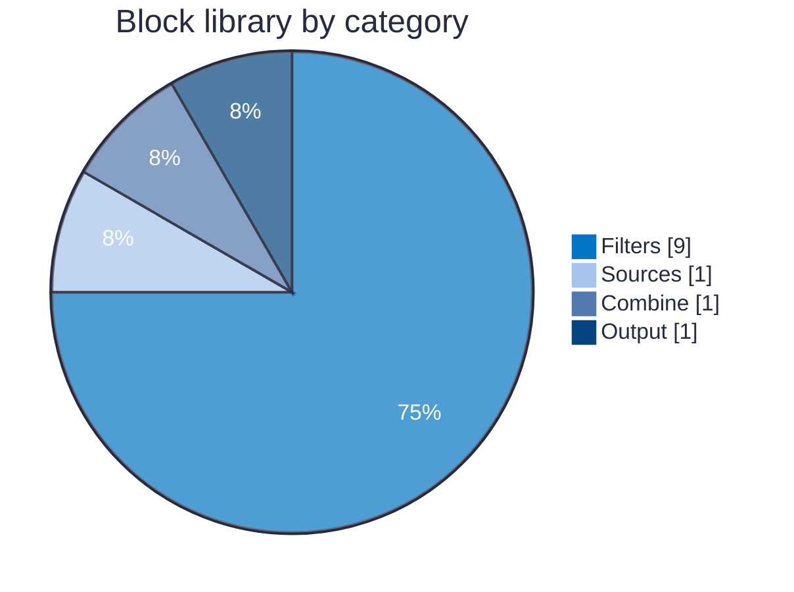
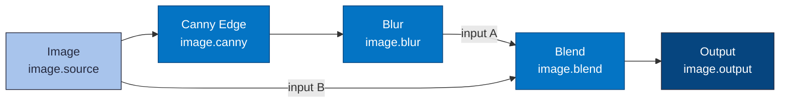
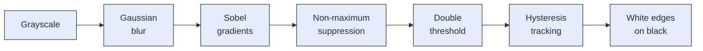
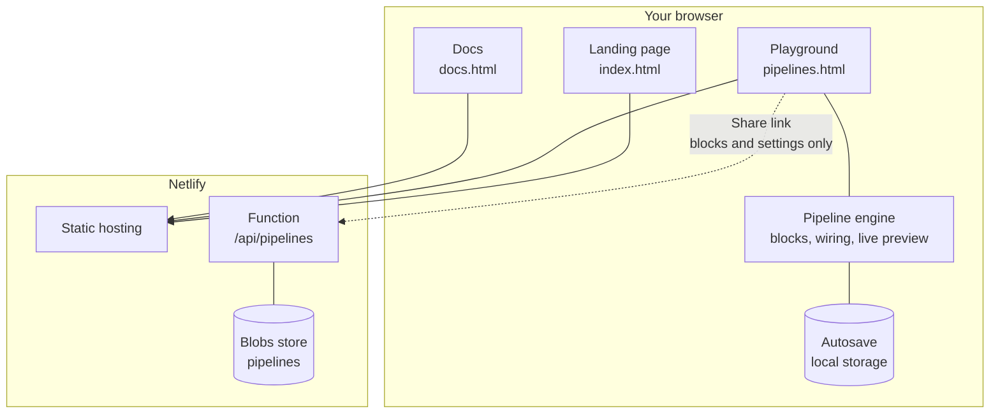
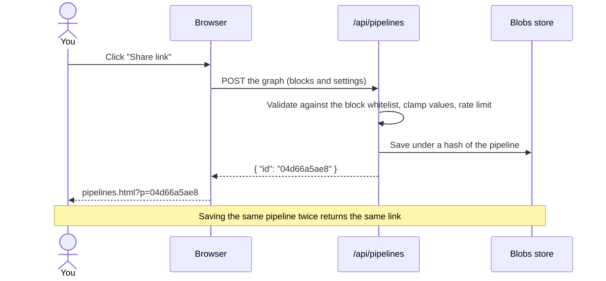

 <div align="center">

# CogniBlock

### Build image pipelines block by block.
**Drag. Connect. Watch every step run live.**

[](https://cogniblock.netlify.app)
[](https://cogniblock.netlify.app/pipelines.html)
[](https://cogniblock.netlify.app/docs.html)
[](#the-token)
[](https://x.com/CogniBlock)
[](https://github.com/CogniBlock/CogniBlock/pkgs/npm/core)


[**Playground**](https://cogniblock.netlify.app/pipelines.html) &nbsp;·&nbsp; [**Docs**](https://cogniblock.netlify.app/docs.html) &nbsp;·&nbsp; [**How it works**](https://cogniblock.netlify.app/#how) &nbsp;·&nbsp; [**X**](https://x.com/CogniBlock)

</div>

---

## Contents

- [What is CogniBlock?](#what-is-cogniblock)
- [Why it is worth a look](#why-it-is-worth-a-look)
- [By the numbers](#by-the-numbers)
- [How a pipeline works](#how-a-pipeline-works)
- [The block library](#the-block-library)
- [Architecture](#architecture)
- [Sharing a pipeline](#sharing-a-pipeline)
- [Use the engine as a package](#use-the-engine-as-a-package)
- [Run it yourself](#run-it-yourself)
- [Deploy](#deploy)
- [Repository layout](#repository-layout)
- [Security and privacy](#security-and-privacy)
- [What we are exploring next](#what-we-are-exploring-next)
- [The token](#the-token)
- [Contributing](#contributing)

---

## What is CogniBlock?

CogniBlock makes a pipeline something you can **see**. Instead of reading code to understand what happens to an image, you build it from blocks: each block does one job, you wire them together, and every block shows a live preview of its own result.

Pick a picture, add *Canny Edge* to trace its outlines, *Blur* to soften them, *Blend* to glow them back over the original, and watch the picture change as you move a slider. Then download the result or send a link to anyone.

> **Everything runs in the browser.** No server crunches your images, no account is needed, and nothing you load ever leaves your device.

## Why it is worth a look

- **See every step.** Each block previews its own output, so you learn what a filter really does instead of guessing.
- **Instant feedback.** Change a setting and everything downstream updates on the spot.
- **Zero cost to run.** All processing happens on the visitor's own device. There is no GPU bill and nothing to scale.
- **Real algorithms, not mock-ups.** Blur is a true Gaussian blur and Canny Edge is a full implementation: smoothing, Sobel gradients, non-maximum suppression and hysteresis thresholding.
- **Share in one click.** A short link opens your exact pipeline for anyone. Only blocks and settings are saved, never your images.
- **Hackable by design.** Plain HTML, CSS and JavaScript. No framework, no bundler, no build step. Open the files and read them.
- **Built to be extended.** A block is a small, self-contained definition, so adding new ones is straightforward.

## By the numbers

| | |
|---|---|
| Blocks in the library | **12** |
| Ready-made example pipelines | **4** |
| Frontend npm dependencies | **0** |
| Serverless functions | **1** |
| Tests in the engine package | **18** |
| Build steps | **0** |
| Starter pipeline (5 blocks) recomputes in | **~60 ms** *(measured on a development machine)* |



## How a pipeline works

A pipeline is a graph. Images flow left to right along the wires, and each block transforms the image it receives. The starter pipeline in the playground looks like this:



Rules of the road:

- An **output** can feed any number of blocks; an **input** accepts exactly one wire.
- **Loops are rejected**, so a block can never depend on itself.
- A block with a missing input shows *Connect an input* instead of a preview.
- Results are **cached per block**, so changing one setting only recomputes the blocks after it.

### Inside Canny Edge

The edge detector is a classic multi-stage algorithm, implemented from scratch:



## The block library

| Category | Block | What it does |
|---|---|---|
| **Sources** | Image | A built-in sample or your own upload |
| **Filters** | Grayscale | Removes all colour |
| | Blur | Gaussian blur, radius 0 to 12 px |
| | Light | Brightness and contrast |
| | Invert | Flips every colour |
| | Threshold | Pure black and white at a level you choose |
| | Canny Edge | Traces the edges of shapes |
| | Pixelate | Chunky mosaic, 2 to 40 px squares |
| | Duotone | Maps dark and light to two colours |
| | Resize | Scale 10 to 200 percent |
| **Combine** | Blend | Mixes two images: normal, multiply, screen, difference or add |
| **Output** | Output | Shows the result and downloads it as a PNG |

Full settings and ranges for every block are in the **[docs](https://cogniblock.netlify.app/docs.html)**.

## Architecture

The site is static. The only server-side piece is a tiny function that stores shared pipelines.



## Sharing a pipeline

Pressing **Share link** saves the pipeline's blocks and settings and returns a short URL. Images are never part of it.



<details>
<summary><b>What a pipeline file looks like</b></summary>

<br>

```json
{
  "v": 1,
  "nodes": [
    { "id": "n1", "type": "image",  "x": 0,   "y": 20, "params": { "sample": "shapes" } },
    { "id": "n2", "type": "canny",  "x": 250, "y": 20, "params": { "sigma": 1.4, "low": 6, "high": 18 } },
    { "id": "n3", "type": "output", "x": 500, "y": 20, "params": {} }
  ],
  "links": [
    { "from": "n1", "to": "n2", "port": 0 },
    { "from": "n2", "to": "n3", "port": 0 }
  ]
}
```

The same format powers **Export**, **Import** and the sharing API. See the [format reference](https://cogniblock.netlify.app/docs.html#format).

</details>

### API

| Method | Endpoint | Purpose |
|---|---|---|
| `POST` | `/api/pipelines` | Save a pipeline, returns `{ "id" }` |
| `GET` | `/api/pipelines?id=<id>` | Load a pipeline, returns `{ "graph" }` |

Responses use standard status codes (`400`, `404`, `405`, `413`, `429`). Details are in the [API docs](https://cogniblock.netlify.app/docs.html#api).

## Use the engine as a package

The pipeline engine is published as **[`@cogniblock/core`](packages/core)** on GitHub Packages: every block, the pipeline validator and a runner, in pure JavaScript with zero dependencies. It works in browsers and Node 18+, ships TypeScript types, and gives byte-for-byte the same output as the playground for the same input (Resize excepted, see the [package README](packages/core/README.md)).

```js
import { run, createImage } from "@cogniblock/core";

const { results } = run(pipeline, { sources: { default: createImage(width, height, rgbaBytes) } });
results.n3; // { width, height, data }
```

Setup, examples and the full API are in the [package README](packages/core/README.md).

## Run it yourself

The frontend needs nothing but a static file server.

```bash
git clone https://github.com/CogniBlock/CogniBlock.git
cd CogniBlock

# any static server works
python -m http.server 8000
# then open http://localhost:8000
```

Everything works this way **except Share link**, which needs the function. The engine package has its own tests:

```bash
cd packages/core
npm test
```

To run the share function too, use the Netlify CLI from the repository root:

```bash
npm install
npx netlify dev
```

## Deploy

CogniBlock deploys to [Netlify](https://www.netlify.com) as-is.

1. Push this repository to GitHub.
2. In Netlify choose **Add new site, Import an existing project** and pick the repository.
3. Leave the build command empty. The settings come from [`netlify.toml`](netlify.toml): publish directory `.` and functions in `netlify/functions`.
4. Deploy. The function and its storage are set up automatically.

## Repository layout

```text
.
├── index.html                  Landing page, including "How it works"
├── pipelines.html              The playground: node editor and pipeline engine
├── docs.html                   Documentation
├── netlify/
│   └── functions/
│       └── pipelines.mjs       Sharing API (validation, storage, rate limit)
├── packages/
│   └── core/                   @cogniblock/core: the engine as a package, with tests
├── .github/
│   └── workflows/              Tests, and publishing the package on each Release
├── netlify.toml                Hosting and function configuration
├── package.json                One dependency: @netlify/blobs
└── README.md
```

## Security and privacy

- **Images stay local.** Uploads and results are processed in the browser and never sent anywhere.
- **Only blocks and settings are shared**, and only when you press *Share link*.
- **The API accepts nothing it does not recognise.** Every request is checked against a whitelist of block types and settings, numbers are clamped to their ranges, colours must be `#rrggbb`, and loops, duplicate inputs and unknown blocks are rejected.
- **Hard limits**: 20 KB per pipeline, 40 blocks, 80 wires, and 30 new saves per hour for each visitor.
- **Autosave is local.** Your work is kept in your own browser's storage, not on a server.

## What we are exploring next

These are ideas, not promises:

- Blocks backed by machine-learning models that run in the browser
- More filters and generators, and blocks with more than one output
- A community gallery of shared pipelines
- Keyboard shortcuts and undo and redo in the playground

Have a better idea? [Open an issue](https://github.com/CogniBlock/CogniBlock/issues).

## The token

CogniBlock has a community token on **Solana**.

| | |
|---|---|
| Network | Solana |
| Contract address | *To be announced* |
| Official updates | [@CogniBlock on X](https://x.com/CogniBlock) |

> **Please be careful.** Only trust a contract address that is published on this README and on the official X account. Anyone can create a token with a similar name. Crypto assets are volatile and you can lose everything you put in. Nothing in this repository is financial advice.

## Contributing

Issues and pull requests are welcome. The project is intentionally simple: plain files, no build tooling. If you can open an HTML file, you can contribute.

1. Fork the repository and create a branch.
2. Make your change and try it in the playground.
3. Open a pull request that says what changed and why.

---

<div align="center">

**CogniBlock**: see the pipeline, not just the code.

[Live site](https://cogniblock.netlify.app) &nbsp;·&nbsp; [Playground](https://cogniblock.netlify.app/pipelines.html) &nbsp;·&nbsp; [Docs](https://cogniblock.netlify.app/docs.html) &nbsp;·&nbsp; [X](https://x.com/CogniBlock)

</div>
