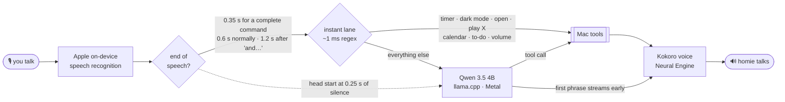

<div align="center">


# homie

**A voice buddy in your Mac's notch that runs entirely on your Mac.**<br>
Hold <kbd>fn</kbd>, talk. It sets timers, plays music, reads your calendar, flips dark mode, looks at what you circle on screen, points things out on your screen, shows 3D models, and talks back. The brain, the voice and your memories never leave the computer. Works in airplane mode.

[](../../actions/workflows/tests.yml)


[](LICENSE)


</div>

## Why it's fast

A 4-billion-parameter model on a laptop writes about 15–30 tokens a second. Asking it to call a tool means writing the call out, which takes 2–5 seconds. So most of homie's speed comes from **not asking the model**, and the rest from never making it re-read anything.



| Trick | What it buys |
|---|---|
| **Instant lane.** ~600 lines of patterns catch everyday phrasings and run the tool directly, with tests for phrases it must *not* fire on ("close this window", "why is dark mode bad for your eyes"). | Timers, settings, apps, calendar and music in **~0.4 s**, with no model at all. 87% of a held-out phrase set before tuning on it; now 214/214 phrases with 0 wrong fires. |
| **Read-outs without the model.** "What's on my calendar tomorrow?" reads EventKit and speaks a summary built in code. | 5–7 s → under 1 s |
| **Head start.** At 0.25 s of silence the model starts on what you've said so far; if you keep talking it restarts. | ~0.35 s off every brain turn |
| **Never re-read the instructions.** The model's state after reading the ~3,700-token prompt is saved to disk, ending exactly at the user-turn marker, so a question only *adds* tokens. Requests use sorted JSON keys, so the prompt text is byte-identical on every launch. | Launch-ready in 0.12 s; a question re-reads ~45 tokens instead of 3,700 (7–19 s) |
| **Talk early.** The first spoken phrase breaks at a natural joint ("Did you know │ that there's a black hole…"). | p90 first sound 1.49 → 0.88 s |
| **Point, don't draw.** homie says *what* to mark ("circle Send"); Apple's on-device text recognition and the Accessibility tree find *where*. The model never writes coordinates. | Exact circles, underlines and arrows in ~0.5 s |
| **3D from one tool call.** "Show me a water molecule" picks a SceneKit scene and fills in a few words; the model never writes geometry. | Molecules, math surfaces, the planets in < 0.3 s |
| **Small-model guard rails.** An action needs a matching word in what you said; leaked tool-call text is never spoken; invented IDs are redirected. | "tell me a joke" no longer plays a song |

## What didn't work

We measured these, and they're not in the app:

- **Speculative decoding is slower on this hybrid model.** n-gram 2.5–3.1 s, a 2B draft model 3.0 s, against a 1.9 s baseline. Qwen 3.5 has no MTP layers.
- **MLX** wrote 34 vs 31 tokens/s against llama.cpp. Not worth switching engines.
- **Showing the model only the tools relevant to each request** is the textbook trick, and it backfires on a laptop: a new tool list invalidates the prompt cache, which costs 4–17 s. One stable list wins.
- **A `remember` tool:** the model called it 1 time in 5, and once *said* "I'll remember that" without doing it. homie learns from phrasing instead, plus a 0.2–0.7 s look-back after each chat.
- **The 2B model with the 4B's prompt** scored 16/30 and kept saying "Got it!" without acting. Plain rules plus the grounding check brought it to 26/30.
- **Freehand drawing on a 4B model.** Even with worked examples it drew a T-Rex as a green box with a face, in 13–20 s. homie points at your screen instead.
- **Moving the voice model's crashing stage off the CPU:** FluidAudio v3 doesn't allow it ([FluidAudio#1172](https://github.com/FluidInference/FluidAudio/issues/1172)). homie restarts the voice and rephrases instead.

The full experiment log, with numbers, is in [docs/writeups/homie-bench.md](docs/writeups/homie-bench.md).

## Privacy, exactly

Everything runs on your Mac. homie makes these network requests and no others:

| When | What | Where |
|---|---|---|
| Once, on first launch | The model (1.3 or 2.7 GB), its vision add-on on 16 GB+ Macs (672 MB), all pinned and SHA-256 checked, and the voice model (~390 MB) | Hugging Face |
| You ask to play a song | Song lookup and album art | Apple's iTunes Search API |
| You ask to open a site or search | Your browser opens it | wherever you asked |

No accounts, no analytics (the signed download's setup screens count anonymous steps, with rough location (country/city, the IP itself isn't kept), until you pick free homie, then nothing; this source build has none at all; the download link counts one anonymous download, no cookies). Speech recognition, dictation (<kbd>fn</kbd>+<kbd>⌥</kbd>) and screen reading (hold <kbd>fn</kbd>+<kbd>⌃</kbd> and circle something) all run on your Mac: the circled area goes to the local model as a picture and never leaves the computer. Verify it yourself:

```bash
lsof -nP -i -a -c llama-server     # the brain only listens on 127.0.0.1
```

What homie learns about you lives in `~/Library/Application Support/Pixie/Local/memory.json`, readable only by you. Say "forget everything" to clear it.

## Install

Requires an **Apple silicon** Mac (M1 or newer) on **macOS 26+**.

**Just want it?** [Download homie.dmg](https://homie-mac.vercel.app/download?from=readme) (signed and notarized), drag it to Applications, hold fn and talk. The download also includes homie max, the optional paid cloud tier, which isn't in this repo.

**Build it yourself:**

```bash
git clone https://github.com/Cosmhyccc/homie && cd homie
bash build.sh            # fetches llama.cpp (checksum-verified), builds the voice engine, builds homie.app
open build/homie.app     # hold fn and talk
```

On first launch homie downloads its brain once. Macs with **8 GB** automatically get **homie lite** (Qwen 3.5 2B, ~1.9 GB in memory for brain + voice instead of ~3.75 GB).

| | homie | homie lite |
|---|---|---|
| Model | Qwen 3.5 4B (Q4_K_M) | Qwen 3.5 2B (Q4_K_M) |
| Memory, brain + voice | ~3.75 GB | ~1.9 GB |
| 30-request accuracy eval | 30/30 | 26/30 |
| Picked when | more than 8 GB of memory | 8 GB |

### Uninstall

Quit homie from its menu, drag it to the Trash, then remove what it downloaded (~3 GB) and what it learned:

```bash
rm -rf ~/Library/Application\ Support/Pixie/Local   # brain models, prompt cache, memory.json
rm -rf ~/.cache/fluidaudio                         # voice model
```

Permissions you granted (microphone, screen, accessibility) can be removed in System Settings → Privacy & Security.

## Measure it on your Mac

```bash
bash Tests/local_eval/bench.sh            # speech end → first sound, p50/p90 (runs on spare ports; never touches your homie)
TIER=lite bash Tests/local_eval/bench.sh  # the 2B tier
bash Tests/local_eval/run.sh              # 30-request accuracy eval
bash scripts/test.sh                      # unit tests: router, coverage, memory, chunking, songs, downloader
```

Open a PR with your `Tests/local_eval/results/*.json` and we'll add your chip to the chart.

## How it's built

| | |
|---|---|
| [`LocalBrain.swift`](Sources/LocalBrain.swift) | Listening, end-of-speech detection, head start, the model loop, speaking, memory, prompt cache |
| [`LocalRouter.swift`](Sources/LocalRouter.swift) | The instant lane, read-outs, model-call repairs, the grounding check |
| [`LocalMemory.swift`](Sources/LocalMemory.swift) | What homie learns about you, and when you're around |
| [`ScreenPeek.swift`](Sources/ScreenPeek.swift) | Looking at what you circle (a picture for the vision add-on, plus OCR) |
| [`ScreenMarks.swift`](Sources/ScreenMarks.swift) | Pointing at your screen: finds words (OCR) and buttons (Accessibility), then circles/underlines/arrows them |
| [`HomieCanvas.swift`](Sources/HomieCanvas.swift) | The 3D canvas (SceneKit): molecules, math surfaces, planets, bars |
| [`HomieModels.swift`](Sources/HomieModels.swift) | Bundled engines and the checksum-verified model download |
| `*Controller.swift`, [`MacControls.swift`](Sources/MacControls.swift) | The tools: music, apps, windows, files, reminders, timers, settings |
| [`LocalVoice/`](LocalVoice) | The voice helper: Kokoro-82M on the Neural Engine via [FluidAudio](https://github.com/FluidInference/FluidAudio) |

The architecture deep dive is in [docs/ARCHITECTURE.md](docs/ARCHITECTURE.md).

## Known issues

- The voice model crashes on ~5% of exact sentences inside Core ML ([FluidAudio#1172](https://github.com/FluidInference/FluidAudio/issues/1172)). homie restarts it (~1.3 s) and rephrases.
- 8 GB Macs (homie lite) skip the vision add-on, so circling there reads text and rough labels only.
- Spotify opens search results but doesn't press play; Apple Music plays directly.

## Contributing

Phrasings homie should understand, speed numbers from your Mac and bug reports with what you said are all gold. See [CONTRIBUTING.md](CONTRIBUTING.md).

## License

[MIT](LICENSE) for the code. The homie name and logo are not covered. Built on [llama.cpp](https://github.com/ggml-org/llama.cpp), [Qwen 3.5](https://huggingface.co/Qwen), [Kokoro](https://huggingface.co/hexgrad/Kokoro-82M) and [FluidAudio](https://github.com/FluidInference/FluidAudio).
