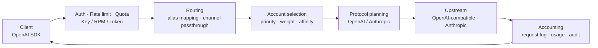

<p align="center">
  
</p>

<p align="center">
  <a href="LICENSE"></a>
  <a href="package.json"></a>
  <a href="package.json"></a>
  <a href="package.json"></a>
  <a href="https://github.com/Crequency/Portara/actions/workflows/ci.yml"></a>
  <a href="https://github.com/Crequency/Portara/stargazers"></a>
</p>

Portara sits between your applications and the model providers behind them and exposes a single
OpenAI-compatible endpoint. Credentials, rate limits, quotas, routing and cost accounting all live
in this layer, so no upstream secret ever appears in business code. One process serves the data
plane, the admin API and the web console on the same port.

## Features

- **Single endpoint** — the `/v1/*` data plane, the `/api/*` control plane and the Vue console share one process and one port; a single container is a complete deployment.
- **OpenAI-compatible streaming** — chat, completions, embeddings, responses and model listing; SSE bytes are forwarded as-is instead of being re-serialized on the proxy path.
- **Channel × account routing with session affinity** — an alias maps one gateway model to one or more channel/model pairs, each channel holds multiple accounts ranked by priority and weight, and a client-supplied `prompt_cache_key` pins a conversation to the same `(channel, account)`.
- **Balance & quota adapters** — vendor balance and usage windows are read by small fetch/parse pairs, so exhausted or cooling targets are skipped before they are used. Adapters come in two shapes: plain HTTP (key or bearer) and *session-based*, for vendors whose usage only exists behind a web login.
- **Token-bucket rate limiting** — a per-key RPM is enforced as a Redis-backed token bucket inside one Lua script, so bursts are bounded without the fixed-window 2× boundary leak.
- **OpenAI ⇄ Anthropic translation** — the channel decides which protocol the upstream speaks; clients only ever speak OpenAI.
- **Encrypted key storage with audit** — upstream keys are sealed with AES-256-GCM, and sensitive reads and writes are recorded and fail closed.
- **Bilingual, hand-written UI** — English and Chinese copy through i18n, custom CSS and hand-built controls, with no UI framework.

## Quick Start

Node.js 22.12+ and pnpm 11 are required; PostgreSQL and Redis come from Compose.

```bash
cp .env.example .env                        # set PORTARA_MASTER_KEY and PORTARA_SESSION_SECRET
docker compose up -d postgres redis
pnpm install && pnpm build && pnpm start
```

Open <http://127.0.0.1:52740/>, sign in with the administrator account from `.env`, issue a key
and call the gateway with any OpenAI SDK.

## How to Dev

Prerequisites: **Node.js >= 22.12** and **pnpm 11** (`corepack enable && corepack prepare pnpm@11 --activate`),
plus **Docker** with **Compose v2**; PostgreSQL and Redis come from Compose.

| Path | What lives there |
| --- | --- |
| `server/src/routes/` · `services/` | `/v1/*` data plane, `/api/*` control plane, routing, quota, audit |
| `server/src/migrations.ts` | Ordered, additive, idempotent SQL migrations |
| `web/src/views/` · `components/` · `i18n/` | Console pages, hand-built controls and charts, EN/ZH copy |
| `scripts/smoke.mjs` · `scripts/ui/` | End-to-end suite; headless-browser UI checks |
| `docker/` · `Dockerfile.caddy` | Caddyfile and entrypoint; multi-stage Caddy + Node image |

**Dependencies** — both bind loopback only, `127.0.0.1:52744` and `:52745`:

```bash
docker compose up -d postgres redis
```

**Two ways to run it** — the first serves sources, the second serves built artifacts:

```bash
pnpm dev                    # terminal 1: tsx watch on :52740
pnpm dev:web                # terminal 2: Vite on :52741, proxies /api and /v1 to :52740
pnpm build && pnpm start    # single port :52740, server/dist + web/dist, no watchers
```

`pnpm start` runs `server/dist`, not the sources: after touching `server/src` or `web/src` you
must rebuild, or a stale `dist` keeps answering and your change looks ignored — the easiest trap here.

**Environment** — `cp .env.example .env`, then set `PORTARA_MASTER_KEY` (`openssl rand -base64 32`,
must decode to exactly 32 bytes) and `PORTARA_SESSION_SECRET` (`openssl rand -hex 32`). The
administrator account is created on first start only and only while that username is absent;
changing `PORTARA_ADMIN_PASSWORD` later does not rotate it.

**Checks before a PR** — four gates, then two UI passes against a running instance:

```bash
pnpm typecheck && pnpm build && pnpm test   # gates 1-3
pnpm smoke                                  # gate 4: PG + Redis, isolated schema
pnpm ui:check && pnpm ui:keys               # pages render; no raw i18n keys on screen
```

`pnpm smoke` spawns `server/dist/index.js` (build first) and refuses to run unless
`PORTARA_DB_SCHEMA` contains `smoke`, so it never touches the development database. The UI checks
need `playwright-core` — `pnpm add -D playwright-core && npx playwright-core install
chromium-headless-shell`, or set `PLAYWRIGHT_CORE_PATH` to an existing install and
`CHROME_HEADLESS_SHELL` to an existing browser; export `PORTARA_ADMIN_PASSWORD` for the sign-in.

**Database changes** — migrations live in `server/src/migrations.ts`: additive only, never edit a
published one, each must be idempotent, and a change of meaning must backfill existing rows in the
same migration. Destructive steps need a snapshot; tests always use their own schema.

**Docker** — `docker compose --profile app up -d --build` builds `Dockerfile.caddy` (Caddy +
console + Node) and publishes it on `${PORTARA_HTTP_PORT:-52740}`; or pull
`ghcr.io/crequency/portara:0.6.7`.

**CI** — pushes to `main` and PRs run `verify` (typecheck → build → test → smoke); a `vX.Y.Z`
tag also builds `Dockerfile.caddy` and pushes it to GHCR with semver tags (`0.6.7`, `0.6`, `0`).

## Architecture



Routing happens twice: the alias mapping yields an ordered list of channels, then account selection
yields an ordered list of accounts inside the chosen channel. Failover walks those lists, and only
retryable status codes move a request to the next target.

## Endpoints

| Endpoint | Description |
| --- | --- |
| `POST /v1/chat/completions` | Chat completions, including `stream: true` over SSE |
| `GET /v1/models` | Models declared by every enabled channel |
| `GET /v1/usage` | Balance and usage snapshots for the calling key |
| `GET /api/channels/{id}/accounts/{aid}/web-session` | Web-session status for a session-based adapter (cookie **names** only, never values) |
| `POST /api/channels/{id}/accounts/{aid}/web-session` | Store a pasted web cookie and immediately probe it (`{ cookie }`) |
| `DELETE /api/channels/{id}/accounts/{aid}/web-session` | Forget the stored web session |
| `GET /api/billing/health` | Admin-only billing health: users without a plan, orphan keys, channels without a channel-level rate, disabled plans and zero-rate requests in the last 24 h |
| `GET /healthz` | Liveness of the process |
| `GET /readyz` | Readiness, including PostgreSQL and Redis |
| `/api/*` | Control plane used by the console; management endpoints are admin-only, operator accounts can only read their own keys, logs and statistics |

Other `/v1/*` paths pass through the same authentication, rate limiting and accounting.

## Security

- **Envelope encryption** — channel and account credentials are sealed with AES-256-GCM under a master key supplied through `PORTARA_MASTER_KEY`.
- **Web sessions are credentials too** — some vendors only expose balance behind a web login (an API key answers `401 unauthenticated`). Pasted cookies are sealed with the same envelope encryption, stored one per account, and every read returns cookie *names* only — never values or ciphertext. Pastes are audited by name.
- **Hashed and encrypted client keys** — authentication uses a SHA-256 hash, while a separate sealed copy lets an administrator reveal a key on demand; every reveal is audited.
- **Admin-owned key limits** — operators may issue their own keys, but RPM and token quota stay admin-controlled: creation silently uses the system default, while an update carrying either field is rejected with 400.
- **Tenant isolation** — operator accounts see only requests produced by their own keys; cost, sell price, client IP, session hashes, channels, users and model mappings stay admin-only.
- **Fail-closed audit** — an operation that cannot be written to the audit log fails instead of proceeding silently.
- **Short-lived tokens** — access tokens are stateless JWTs measured in minutes; long sessions ride revocable, rotating refresh tokens.
- **Additive migrations only** — published migrations are never edited and corrections always arrive as new ones.

## License

[AGPL-3.0](LICENSE). Running a modified copy as a network service requires offering its complete corresponding source.

Copyright © 2025-2026 Crequency Open Source Organization (云矩创频开源组织)

## Star History

<p align="center">
  <a href="https://www.star-history.com/#Crequency/Portara&Date&dark">
    
  </a>
</p>

## The Name

**Portara** (πόρτα, "door") is the great marble door frame that is all that remains of the Temple of
Apollo on Naxos: no walls, no hall, only the entrance itself. This project is meant to be the same
kind of thing — every AI request passes through it, and the door itself should never be a burden.
