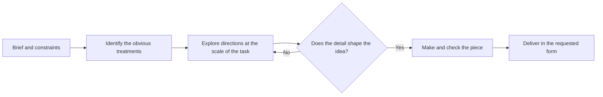

<div align="center">

# Directing Creative Work

**Stop getting the average. An Agent Skill that makes AI agents direct creative work instead of predicting it.**

[](CHANGELOG.md)
[](LICENSE)
[](https://agentskills.io)
[](#-any-language)
[](#requirements)
[](https://github.com/D3Br4nd/Directing-Creative-Work/stargazers)


[Quick start](#-quick-start) · [Examples](#-examples) · [How it works](#-how-it-works) · [Installation](#-installation) · [Credits](#-credits)

</div>

---

Ask an AI for a tagline, a name or a landing page and you get the most probable answer: the one everyone else gets too. Ask it to be original and you get the *first clever twist*, which is just as predictable.

**Directing Creative Work** gives an agent a way to choose between creative directions. It considers the predictable treatment and the first clever twist, then looks for a detail in your brief that changes how the work is made.

## ✨ Highlights

| Decision | How the skill handles it |
|---|---|
| Finding an angle | Tests whether changing a detail in the brief would change the idea itself. |
| Breaking a convention | Chooses a departure when it helps the audience. Familiar forms remain available when clarity matters. |
| Working with facts | Grounds public claims in the supplied material. Characters, scenes and dialogue can be invented for fiction or proposed concepts. |
| Revising a draft | Preserves the author's facts and voice, including wording the user asks to keep. |
| Handing over the result | Delivers the requested artifact first. Exact formats, counts, language and length take precedence over direction notes. |

## 🚀 Quick start

```bash
npx skills add D3Br4nd/Directing-Creative-Work
```

Then just ask for something creative:

> *"Write the window sign for my bakery. Nothing generic."*

No setup, no dependencies, no API keys: the skill is pure instructions. Other install options are [below](#-installation).

## 🖼️ Examples

<table>
<tr>
<th width="50%">You ask</th>
<th width="50%">You get</th>
</tr>
<tr>
<td>

*"Make this less generic. It's the hero of our landing page for a shared shopping-list app for flatmates:"*

> Empower your household with seamless collaboration. Organize, share and simplify your life.

</td>
<td>

> **Three ketchups. No loo roll.**
>
> One list the whole flat adds to, so whoever's at the shop buys what's actually run out.

</td>
</tr>
<tr>
<td>

*"Scrivi il testo per la vetrina di un panificio che apre il 3 dicembre in via del Pratello a Bologna. Si chiama Forno Nero, lievitazione naturale, apre alle 7. Massimo 60 parole."*

</td>
<td>

> **FORNO NERO**
> pane a lievitazione naturale
>
> Apriamo il 3 dicembre.
> Fino ad allora aspettiamo:
> è la cosa che sappiamo fare meglio.
>
> Poi, dalle 7 del mattino,
> aspettiamo voi.
>
> *Via del Pratello, Bologna*

</td>
</tr>
</table>

<details>
<summary><b>See a complete reply to a sensitive copy brief</b></summary>

<br>

*"Make the message our banking app shows when a bank transfer fails more creative. Right now it says: 'Error 402. Operation failed.'"*

```markdown
**We couldn’t complete your transfer.**

[Confirmed status of the money you tried to send.]
[Next step the bank has verified for this error.]

Error code 402

*Before publishing, replace both bracketed lines with verified customer-facing copy.*
```

The error code identifies the failure. The bank needs to supply the debit status and recovery action before this draft reaches customers.

</details>

## 🧠 How it works



### What a reply looks like

For an open creative brief, the piece comes first. Up to three short notes follow: the obvious version it passed over and what the chosen one does for the audience, two other directions you can ask for, and any fact to confirm before publishing. Ask for the full reasoning and you get it.

A request for two names as JSON gets an array with two names. A request for a poem alone gets the poem. A short functional message can include a separate editorial check if a fact needed for publication is missing.

### 🌍 Any language

The requested output language applies to the piece. Discussion follows the user's language unless they specify another one.

## 📜 Principles

The idea for this skill came after reading [HUMAN.md](https://www.human-md.ai/), the manifesto by Briana (Mazzio) May.

| Principle | How the agent applies it |
|---|---|
| Explore beyond the obvious | Tries directions drawn from a gesture, craft, rhythm or object outside the usual references for the medium. |
| Work for the recipient | Judges a choice by what a particular reader, viewer or listener can experience. |
| Make the idea visible | Carries the anchor into the structure, sound, action or point of view of the piece. |
| Use feedback precisely | Revises the part that missed while preserving the decisions the user asked to keep. |

The full list of defaults to avoid, by medium, plus the second-order defaults and the moves worth trying, lives in [`references/average-defaults.md`](skills/directing-creative-work/references/average-defaults.md).

## 📦 Installation

The skill is the [`skills/directing-creative-work/`](skills/directing-creative-work/) folder. Pick one:

**Any agent, one command** (uses the community [`skills` CLI](https://github.com/vercel-labs/skills)):

```bash
npx skills add D3Br4nd/Directing-Creative-Work
```

**Manual copy:**

```bash
git clone https://github.com/D3Br4nd/Directing-Creative-Work.git
cp -R Directing-Creative-Work/skills/directing-creative-work ~/.claude/skills/
```

| Agent | Project only | All projects |
|---|---|---|
| Claude Code | `.claude/skills/` | `~/.claude/skills/` |
| OpenAI Codex | `.agents/skills/` | `~/.agents/skills/` |
| OpenCode | `.opencode/skills/` | `~/.config/opencode/skills/` |
| Google Antigravity | `.agents/skills/` | `~/.gemini/config/skills/` |

<details>
<summary><b>claude.ai</b></summary>

<br>

Zip the folder and upload it as a custom skill in the claude.ai settings (code execution must be enabled):

```bash
cd skills && zip -r ../directing-creative-work.zip directing-creative-work -x '*/.DS_Store'
```

</details>

<details>
<summary><b>Claude Code tips</b></summary>

<br>

- Skills in `~/.claude/skills/` or `.claude/skills/` are picked up automatically. If the `skills` folder didn't exist when the session started, restart Claude Code.
- Invoke it explicitly with `/directing-creative-work`.
- Opened inside this repository, the skill is already available through the link in `.claude/skills/`.

</details>

## 💬 Usage

The skill activates on its own when you ask for creative work, or ask to make something less generic, in any language:

```text
"Write the window sign for my shop, nothing generic."
"This page sounds like an AI wrote it, give it some soul."
"Rendi più creativo il messaggio di benvenuto della nostra app."
"Dame un nombre fuera de lo común para la newsletter."
```

Give it the desired deliverable, audience and constraints, including any source wording to keep. When the audience is open, the agent chooses a plausible reader. A faithful translation, a grammar-only edit or a factual summary calls for a different approach.

<details>
<summary><b>Prompts to try after installing</b></summary>

<br>

1. *"Scrivi il testo per la vetrina di un panificio di quartiere che apre il 3 dicembre in via del Pratello a Bologna. Si chiama Forno Nero, fa pane a lievitazione naturale e apre alle 7. Massimo 60 parole."*
   Expect an Italian sign of at most 60 words, with all the opening details and a creative choice shaped by the shop, street or hour.
2. *"Can you make this less generic? It's the hero of our landing page for a shared shopping-list app for flatmates: 'Empower your household with seamless collaboration.'"*
   Expect a headline and subline built on a concrete scene from flat-sharing life, with no "empower" or "seamless" and no promised features the brief didn't mention.
3. *"Make the message our banking app shows when a bank transfer fails more creative. Right now it says: 'Error 402. Operation failed.'"*
   Expect a calm, clear message with no jokes. The code stays visible, and the debit status and recovery step are marked for confirmation.
4. *"dame tres ideas fuera de lo común para el vídeo de lanzamiento de nuestro helado de sésamo negro"*
   Expect exactly three ideas in Spanish. Each gives the crew a different action to film and a role for the ice cream.

The full test cases are in [`evals/evals.json`](skills/directing-creative-work/evals/evals.json), and the activation queries, in five languages, in [`evals/eval_queries.json`](skills/directing-creative-work/evals/eval_queries.json).

</details>

## 🗂️ Project layout

```text
skills/directing-creative-work/
├── SKILL.md                        instructions and metadata
├── references/average-defaults.md  defaults to avoid and moves worth trying, by medium
└── evals/                          test cases and activation queries
scripts/validate_skill.py           validator, run before every commit
AGENTS.md                           rules for agents that maintain the repository
CHANGELOG.md                        release notes
```

### Requirements

None. The skill contains only instructions: no scripts, no network, no packages.

### Development

```bash
python3 scripts/validate_skill.py
```

The rules for changing the skill, including those that keep it agent-agnostic, are in [AGENTS.md](AGENTS.md). Issues and pull requests are welcome.

## 🙏 Credits

- [**HUMAN.md**](https://www.human-md.ai/) by Briana (Mazzio) May: the manifesto that sparked the idea. Its text is not reproduced here.
- [Agent Skills specification](https://agentskills.io/specification), [evaluating skills](https://agentskills.io/skill-creation/evaluating-skills) and [optimizing descriptions](https://agentskills.io/skill-creation/optimizing-descriptions).
- [Claude Code: skills](https://code.claude.com/docs/en/skills) and [Anthropic's skill authoring best practices](https://platform.claude.com/docs/en/agents-and-tools/agent-skills/best-practices).

## 📄 License

[MIT](LICENSE) © 2026 Max Brandini. The license covers the skill and the documentation in this repository, not the HUMAN.md manifesto.
