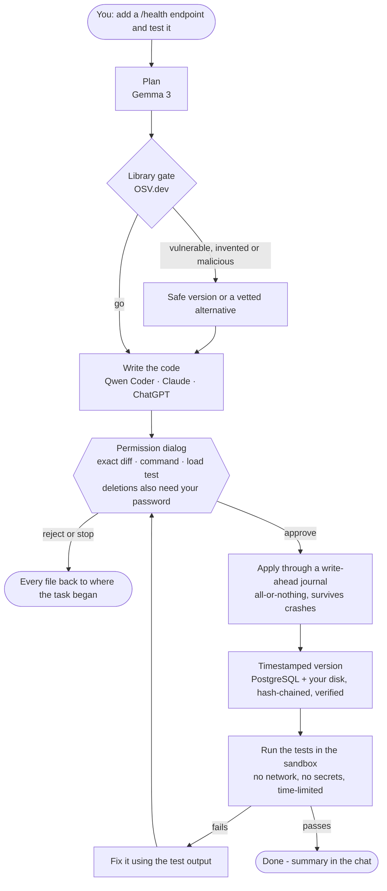
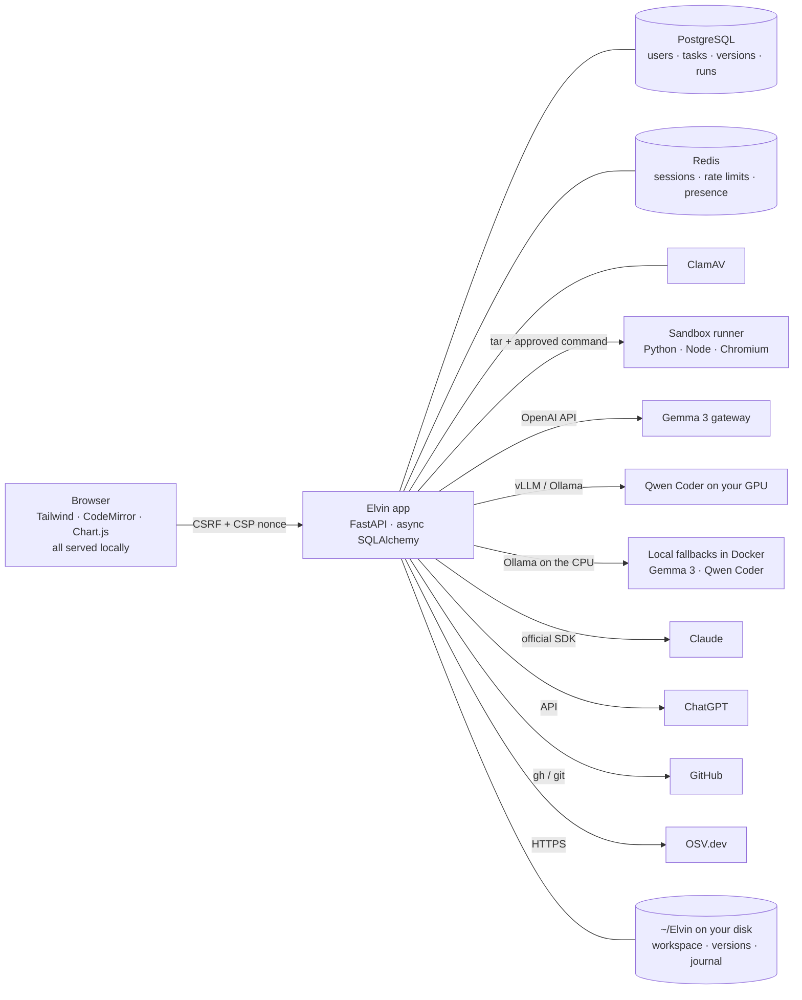

<div align="center">


# Elvin

### The autonomous agentic coder that asks before it acts

[](#1-automated-tests)
[](#2-real-browser-check)
[](#3-stress-test)
[](#architecture)
[](#architecture)
[](#install-one-click)
[](#install-one-click)
[](LICENSE)

**Plan → check every library → write → ask permission → apply crash-safely → timestamp & verify → test in a sandbox → fix**

Local-first with **Gemma 3 + Qwen Coder** · optional **Claude** and **ChatGPT** · your code stays on your computer unless you pick a cloud model


</div>

> [!WARNING]
> **No warranty. No liability. No responsibility.** Elvin is provided **"as is"**, without warranty of any kind, and its author and contributors accept **no liability and no responsibility** for any loss, damage or cost that comes from using it, or for any code, change or action it produces. AI models make mistakes: generated code, security findings, vulnerability reports, licence summaries and load-test numbers can be wrong or incomplete. The safety features are aids, not guarantees, and nothing Elvin says is legal or security advice. Review every change before you approve it, keep your own backups, and only scan, clone or load-test systems you own or are authorised to test. Full text: [DISCLAIMER.md](DISCLAIMER.md) · [MIT License](LICENSE).

---

**Contents** · [Highlights](#highlights) · [How it works](#how-it-works) · [Features](#features) · [Screenshots](#screenshots) · [Install](#install-one-click) · [Quick start](#quick-start) · [Where your files live](#where-your-files-live) · [AI models & hardware](#ai-models--hardware) · [How Elvin keeps your code safe](#how-elvin-keeps-your-code-safe) · [Security](#security) · [Limits](#limits) · [Testing & results](#testing--results) · [Architecture](#architecture) · [Configuration](#configuration) · [Troubleshooting](#troubleshooting) · [License](#license) · [Disclaimer](#disclaimer)

## Highlights

- 🤖 **An agent, not just autocomplete.** Describe a change; Elvin plans it, writes multi-file code, runs your tests in a sandbox and fixes what fails.
- ✋ **Nothing happens without you.** Every write, command and load test waits in a permission dialog that shows the exact diff. **Every deletion also needs your password**, and Elvin never touches anything outside the project folder.
- 🧯 **Crash-safe by design.** A write-ahead journal, timestamped and verified versions after every step, and *Stop* puts every file back where the task began.
- 🛡️ **Supply-chain aware.** Every library is checked on OSV.dev before Elvin may use it. Vulnerable versions are upgraded, invented and malicious packages are blocked.
- 🏠 **Local-first.** Gemma 3 on your own gateway plus Qwen Coder on your GPU, with Gemma and Qwen in Docker as automatic fallbacks. Claude and ChatGPT are optional.
- 🧰 **The whole workshop.** Code editor with AI autocomplete, run button, bug hunt, vulnerability scan, Locust load tests, GitHub push and clone, version history, live system status.
- 🧪 **Tested.** 109 automated tests, a real-browser check of every page, a 40-user stress test with zero failed requests, and an AI accuracy evaluation with real models.

## How it works



| Job | Default model | Automatic fallback |
|---|---|---|
| Plan, read design images, verify | **Gemma 3** on your OpenAI-compatible gateway | Gemma 3 4B in Docker on your computer |
| Write and fix code | **Qwen Coder** on your GPU (Ollama with Metal, or vLLM) | the gateway Gemma (or Claude / ChatGPT in those teams), then Qwen Coder and Gemma in Docker |
| Editor autocomplete | **Qwen Coder** | Qwen Coder 3B in Docker |
| Bug hunting | **Claude Haiku**, **ChatGPT** or **Qwen Coder** - your choice | the other two |
| Optional cloud team | **Claude Opus / Haiku** or **ChatGPT** | local models |

The 60-second status check notices when a model goes down, so Elvin moves straight to the next one instead of waiting for a timeout. For writing code, the CPU-only Docker models always come last - they are slower and, at small sizes, less accurate (see [AI accuracy](#4-ai-accuracy-with-real-models)). While a CPU model in Docker is answering, effort is capped at *medium* and Elvin tells you.

| Elvin plans, checks libraries, autosaves and runs | Nothing is applied until you approve |
|---|---|
|  |  |

## Features

Every tool has its own entry in the navigation bar:

| | Feature | What it does |
|---|---|---|
| 🤖 | **Elvin AI** | Chat with an autonomous coding agent. Elvin plans the work, checks every library it wants to use, writes the code, **shows you a permission dialog with the exact diff or command**, applies approved changes, saves a timestamped & verified version, runs your tests in an isolated sandbox and fixes failures. Ask *"stress test http://localhost:8000 with 50 users"* and it launches Locust for you. |
| 🖼️ | **Design from a screenshot** | Attach an image of the UI you want. Gemma describes it, Qwen builds it, the sandbox renders it in network-blocked Chromium and Gemma compares screenshots with your image, iterating until it matches. |
| ⌨️ | **Editor** | A built-in code editor (CodeMirror) with **Copilot-style ghost-text completions from Qwen Coder**: <kbd>Tab</kbd> accepts, <kbd>Esc</kbd> dismisses, <kbd>⌘/Ctrl S</kbd> saves (and timestamps a version). **Images open as previews**, and uploaded **`.zip` files unpack automatically** into their own folder (zip-slip, symlink, encrypted-entry and zip-bomb protection; ClamAV scans every file). |
| ▶️ | **Run code** | Run your project in the sandbox from the **Editor** (<kbd>⌘/Ctrl Enter</kbd>; HTML pages can be rendered to a screenshot) or from **Elvin's chat** (Run button). Elvin sees the latest run's output when you ask it to fix something, and `pip`/`npm install` commands go through the vulnerability detector first. |
| 🐞 | **Bug Hunt** | A white-box security review of any folder with **Claude Haiku, ChatGPT or Qwen Coder** (only these three). Files are reviewed in parallel chunks and a rule-based pre-scan adds instant findings. Qwen is not offered for large projects. CSV export. |
| 🛡️ | **Vuln Scan** | Every dependency (Python, npm, Go, Rust, Ruby and PHP manifests and lockfiles) is checked against **OSV.dev**. Elvin recommends the smallest upgrade that fixes every advisory - one click, with a diff preview - or a vetted alternative when no fix exists. It also catches **packages that don't exist** (AI-invented names) and known-malicious ones. |
| 📈 | **Load Test** | **Locust** with per-page **weights**, users, spawn rate and a custom duration. Live Chart.js graphs, every run stored in PostgreSQL per project, **CSV export**. Targets are limited to your computer and LAN by default. |
| 🐙 | **Git & GitHub** | Connect GitHub (a one-time code through the GitHub CLI, or a token). Push any project to a new private or public repository in one go - with a secret scan, a safe `.gitignore` and a no-reply commit email. **GitHub stats** (repos, stars, contributions, PRs, reviews, notifications) on the dashboard with a manual **Refresh** and **suggestions**. **All your repositories** - owned, forks, organisations - on one page with search, filters and a README / files / commits viewer. **Read-only once pushed: Elvin never deletes, archives, renames or force-pushes anything on GitHub.** |
| 🌿 | **Clone** | Paste a repository. Elvin downloads it into quarantine, reads the **README and licence**, lists the **terms & conditions** (with a **plain-language** button), waits until you tick and agree to each one, **scans every file with ClamAV**, then imports it as a project you or Elvin can edit. |
| 🕓 | **History** | Timestamped, hash-chained versions after every step, stored in **PostgreSQL and on your disk**. Verify, diff and restore any of them. On by default for every user; can be turned off. |
| 💓 | **System status** | AI latency measured **every 60 seconds** (a real one-token answer from the gateway and from loaded local models), the **gateway's PCs** (online, busy slots, overload, host CPU), PostgreSQL, Redis, ClamAV and the sandbox. The administrator can change the gateway address and choose **where Gemma runs**: gateway first, or the local Docker Gemma only. A status dot in the menu and a banner tell everyone when a slower local model is answering. |
| 📊 | **AI usage & models** | Calls, tokens, latency, success rate and estimated cost per model, with recommendations - and pickers for the **effort level**, the **model per role** and the **model combination (team)**. |

Also: projects (create, upload a folder or files, archive, delete), the **10 most recent projects in the navigation menu** with archive and delete buttons, **per-project memory** ("remember: we use PostgreSQL" - never shared between projects), dark and light mode, and an animated glass-style interface that works from phone to wide screen.

## Screenshots

| | |
|---|---|
|  |  |
| **Dashboard** - GitHub stats, suggestions, running tasks, system | **System status** - latency every 60 s, gateway PCs, where Gemma runs |
|  |  |
| **Editor** - Qwen Coder ghost-text autocomplete | **Run code** - from the editor or the chat, output right below |
|  |  |
| **Image preview** - pictures open right in the editor | **Deleting always needs your password** |
|  |  |
| **Load Test** - weights, live charts, CSV export | **Vuln Scan** - OSV.dev advisories and exact upgrades |
|  |  |
| **All GitHub repositories** - search, filters, read-only viewer | **History** - verify, diff and restore any version |
|  |  |
| **Light mode** | **Phone layout** |

## Install (one click)

All you need is an internet connection - the installer sets up Docker if it's missing.

| System | Double-click | Or in a terminal |
|---|---|---|
| **macOS** (Apple Silicon or Intel) | `Install-Elvin-Mac.command` | `bash install/install.sh` |
| **Windows 10/11** | `Install-Elvin-Windows.bat` | `powershell -ExecutionPolicy Bypass -File install\install.ps1` |
| **Linux** | - | `bash install-linux.sh` |

The installer:

1. installs **Docker** if needed (Docker Desktop on macOS and Windows - with WSL2 on Windows - Docker Engine on Linux) and starts it;
2. **detects your hardware** (RAM, Apple Silicon, NVIDIA or AMD GPU and its memory) and picks the best local **Qwen Coder** model (see [AI models & hardware](#ai-models--hardware));
3. asks for your **Gemma gateway** address (optional) and, optionally, **Anthropic** and **OpenAI** keys - if your computer **can't run a local model, a Claude or ChatGPT key is required** and Elvin refuses to start without one;
4. creates every folder (`~/Elvin/{workspace,data,logs,bin,models,run}`) and writes `.env` with freshly generated secrets (kept on re-runs);
5. builds and starts the containers: **app, PostgreSQL, Redis, ClamAV, sandbox runner, the local Gemma + Qwen fallbacks** (and **vLLM** on NVIDIA/AMD);
6. opens **http://localhost:8765** - create your account and you're in.

Later, use `Start-Elvin-Mac.command` / `Stop-Elvin-Mac.command` (`Start-`/`Stop-Elvin-Windows.bat`, or `install/start.sh` / `install/stop.sh`). Stopping keeps all projects and data.

> [!TIP]
> macOS may say a downloaded `.command` file is from an unidentified developer: right-click it → **Open**.

## Quick start

1. Open **http://localhost:8765** and **create your account**. The first account is the administrator.
2. Click **New project** - or upload a folder, some files or a `.zip` (it unpacks itself).
3. Open **Elvin AI** and describe what you want, for example *"build a FastAPI todo API with tests"*.
4. Elvin plans, checks the libraries it needs and opens the **permission dialog**. Tick what you want and approve.
5. It applies the change, saves a verified version, runs the tests in the sandbox and fixes failures - asking again before every change.
6. Press **Run** (in the chat or the editor) to run anything yourself, and **History** to diff or restore any version.
7. When you're happy: **Vuln Scan** and **Bug Hunt** to review, **Load Test** to stress it, **Git** to push it to GitHub.

Tip: *"remember: we deploy on Fly.io"* saves a fact to this project's memory - Elvin uses it in every later answer, and other projects never see it.

## Where your files live

Everything stays on your computer. Your projects are **plain files** in your Elvin folder - `~/Elvin` on macOS and Linux, `%USERPROFILE%\Elvin` on Windows (the installer asks, and saves the path as `ELVIN_HOME_HOST` in `.env`). Open them in any editor or file manager; Elvin notices outside changes the next time the project opens.

```
~/Elvin/
├── workspace/
│   └── <your account id>/
│       └── <project-name>/           ← your project files, exactly as you see them in the editor
├── data/
│   ├── snapshots/<project id>/       ← timestamped versions: content-addressed file blobs + a JSON manifest per version
│   ├── journals/<project id>/        ← write-ahead journal (empty unless a change is being applied)
│   ├── attachments/                  ← images you attached in the chat (re-encoded)
│   ├── uploads/                      ← short-lived staging while an upload is virus-scanned
│   ├── quarantine/                   ← cloned repositories waiting for your agreement and the scan
│   └── outbox/                       ← password-reset emails when no SMTP server is configured
├── removed-projects/                 ← files of deleted projects you chose to keep
├── logs/
├── bin/   models/                    ← Elvin's own Ollama and Qwen Coder models (Apple Silicon / AMD on Windows)
```

Everything else lives in Docker volumes:

| Volume | Holds |
|---|---|
| `elvin_pgdata` | PostgreSQL: accounts, chats, tasks, the version records, load-test results, bug hunts, usage, settings |
| `elvin_redisdata` | sessions, rate limits, presence |
| `elvin_clamdb` | ClamAV virus signatures |
| `elvin_gemma` | the local Gemma 3 and Qwen Coder fallback models |
| `elvin_runner_cache` | the sandbox runner's package cache |

**Backing up:** copy the `~/Elvin` folder and save the database with `docker compose exec db pg_dump -U elvin elvin > elvin-backup.sql`. Stopping Elvin keeps everything; `docker compose down -v` would **delete** the volumes above (your project files in `~/Elvin` stay).

## AI models & hardware

The installer looks at your computer and picks every model size for you - nothing to choose by hand.

**1. The main coder: Qwen Coder on your GPU**

| Your computer | Qwen Coder it installs | How it runs |
|---|---|---|
| **Apple Silicon** (M1-M5, unified memory) | 8 GB → 3B · 16 GB → 7B (+ 1.5B base for autocomplete) · 32 GB → 14B · 64 GB → 32B | Elvin's own **Ollama with Metal** on `127.0.0.1:11435` (vLLM has no Metal support) |
| **NVIDIA GPU** (Linux, or Windows + WSL2) | 6 GB VRAM → 3B · 8 GB → 7B · 12 GB → 14B · 20 GB+ → 32B (AWQ) | **vLLM** container (`docker-compose.nvidia.yml`); the NVIDIA Container Toolkit is installed if missing |
| **AMD GPU** | Linux (ROCm, vLLM): 8 GB → 1.5B · 12 GB → 3B · 24 GB → 7B · 48 GB → 14B · Windows (Ollama ROCm): 8 GB → 3B · 12 GB → 7B · 24 GB → 14B | `docker-compose.amd.yml` / Elvin's own Ollama |
| **Integrated GPU** (Intel Iris / UHD / Arc graphics, AMD Radeon APUs such as the 780M) | none on the GPU - it shares system memory and Docker can't use it for AI | the Docker models below, on the CPU |
| **No GPU, or a GPU too small** (NVIDIA under 6 GB, AMD under 8 GB, Apple under 8 GB, Intel Macs) | none on the GPU | the Docker models below, on the CPU |

**2. The local fallbacks: Gemma 3 + Qwen Coder in Docker (CPU, one loaded at a time)**

Sized by how much memory Docker may use (Docker Desktop's setting on macOS and Windows, your RAM on Linux) and by your CPU's performance cores:

| Docker memory | Gemma 3 (plans, reads images) | Qwen Coder (codes) | Container limit |
|---|---|---|---|
| 16 GB or more **and** 8+ performance cores | 12B | 14B | 12 GB |
| 10 GB or more | 4B | 7B | 7 GB |
| 6 GB or more | 4B | 3B | 5 GB |
| less than 6 GB | 1B (can't read images) | 1.5B | 2 GB |

They step in when the gateway or the GPU coder is unavailable (and do all the work on computers without a usable GPU); for writing code they come after every GPU and cloud model. The installer and start scripts pin them to the CPU's **performance cores** - on an Apple M5 (4 performance + 6 efficiency cores) Gemma 3 4B generated 10.4 tokens/s with 4 threads but only 2.9 with all 10. **Effort is capped at medium** while they answer, and Elvin shows an alert. Gave Docker more memory later? Re-run the installer - it keeps your secrets and picks bigger models.

**3. When a cloud key is compulsory**

A computer that is too weak to run Elvin on local models alone must have a **Claude (Anthropic) or ChatGPT (OpenAI) API key** - the installer won't finish without one and Elvin refuses to start without one. That is the case when:

- there is **no GPU that can run Qwen Coder** (integrated graphics, CPU only, or a GPU below the sizes above) - the Docker models still run, as fallbacks; or
- the GPU only fits a Qwen Coder **smaller than 3B**; or
- there is **no Gemma gateway** and Docker has **less than 6 GB** (so the local Gemma would be 1B and can't read images).

**Gemma 3** runs on your **OpenAI-compatible gateway** (for example two PCs with llama.cpp behind one link). Elvin uses it for planning, vision (design screenshots) and verification.

The administrator can switch Gemma to **local Docker only** on the System Status page (or with `python -m elvin.admin gemma-source local`) - handy while the gateway has trouble.

**Teams** (pick one in Settings or on the Usage page): Gemma + Qwen (fully local, default) · Qwen + Claude · Gemma + Claude · Qwen + Claude + Gemma · Claude only · and the same four with ChatGPT. **Claude Opus** (`claude-opus-5-5`, with the server-side refusal fallback enabled) is the coding fallback and **Claude Haiku** (`claude-haiku-5-5`) does bug hunting; either can be switched to Sonnet 5.5. **Effort** (low · medium · high · max) maps to Claude's effort and ChatGPT's reasoning effort, and to how many fix and review passes Elvin makes.

Every model family has its own concurrency limit (gateway 4 slots, local Qwen 2, Docker models 1, cloud 4), a global queue cap answers *"busy"* instead of piling up work, and three consecutive failures pause a model for 30 seconds while Elvin fails over to the next one.

Elvin knows your platform: commands run in its **Linux sandbox**, and instructions for your own computer use **zsh (macOS), PowerShell (Windows) or bash (Linux)** syntax.

## How Elvin keeps your code safe

- **Permission before everything.** No model may write, delete or run anything until you approve it in a dialog showing the exact diff, command or load-test plan. You can approve some items, reject a step or stop the task.
- **Folder boundary.** Writes and deletions are confined to the project folder - absolute paths, `..`, symlinks out of the folder, `.git` and Windows-reserved names are refused (and logged in the chat).
- **Deleting always needs your password.** Elvin can only *propose* deleting a file inside the project; it happens only after you tick it in the permission dialog **and re-enter your password**. The same goes for deleting a file or a project yourself and for restoring a version that would remove newer files. Wrong passwords count toward the sign-in lockout (5 tries, then 15 minutes) and every confirmation is audited. Stop and Retry, which only undo Elvin's own unapproved work, don't ask - that work is saved in History first.
- **GitHub stays as you pushed it.** Elvin can push new commits, but its git layer refuses `gh repo delete / edit / archive / rename`, `gh release delete`, every `gh api` write and every force, delete or mirror push - so nothing on GitHub can be rewritten or removed from Elvin.
- **Crash-safe failsafe.** Every change set goes through a **write-ahead journal**: pre-images are saved and fsynced first, files are written atomically and the journal is committed last. If the network drops, the app crashes or the power goes out, the next start rolls the half-applied step back and marks the task *interrupted*.
- **Timestamped versions.** After every approved step (and at the end of every task) Elvin snapshots the project into a content-addressed blob store, records the manifest in PostgreSQL **and** as a local JSON file, hash-chains it to the previous version and **verifies** it.
- **Stop means "back to the start".** Stop - or the **90-second timer** that fires when you close your last tab or sign out - cancels the task and restores every file to the moment the task began (the partial work is kept in History). **Retry** recreates the task from that same starting point.
- **Self-check before you see it.** Python and JSON files that don't parse - for example when a small model pastes test output into a file - get one automatic repair round before the permission dialog opens; if a file still doesn't parse, it is flagged in the dialog. Code sent as markdown instead of file blocks is asked for again in the right format.
- **Library gate.** Before Elvin may use a library it is checked on OSV.dev: *go*, *go with this safe version*, or *blocked* with a vetted alternative. Packages that don't exist on their registry and known-malicious packages are always blocked; `pip install` and `npm install` commands are checked too.
- **Integrity checks.** Each time a project opens, Elvin compares every file with its index. Files changed or deleted while Elvin was closed are reported - restore them or accept the changes; a deleted project folder can be rebuilt from the last version.
- **Sandbox.** Commands and screenshots run in a separate container with no secrets, no database access, resource limits and a time limit, on a throw-away copy of the project - nothing a command does there can change or delete your files.

## Security

- **Sessions like Google's:** the signed, HttpOnly, SameSite cookie carries only your user id and a random session token; your details are loaded from PostgreSQL on every request.
- **One login per account:** the session token's hash is stored in PostgreSQL and Redis and cross-checked on every page, API call and live stream. Signing in elsewhere signs the old tab or device out on its next request and tells it *where and when* - your AI tasks keep running.
- **Sign-up, sign-in and reset** only when signed out; Argon2id hashing; password rules; per-IP and per-account rate limits with a 15-minute lockout; single-use 30-minute reset links (SMTP, or `data/outbox/` without email); no account enumeration.
- **Step-up authentication:** every deletion asks for the account password again (audited, counted toward the lockout).
- **CSRF** tokens on every state-changing request plus an Origin check; **Talisman-style headers** (X-Frame-Options, nosniff, Referrer and Permissions Policy, COOP/CORP, HSTS over HTTPS) and a strict **Content-Security-Policy with a fresh nonce per request** - no inline scripts or styles, no `eval`.
- **Jinja2 autoescaping** everywhere; chat markdown is escaped before formatting.
- **ClamAV** scans uploads, images, zip contents and cloned repositories; images are re-encoded to strip anything hidden.
- **Spam and double-send protection:** idempotency keys, one active task per project ("sending only while Elvin is idle"), a duplicate-message window and per-minute/hour limits.
- GitHub tokens are **encrypted at rest** and only ever passed through the environment of the single `gh`/`git` command that needs them.
- **Every list is capped** (see [Limits](#limits)), enforced on the server with row locks so simultaneous requests can't exceed them.

## Limits

| Limit | Value | | Limit | Value |
|---|---|---|---|---|
| Accounts per installation | 200 | | Projects per account | 50 |
| Recent projects in the menu | 10 | | Files / size per upload | 2,000 files, 200 MB |
| Message length | 8,000 characters | | Messages per minute / hour | 6 / 60 |
| Parallel tasks per account | 3 | | Steps per Elvin task | 8 |
| Changes per step | 30 | | File size Elvin may write | 512 KB |
| Memories per project | 100 | | Saved versions per project | 300 (oldest pruned) |
| Messages kept per project | 2,000 | | Auto-cancel after the last tab closes | 90 s |
| Load test users / duration | 500 / 30 min | | Endpoints per load test | 30 (weight 1-100) |
| Load test configs / runs kept | 20 / 100 per project | | Bug-hunt files / size | 1,500 / 6 MB |
| Qwen bug hunts | ≤ 250 files, ≤ 1.5 MB | | Bug-hunt findings / runs kept | 500 / 50 |
| Dependencies per scan | 2,000 | | Clone size / files | 500 MB / 20,000 |
| Login attempts per account | 5, then 15 min lock | | Password-reset links per email | 3 per hour |
| Command runs per minute / kept | 20 / 50 per project | | Run time limit | 180 s |
| Image preview size | 25 MB | | Zip expansion ratio | 200× (zip-bomb guard) |
| GitHub repositories listed | 1,000 | | Wrong delete passwords | 5, then 15 min lock |

All values live in [`elvin/limits.py`](elvin/limits.py).

## Testing & results

> [!NOTE]
> Benchmark and accuracy numbers describe single runs on one machine (Apple M5, 16 GB, Docker Desktop with 7.75 GB) and are not performance guarantees.

**Overall: every automated check passed - 109/109 tests, 80/80 browser page checks, 15/15 browser flows and 0 failed requests in the stress test** (the target was at least 90%). With real models, the gateway's Gemma 3 solved **95%** of the coding tasks and produced valid plans and design descriptions **100%** of the time; the small 3B CPU fallback solved 65%.

### 1. Automated tests

**109 / 109 passed** · `docker compose -f docker-compose.test.yml run --rm --build tests` - a throwaway `elvin_test` database in RAM, deterministic test models, a fake ClamAV daemon and a fake OSV.dev (the suite refuses to run against any other database).

| Area | What is proven |
|---|---|
| **Account isolation** (tested first) | 26 endpoints probed with another user's project, task, version and attachment ids → all `404`, nothing leaked; one project's memory never appears in another project's AI prompts; the project cap holds under 50 simultaneous requests |
| **Auth & browser security** | fresh CSP nonce per request on every script, no inline styles, CSRF + Origin checks, sign-up validation, lockout after 5 wrong passwords, **one login per account** (old device signed out and told where/when), single-use reset links, no account enumeration, template escaping, body-size limits |
| **Elvin agent** | nothing is written before approval · partial approval · writes outside the project folder blocked · **Stop restores the starting point** (partial work kept in History) · **Retry** recreates the task · double-send / busy / duplicate / rate-limit protection · library gate (vulnerable → safe version, malicious and non-existent packages blocked) · memory learned once · sandbox commands · design-from-image with screenshots · **90-second absence timer** · crash recovery · *"stress test …"* launches Locust and reports back |
| **Deleting & GitHub safety** | every deletion needs the password - files, projects, version restores that remove files and **Elvin's own proposals** (no password or a wrong one → nothing deleted); 5 wrong passwords lock like sign-in; paths outside the project refused even with the password; `gh repo delete/edit/archive`, `gh api` writes and force/delete/mirror pushes refused; all repositories listed across pages; read-only viewer |
| **Files & versions** | path traversal and symlink escapes, journal all-or-nothing, **power-cut recovery**, version tamper detection (blob and local manifest copy), integrity restore/accept, rebuilding a deleted project folder, ClamAV rejects the EICAR test virus |
| **Local fallbacks & status** | gateway down → local Docker Gemma with effort capped at medium and an alert; Qwen down → Docker Qwen codes and autocompletes; models found offline are skipped first; admin-only "local Docker only" switch, also from the terminal; optional gateway address with `/v1` added automatically; 60-second monitor with gateway PCs - and it never loads a local model just to time it |
| **Model sizing & self-check** | the installer's model table (memory and cores → 1B/1.5B … 12B/14B), "too weak" rules that make a cloud key compulsory (no GPU coder, a coder under 3B, no gateway with a 1B Gemma), the app refusing to start in those cases; files that don't compile are repaired before the permission dialog, markdown answers are resent as files, GPU and cloud models code before the CPU Docker models |
| **Run, preview, unpack** | commands you run in the sandbox (exit code + output, dangerous commands refused, installs checked on OSV), Elvin sees your last run, HTML rendered to a screenshot, image preview served with a sandbox CSP, zip unpacking (designated folder, zip-slip refused, EICAR inside a zip rejected) |
| **Tools** | OSV scan + one-click upgrade with stale-preview protection, bug hunt (rules + AI, folder scoping, Qwen refused for large projects), Locust with weights + CSV export, safe cloning (terms, plain language, agreement, ClamAV, infected repo deleted), GitHub suggestions, usage statistics, every page renders |

### 2. Real-browser check

**80 / 80 page checks, 15 / 15 flows.** Chromium (Playwright) opened every page at **390, 820, 1280 and 1680 px**: no horizontal overflow, no Content-Security-Policy violations, no JavaScript errors and no HTTP errors. Flows clicked through: sign-up · dashboard with GitHub stats · Elvin chat → permission dialog → approve → sandbox run · editor ghost-text + Tab + save · run code from the editor · image preview · deleting a file asks for the password (a wrong one deletes nothing) · run code from Elvin's chat · System Status: switch to the local Gemma and back · all GitHub repositories with filters · Locust run with live charts · live OSV.dev scan · version verify · light/dark switch · phone layout. (`docker-compose.e2e.yml`, service `browser`; the screenshots in this README come from this run.)

### 3. Stress test

**0 failed requests out of 26,186.** Locust ran **40 simultaneous simulated people for 6 minutes** against the full stack (each fake AI call takes 400 ms). Each person signs up, creates a project and mixes dashboard visits, chats with Elvin (approving the permission dialog), file edits, versions and verification, integrity checks and usage pages.

| Requests | Failed | Throughput | Median | p95 | p99 | Max | Elvin tasks completed | Permission dialogs approved |
|---|---|---|---|---|---|---|---|---|
| 26,186 | **0** | 72 req/s | 6 ms | 19 ms | 41 ms | 192 ms | 1,390 | 675 |

The slowest operation is saving a file (p95 42 ms: atomic write + journal + timestamped version). Raw CSVs and the Locust HTML report: [`docs/stress-test/`](docs/stress-test/).

### 4. AI accuracy with real models

`tests/stress/ai_eval.py` measures the models through Elvin's own prompts, router, parser and sandbox: **20 coding tasks** with hidden pytest tests (first try, and after one automatic fix round with the test output - like the agent's fix loop), **planner JSON validity** (10 requests) and **design images** (4 generated mock-ups: valid JSON naming the right main colour). Real models: Gemma 3 on the gateway (one of its two PCs online, and busy) and the Docker models on this Mac (Apple M5 CPU, 4 threads). The GPU Qwen Coder (7B with Metal) wasn't installed on this machine, so it isn't in these numbers.

| Who wrote the code | Coding, first try | After one fix round | Right file format | Median per task |
|---|---|---|---|---|
| **Gemma 3 on the gateway** - Elvin's coder when the GPU Qwen isn't available | **95%** (19/20) | **95%** | 100% | 127 s (gateway overloaded) |
| **Qwen Coder 3B in Docker** (CPU) - the last resort when the gateway is down too | 65% (13/20) | 65% | 95% | 36 s |

| Planning and design images (Gemma 3 on the gateway) | Result |
|---|---|
| Plans that are valid JSON with every required field | **100%** (10/10) |
| Design images described as valid JSON | **100%** (4/4) |
| ...naming the right main colour | **100%** (4/4) |

**What the run taught us - and what changed.** The 3B CPU model got the logic wrong in four tasks and, in two, pasted the test output into the file during its fix round. Elvin now **checks that files parse before showing them** (one automatic repair round; otherwise the file is flagged in the permission dialog) and lets **GPU and cloud models write code before the CPU-only Docker models**, so the 65% row only applies when neither the GPU Qwen nor the gateway is reachable. Both runs measured the raw models, before the self-check existed. On a computer like this one, the GPU Qwen or a Claude / ChatGPT key gives better results than the Docker fallbacks.

Run it yourself - choose who writes the code with `EVAL_CODER_CHAIN` (for example `gemma` or `qwen_local`):

```bash
docker compose -f docker-compose.e2e.yml up -d e2erunner
docker network connect --alias gemma elvin-e2e_default elvin-gemma-1   # lets the evaluation reach the local Docker models
docker compose -f docker-compose.e2e.yml run --build --no-deps \
  -e GATEWAY_URL=http://<your-gateway>:8000/v1 -e GATEWAY_API_KEY=<your-key> \
  -e LOCAL_GEMMA_URL=http://gemma:11434 -e LOCAL_QWEN_MODEL=qwen2.5-coder:3b \
  -e RUNNER_URL=http://e2erunner:9000 -e RUNNER_TOKEN=e2e-runner-token -e LOCAL_LLM_BACKEND=none \
  stress python /stress/ai_eval.py
```

## Architecture



```
elvin/                FastAPI app
  routers/            pages, auth, JSON APIs (projects, Elvin, tools, git, system)
  services/agent.py   the Elvin agent loop (plan → gate → code → permission → apply → verify → run → fix)
  services/ai/        providers (gateway, vLLM, Ollama, Claude SDK, OpenAI), router, prompts, parsers
  services/           journal, snapshots, integrity, vulns (OSV), bughunt, loadtest (Locust), gitops, clone,
                      archives, clamav, status monitor, app settings, usage, tasks
  security/           sessions, step-up password checks, CSRF, headers + CSP nonce, rate limits, crypto
  templates/ static/  Jinja2 pages, ES-module JS, vendored libraries
  admin.py            settings from a terminal (gateway address, where Gemma runs)
runner/               sandbox runner service
install/              one-click installers and start/stop scripts
tests/                pytest suite, browser check (Playwright), stress test (Locust), AI evaluation
```

## Configuration

The installer writes `.env`; re-run it to change values. Key settings: `GATEWAY_URL` (optional), `GATEWAY_API_KEY`, `GATEWAY_MODEL`, `LOCAL_LLM_BACKEND` (`ollama` / `vllm` / `none`), `QWEN_MODEL`, `QWEN_AUTOCOMPLETE_MODEL`, `ANTHROPIC_API_KEY`, `OPENAI_API_KEY`, `ELVIN_PORT`, `ELVIN_BIND` (`127.0.0.1`, or `0.0.0.0` for LAN access), `ELVIN_HOME_HOST`, `SMTP_*` (password-reset email), `CLAMAV_REQUIRED`, `LOADTEST_ALLOW_PUBLIC` (keep `false` unless you test servers you are authorised to test), `LOCAL_GEMMA_MODEL` / `LOCAL_QWEN_MODEL` / `LOCAL_GEMMA_MEM` (the local Docker fallbacks), `LOCAL_GEMMA_THREADS` (CPU threads; the start scripts use your performance cores) and `GEMMA_SOURCE` (`auto` or `local`). See [`.env.example`](.env.example).

The administrator (the first account) can change some settings while Elvin runs - on the System Status page, or from a terminal:

```bash
docker compose exec app python -m elvin.admin show
docker compose exec app python -m elvin.admin gateway http://192.168.1.50:8000      # the gateway PC got a new address
docker compose exec app python -m elvin.admin gemma-source local                    # use the local Docker Gemma for now
docker compose exec app python -m elvin.admin gemma-source auto                     # gateway first again
```

## Troubleshooting

- **"ClamAV isn't ready"** - on first start ClamAV downloads its signature database (a few minutes). Uploads and clones wait for it.
- **Qwen shows offline on a Mac** - start Elvin with `Start-Elvin-Mac.command`, which also starts Elvin's Ollama on port 11435 (`bash install/lib/macos-ollama.sh` installs it if it never was); the first install downloads the model (≈5 GB for 7B). Meanwhile the Qwen Coder in Docker writes the code.
- **Gemma offline** - check the gateway's `/status` page. If the gateway PC got a new IP address, enter it on **System status** (or with `python -m elvin.admin gateway ...`). Meanwhile Elvin uses the local Docker Gemma.
- **Local models are very slow** - Docker Desktop's memory is probably full and the model is being swapped out (we measured 1.9 tokens/s instead of 10). Give Docker more memory in its settings, or stop containers you don't need.
- **A task says "interrupted"** - Elvin was stopped mid-task and half-applied changes were rolled back. Press **Retry**.
- **Logs** - `docker compose logs app` (and `runner`, `clamav`, `gemma`, `vllm`).

## License

Elvin is released under the [MIT License](LICENSE) © 2026 DHURJATI-JS, with no warranty and no liability or responsibility (see [DISCLAIMER.md](DISCLAIMER.md)). Vendored front-end libraries keep their own licences (Tailwind CSS, Chart.js and CodeMirror: MIT; Font Awesome Free: icons CC BY 4.0, fonts SIL OFL 1.1, code MIT). AI models are downloaded from their publishers and are covered by their own licences and terms (for example the Gemma Terms of Use and the Qwen licences); cloud models are covered by Anthropic's and OpenAI's terms. Check them before any commercial use.

## Disclaimer

**No warranty.** Elvin is provided **"as is" and "as available", without warranty of any kind**, express or implied, including but not limited to merchantability, fitness for a particular purpose, non-infringement, accuracy, availability and security.

**No liability.** To the maximum extent permitted by law, the authors and contributors are **not liable** for any direct, indirect, incidental, special, consequential or exemplary damages - including lost or corrupted data or code, lost profits, security incidents, charges from AI providers or GitHub, or harm to systems you test - arising from using or being unable to use Elvin, even if advised of the possibility of such damage.

**No responsibility.** The author and contributors accept **no responsibility** for how Elvin is used, for any code it writes or changes, for any command, push, clone, scan or load test it runs, or for any decision or consequence that follows from its output. Every change Elvin makes is approved by you, and you remain responsible for it.

**AI output can be wrong.** Code, reviews, security and vulnerability findings, licence and terms summaries, design verdicts and load-test analysis produced by Elvin **can be wrong, incomplete or insecure**. Licence and terms summaries are **not legal advice**, and security findings are **not a security audit**.

**Safety features are aids, not guarantees.** Permission dialogs, password confirmation, the sandbox, ClamAV, the OSV library gate, the journal and versioning reduce risk; they cannot remove it. Review every change before you approve it and keep your own backups.

**Your responsibility.** Only scan, clone and load-test systems you own or are explicitly authorised to test. You are responsible for complying with the licences of code you clone, the terms of the AI services and models you use, and GitHub's terms - and for any costs they charge.

**Not production-hardened.** Elvin is a student project meant to run on your own computer. Exposing it to a network or the internet is at your own risk. Benchmark and accuracy numbers are single measurements, not guarantees.
