# multi-agent-job-search

[English](README.md) | [中文](README.zh.md)

A standalone Python multi-agent system for job search, featuring 3 AI agents, 5 safety guardrails, and workflow orchestration.

---

## What This Is

This repository contains a **self-contained Python multi-agent pipeline** that automates job-search preparation: triaging positions, tailoring resumes, and generating interview prep. It runs independently with no external platform dependencies beyond a Python environment and an LLM API key.

The project originated as a design-validated domain Skill on OpenCode (~400 lines of Markdown rules defining agent behavior, safety constraints, and workflows). That original design was battle-tested across 16+ real job applications and iteratively improved based on actual AI failure modes. The SKILL.md is preserved in `docs/SKILL.md` as design documentation.

This Python implementation translates those design rules into executable code:

- **3 agents** (triage, resume, interview) calling an LLM via the OpenAI-compatible API
- **5 guardrails** (G1-G5), 3 blocking and 2 advisory, checked deterministically after every agent step
- **Workflow orchestrator** coordinating the full pipeline with retry logic and state persistence
- **State dual-write**: every position update is saved to both a position-level JSON tracker and an aggregate dashboard

The system is self-contained: `pip install -r requirements.txt`, set an API key, and run `python main.py apply --jd demo/jd.txt --profile demo/candidate-profile.md`. No OpenCode installation is needed.

---

## Architecture

```mermaid
flowchart LR
    subgraph Input["Input"]
        A["JD file + Candidate profile"]
        B["parse_jd() / parse_profile()"]
        A --> B
    end

    subgraph Pipeline["Agent Pipeline"]
        C["TriageAgent"]
        D["Track label:<br/>Safety / Stretch<br/>/ Boundary"]
        F["ResumeAgent"]
        G["Tailored markdown<br/>resume + ATS score"]
        I["InterviewAgent"]
        J["Predicted questions<br/>+ chase trees<br/>+ draft answers"]
        L["StateTracker"]
        C --> D
        F --> G
        I --> J
    end

    subgraph Guardrails["Guardrails"]
        E["G1 (skipped)<br/>G2 (advisory)<br/>G3 (blocking)"]
        H["G1 (blocking)<br/>G2 (advisory)<br/>G3 (blocking)<br/>G4 (advisory)"]
        K["G1 (blocking)<br/>G2 (advisory)<br/>G3 (blocking)<br/>G5 (advisory)"]
    end

    subgraph Output["Output"]
        M["Dual-write:<br/>position.json<br/>+ dashboard.json"]
    end

    subgraph Legend["Legend"]
        L1["Input"]:::inputClass
        L2["Triage"]:::triageClass
        L3["Resume"]:::resumeClass
        L4["Interview"]:::interviewClass
        L5["State"]:::stateClass
        L6["Blocking GR"]:::blockingClass
        L7["Advisory GR"]:::advisoryClass
        L8["Output"]:::outputClass
    end

    B --> C
    D --> E
    E --> F
    G --> H
    H --> I
    J --> K
    K --> L
    L --> M

    classDef inputClass fill:#d5d8dc,stroke:#839192,color:#1c2833
    classDef triageClass fill:#d7bde2,stroke:#7d3c98,color:#1c2833
    classDef resumeClass fill:#aed6f1,stroke:#2471a3,color:#1c2833
    classDef interviewClass fill:#a9dfbf,stroke:#1e8449,color:#1c2833
    classDef stateClass fill:#f9e79f,stroke:#b7950b,color:#1c2833
    classDef blockingClass fill:#e74c3c,stroke:#c0392b,color:#fff
    classDef advisoryClass fill:#f39c12,stroke:#d35400,color:#fff
    classDef outputClass fill:#82e0aa,stroke:#27ae60,color:#1c2833
    classDef guardrailClass fill:#f5cba7,stroke:#e67e22,color:#1c2833

    class A,B inputClass
    class C,D triageClass
    class F,G resumeClass
    class I,J interviewClass
    class L stateClass
    class E,H,K guardrailClass
    class M outputClass
```



**Pipeline steps:**

1. **Parse inputs**: `parse_jd()` extracts title, company, responsibilities, requirements, and preferred qualifications from a markdown or plain-text JD file. `parse_profile()` reads a YAML, JSON, or markdown candidate profile into a typed `CandidateProfile` dataclass.

2. **TriageAgent** evaluates the JD against the candidate profile along three dimensions -- hard-skill match, hold-ability (can the candidate pass now?), and salary/level gap -- and outputs a track label: 保底 (safety), 冲刺 (stretch), or 边界 (boundary).

3. **ResumeAgent** extracts JD keywords, selects track-appropriate bullets from the master CV, and generates a tailored resume with an AI-estimated ATS score. The output is plain markdown, no proprietary format.

4. **InterviewAgent** predicts round-by-round interview questions, drafts answers from verified profile facts only, and builds chase trees (2-3 follow-up questions per concept).

5. **StateTracker** writes two files after every step: a position-level JSON file (`<company>_<role>.json`) and an aggregate dashboard (`dashboard.json`), maintaining consistency without a database.

**Guardrails (G1-G5) wrap every agent step:**

| Guardrail | Stage | Severity | What It Prevents |
|:---|:---|:---|:---|
| **G1** Pre-promotion content firewall | Resume, Interview | Blocking | AI from writing unverified skills into resumes |
| **G2** Truth-source hierarchy | All stages | Advisory | Master CV from drifting away from verified facts |
| **G3** Real numbers only | All stages | Blocking | AI from inventing numbers to "strengthen" bullet points |
| **G4** Cross-track contamination | Resume | Advisory | Stretch-track framing from leaking into safety-track resumes |
| **G5** Rumor-vs-fact separation | Interview | Advisory | Scraped interview experiences from being treated as confirmed facts |

G1-G3 are blocking: a violation raises `GuardrailViolation` and halts the pipeline. G4-G5 are advisory: violations are logged as warnings but never block execution.

---

## Quickstart

```bash
# Clone the repository
git clone https://github.com/DJH-001/multi-agent-job-search.git
cd multi-agent-job-search

# Create and activate a virtual environment
python -m venv .venv
.venv\Scripts\activate

# Install dependencies
pip install -r requirements.txt

# Configure your API key
copy .env.example .env
# Edit .env with your OpenAI-compatible API key and optional base URL

# Run the full pipeline with demo data
python main.py apply --jd demo/jd.txt --profile demo/candidate-profile.md

# Check pipeline status
python main.py status --output output

# Run the test suite
python -m pytest tests/ -v
```

**Requirements:** Python 3.9+, an OpenAI-compatible API key (tested with OpenAI and DeepSeek).

The `.env.example` file documents all configuration options:
- `OPENAI_API_KEY` -- your API key (required)
- `OPENAI_BASE_URL` -- base URL for the API (defaults to `https://api.openai.com/v1`)
- `LLM_MODEL` -- model name (defaults to `gpt-4o`, also tested with `deepseek-chat`)

---

## Project Structure

```
multi-agent-job-search/
├── main.py                         # CLI entry point (argparse: apply, status, mcp)
├── requirements.txt                # openai, rich, python-dotenv, pytest, mcp
├── .env.example                    # API key and model configuration template
├── LICENSE                         # MIT
│
├── src/
│   ├── __init__.py
│   ├── config.py                   # Loads OPENAI_API_KEY, OPENAI_BASE_URL, LLM_MODEL from env
│   ├── schema.py                   # Dataclass contracts: CandidateProfile, JobDescription,
│   │                               #   TriageResult, ResumeOutput, InterviewPrep
│   ├── orchestrator.py             # JobSearchOrchestrator: 5 workflows (A-E),
│   │                               #   guardrail runner, retry logic, JD/profile parsers
│   ├── mcp_server.py               # MCP stdio server: 3 read-only tools for agent integration
│   ├── agents/
│   │   ├── __init__.py
│   │   ├── triage.py               # TriageAgent: JD vs profile assessment, track label output
│   │   ├── resume.py               # ResumeAgent: keyword extraction, bullet selection,
│   │   │                           #   ATS scoring, banned-word detection
│   │   └── interview.py            # InterviewAgent: question prediction, draft answers,
│   │                               #   chase trees, round-by-round prep
│   ├── guardrails/
│   │   ├── __init__.py
│   │   ├── g1_pre_promotion.py     # G1: deterministic skill whitelist check (blocking)
│   │   ├── g2_source_hierarchy.py  # G2: [source:] annotation check (advisory)
│   │   ├── g3_real_numbers.py      # G3: invented-number detection (blocking)
│   │   ├── g4_cross_track.py       # G4: cross-track contamination via LLM + regex (advisory)
│   │   └── g5_rumor_vs_fact.py     # G5: rumor-vs-fact firewall via LLM + regex (advisory)
│   └── state/
│       ├── __init__.py
│       └── tracker.py              # StateTracker: dual-write JSON persistence,
│                                   #   JobState dataclass, dashboard aggregation
│
├── tests/
│   ├── __init__.py
│   ├── test_guardrails_g1_g3.py    # 28 tests: G1 (skill whitelist), G3 (fake numbers)
│   ├── test_guardrails_g4_g5.py    # 14 tests: G4 (cross-track), G5 (rumor-vs-fact)
│   ├── test_tracker.py             # 6 tests: save/load roundtrip, dual-write, dashboard
│   └── test_mcp.py                 # MCP server: tool registration, parsing, error handling, LLM skipif
│
├── demo/
│   ├── jd.txt                      # Sample JD: Senior Camera Hardware Engineer
│   ├── candidate-profile.md        # Sample profile: fictional hardware engineer
│   └── 示例-某相机公司-硬件工程师/  # Example output from a completed pipeline run
│       ├── resume.md
│       ├── interview_prep_round1.json
│       └── position.json
│
├── docs/
│   ├── SKILL.md                    # Original OpenCode Skill design (~400 lines Markdown)
│   │                               #   Documents the design phase: 5 core principles,
│   │                               #   5 guardrails, dual-track engine, promotion gate,
│   │                               #   workflows A-E, and writing rules
│   └── architecture.md             # Detailed architecture documentation
│
├── config/
│   └── skill.md                    # Copy of docs/SKILL.md (for OpenCode compatibility)
│
├── scripts/
│   └── verify_guardrails.py        # Standalone guardrail compliance verification
│
├── templates/
│   ├── position-analysis.md        # Position analysis template
│   ├── interview-prepare.md        # Interview prep template
│   └── interview-review.md         # Interview review template
│
└── output/                         # Created at runtime -- pipeline output directory
```

---

## Platform vs My Work

This project has two layers: a **design layer** (the SKILL.md rules and methodology) and an **implementation layer** (the Python code). The table below separates what the OpenCode platform provided during the original deployment from what was designed and built independently.

| Capability | Provided by OpenCode Platform | Designed & Built |
|:---|:---|:---|
| **Agent runtime** (LLM calls, parallel dispatch, session management) | Built-in. OpenCode handles agent lifecycle, tool dispatch, and state persistence across sessions. | I designed which agent roles to dispatch for each workflow step and when to run them sequentially vs in parallel. |
| **SKILL.md rules (~400 lines)** | Not provided. | **Core design output.** Domain rules: 5 principles, 5 guardrails, dual-track engine, promotion gate, workflows A-E, AI-slop ban lists. |
| **G1-G5 guardrails** | Not provided. | **Design:** each guardrail addresses a real AI failure observed in practice. **Implementation:** `src/guardrails/g1_*.py` through `g5_*.py` -- deterministic checks with LLM assistance where needed. |
| **Dual-track engine** | Not provided. | Three-track triage (保底/冲刺/边界) with distinct governance strategies per track. |
| **Promotion gate** | Not provided. | 5-step human-in-the-loop mechanism: learn, challenge list, self-certify, register, backflow. |
| **Python implementation** | Not provided. | **Entirely self-built.** `main.py` (CLI), `src/orchestrator.py` (900 lines, 5 workflows), `src/agents/` (3 agent files), `src/guardrails/` (5 guardrail files), `src/state/tracker.py` (dual-write persistence), `src/schema.py` (dataclass contracts), `src/config.py` (env-based config). |
| **Test suite** | Not provided. | **Entirely self-built.** 44 pytest tests across 3 test files covering G1-G5 guardrails and state management. |
| **State dual-write** | Not provided. | **Design:** every update writes to two locations for distributed consistency. **Implementation:** `StateTracker` in `src/state/tracker.py` with atomic dual-write logic. |
| **File system architecture** | Not provided. | Three-layer structure: truth-source (immutable facts), company/position (per-position isolation), market-research (cross-company intelligence). |
| **Workflows A-E** | Not provided. | Five standard workflows with explicit step sequences: A (new position), B (update existing), C (re-derive all), D (detect source changes), E (interview iteration). |
| **Writing rules & ban lists** | Not provided. | Specific rules for AI-generated professional text: banned AI-slop words, plain alternatives, bullet structure constraints. |

**Bottom line:** The OpenCode platform provided the agent runtime environment for the original deployment. The domain architecture, safety system, workflow definitions, and the complete Python reimplementation were designed and built independently. The Python system is fully standalone -- it requires no OpenCode installation to run.

---

## Design Highlights

### Five Core Principles

1. **Truth-source first.** Every output (resume, cover letter, interview answer) must be traceable to verified personal data. The agent cannot invent or embellish.
2. **Position isolation.** Preparing for one position does not give the agent access to another position's folder. No cross-contamination.
3. **Optional reference.** If one position's output could help another, the agent must explicitly ask for permission before referencing it. No silent copying.
4. **State dual-write.** Every progress update writes to two locations: the position-level tracker (detail) and the aggregate dashboard (summary). This is a distributed consistency problem solved through rule constraints.
5. **Completeness check.** Before producing any material for a new position, the agent must cross-reference against the full verified facts inventory to prevent omissions.

### Dual-Track Engine

Every incoming position is triaged into one of three governance tracks:

- **Safety track (保底轨):** Candidate can interview now and likely pass. Strategy: fast application, stable messaging, no over-packaging.
- **Stretch track (冲刺轨):** Candidate wants the role but has a clear skill gap. Strategy: identify gaps explicitly, record genuine growth, gate new skills behind the promotion mechanism before they appear in materials.
- **Boundary track (边界轨):** Unclear fit. Strategy: default to conservative messaging, treat any new capability claims through the stretch-track promotion gate.

Tracks are determined through a 3-step evaluation (read JD, natural-language assessment, single label output) with strict rules against formulaic scoring and silent label rewriting. Label changes are append-only in a change log.

### Promotion Gate

Content learned after the initial profile cannot appear in application materials until it passes the promotion gate:

1. **Record learning** in the growth timeline (facts only, no future plans).
2. **AI generates a challenge list:** hard questions interviewers might ask, evidence gaps, reproducibility challenges, statements that would fail under pressure.
3. **Human self-certifies:** the candidate checks each item and confirms they can explain, reproduce, and handle pushback.
4. **Register the promotion:** date, content, linked evidence, and the candidate's explicit confirmation statement.
5. **回流 (backflow):** promoted content flows back into the truth-source materials and master CV.

The AI never decides what is "ready." It only generates the challenge list and records the human's confirmation. This is a human-in-the-loop safety mechanism, not an AI evaluation.

### Iterated Guardrails

The five guardrails (G1-G5) were not designed upfront. They were added incrementally as real failure modes emerged during live usage:

- **G1** (pre-promotion content firewall): added after the agent tried to write unverified skills from the growth timeline into a resume.
- **G4** (cross-track contamination): added after stretch-track framing language leaked into a safety-track resume.

Each guardrail has a corresponding MUST NOT rule that makes the constraint enforceable by any agent, whether running as an OpenCode Skill or as the Python implementation.

---

## Honest Disclaimers

### What This Project IS

- A **standalone Python application** you can clone, install, and run with `python main.py apply --jd demo/jd.txt --profile demo/candidate-profile.md`.
- A **multi-agent orchestration system** with 3 LLM-backed agents, 5 deterministic guardrails, retry logic, and dual-write state persistence.
- An example of **design-first engineering**: the system architecture was validated as a declarative Skill (~400 lines of Markdown) before being reimplemented in Python.
- A demonstration of **iterated safety design**: guardrails that evolved from real failure modes rather than speculative threat models.
- Evidence of **systems thinking applied to AI agents**: distributed consistency (state dual-write), access control (position isolation), human-in-the-loop safety (promotion gate).

### What This Project IS NOT

- **Not an OpenCode-only artifact.** The SKILL.md in `docs/` documents the design methodology and original deployment, but it is not a runtime dependency. The Python implementation in `src/` runs without OpenCode.
- **Not a production SaaS.** The system was designed for a real user and has been tested on multiple positions, but it is not a multi-tenant product. Design decisions reflect a single-user, high-trust context.
- **Not a claim that I built OpenCode.** OpenCode provided the agent runtime for the original deployment. The domain architecture, safety system, workflow definitions, and Python reimplementation are my own work. The "Platform vs My Work" table above draws this line explicitly.

### Design-Phase Documentation

The original design was validated as an OpenCode Skill (~400 lines of Markdown rules, tested across 16+ real applications). This Python reimplementation makes the system independently runnable for verification and demonstration purposes. The Skill file at `docs/SKILL.md` is preserved as design documentation showing the methodology that preceded the code.

### On the Role of AI in This Project

The SKILL.md and Python code were written iteratively, with AI assistance for drafting and refinement, but the architecture, guardrail design, and workflow decisions were driven by human judgment and real usage feedback. Every guardrail addresses an actual failure observed in practice. Every workflow step corresponds to a real task that needed to be done. This is human-directed design with AI-assisted execution.

---

## Using from OpenCode / Codex / Claude Code

The project includes an MCP stdio server (`src/mcp_server.py`) that exposes three read-only tools for coding agents. After installing dependencies (`pip install -r requirements.txt`) and configuring your `.env` file, register the server in your agent:

**Installing dependencies:**

```bash
pip install -r requirements.txt
```

**OpenCode** — add to your `opencode.jsonc` (or `~/.config/opencode/opencode.json`):

```jsonc
{
  "mcpServers": {
    "job-search": {
      "command": "python",
      "args": ["main.py", "mcp"],
      "cwd": "D:\\Projects\\multi-agent-job-search",
      "timeout": 120000
    }
  }
}
```

**Codex CLI** — register with one command:

```bash
codex mcp add job-search -- python main.py mcp
```

Then edit the registered config to set `"timeout": 120000`.

**Claude Code** — register with one command:

```bash
claude mcp add job-search -- python main.py mcp
```

Then edit the registered config to set `"timeout": 120000`.

### Timeout requirement

**All platforms must set `timeout: 120000` (120 seconds).** The default MCP timeout (30 s) is too short — LLM calls for resume generation and interview prep can take longer. Without this setting, your agent will disconnect the server mid-tool-call, producing cryptic errors.

### Platform-specific notes

| Platform | Config file | Key setting |
|:---|:---|:---|
| OpenCode | `opencode.jsonc` (project or `~/.config/opencode/`) | `"timeout": 120000` in the MCP server block |
| Codex CLI | `~/.codex/config.toml` (after `codex mcp add`) | `timeout = 120000` |
| Claude Code | `~/.claude/claude_desktop_config.json` or workspace `.mcp.json` | `"timeout": 120000` |

### Exposed tools

| Tool | Description |
|:---|:---|
| `mcp_triage` | Evaluate JD against candidate profile → track label + gap list |
| `mcp_tailor_resume` | Generate tailored markdown resume with ATS score |
| `mcp_prepare_interview` | Predict interview questions, draft answers, build chase trees |

All tools are **read-only** — they return JSON result dicts and never write to the filesystem.

---

## Dashboard Preview


---

## License

MIT. See [LICENSE](LICENSE) for details.
