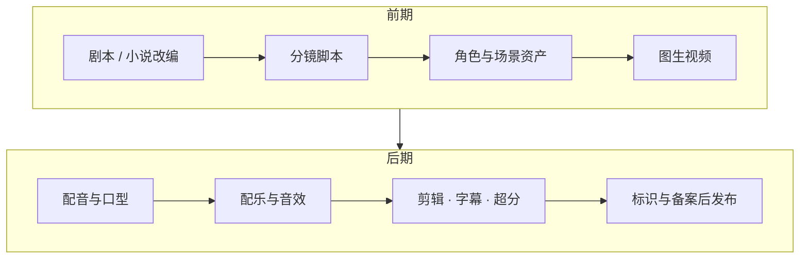

# Awesome AI Drama · AI 短剧 / 漫剧开源工具大全

   

**简体中文** | [English](README.en.md)

从剧本、分镜、角色一致性、视频生成、配音口型到剪辑和合规发布，AI 短剧与漫剧全流程的开源工具精选。每个项目都标注了星标数和最近更新时间，数据每周自动刷新、按热度重新排序。

## 为什么做这份清单

AI 漫剧已经是短剧的主力：[澎湃号的一篇文章](https://www.thepaper.cn/newsDetail_forward_33483129)援引中国网络视听协会的数据称，2026 年一季度全行业上线微短剧约 12.8 万部，其中 AI 微短剧约 12.2 万部。开源社区里相关项目也在爆发，但散落在各处、良莠不齐。这里把**真正能用、仍在维护**的项目按制作流程整理好，并附上国内发布前必须知道的合规规定。

## 制作流程一览

## 快速上手：选一条路线

| 路线 | 适合谁 | 推荐组合 |
|---|---|---|
| 零代码 | 想最快出片 | [即梦 AI](https://jimeng.jianying.com/) / [可灵 AI](https://kling.ai/) 出镜头 + [IndexTTS](https://github.com/index-tts/index-tts) 配音 + [VideoCaptioner](https://github.com/WEIFENG2333/VideoCaptioner) 字幕 |
| 一站式开源平台 | 想要完整工作台、可自部署 | [Toonflow](https://github.com/HBAI-Ltd/Toonflow-app) 或 [LocalMiniDrama](https://github.com/xuanyustudio/LocalMiniDrama)，接入自己的模型 Key |
| 全本地 | 有显卡、想控制每一步 | [ComfyUI](https://github.com/Comfy-Org/ComfyUI) + [Wan2.2](https://github.com/Wan-Video/Wan2.2) + [Qwen-Image](https://github.com/QwenLM/Qwen-Image) 做角色图 + [GPT-SoVITS](https://github.com/RVC-Boss/GPT-SoVITS) + [InfiniteTalk](https://github.com/MeiGen-AI/InfiniteTalk) 对口型 |
| Agent 工作流 | 用 Claude Code / Codex 写剧本分镜 | [shuohao-skills](https://github.com/eternityspring/shuohao-skills) 或 [drama-skills](https://github.com/zenstory-ai/drama-skills) 出剧本和分镜，再交给任意视频模型 |

## 目录

- [快速上手：选一条路线](#快速上手选一条路线)
- [一站式短剧 / 漫剧创作平台](#一站式短剧--漫剧创作平台)
- [Agent Skills（剧本 · 分镜 · 提示词）](#agent-skills剧本--分镜--提示词)
- [开源视频生成模型](#开源视频生成模型)
- [角色一致性与图像生成 / 编辑](#角色一致性与图像生成--编辑)
- [配音 / TTS / 声音克隆](#配音--tts--声音克隆)
- [口型同步与对话视频](#口型同步与对话视频)
- [配乐与音效](#配乐与音效)
- [剪辑、字幕与后期](#剪辑字幕与后期)
- [解说、推文与短视频二创](#解说推文与短视频二创)
- [ComfyUI 生态](#comfyui-生态)
- [提示词与案例库](#提示词与案例库)
- [商用模型与平台（非开源）](#商用模型与平台非开源)
- [合规与发布（中国大陆）](#合规与发布中国大陆)
- [相关合集](#相关合集)
- [参与贡献](#参与贡献)

图例：🆕 近 90 天内新建　💤 超过一年没有更新　⭐ 星标数（2026-11-09 更新）

## 一站式短剧 / 漫剧创作平台

从小说或一句话创意出发，串起剧本、角色资产、分镜、出图出视频和成片的开源工作台，多数支持本地部署和自选模型。

| 项目 | 说明 | ⭐ | 最近更新 |
|---|---|---:|---|
| [Toonflow-app](https://github.com/HBAI-Ltd/Toonflow-app) | 短剧、漫剧制作平台，无限画布 + AI Agent + 可视化工作流，覆盖剧本、分镜、角色场景资产与图像视频生成，支持本地部署、MCP 和插件。 | 21.1k | 2026-11 |
| [huobao-drama](https://github.com/chatfire-AI/huobao-drama) | 火宝短剧，一句话生成完整短剧，从剧本到成片全自动。 | 17.1k | 2026-11 |
| [dramaclaw](https://github.com/dramaclaw/dramaclaw) | 通用 AIGC 视频引擎，剧本到成片一条流水线，漫剧、广告、电商视频都能做。 | 7.5k | 2026-11 |
| [printfilm](https://github.com/yi1108/printfilm) 🆕 | AI 短视频营销与 AI 短剧创作平台。 | 7.4k | 2026-11 |
| [Jellyfish](https://github.com/Forget-C/Jellyfish) | 面向 AI 短剧的端到端生产工作台：剧本输入、结构化分镜、一致性管理、镜头准备、视频生成到导出。 | 7.1k | 2026-07 |
| [ArcReel](https://github.com/ArcReel/ArcReel) | Agent 驱动、可自部署的视频工作台，把小说和剧本转成角色、场景、道具资产、分镜、视频和剪映草稿，带跨镜头一致性和费用追踪。 | 6.3k | 2026-11 |
| [BigBanana-AI-Director](https://github.com/shuyu-labs/BigBanana-AI-Director) | 一站式 AI 短剧 / 漫剧导演平台，采用 Script-to-Asset-to-Keyframe 工作流控制角色一致性和镜头运动。 | 2.4k | 2026-11 |
| [LocalMiniDrama](https://github.com/xuanyustudio/LocalMiniDrama) | 本地运行的 AI 短剧 / 漫剧生成工具，故事 → 分镜 → 视频，数据不出本机，已接入 Seedance 2。 | 2.4k | 2026-11 |
| [ai_story](https://github.com/xhongc/ai_story) | AI 视频、AI 动漫、AI 短剧 / 漫剧自动化生成工具。 | 2.0k | 2026-10 |
| [AIComicBuilder](https://github.com/LingyiChen-AI/AIComicBuilder) | 把剧本变成动态漫画视频，含 AI 角色设计、分镜和视频合成。 | 2.0k | 2026-04 |
| [ai-fusion-video](https://github.com/Stonewuu/ai-fusion-video) | 融光，基于 Agent 的全流程 AI 短剧 / 漫剧 / 视频创作平台（Java + AgentScope）。 | 1.7k | 2026-11 |
| [LingGuo-Drama](https://github.com/LingGuoAI/LingGuo-Drama) | 灵果短剧 AI，一句话生成完整短剧或漫剧。 | 1.7k | 2026-08 |
| [lumenx](https://github.com/alibaba/lumenx) | 阿里开源的 LumenX Studio，把小说文本转成动态视频，打通剧本分析、角色定制、分镜绘制到视频合成。 | 1.5k | 2026-10 |
| [aid-studio](https://github.com/shijue-aid/aid-studio) | AI 漫剧、短剧、电影与漫画创作平台，支持剧本、角色场景、智能分镜、出图出视频、配音和成片预览，可自部署。 | 1.4k | 2026-10 |
| [StoryGen-Atelier](https://github.com/0xsline/StoryGen-Atelier) | 分镜与视频生成工具，用 Gemini 写分镜和出关键帧、Veo 生成过渡镜头、ffmpeg 拼接成片。 | 1.0k | 2026-09 |
| [TypeTale](https://github.com/TypeTale/TypeTale) | 字字动画，免费的 AIGC 视频生成软件，主打 AI 短剧、AI 电影和小说推文。 | 909 | 2026-08 |
| [wind-comic](https://github.com/ChrisChen667788/wind-comic) | 多 Agent 流水线，一行文字生成短剧：剧本、电影感分镜、角色一致的视频，模型供应商可替换。 | 707 | 2026-11 |
| [novanova-studio](https://github.com/Swayingleaves/novanova-studio) | Agent 驱动的全流程平台，集出图出视频、无限画布、小说转短剧、3D 导演台于一体。 | 702 | 2026-11 |
| [Nomi](https://github.com/aqm857886159/Nomi) | 本地优先的 AI 视频工作台，可接任意模型或本地 ComfyUI，让 Claude Code / Codex 通过 MCP 来执导，输出可编辑的时间线初剪。 | 634 | 2026-11 |
| [CineGen-ShortDrama](https://github.com/UllrAI/CineGen-ShortDrama) | AI 导演系统，生成漫剧、动漫、短剧、解说漫和动态漫。 | 571 | 2026-09 |
| [Open-AI-Micro-Drama-Generator](https://github.com/Anil-matcha/Open-AI-Micro-Drama-Generator) | 多 Agent 微短剧生成器，编剧 → 分镜 → 关键帧 → 视频。 | 569 | 2026-08 |
| [KomaSlate](https://github.com/xeronsh/KomaSlate) | 本地优先、非破坏性的 AI 分镜工作台，支持重拍镜头、版本对比和 FCPXML 导出。 | 413 | 2026-11 |
| [novelvids](https://github.com/Anning01/novelvids) | AI 漫剧与短剧创作工作台，覆盖故事创作、角色资产、分镜和出图出视频，支持本地部署。 | 362 | 2026-11 |
| [AI-Canvas-tauri](https://github.com/Tenney95/AI-Canvas-tauri) | 免费轻量的 AI 无限画布，支持短剧剧本、角色、分镜、出图出视频和剪辑，集成 ComfyUI、Agent、MCP。 | 343 | 2026-11 |
| [Kinema](https://github.com/chillzhuang/Kinema) 🆕 | 由 Codex、Claude Code 驱动的影像智能体，管理章节与分镜规划、角色场景道具资产，直到成片。 | 242 | 2026-09 |

## Agent Skills（剧本 · 分镜 · 提示词）

装进 Claude Code、Codex、DeepSeek Harness 等智能体就能用的技能包，适合已有出图出视频渠道、想让 AI 写剧本和分镜的人。

| 项目 | 说明 | ⭐ | 最近更新 |
|---|---|---:|---|
| [seedance-2.0](https://github.com/Emily2040/seedance-2.0) | 围绕 Seedance 2.0 的完整制作流程（剧本、分镜、提示词到成片）。 | 8.1k | 2026-10 |
| [shuohao-skills](https://github.com/eternityspring/shuohao-skills) | AI 短剧制作 Skill：拆角色、排大纲、出场景与道具设定、写剧本、切分镜。 | 6.3k | 2026-10 |
| [seedance2-skill](https://github.com/dexhunter/seedance2-skill) | 为 Seedance 2.0 写出高质量视频提示词的 Skill。 | 4.4k | 2026-09 |
| [drama-skills](https://github.com/zenstory-ai/drama-skills) | 小说改剧本、角色三视图、分镜脚本、生图生视频提示词和成片审片。 | 4.0k | 2026-11 |
| [seedance-prompt-skill](https://github.com/songguoxs/seedance-prompt-skill) | 生成 Seedance 2.0 视频提示词的 Skill。 | 3.0k | 2026-02 |
| [Seedance2-Storyboard-Generator](https://github.com/liangdabiao/Seedance2-Storyboard-Generator) | 把小说或故事转成多集视频剧本和分镜，针对 Seedance 2.0 设计。 | 2.8k | 2026-10 |
| [manju-laoli-skill](https://github.com/lixiaoxiao9888-create/manju-laoli-skill) 🆕 | 漫剧全流程套装：1 个总控 + 12 个子技能，覆盖素材、剧本、资产、分镜和质检。 | 2.0k | 2026-11 |
| [short-drama](https://github.com/0xsline/short-drama) | 短剧剧本创作 Skill，从选题立项、分集撰写到质量自检、合规审核和出海。 | 1.6k | 2026-04 |
| [ai-manju-skills](https://github.com/zhanghao123vip/ai-manju-skills) 🆕 | 21 个题材的 AI 漫剧全流程 Skill，一句点子生成企划、资产提示词、分集剧本、分镜和视频提示词。 | 630 | 2026-11 |
| [short-drama-factory](https://github.com/lixiaoxiao9888-create/short-drama-factory) | 面向抖音 / 红果的工业化短剧编剧系统，网文或创意改成 30 至 100 集剧本。 | 564 | 2026-10 |
| [screen-creative-skills](https://github.com/VanGong1999/screen-creative-skills) | 31 个影视策划与评估 Skill：IP 改编、题材提炼、人物小传、拉片分析、大纲生成。 | 501 | 2026-10 |
| [OnlyShot](https://github.com/A-cat-with-carrots/OnlyShot) | 一句话 → 剧本、分镜、分镜图、视频、剪辑五步出短剧，集成即梦 / Seedance。 | 399 | 2026-07 |
| [Micro-Drama-Skills](https://github.com/zhaihao118/Micro-Drama-Skills) | 用 Claude Skills 串起剧本、角色设计、分镜生成到视频提交的短剧自动化流程。 | 331 | 2026-02 |
| [story-shot-agent](https://github.com/neopen/story-shot-agent) | 剧本分镜智能体，把任意格式剧本拆成镜头片段并生成跨片段一致的视频提示词。 | 239 | 2026-11 |
| [Wan-skills](https://github.com/Wan-Video/Wan-skills) | 万相官方 Agent Skills，让智能体直接调用 Wan 的生成能力。 | 77 | 2026-04 |

## 开源视频生成模型

可以下载权重本地跑或接进 ComfyUI 的视频模型。显存不够时可以先用各自的云端 API 或 RunningHub 这类云端 ComfyUI。

| 项目 | 说明 | ⭐ | 最近更新 |
|---|---|---:|---|
| [Open-Sora](https://github.com/hpcaitech/Open-Sora) | Open-Sora，面向所有人的高效开源视频生成。 | 29.9k | 2026-04 |
| [Wan2.2](https://github.com/Wan-Video/Wan2.2) | 阿里万相 Wan2.2，开源大规模视频生成模型，文生视频、图生视频都支持。 | 18.5k | 2026-09 |
| [Wan2.1](https://github.com/Wan-Video/Wan2.1) | 万相 Wan2.1，上一代开源视频模型，社区工作流和 LoRA 资源丰富。 | 17.4k | 2026-03 |
| [FramePack](https://github.com/lllyasviel/FramePack) 💤 | 让视频扩散在消费级显卡上也能跑长视频的框架。 | 17.3k | 2025-10 |
| [CogVideo](https://github.com/zai-org/CogVideo) 💤 | 智谱 CogVideoX，文生视频和图生视频。 | 13.2k | 2025-11 |
| [HunyuanVideo](https://github.com/Tencent-Hunyuan/HunyuanVideo) | 腾讯混元视频生成框架。 | 12.7k | 2026-10 |
| [LTX-Video](https://github.com/Lightricks/LTX-Video) | LTX-Video，速度快的开源视频模型。 | 11.3k | 2026-11 |
| [LTX-2](https://github.com/Lightricks/LTX-2) | LTX-2 音视频联合生成模型，附 LoRA 训练工具。 | 10.2k | 2026-11 |
| [SkyReels-V2](https://github.com/SkyworkAI/SkyReels-V2) | 昆仑天工 SkyReels-V2，支持无限时长的影视级视频生成。 | 7.8k | 2026-01 |
| [HunyuanVideo-1.5](https://github.com/Tencent-Hunyuan/HunyuanVideo-1.5) | 混元视频 1.5，轻量版视频生成模型。 | 4.6k | 2026-04 |
| [MAGI-1](https://github.com/SandAI-org/MAGI-1) | 自回归大规模视频生成，可逐段续写。 | 3.8k | 2026-06 |
| [Helios](https://github.com/PKU-YuanGroup/Helios) | 实时长视频生成模型。 | 2.3k | 2026-11 |
| [HunyuanVideo-I2V](https://github.com/Tencent-Hunyuan/HunyuanVideo-I2V) | 基于混元视频的可定制图生视频模型。 | 1.9k | 2026-04 |
| [SkyReels-V3](https://github.com/SkyworkAI/SkyReels-V3) | SkyReels V3 多模态视频生成模型。 | 596 | 2026-01 |

## 角色一致性与图像生成 / 编辑

漫剧最头疼的是"同一个角色每张图都长得不一样"。先用这些模型做稳定的角色设定图和关键帧，再拿去图生视频。

| 项目 | 说明 | ⭐ | 最近更新 |
|---|---|---:|---|
| [flux](https://github.com/black-forest-labs/flux) 💤 | FLUX.1 系列模型的官方推理代码。 | 26.0k | 2025-07 |
| [InstantID](https://github.com/instantX-research/InstantID) 💤 | 一张照片零样本保持人物身份。 | 12.0k | 2024-07 |
| [Qwen-Image](https://github.com/QwenLM/Qwen-Image) | 通义千问图像模型，擅长复杂文字渲染和精确图像编辑，中文海报、字幕画面友好。 | 8.5k | 2026-02 |
| [IP-Adapter](https://github.com/tencent-ailab/IP-Adapter) 💤 | 用参考图做提示的适配器，常用于锁定角色或画风。 | 6.7k | 2024-06 |
| [OmniGen2](https://github.com/VectorSpaceLab/OmniGen2) | 统一的多模态生成与编辑模型。 | 4.1k | 2026-03 |
| [PuLID](https://github.com/ToTheBeginning/PuLID) 💤 | 快速的人物 ID 定制。 | 3.6k | 2025-07 |
| [UNO](https://github.com/bytedance/UNO) 💤 | 字节 UNO，单主体和多主体定制，适合多角色同框。 | 1.4k | 2025-09 |
| [USO](https://github.com/bytedance/USO) 💤 | 字节 USO，统一风格与主体驱动生成，可同时锁角色和画风。 | 1.2k | 2025-09 |

## 配音 / TTS / 声音克隆

给角色配音、做旁白。多角色对白可以重点看 MOSS-TTSD、VibeVoice 这类对话合成模型。

| 项目 | 说明 | ⭐ | 最近更新 |
|---|---|---:|---|
| [GPT-SoVITS](https://github.com/RVC-Boss/GPT-SoVITS) | 1 分钟语音就能训练出可用的声音模型，中文社区使用广泛。 | 64.6k | 2026-10 |
| [VibeVoice](https://github.com/microsoft/VibeVoice) | 微软开源语音模型，支持长篇多说话人语音合成。 | 56.8k | 2026-10 |
| [fish-speech](https://github.com/fishaudio/fish-speech) | Fish Speech 开源 TTS，中英日等多语言。 | 33.6k | 2026-11 |
| [index-tts](https://github.com/index-tts/index-tts) | B 站开源的 IndexTTS，工业级可控的零样本 TTS。 | 25.0k | 2026-09 |
| [CosyVoice](https://github.com/QwenAudio/CosyVoice) | 通义 CosyVoice 多语言语音生成，推理、训练、部署全套。 | 24.3k | 2026-05 |
| [F5-TTS](https://github.com/SWivid/F5-TTS) | 基于 Flow Matching 的零样本 TTS。 | 15.5k | 2026-11 |
| [Qwen3-TTS](https://github.com/QwenLM/Qwen3-TTS) | 通义 Qwen3-TTS，支持流式合成、自由描述音色设计和声音克隆。 | 14.3k | 2026-03 |
| [Spark-TTS](https://github.com/SparkAudio/Spark-TTS) 💤 | Spark-TTS 中英双语 TTS 与声音克隆。 | 11.0k | 2025-04 |
| [higgs-audio](https://github.com/boson-ai/higgs-audio) | Boson AI 的文本-音频基础模型，表现力强。 | 8.4k | 2026-06 |
| [MegaTTS3](https://github.com/bytedance/MegaTTS3) | 字节 MegaTTS 3，中英零样本语音合成。 | 6.1k | 2026-06 |
| [MOSS-TTSD](https://github.com/OpenMOSS/MOSS-TTSD) | 多说话人长对话合成，零样本克隆，适合角色对白。 | 1.4k | 2026-09 |

## 口型同步与对话视频

让角色张嘴说台词。InfiniteTalk / MultiTalk 支持长时长和多人对话，LivePortrait 适合表情驱动。

| 项目 | 说明 | ⭐ | 最近更新 |
|---|---|---:|---|
| [LivePortrait](https://github.com/KlingAIResearch/LivePortrait) | 可灵团队的 LivePortrait，让静态人像动起来、驱动表情。 | 19.4k | 2026-06 |
| [Wav2Lip](https://github.com/Rudrabha/Wav2Lip) 💤 | 经典的口型同步模型，生态成熟（较老，适合入门）。 | 13.3k | 2025-06 |
| [InfiniteTalk](https://github.com/MeiGen-AI/InfiniteTalk) | 不限时长的说话视频生成，支持图生视频和视频生视频。 | 8.4k | 2026-05 |
| [MuseTalk](https://github.com/TMElyralab/MuseTalk) 💤 | 实时高质量口型同步。 | 6.9k | 2025-09 |
| [LatentSync](https://github.com/bytedance/LatentSync) 💤 | 字节 LatentSync，基于扩散模型的口型同步。 | 6.3k | 2025-06 |
| [Sonic](https://github.com/jixiaozhong/Sonic) | 关注全局音频感知的人像动画。 | 3.3k | 2026-01 |
| [MultiTalk](https://github.com/MeiGen-AI/MultiTalk) | 音频驱动的多人对话视频生成。 | 3.0k | 2026-05 |
| [HunyuanVideo-Avatar](https://github.com/Tencent-Hunyuan/HunyuanVideo-Avatar) | 混元视频数字人，音频驱动的多角色动画。 | 2.2k | 2025-12 |
| [fantasy-talking](https://github.com/Fantasy-AMAP/fantasy-talking) | 动作连贯的说话人像生成。 | 1.6k | 2026-01 |
| [hallo3](https://github.com/fudan-generative-vision/hallo3) 💤 | 基于视频 DiT 的高动态人像动画。 | 1.4k | 2025-03 |
| [echomimic_v3](https://github.com/antgroup/echomimic_v3) | 蚂蚁 EchoMimic V3，1.3B 参数的多模态人体动画。 | 1.1k | 2026-03 |

## 配乐与音效

背景音乐、主题曲和拟音音效。MMAudio、HunyuanVideo-Foley、ThinkSound 可以直接根据画面生成音效。

| 项目 | 说明 | ⭐ | 最近更新 |
|---|---|---:|---|
| [ACE-Step-1.5](https://github.com/ace-step/ACE-Step-1.5) | 本地音乐生成模型，支持 Mac、AMD、Intel 和 CUDA。 | 14.5k | 2026-11 |
| [YuE](https://github.com/multimodal-art-projection/YuE) | YuE 完整歌曲生成，支持翻唱和音乐编辑。 | 13.2k | 2026-11 |
| [ace-step-ui](https://github.com/fspecii/ace-step-ui) | ACE-Step 1.5 的图形界面，免费本地生成音乐。 | 5.2k | 2026-06 |
| [heartlib](https://github.com/HeartMuLa/heartlib) | HeartMuLa 开源音乐生成模型。 | 3.8k | 2026-10 |
| [DiffRhythm](https://github.com/ASLP-lab/DiffRhythm) | 快速的端到端整首歌曲生成。 | 2.4k | 2025-11 |
| [MMAudio](https://github.com/hkchengrex/MMAudio) | 根据视频生成匹配的音频。 | 2.3k | 2026-02 |
| [ThinkSound](https://github.com/QwenAudio/ThinkSound) | 通义 ThinkSound，用思维链从任意模态生成音频，可给画面配音效。 | 1.4k | 2026-04 |
| [HunyuanVideo-Foley](https://github.com/Tencent-Hunyuan/HunyuanVideo-Foley) 💤 | 混元视频拟音，给画面配高保真音效。 | 1.1k | 2025-09 |

## 剪辑、字幕与后期

出片以后的最后一公里：识别字幕、翻译出海、超分辨率、补帧和剪辑。

| 项目 | 说明 | ⭐ | 最近更新 |
|---|---|---:|---|
| [Real-ESRGAN](https://github.com/xinntao/Real-ESRGAN) 💤 | 通用的图像 / 视频超分辨率修复（较老，仍很常用）。 | 37.4k | 2024-08 |
| [faster-whisper](https://github.com/SYSTRAN/faster-whisper) | 更快的 Whisper 语音识别，做字幕的基础组件。 | 26.6k | 2026-11 |
| [whisperX](https://github.com/m-bain/whisperX) | 带词级时间戳和说话人分离的语音识别。 | 25.2k | 2026-10 |
| [video2x](https://github.com/k4yt3x/video2x) | 基于机器学习的视频超分和补帧。 | 22.7k | 2026-03 |
| [pyvideotrans](https://github.com/jianchang512/pyvideotrans) | 视频翻译，自动配音并嵌入字幕，适合短剧出海。 | 19.7k | 2026-11 |
| [VideoLingo](https://github.com/Huanshere/VideoLingo) | Netflix 级字幕切分、翻译、对齐，还能配音，一键全自动。 | 19.1k | 2026-09 |
| [Waifu2x-Extension-GUI](https://github.com/AaronFeng753/Waifu2x-Extension-GUI) | 视频 / 图片 / GIF 超分和补帧图形工具，集成 Real-ESRGAN、Real-CUGAN、RIFE 等，动漫画面效果好。 | 17.2k | 2026-11 |
| [VideoCaptioner](https://github.com/WEIFENG2333/VideoCaptioner) | 卡卡字幕助手，基于大模型做字幕生成、断句、校正和翻译。 | 16.5k | 2026-09 |
| [shotcut](https://github.com/mltframework/shotcut) | 跨平台开源视频剪辑软件。 | 15.6k | 2026-11 |
| [SmartSub](https://github.com/buxuku/SmartSub) | 视频转字幕、翻译、AI 配音与声音克隆、字幕烧录的一站式桌面工具。 | 6.0k | 2026-11 |
| [SeedVR](https://github.com/ByteDance-Seed/SeedVR) | 字节 SeedVR / SeedVR2，基于扩散模型的视频修复和超分。 | 1.4k | 2026-01 |
| [Practical-RIFE](https://github.com/hzwer/Practical-RIFE) | 实用的视频补帧，提升流畅度。 | 1.0k | 2026-08 |

## 解说、推文与短视频二创

不做完整剧情，而是做影视解说、小说推文、高光切片的路线。

| 项目 | 说明 | ⭐ | 最近更新 |
|---|---|---:|---|
| [MoneyPrinterTurbo](https://github.com/harry0703/MoneyPrinterTurbo) | 输入主题或关键词，一键生成高清短视频。 | 141.1k | 2026-11 |
| [NarratoAI](https://github.com/linyqh/NarratoAI) | 用大模型一键生成解说并剪辑视频，适合影视和短剧解说。 | 11.7k | 2026-10 |
| [YouDub-webui](https://github.com/liuzhao1225/YouDub-webui) | 视频翻译配音：语音识别、字幕翻译、声音克隆、混音渲染。 | 5.8k | 2026-11 |
| [dramaxis](https://github.com/Agions/dramaxis) | 剧枢，多智能体影视叙事与解说平台，可与剪映草稿互通。 | 457 | 2026-10 |
| [AI_novel](https://github.com/tyxben/AI_novel) | 小说一键转短视频（有声书 + AI 配图），适用于抖音 / 小红书。 | 266 | 2026-08 |

## ComfyUI 生态

本地方案的核心。大多数开源视频、配音、口型模型都有 ComfyUI 节点。

| 项目 | 说明 | ⭐ | 最近更新 |
|---|---|---:|---|
| [ComfyUI](https://github.com/Comfy-Org/ComfyUI) | 节点式扩散模型界面与后端，本地 AIGC 的事实标准。 | 145.8k | 2026-11 |
| [ComfyUI-WanVideoWrapper](https://github.com/kijai/ComfyUI-WanVideoWrapper) | 在 ComfyUI 里使用万相等视频模型的封装节点。 | 6.8k | 2026-05 |
| [ComfyUI-LivePortraitKJ](https://github.com/kijai/ComfyUI-LivePortraitKJ) 💤 | LivePortrait 的 ComfyUI 节点。 | 2.2k | 2024-08 |
| [ComfyUI-VideoHelperSuite](https://github.com/Kosinkadink/ComfyUI-VideoHelperSuite) | 视频加载、合成、导出等常用视频节点。 | 1.9k | 2026-09 |
| [ComfyUI-Frame-Interpolation](https://github.com/Fannovel16/ComfyUI-Frame-Interpolation) | ComfyUI 补帧节点。 | 1.1k | 2026-03 |
| [comfyui-AICG3D](https://github.com/JGRFW/comfyui-AICG3D) 🆕 | ComfyUI 本地短剧工作台插件，支持长视频生成。 | 483 | 2026-11 |

## 提示词与案例库

抄作业专区。

| 项目 | 说明 | ⭐ | 最近更新 |
|---|---|---:|---|
| [awesome-image-video-prompts](https://github.com/ai-boost/awesome-image-video-prompts) | 主流图像 / 视频模型的可复制提示词，附真实输出和出处。 | 3.5k | 2026-11 |
| [ZeroLu/awesome-seedance](https://github.com/ZeroLu/awesome-seedance) | Seedance 2.0 高质量提示词与资源，覆盖电影、动漫、广告等场景。 | 2.8k | 2026-11 |
| [LearnPrompt/awesome-seedance](https://github.com/LearnPrompt/awesome-seedance) 🆕 | 有出处可查的 Seedance 提示词库，带跨模型复测和模板，中英日三语。 | 2.5k | 2026-11 |

## 商用模型与平台（非开源）

不想折腾本地部署时最快的出片方式。功能和价格变化快，以官网为准。

| 平台 | 说明 |
|---|---|
| [即梦 AI](https://jimeng.jianying.com/) | 字节跳动出品，集成 Seedream 生图和 Seedance 视频模型。 |
| [可灵 AI](https://kling.ai/) | 快手出品的视频生成平台。 |
| [海螺 AI](https://hailuoai.com/) | MiniMax 出品，以视频生成为核心。 |
| [Vidu](https://www.vidu.cn/) | 生数科技出品，支持参考生视频、文生视频和图生视频。 |
| [万相（阿里云百炼 API）](https://help.aliyun.com/zh/model-studio/video-generate-edit-model/) | 阿里万相视频模型的官方 API，含文生视频、图生视频、参考生视频、视频编辑和数字人。 |
| [PixVerse](https://pixverse.ai/) | 爱诗科技出品的视频生成平台。 |
| [RunningHub](https://www.runninghub.ai/) | 云端 ComfyUI，不用本地显卡也能跑开源视频工作流，可通过 API 调用。 |

## 合规与发布（中国大陆）

> 以下为公开规定的摘要，方便快速了解，不构成法律意见。具体要求以原文和平台规则为准。

- **[《人工智能生成合成内容标识办法》](https://www.cac.gov.cn/2025-03/14/c_1743654684782215.htm)**：国家网信办等四部门发布，2025 年 9 月 1 日起施行。AI 生成的视频、音频需要添加显式标识和元数据隐式标识，不得恶意删除或篡改标识。
- **[《微短剧发展管理办法》（国家广播电视总局令第 16 号）](https://www.news.cn/legal/20260731/4b8eea40226644d0a347c72ea1b21b75/c.html)**：2026 年 9 月 1 日起施行，按投资额度、题材把微短剧分为三类，分类实行备案公示和发行许可。
- **[《管理提示（AI 微短剧分类分层标准）》](https://m.163.com/dy/article/L0B868QC053469RG.html)**：广电总局网络视听司 2026 年 6 月 25 日发布、7 月 1 日起施行：投资 80 万元及以上或涉及特殊题材为"重点"，30 至 80 万元一般题材为"普通"，不足 30 万元一般题材为"其他"。（链接为央视新闻稿件转载）

## 相关合集

| 项目 | 说明 | ⭐ | 最近更新 |
|---|---|---:|---|
| [awesome-short-drama-skills](https://github.com/UnderleveledBuilder/awesome-short-drama-skills) 🆕 | AI 短剧 · 漫剧 Skill 精选（只收技能包）。 | 2.0k | 2026-11 |
| [awesome-ai-media-cn](https://github.com/JuneYaooo/awesome-ai-media-cn) | AI 视频制作与自媒体运营工具合集。 | 370 | 2026-11 |
| [awesome-ai-video](https://github.com/zhaotoday/awesome-ai-video) 🆕 | AI 视频生产资源索引。 | 49 | 2026-11 |

## 参与贡献

欢迎推荐项目或纠错：[提交 Issue](https://github.com/DU8866-nice/awesome-ai-drama/issues/new/choose)，或者修改 [`data/tools.yaml`](data/tools.yaml) 后提 PR，详见 [贡献指南](CONTRIBUTING.md)。README 由脚本生成，请不要直接改它。

## Star 趋势

## 许可

[CC0 1.0](LICENSE)：本清单内容放弃版权，可自由使用。各项目的许可证以其仓库为准。
