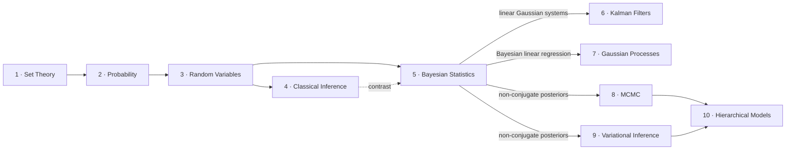

<div align="center">

# Bayesian Modelling — Handwritten Lecture Notes

**Lecture notes and code for the *Bayesian Modelling* course of the
[Doctorado en Inteligencia Artificial](https://doctoradoia.cl/) (PhD in Artificial Intelligence), Chile**

by [**Daniel Uzcategui**](https://doctoradoia.cl/cuerpo-academico/daniel-uzcategui/), PhD in Physics

[](#about)
[](#course-map)
[](#course-map)
[](#code)
[](https://www.pymc.io/)
[](#code)
[](NOTES_LICENSE.md)
[](LICENSE)


</div>

---

## About

> [!NOTE]
> **The course is in progress.** New lectures, notebooks and corrections are added as
> they are taught. Star or watch the repository to follow along.

These are the notes I wrote by hand, on an iPad, while preparing and teaching
**Bayesian Modelling** for the *Doctorado en Inteligencia Artificial*
([my profile](https://doctoradoia.cl/cuerpo-academico/daniel-uzcategui/)).

The notebooks also work as an **introduction to probabilistic inference in JAX**:
Hamiltonian Monte Carlo and variational inference are written from scratch, with
gradients from `jax.grad` and speed from `jit` and `vmap`, without a probabilistic
programming library. Then the same ideas are used through PyMC, up to
hierarchical models.

The course goes from the foundations (sets, probability, random variables) to
the tools used in modern probabilistic machine learning: conjugate models,
Kalman filtering, Gaussian processes, MCMC, variational inference and
hierarchical models.

## Course map

| # | Lecture | Highlights | Notes | Code |
|:-:|---|---|:-:|:-:|
| 1 | **Set Theory** | sets, subsets, power sets, Cartesian products, set identities, De Morgan | [PDF](lecture01_set_theory/lecture01_set_theory.pdf) · 24 pp · [typeset](lecture01_set_theory/lecture01_set_theory_typeset.pdf) | — |
| 2 | **Probability** | axioms, interpretations of probability, counting, independence, conditional probability, total probability, Bayes' theorem | [PDF](lecture02_probability/lecture02_probability.pdf) · 35 pp · [typeset](lecture02_probability/lecture02_probability_typeset.pdf) | — |
| 3 | **Random Variables** | PMF/PDF/CDF, Bernoulli → Poisson (derived from first principles), exponential, normal, joint and conditional distributions, expectation, variance, covariance | [PDF](lecture03_random_variables/lecture03_random_variables.pdf) · 64 pp · [typeset](lecture03_random_variables/lecture03_random_variables_typeset.pdf) | — |
| 4 | **Classical Inference** | maximum likelihood, confidence intervals, hypothesis testing | [PDF](lecture04_classical_inference/lecture04_classical_inference.pdf) · 14 pp · [typeset](lecture04_classical_inference/lecture04_classical_inference_typeset.pdf) | — |
| 5 | **Bayesian Statistics** | posterior and predictive distributions, Beta–Binomial, Gaussian–Gaussian, Normal–Inv-χ², exponential family, multivariate normal, linear Gaussian systems, model selection | [PDF](lecture05_bayesian_statistics/lecture05_bayesian_statistics.pdf) · 67 pp | [1 notebook](lecture05_bayesian_statistics/code) |
| 6 | **Kalman Filters** | state-space models, Bayesian filtering equations, full Kalman derivation (Woodbury identity), forecasting | [PDF](lecture06_kalman_filters/lecture06_kalman_filters.pdf) · 18 pp | [1 notebook](lecture06_kalman_filters/code) |
| 7 | **Gaussian Processes** | Bayesian linear regression, GP prior and posterior, prediction at new inputs, kernels | [PDF](lecture07_gaussian_processes/lecture07_gaussian_processes.pdf) · 17 pp | [1 notebook](lecture07_gaussian_processes/code) |
| 8 | **Markov Chain Monte Carlo** | sampling instead of integrating, Metropolis–Hastings and detailed balance, Hamiltonian Monte Carlo, leapfrog, Gelman–Rubin R̂ | [PDF](lecture08_mcmc/lecture08_mcmc.pdf) · 20 pp | [3 notebooks](lecture08_mcmc/code) |
| 9 | **Variational Inference** | KL divergence, ELBO via Jensen, mean-field VI, ADVI, score-function gradients | [PDF](lecture09_variational_inference/lecture09_variational_inference.pdf) · 11 pp | [1 notebook](lecture09_variational_inference/code) |
| 10 | **Hierarchical Models** | complete, no and partial pooling, plate diagrams, the eight-schools model | [PDF](lecture10_hierarchical_models/lecture10_hierarchical_models.pdf) · 10 pp | [1 notebook](lecture10_hierarchical_models/code) |

Lectures 1–4 also have a typeset LaTeX version, with its source in each folder's `latex/`. Each lecture folder has its own README with a short outline and a description of its notebooks.

## How the lectures connect



## Code

| Lecture | Notebook | What it does |
|---|---|---|
| 5 | [`gaussian_2d_inference`](lecture05_bayesian_statistics/code/gaussian_2d_inference.ipynb) | Posterior of a 2D Gaussian mean with known Σ, as a special case of a linear Gaussian system (Iris *setosa* data) |
| 6 | [`nile_kalman`](lecture06_kalman_filters/code/nile_kalman.ipynb) | Local-level Kalman filter for the annual flow of the Nile |
| 7 | [`gp_linear_and_nonlinear`](lecture07_gaussian_processes/code/gp_linear_and_nonlinear.ipynb) | GP regression: a linear kernel reproduces Bayesian linear regression, then a Gaussian kernel fits a nonlinear function |
| 8 | [`metropolis_hastings`](lecture08_mcmc/code/metropolis_hastings.ipynb) | Inverse-CDF and Cholesky sampling, then Metropolis–Hastings on a banana-shaped target |
| 8 | [`hmc`](lecture08_mcmc/code/hmc.ipynb) | Hamiltonian Monte Carlo from scratch, with gradients from JAX |
| 8 | [`intro_pymc`](lecture08_mcmc/code/intro_pymc.ipynb) | First PyMC model: NUTS samples checked against the closed-form Gaussian posterior |
| 9 | [`variational_inference`](lecture09_variational_inference/code/variational_inference.ipynb) | Variational inference written from scratch in JAX: a Gaussian-mixture family fitted to a banana posterior by maximizing a Monte Carlo ELBO |
| 10 | [`hierarchical_model`](lecture10_hierarchical_models/code/hierarchical_model.ipynb) | Eight-schools hierarchical model in PyMC (non-centred), MCMC compared with ADVI |

The notebooks are saved with their outputs, so plots and results show on GitHub without running anything.

### Run them locally

```bash
git clone https://github.com/Danuzco/bayesian-modelling-notes.git
cd bayesian-modelling-notes
conda env create -f environment.yml
conda activate bayesian-modelling
jupyter lab
```

Or with pip: `pip install -r requirements.txt`.

## Repository layout

```
bayesian-modelling-notes/
├── lecture01_set_theory/
│   ├── lecture01_set_theory.pdf      # handwritten notes
│   ├── lecture01_set_theory_typeset.pdf  # typeset version (Lectures 1–4)
│   ├── latex/                        # LaTeX source of the typeset version
│   └── README.md                     # outline of the lecture
├── ...
├── lecture05_bayesian_statistics/
│   ├── lecture05_bayesian_statistics.pdf
│   ├── README.md
│   └── code/                         # notebooks for this lecture
├── ...
├── environment.yml / requirements.txt
├── LICENSE                           # MIT, for the code
└── NOTES_LICENSE.md                  # CC BY 4.0, for the notes
```

## A note on the notes

These are working notes written during the course, not a polished textbook.
Some sections end early and a few pages mix in Spanish, the language the course is
taught in. If you find a mistake, please
[open an issue](../../issues). Corrections are welcome.

## License and citation

- **Notes** (PDFs): [Creative Commons Attribution 4.0](NOTES_LICENSE.md). You can share and adapt them with credit.
- **Code** (notebooks): [MIT](LICENSE).

If these notes help your teaching or research, you can cite them with the
**"Cite this repository"** button on GitHub (see [`CITATION.cff`](CITATION.cff)),
or with this BibTeX entry (also in [`CITATION.bib`](CITATION.bib)):

```bibtex
@misc{uzcategui2026bayesian,
  author       = {Uzcategui, Daniel},
  title        = {{Bayesian Modelling: Handwritten Lecture Notes}},
  year         = {2026},
  howpublished = {GitHub repository},
  url          = {https://github.com/Danuzco/bayesian-modelling-notes},
  note         = {Lecture notes and Jupyter notebooks for the Bayesian Modelling course of the Doctorado en Inteligencia Artificial, Chile}
}
```
