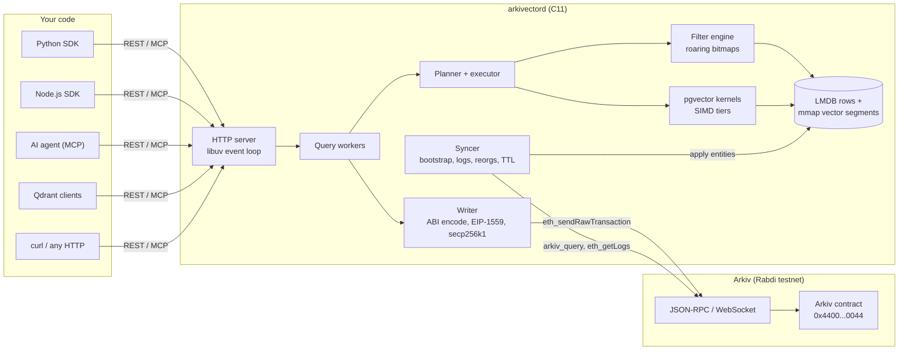
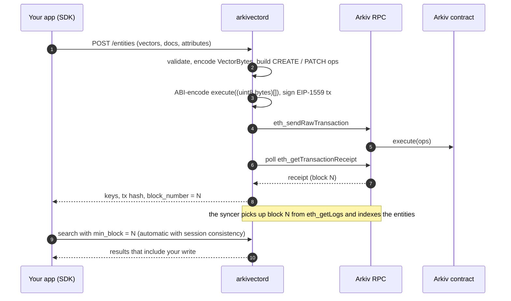

# Arkivector


**pgvector for Arkiv.** Semantic search over data that lives on a decentralized chain, with pgvector's own distance math, behind one REST call.

**[Website](https://arkivector.dikshitrj.in)** · **[Documentation](https://arkivector.dikshitrj.in/docs)** · [Wiki](https://github.com/DikshitRJ/arkivector/wiki) · [Releases](https://github.com/DikshitRJ/arkivector/releases)

[](https://github.com/DikshitRJ/arkivector/releases)
[](https://pypi.org/project/arkivector/)
[](https://github.com/DikshitRJ/arkivector/pkgs/container/arkivectord)
[](LICENSE)
[](https://arkivector.dikshitrj.in/docs)

Most RAG pipelines keep their embeddings in a hosted vector database: a company's servers, a company's pricing page, a company's terms of service. Arkivector stores your vectors on [Arkiv](https://arkiv.network), a chain where data is owned by a wallet, and gives you the similarity search you already know from pgvector on top of it.

```python
hits = client.search("agent.memory", vector=embed("what did the user say about refunds?"), k=5)
```

That query runs against vectors that were written to a blockchain. Nobody can delete them behind your back, and nobody bills you per million dimensions.

## Contents

- [Documentation](#documentation)
- [Why this exists](#why-this-exists)
- [What you get](#what-you-get)
- [Quick start](#quick-start)
  - [1. Run the daemon](#1-run-the-daemon)
  - [2. Give it a wallet](#2-give-it-a-wallet)
  - [3. Install an SDK](#3-install-an-sdk)
  - [4. Store and search](#4-store-and-search)
- [How it works](#how-it-works)
  - [Architecture](#architecture)
  - [What happens on a write](#what-happens-on-a-write)
  - [What happens on a search](#what-happens-on-a-search)
  - [How vectors are stored on chain](#how-vectors-are-stored-on-chain)
- [The math, borrowed from pgvector](#the-math-borrowed-from-pgvector)
- [Why C](#why-c)
- [Configuration reference](#configuration-reference)
- [Limitations and what comes next](#limitations-and-what-comes-next)
- [Repository layout](#repository-layout)
- [Acknowledgements](#acknowledgements)
- [AI disclosure](#ai-disclosure)
- [License](#license)

## Documentation

The full documentation lives in [`docs/wiki/`](docs/wiki/README.md), one Markdown page per topic. The same files are rendered at **[arkivector.dikshitrj.in/docs](https://arkivector.dikshitrj.in/docs)** and published to the [GitHub wiki](https://github.com/DikshitRJ/arkivector/wiki) on every push to `main`.

| Section | Pages |
| :--- | :--- |
| Getting started | [Install and get started](docs/wiki/install.md) · [Quick start](docs/wiki/getting-started/quickstart.md) · [Concepts](docs/wiki/getting-started/concepts.md) · [Configuration](docs/wiki/getting-started/configuration.md) · [Signing writes](docs/wiki/getting-started/signing.md) |
| REST API (curl) | [Overview](docs/wiki/api/README.md) · [Health and version](docs/wiki/api/health.md) · [Collections](docs/wiki/api/collections.md) · [Upsert](docs/wiki/api/entities-upsert.md) · [Get](docs/wiki/api/entities-get.md) · [Delete and extend](docs/wiki/api/entities-delete-extend.md) · [Prepare](docs/wiki/api/entities-prepare.md) · [Submit](docs/wiki/api/entities-submit.md) · [Search](docs/wiki/api/search.md) · [Batch search](docs/wiki/api/search-batch.md) · [Scroll](docs/wiki/api/scroll.md) · [Count](docs/wiki/api/count.md) · [Filters](docs/wiki/api/filters.md) · [Vectors](docs/wiki/api/vectors.md) · [Consistency](docs/wiki/api/consistency.md) · [Errors](docs/wiki/api/errors.md) · [Qdrant](docs/wiki/api/qdrant.md) |
| Python SDK | [Overview](docs/wiki/python/README.md) · [Client](docs/wiki/python/client.md) · [Collections](docs/wiki/python/collections.md) · [Writing](docs/wiki/python/writing.md) · [Searching](docs/wiki/python/searching.md) · [Reading](docs/wiki/python/reading.md) · [Filters](docs/wiki/python/filters.md) · [Types](docs/wiki/python/types.md) · [Errors](docs/wiki/python/errors.md) · [LangChain and LlamaIndex](docs/wiki/python/integrations.md) |
| Node.js SDK | [Overview](docs/wiki/node/README.md) · [Client](docs/wiki/node/client.md) · [Collections](docs/wiki/node/collections.md) · [Writing](docs/wiki/node/writing.md) · [Searching](docs/wiki/node/searching.md) · [Reading](docs/wiki/node/reading.md) · [Filters](docs/wiki/node/filters.md) · [Types](docs/wiki/node/types.md) · [Errors](docs/wiki/node/errors.md) · [LangChain.js](docs/wiki/node/integrations.md) |
| MCP server | [Overview](docs/wiki/mcp/README.md) · [Connect a client](docs/wiki/mcp/setup.md) · [Tools](docs/wiki/mcp/tools.md) |
| Architecture | [Overview](docs/wiki/architecture/README.md) · [Chain sync](docs/wiki/architecture/sync.md) · [Storage](docs/wiki/architecture/storage.md) · [Search and HNSW](docs/wiki/architecture/search.md) · [Write path](docs/wiki/architecture/write-path.md) · [pgvector inside the daemon](docs/wiki/architecture/pgvector.md) · [VectorBytes](docs/wiki/architecture/vectorbytes.md) |
| Operations | [Deployment](docs/wiki/operations/deployment.md) · [Security](docs/wiki/operations/security.md) · [Monitoring](docs/wiki/operations/monitoring.md) · [Troubleshooting](docs/wiki/operations/troubleshooting.md) |
| Development | [Contributing](docs/wiki/development/README.md) · [Testing](docs/wiki/development/testing.md) · [Releasing](docs/wiki/development/releasing.md) |

The formal API contract is [`spec/openapi.yaml`](spec/openapi.yaml), with field-level rules in [`docs/api/`](docs/api/). The design rationale is in [`ARCHITECTURE.md`](ARCHITECTURE.md).

## Why this exists

[pgvector](https://github.com/pgvector/pgvector) is the reason "just use Postgres" became an acceptable answer to "where do I put my embeddings?". It is a Postgres extension with more than 23,000 GitHub stars that adds vector types and similarity search to the database you already run. You write `ORDER BY embedding <=> $1 LIMIT 5` and your RAG pipeline has retrieval, without adding a service or learning a new query language. That simplicity is why it sits underneath a large share of today's agent and RAG stacks.

[Arkiv](https://arkiv.network) is roughly "SQL on web3": a chain built for data, where entities have typed attributes, an owner, and an expiry, and you query them with a filter language instead of decoding raw contract storage. It is a natural home for agent memory, shared knowledge bases, and anything you would rather not hand to a single provider.

What Arkiv did not have was vector search. You could store an embedding as bytes, but you could not ask "which entities are closest to this one?". So I wrote a vector search engine for it, and instead of reinventing the math, I built it from pgvector's own source code.

## What you get

- Similarity search over Arkiv entities with all four pgvector types (`vector`, `halfvec`, `sparsevec`, `bit`) and all six pgvector distance operators.
- pgvector's HNSW index for large collections, with pgvector 0.8's iterative scans for filtered queries, and an exact scan whenever that is faster or you ask for 100% recall.
- Results that match real pgvector. A parity suite runs 97 tests against pgvector 0.8.7 in Postgres and checks that every distance is bit-identical or within float32 rounding.
- Filters on typed attributes, as a JSON tree or as Arkiv-style `where` strings, combined with vector search in one request.
- Writes that go on chain. The daemon builds, signs, and submits the Arkiv transaction, waits for the receipt, then indexes the entity when it syncs back.
- Read-your-writes consistency. Every response carries the block it reflects (`as_of_block`), and the SDKs can wait for the block of your last write before reading.
- SDKs for Python and Node.js, an [MCP server](#use-it-from-an-ai-agent-mcp) so AI agents can search and store memories, and a Qdrant-compatible search subset.
- One small daemon: an 18 MB container image or a single Linux binary.

## Quick start

You need three things: the daemon (`arkivectord`), a funded Arkiv wallet if you want to write, and an SDK.

### 1. Run the daemon

#### Docker (any OS, recommended)

Pull the image from GitHub Container Registry and run it in the background:

```bash
read -rs ARKIV_PRIVATE_KEY && export ARKIV_PRIVATE_KEY   # paste the wallet key: not echoed, not saved in shell history
docker run -d --name arkivectord \
  -p 127.0.0.1:8080:8080 \
  -v arkivector-data:/data \
  -e ARKIVECTOR_ARKIV_ACCESS_KEY="<your Arkiv Hub access key>" \
  -e ARKIV_PRIVATE_KEY \
  ghcr.io/dikshitrj/arkivectord:latest

curl http://127.0.0.1:8080/healthz      # {"status":"ok"}
```

The daemon now listens on `http://127.0.0.1:8080` and syncs from the Arkiv Rabdi testnet. Your index lives in the `arkivector-data` volume and survives restarts.

#### Linux x86_64, prebuilt binary

Download the latest release and run it:

```bash
VERSION=$(curl -fsSLI -o /dev/null -w '%{url_effective}' https://github.com/DikshitRJ/arkivector/releases/latest | sed 's|.*/tag/v||')   # latest release
curl -LO https://github.com/DikshitRJ/arkivector/releases/download/v${VERSION}/arkivectord-${VERSION}-linux-x86_64.tar.gz
tar xzf arkivectord-${VERSION}-linux-x86_64.tar.gz
cd arkivectord-${VERSION}-linux-x86_64

export ARKIVECTOR_ARKIV_ACCESS_KEY="<your Arkiv Hub access key>"
read -rs ARKIV_PRIVATE_KEY && export ARKIV_PRIVATE_KEY   # paste the wallet key: not echoed, not saved in shell history
export ARKIVECTOR_STORAGE_DATA_DIR="$HOME/.local/share/arkivector"

./bin/arkivectord --config arkivector.example.toml
```

libcurl is bundled in the tarball. You need libuv and OpenSSL 3 from your distribution (`apt install libuv1 libssl3`, `dnf install libuv openssl`, and so on).

The daemon needs libcurl 8.11 or newer for WebSocket support. If your distribution ships something older, `daemon/tools/ci-install-curl.sh` builds a current one.

### 2. Give it a wallet

Reading works without a wallet. Writing means sending Arkiv transactions, and those need a signer and a bit of gas. The signer can be the daemon (below), or each of your users' own wallets (MetaMask, a hardware wallet, `eth_account`, viem, ethers, a KMS), in which case the daemon needs no key at all: see [Signing writes](docs/wiki/getting-started/signing.md).

1. Create a fresh EVM wallet for the daemon (MetaMask, Rabby, or anything that can export a private key). Don't reuse the wallet that holds your savings.
2. Get free test GLM from the faucet: <https://hub.arkiv.network/faucet>.
3. Create an access key at <https://hub.arkiv.network/access-keys> (sign in with the wallet and pick Rabdi). Without one you share Arkiv's public pool, which is throttled hard.
4. Pass both to the daemon as environment variables:

| Variable | Required | What it does |
| :--- | :--- | :--- |
| `ARKIV_PRIVATE_KEY` | For managed writes | Hex private key that signs transactions (`0x` prefix optional). Without it the daemon can't sign, but it still relays writes signed by your users' wallets. Keep it out of config files and shell history; in production prefer an encrypted keystore or a remote signer (`[write.signer]`). |
| `ARKIVECTOR_ARKIV_ACCESS_KEY` | Recommended | Your Arkiv Hub access key, so you are not on the throttled public pool. |
| `ARKIVECTOR_STORAGE_DATA_DIR` | Binary only | Where the local index lives. The Docker image uses `/data`. |
| `ARKIVECTOR_URL` | SDKs | Where the SDKs find the daemon. Defaults to `http://127.0.0.1:8080`. |

Put the daemon wallet's address in each collection's `writers` list. A collection only indexes entities created by its writers, so without it your writes land on chain, never show up in search, and you lose an afternoon finding out why.

### 3. Install an SDK

Python and Node.js are supported today. More languages are planned.
```bash
pip install arkivector
```

```bash
echo "@dikshitrj:registry=https://npm.pkg.github.com" >> .npmrc
read -rs NODE_AUTH_TOKEN && export NODE_AUTH_TOKEN   # GitHub token with read:packages
echo '//npm.pkg.github.com/:_authToken=${NODE_AUTH_TOKEN}' >> .npmrc   # a reference, not the token
npm install @dikshitrj/arkivector
```

### 4. Store and search

Python:

```python
from arkivector import Client, EntityInput, F

client = Client(session_consistency=True)   # reads ARKIVECTOR_URL; waits for your own writes

client.create_collection(
    "agent.memory",
    ("halfvec", 4),                           # use your embedding model's dimension, e.g. 768
    {"method": "hnsw", "opclass": "halfvec_cosine_ops"},
    writers=["0xYourDaemonWalletAddress"],
    attributes={"topic": "str"},
    default_ttl={"days": 7},                  # Arkiv entities expire; this is the default lifetime
)

client.upsert("agent.memory", [
    EntityInput(id="cat", vector=[1, 0, 0, 0], document="Cats purr.", attributes={"topic": "pets"}),
    EntityInput(id="dog", vector=[0.9, 0.1, 0, 0], document="Dogs bark.", attributes={"topic": "pets"}),
    EntityInput(id="car", vector=[0, 0, 1, 0], document="Cars need fuel.", attributes={"topic": "vehicles"}),
], wait="receipt")                            # returns once the transaction is mined

res = client.search("agent.memory", vector=[1, 0.05, 0, 0], k=2, filter=F.eq("topic", "pets"))
for hit in res.hits:
    print(hit.id, round(hit.distance, 4))     # cat 0.0012, dog 0.0018
```

Node.js:

```js
import { Arkivector } from "@dikshitrj/arkivector";

const client = new Arkivector({ url: "http://127.0.0.1:8080", sessionConsistency: true });

await client.upsert("agent.memory", [
  { id: "fish", vector: [0.8, 0, 0.2, 0], document: "Fish swim.", attributes: { topic: "pets" } },
]);

const res = await client.search("agent.memory", { vector: [1, 0.05, 0, 0], k: 3 });
console.log(res.hits.map((h) => [h.id, h.distance]));
```

This is the flow I ran against the Rabdi testnet: the upsert transaction landed in under three seconds, and the search above returned `cat` and `dog` with those distances a few blocks later.

Plain HTTP works too, if you would rather not install anything:

```bash
curl -s http://127.0.0.1:8080/v1/collections/agent.memory/search \
  -H 'content-type: application/json' \
  -d '{"vector":[1,0.05,0,0],"k":2,"filter":{"eq":{"topic":"pets"}}}'
```

## Use it from an AI agent (MCP)

The daemon is also a [Model Context Protocol](https://modelcontextprotocol.io) server at `POST /mcp`, so agents can search your collections, read entities and, with a wallet, store memories on chain:

```bash
claude mcp add --transport http arkivector http://127.0.0.1:8080/mcp      # Claude Code
```

Tools: `arkivector_list_collections`, `arkivector_search` (vector + `where`/`filter`), `arkivector_get`, `arkivector_count`, and `arkivector_upsert` when the daemon has a signer. Each tool runs the matching REST endpoint, and API-key scopes apply per tool. Setup for Claude Desktop, Cursor, VS Code and other clients: [MCP docs](docs/wiki/mcp/setup.md).

## How it works

### Architecture

Arkivector has two parts: a daemon that does the heavy lifting, and thin SDKs that talk to it over REST. The chain stays the source of truth. The daemon keeps a local index that it can always rebuild from Arkiv.



Inside the daemon:

- The HTTP server runs on a libuv event loop that never blocks. Every request is handed to a worker pool, so a slow scan never stalls other connections.
- The syncer bootstraps each collection with `arkiv_query`, then follows the chain block by block through `eth_getLogs` on the Arkiv contract. It keeps a ring of recent block hashes to detect reorgs and roll back, drops entities when their expiry block passes, and runs a periodic count check against the chain to catch drift.
- Entity rows go into LMDB. Vectors go into memory-mapped segment files in pgvector's own in-memory layout, so a search reads them in place with no copy.
- Attribute filters compile to roaring bitmaps (one posting list per attribute value), and the filter result is intersected with the "live at this block" bitmap before any distance is computed.
- The writer turns a REST upsert into Arkiv operations, ABI-encodes them, signs an EIP-1559 transaction with secp256k1, and submits it.

### What happens on a write



The daemon never indexes a write optimistically. An entity shows up in search only after it has been read back from the chain, so the index can't drift from what Arkiv actually holds.

### What happens on a search

1. Parse the request and the filter (JSON tree or `where` string).
2. If `min_block` is set, wait until the collection has synced that far, or time out with `504 consistency_timeout`.
3. Evaluate the filter on the attribute bitmaps, intersected with the entities that are live at `as_of_block`.
4. Plan: small or very selective candidate sets are scored exactly with the pgvector kernel for the requested operator. Larger ones walk the collection's HNSW graph (with pgvector's iterative scan when there is a filter); every hit is then rescored with the real operator, and if the walk finds fewer than `k` matches the query falls back to the exact scan. Ties are broken by entity key.
5. Return hits with `distance`, `score`, attributes, the document and, if you ask, the raw vector, plus the `as_of_block` the answer reflects.

### How vectors are stored on chain

Each item you store is a normal Arkiv entity with a few reserved attributes, so any Arkiv client can read it and nothing depends on Arkivector staying online:

| Attribute | Arkiv type | Contents |
| :--- | :--- | :--- |
| `arkiv.schema` | `str` | The collection's schema tag, e.g. `arkivector.v1.agent.memory`. This is how the syncer finds the collection's entities. |
| `av.id` | `str` | Your ID (`"cat"`). |
| `av.vec` | `bytes` | The vector in VectorBytes v1 format. |
| `av.doc` | `bytes` | Optional UTF-8 document text. |
| your attributes | typed | `str`, `i32`, `u64`, `u256`, `dec`, `bool`, `addr`, `key`, encoded as Arkiv wire values. |

VectorBytes is a 4-byte header (`'A' 'V'`, a version/type nibble pair, and a flags byte) followed by exactly pgvector's in-memory struct for that type, little endian. A `halfvec(768)` costs 4 + 4 + 2 × 768 = 1,544 bytes on chain, which is one reason `halfvec` is the recommended column type: half the gas of `vector` with almost no loss in recall.

## The math, borrowed from pgvector

The distance functions are pgvector's C code, copied from v0.8.7 and compiled into the daemon unchanged apart from a few marked lines (every file and every change is listed in `daemon/src/pgvector/PROVENANCE.md`). If you already know pgvector, you already know these.

| Operator | Name | Distance | Score returned |
| :---: | :--- | :--- | :--- |
| `<->` | Euclidean (L2) | $\sqrt{\sum_i (u_i - v_i)^2}$ | $-d$ |
| `<#>` | Negative inner product | $-\sum_i u_i v_i$ | $-d$ |
| `<=>` | Cosine | $1 - \dfrac{u \cdot v}{\lVert u \rVert\,\lVert v \rVert}$ | $1 - d$ (the cosine similarity) |
| `<+>` | Manhattan (L1) | $\sum_i \lvert u_i - v_i \rvert$ | $-d$ |
| `<~>` | Hamming (bit) | $\mathrm{popcount}(u \oplus v)$ | $-d$ |
| `<%>` | Jaccard (bit) | $1 - \dfrac{\lvert u \land v \rvert}{\lvert u \lor v \rvert}$ | $-d$ |

The vector types behave exactly as in pgvector:

- `vector` stores float32, up to 16,000 dimensions.
- `halfvec` stores IEEE 754 binary16. Each value is rounded from float32 with round-half-to-even, the same conversion pgvector uses, and values beyond ±65,504 are rejected.
- `sparsevec` stores sorted index/value pairs and computes distances over the union of the non-zero indices.
- `bit` stores packed bits (up to 64,000) for binary-quantized embeddings, compared with Hamming or Jaccard.

The kernels are compiled once per CPU feature level (baseline x86-64, x86-64-v3 with AVX2 and FMA, x86-64-v4 with AVX-512, and aarch64), and the daemon picks the best one the CPU supports at startup. Fused multiply-add changes the last bit of some float32 sums, which is why the parity suite accepts "within float32 rounding" alongside "bit-identical".

pgvector's HNSW index is in the daemon too: the multi-layer proximity graph from Malkov and Yashunin, with pgvector's level sampling

$$\ell = \left\lfloor -\ln(U) \cdot m_L \right\rfloor, \quad U \sim \mathcal{U}(0,1), \quad m_L = \frac{1}{\ln M}$$

and its defaults of $M = 16$, `ef_construction = 64`, and `ef_search = 40`, plus pgvector 0.8's iterative scan for filtered queries. Every collection created with `"method": "hnsw"` keeps a graph next to its exact vectors, and the planner chooses per query: candidate sets of 2,048 or fewer, very selective filters, and `exact: true` get an exact scan; larger ones use the graph, which an end-to-end test holds to recall@10 ≥ 0.9 against exact search. `ef_search`, `iterative_scan` and `max_scan_tuples` can be set per search, and `explain: true` shows the plan that ran.

## Why C

Because pgvector is written in C, and the goal was to run pgvector's actual math.

- The distance kernels, the half-precision conversion, the sparse and bit routines, and the HNSW graph code come straight from pgvector's source tree. Copying the C means the numbers match pgvector by construction, and the parity suite proves it against a live Postgres.
- pgvector expects PostgreSQL around it (`palloc`, `ereport`, `fmgr`, lightweight locks). A small compatibility layer in `daemon/src/pgcompat/` provides those: `palloc` allocates from per-request arenas, `ereport(ERROR)` unwinds to a `setjmp` boundary and becomes a normal API error, and the function manager calls pgvector's functions the way Postgres would. The upstream files stay untouched, and a CI job diffs them against pgvector and PostgreSQL to keep it that way.
- When pgvector ships a fix, updating means re-copying the file and rerunning the parity suite.
- C also keeps the daemon small (an 18 MB container) and fast: vectors are searched in place from memory-mapped files, and the hot loops are the same SIMD code pgvector runs.

The rest of the daemon is new C11 built with `-Wall -Wextra -Wpedantic -Wconversion -Werror`, checked with clang-tidy and cppcheck, and fuzzed with libFuzzer on every parser that sees untrusted input (HTTP, JSON-RPC responses, filters, vector literals, VectorBytes, and transaction calldata).

## Configuration reference

The daemon reads an optional TOML file (`--config`), and any setting can be overridden with an environment variable named `ARKIVECTOR_<SECTION>_<KEY>`. `daemon/arkivector.example.toml` has every option with comments. The ones you are most likely to touch:

| Variable | Default | Meaning |
| :--- | :--- | :--- |
| `ARKIVECTOR_SERVER_LISTEN` | `127.0.0.1:8080` (`0.0.0.0:8080` in Docker) | Listen address. |
| `ARKIVECTOR_SERVER_API_KEYS_FILE` | unset | Turns on API-key auth. Set this before exposing the daemon beyond localhost. |
| `ARKIVECTOR_ARKIV_RPC_URLS` | Rabdi RPC | Comma-separated JSON-RPC endpoints, tried in order. |
| `ARKIVECTOR_ARKIV_CHAIN_ID` | `7794095` | Rabdi. |
| `ARKIVECTOR_ARKIV_CONFIRMATIONS` | `0` | How many blocks behind head to stay for reorg safety. `2` is a good value on Rabdi. |
| `ARKIVECTOR_LOG_LEVEL` | `info` | `debug`, `info`, `warn`, or `error`. |

API-key auth uses a small TOML file. Clients send the secret as `Authorization: Bearer <secret>`, and the SDKs pick it up from `ARKIVECTOR_API_KEY`:

```toml
[[keys]]
id = "my-app"
key = "a-long-random-secret"     # or: sha256 = "<hex digest of the secret>"
scopes = ["read", "write"]       # read | write | admin
```

The full REST API is specified in `spec/openapi.yaml` and documented in `docs/api/`.

## Limitations and what comes next

This was built for a hackathon. Everything in the quick start works and was tested end to end, including on the Rabdi testnet, but some parts are unfinished:

| Limitation | Effect today | Plan |
| :--- | :--- | :--- |
| Tested on the Rabdi testnet only | Mainnet is configurable through `rpc_urls` and `chain_id` but has not been tried. | Run the sync and write tests against mainnet once its endpoints are published, and check gas reservations against real usage there ([#16](https://github.com/DikshitRJ/arkivector/issues/16)). |
| Linux only | macOS and Windows use the Docker image. | Port the few glibc-specific calls ([#17](https://github.com/DikshitRJ/arkivector/issues/17)). |
| Two SDK languages | SDKs exist for Python and Node.js. | C, C++ and Rust SDKs ([#18](https://github.com/DikshitRJ/arkivector/issues/18)). |

Fixed in v1.2.0 ([latest release](https://github.com/DikshitRJ/arkivector/releases/latest)):

- **HNSW graphs survive restarts** ([#11](https://github.com/DikshitRJ/arkivector/issues/11)). Each collection's graphs are grouped by expiry band, saved under `<data_dir>/segments/<collection>/` and loaded at startup, so only what changed since the save is indexed. Rebuilds run on a background thread while sync continues, and a band whose entities have all expired is released whole. A corrupt or mismatched file is rejected with a warning and rebuilt. Settings: `[hnsw] persist`, `band_blocks`.
- **Entity keys follow the wallet's on-chain nonce** ([#13](https://github.com/DikshitRJ/arkivector/issues/13)). Writes read `entityNonce` from the Arkiv contract before predicting keys and take the final keys from the `EntityCreated` receipt logs. `entities:prepare` uses the wallet's real nonces.
- **Dynamic gas** ([#14](https://github.com/DikshitRJ/arkivector/issues/14)). Fees come from `eth_feeHistory`, then `eth_gasPrice`, then the config, capped by `write.max_fee_cap_gwei`. The gas limit is `eth_estimateGas` plus `write.gas_margin_pct`. A stuck transaction is resent with bumped fees.
- **Qdrant writes are real** ([#15](https://github.com/DikshitRJ/arkivector/issues/15)). Upserts and deletes go through the REST writer, searches return payloads, and a daemon without a signer refuses writes.
- **Sign with your own wallet** ([#12](https://github.com/DikshitRJ/arkivector/issues/12)). `entities:prepare` returns EIP-1559 transactions ready to sign (gas and fee included), and the new `entities:submit` takes them back signed (or the hashes a wallet like MetaMask broadcast), checks them, broadcasts them and waits until they are indexed. The SDKs do it in one call (`upsert_signed` / `upsertSigned`) with MetaMask, viem, ethers, `eth_account` or any function, so the daemon needs no key. For the daemon's own signer, `[write.signer]` adds encrypted keystores (passphrase file or systemd credential) and remote signers (Web3Signer, Clef); `/v1/version` reports the signer kind. Guide: [Signing writes](docs/wiki/getting-started/signing.md).

The open work is tracked task by task in `openspec/changes/integration-e2e-verify/tasks.md` and `openspec/changes/daemon-hnsw-ci-fix/tasks.md`.

## Repository layout

```
daemon/          arkivectord: C11 sources, tests, fuzzers, mock Arkiv node, Dockerfile
  src/pgvector/  pgvector v0.8.7 code (copied, see PROVENANCE.md)
  src/pgcompat/  PostgreSQL API shims and verbatim PostgreSQL files
sdk/python/      Python SDK (stdlib only, fully typed, LangChain adapter)
sdk/node/        Node.js / TypeScript SDK (zero runtime dependencies, LangChain.js adapter)
spec/            The daemon/SDK contract: OpenAPI, error codes, golden test vectors
docs/wiki/       The documentation (rendered at arkivector.dikshitrj.in/docs and mirrored to the GitHub wiki)
docs/api/        The API contract in prose, field by field
openspec/        Specs and change proposals for spec-driven development
web/             The website, arkivector.dikshitrj.in (React + Vite on Cloudflare Workers)
```

To hack on it locally, `daemon/tools/dev-up.sh up` starts a mock Arkiv node with 200 demo entities and the daemon on `:8080`. Both SDKs' `examples/golden_check` and `examples/quickstart --write` run against it.

## Acknowledgements

- [pgvector](https://github.com/pgvector/pgvector), by Andrew Kane and contributors. The distance functions, vector types, and HNSW implementation in this project are theirs, used under the PostgreSQL License (see `daemon/src/pgvector/LICENSE.pgvector`). Arkivector would be a much worse project without it.
- [PostgreSQL](https://www.postgresql.org/), for the list, pairing heap, and float formatting code that pgvector depends on (`daemon/src/pgcompat/LICENSE.postgresql`).
- [Arkiv](https://arkiv.network), for the chain, the Rabdi testnet, the faucet, and documentation good enough to build an indexer from.
- The libraries vendored in `daemon/third_party/`: LMDB, CRoaring, yyjson, llhttp, libsecp256k1, tomlc99, and tiny_sha3.

## AI disclosure

This project was written with AI assistance. Development was spec driven: the architecture, the API contract (`spec/`, `docs/api/`), and every phase of work were written down as specifications before any code. The OpenSpec proposals and task lists live in the `openspec/` folder. AI agents implemented, reviewed, and tested the code against those specs, and every change was checked by builds, sanitizers, fuzzers, the integration suite, and the pgvector parity tests described above.

## License

MIT. See [LICENSE](LICENSE). The copied pgvector and PostgreSQL code keeps its original PostgreSQL License.
