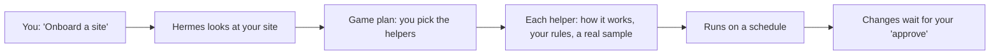

# directory-ops

### An AI employee for your directory website

Keeps your listings accurate, finds the content that brings traffic, and turns leads into money, while you sleep.
It runs on **Hermes Agent** (an AI assistant you host on Hostinger), you talk to it in plain English, and **it asks before it changes anything.**

<p>
  <a href="https://www.hostinger.com/freyhermes"></a>
</p>

Use code **FREYHERMES** at checkout for a discount.

**No coding. About 15 minutes to set up. Works with almost any directory** (plasma centers, car washes, venues, dentists, job boards, anything with listings).

---

## What you get

You install it once, say **"Onboard a site"**, and Hermes:

1. **Looks at your site** (pages, listings, blog, what's broken) and tells you what it sees, with real numbers.
2. **Writes a game plan for your goal** (more traffic, accurate listings, leads, richer pages) and shows you every helper it can run. **You pick.**
3. **Sets up each helper you picked**, one at a time: shows you exactly how it works, asks a few questions about *your* site, learns your rules, and shows you a **real sample of its work** before anything runs.
4. **Runs them on a schedule** and sends you a short summary. Anything that would change your site waits for your "approve".

## The helpers

| | Helper | What it does for you | How often |
|---|---|---|---|
| 🗂️ | **Keep listings accurate** | Re-checks hours, phones, websites and closures against each business's own page and Google. When a chain changes hours everywhere, it fixes all of them in one sweep. Flags broken website links and wrong hours your pages show Google. | Weekly |
| 🔎 | **What customers ask** | Reads real Reddit conversations to learn what people want to know before choosing a business, then fills those details into your listings from each business's own website, with a quote as proof. | Once, then for new listings |
| 📬 | **Read your site's inbox** | Sorts your site's emails, ignores spam, and turns "add my business" or "this place closed" into ready-to-approve changes. | Weekly |
| ✍️ | **Articles people search for** | Finds the few articles worth writing (real searches + your data that nobody else has), shows you a ranked list, writes the one you pick, and shows a preview **in your site's own design**. | Up to weekly |
| 🔗 | **Links between pages** | Finds where links to your money pages naturally fit (exact sentence + link text), broken pages your site should have, and template fixes. Counts menus and breadcrumbs too, so it never suggests what you already have. | Monthly |
| 🧹 | **SEO errors and broken links** | Crawls your site for broken links, old addresses that now 404, pages fighting for the same search, duplicate titles and thin pages, and hands you one ready-to-paste fix. | Monthly |
| 📝 | **Fresh page text** | Rewrites the intro text on your city, state or category pages with real facts from your listings. Never touches titles or URLs. | Every few months |
| 📅 | **Keep facts current** | Watches pages with facts that change (fees, prices, rules, calculators) and updates them from official sources. | Per page |
| 🧮 | **Free tool ideas** | Finds the simple calculators and tools people search for in your niche, so you can build pages that bring traffic. | Every few months |
| 💸 | **Pass on leads** | Sends quote requests from your site to the right business (first one free), finds missing business emails on their websites, follows up, and reroutes when there's no answer. Drafts first. | Every couple of hours |

**Plus the setup helpers:** step-by-step setup guides, "check my setup", and "review changes" (see and approve everything waiting for you).

## Quick start

1. **Get Hermes on Hostinger.** Click the button above, pick a plan, and enter code **FREYHERMES** at checkout.
2. **Pick a smart model.** In the Hermes chat, click the model name at the bottom and choose **Claude Sonnet** (newest version). These helpers follow detailed playbooks; smaller models skip steps.
3. **Install.** Start a new chat and paste the install message from **[INSTALL.md](INSTALL.md)** (about 2 minutes).
4. **Start.** Start another new chat and say:

```
Onboard a site
```

That's it. Hermes walks you through the rest, one question at a time.

## How it works



Your website stays where it is. Hermes reads your site and your listings (Supabase, a GitHub repo, or a spreadsheet), proposes changes, and only applies what you approve. When something needs your site's code changed, it writes a ready-to-paste prompt for Claude Code or your developer.

## What it costs

- **Hermes on Hostinger:** your monthly plan.
- **AI usage:** comes out of your Hostinger AI credits. In our tests, onboarding a site on Claude Sonnet used about **2 to 3 credits** (one time). Scheduled helpers cost a small amount per run; how much depends on your site's size and how many helpers you run. Check your balance after the first week.
- **Web searches:** a few Oxylabs credits per run (onboarding a site used about 20).
- **Everything else is free:** Google pages, the public Reddit archive, your own site. Paid SEO tools (Ahrefs, Semrush) are optional, never required.

> **Tip:** the default model is cheaper, but it makes more mistakes on these playbooks. Claude Sonnet usually costs less overall because it gets it right the first time.

## Safe by default

- ✅ **Nothing changes without your OK.** Proposals first; you reply "approve 1, 3" or "approve all".
- 🔑 **Keys never go in the chat.** You add them in Hostinger's settings; Hermes only checks they're there.
- 🗑️ **Nothing gets deleted.** Closed businesses are marked closed, never removed.
- ↩️ **Every change is logged** with the old value, so anything can be undone.
- 📨 **No emails go out on their own** until you turn that on. Drafts first.
- 👀 **Previews are private:** a link that's hidden from Google and deletes itself after 72 hours.

## Works with

| Your setup | What works |
|---|---|
| Listings in **Supabase** | Everything |
| Listings in **your site's code on GitHub** (data files) | Everything; changes arrive as a pull request you click to accept |
| **WordPress**, Google Sheets, Airtable | Website helpers (SEO, links, articles, tools, research); listing edits coming |
| No website yet | Research, tool ideas and article ideas, to plan it right |

## FAQ

**Do I need to know how to code?** No. You chat with Hermes. When your site's code needs a change, it writes the instruction for you.

**Will it break my site?** It can't change anything until you approve it, and every change can be undone.

**How long does setup take?** Install about 2 minutes. Onboarding a site about 15 minutes of chatting.

**More than one site?** Yes. Say "Onboard a site" again for each one.

**Not sure what you need?** Say "not sure". Hermes explains each helper in one sentence and recommends based on where you are.

**Can it make images?** Not out of the box: Hermes needs a separate image service for that. Articles work great without.

**Can I pause or change a helper?** Yes, just say it: "pause the listing check", "run it every two weeks", "ask me before every change".

## Troubleshooting

| What you see | Fix |
|---|---|
| Hermes can't see a key you added | In Hostinger, click **Save & redeploy**, then start a **new chat** and say "continue". Old chats don't see new keys. |
| "401" or "key is wrong" | The key was copied wrong. Copy it again, edit it in Hostinger, Save & redeploy, new chat. |
| "Your site's security blocks simple scanners" | Hermes switches to its web reader automatically. For full-site checks it gives you a 2-minute guide to let it in. |
| A job didn't run | Say "Run check my setup". It lists your scheduled jobs and their last run. |
| Results look wrong | Say what's wrong in plain words. Hermes saves it as a rule for next time. |

## Updating

New versions come out over time. Start a new chat and paste the update message from [INSTALL.md](INSTALL.md#updating-later). Your settings and notes are never touched.

## Built by

directory-ops is built by **Frey**, who runs a portfolio of directory websites and uses these exact helpers on them every week.

**Need links too?** Backlinks are the one part of directory SEO an agent can't do on its own: it takes real relationships with real site owners. Frey is also the founder of **[HeyLinks](https://www.heylinks.ai)**, done-for-you link building for directories and niche sites: relevant backlinks and link inserts on real sites in your niche. No PBNs, no spammy sites, every link chosen for relevance.

## License

MIT. Use it, change it, share it.
