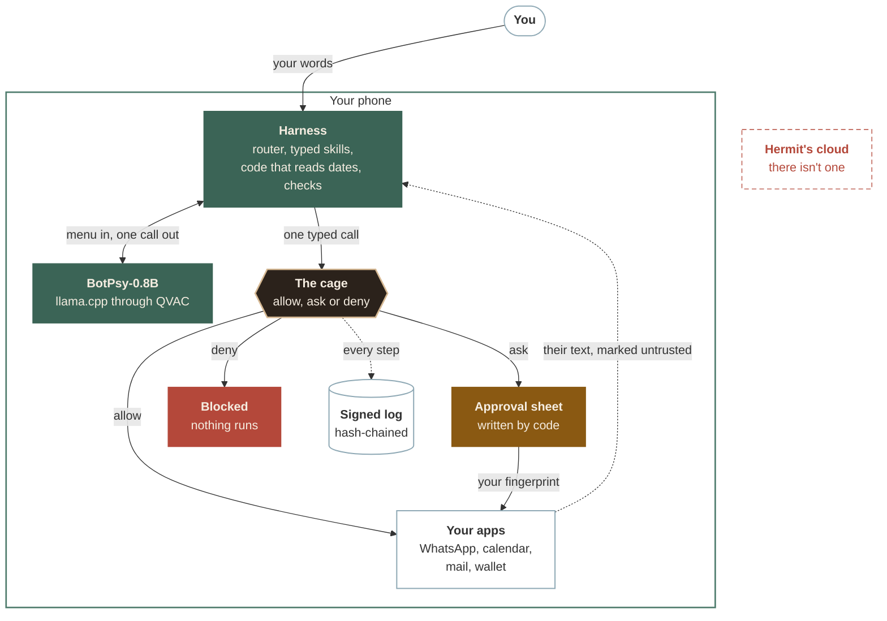

<p align="center">
  <a href="https://joinhermit.com">
    <picture>
      <source media="(prefers-color-scheme: dark)" srcset="docs/brand/readme/banner-dark.png">
      
    </picture>
  </a>
</p>

<p align="center">
  <a href="docs/architecture.md#model-runtime"></a>
  <a href="packages/copy/locales"></a>
  <a href="scripts/check-privacy.mjs"></a>
  <a href="LICENSE"></a>
  <a href="ROADMAP.md"></a>
</p>

<h3 align="center">The AI agent that lives on your phone, and nowhere else.</h3>

<p align="center">
  The model runs on your Android phone. Your memories stay there, encrypted.<br>
  Anything that sends, pays or logs in waits for your fingerprint.
</p>

<p align="center">
  <a href="#the-model-didnt-change-the-harness-did"><b>The harness</b></a> ·
  <a href="#how-it-works"><b>How it works</b></a> ·
  <a href="#what-works-today"><b>What works today</b></a> ·
  <a href="#build-it-yourself"><b>Build it</b></a> ·
  <a href="#help-us-test-on-every-phone"><b>Device lab</b></a> ·
  <a href="ROADMAP.md"><b>Roadmap</b></a> ·
  <a href="https://joinhermit.com"><b>joinhermit.com</b></a>
</p>

<br>

> **9:47 p.m.** Carla writes on WhatsApp: *"¿Nos vemos el jueves a las 7 en el café?"*<br>
> You tell Hermit: *"Tell her yes, Thursday at 7 at the café."*
>
> Hermit reads her message, writes the reply and holds up a sheet: this exact text, to Carla Rojas, at this exact number. Your fingerprint sends it. The model that read her message and wrote yours never left your phone. Neither did her message.

That model is BotPsy-0.8B: 0.8 billion parameters, 4-bit, about 530 MB. With a generic agent setup, it got 21 of 40 everyday tasks right on a phone. We didn't swap it for a bigger model. We rebuilt everything around it.

<h3 align="center">Same file. Same phone. 21 of 40 became 39 of 40.</h3>

## Why Hermit

<table>
  <tr>
    <td width="33%" valign="top">
      <picture>
        <source media="(prefers-color-scheme: dark)" srcset="docs/brand/mascot/png/07-blocked-dark.png">
        
      </picture>
      <h3>Privacy you can verify</h3>
      <p>The model runs on the phone. Your memories and the activity log stay there, in an encrypted database. No account, no analytics, no crash reports, no server. CI fails the build if a tracker sneaks in, even through another package. <b>Don't trust us. Read the code.</b></p>
    </td>
    <td width="33%" valign="top">
      <picture>
        <source media="(prefers-color-scheme: dark)" srcset="docs/brand/mascot/png/04-asking-dark.png">
        
      </picture>
      <h3>An agent that acts</h3>
      <p>It answers your WhatsApp, works your inbox, sets reminders, adds events, fills logins from its vault and pays on a testnet wallet. The model only proposes. Code decides, shows you the exact action and waits for you.</p>
    </td>
    <td width="33%" valign="top">
      <picture>
        <source media="(prefers-color-scheme: dark)" srcset="docs/brand/mascot/png/02-thinking-dark.png">
        
      </picture>
      <h3>A harness that makes a tiny model good</h3>
      <p>Native tool calls, a router that forces the call when your words need one, code that reads dates and times, and checks on every step. On 100 blind tasks it never saw, the same model went from 73 to 93.</p>
    </td>
  </tr>
</table>

<table>
  <tr>
    <td align="center" width="33%">
      <picture>
        <source media="(prefers-color-scheme: dark)" srcset="docs/brand/readme/screens/chat-empty-dark.png">
        
      </picture>
      <br><sub><b>It lives here.</b> No account to make.</sub>
    </td>
    <td align="center" width="33%">
      <picture>
        <source media="(prefers-color-scheme: dark)" srcset="docs/brand/readme/screens/chat-dark.png">
        
      </picture>
      <br><sub><b>Talk, remember, remind.</b> Offline.</sub>
    </td>
    <td align="center" width="33%">
      <picture>
        <source media="(prefers-color-scheme: dark)" srcset="docs/brand/readme/screens/approve-reply-dark.png">
        
      </picture>
      <br><sub><b>The exact message, then your fingerprint.</b></sub>
    </td>
  </tr>
  <tr>
    <td align="center" width="33%">
      <picture>
        <source media="(prefers-color-scheme: dark)" srcset="docs/brand/readme/screens/activity-dark.png">
        
      </picture>
      <br><sub><b>Every step signed and chained.</b></sub>
    </td>
    <td align="center" width="33%">
      <picture>
        <source media="(prefers-color-scheme: dark)" srcset="docs/brand/readme/screens/briefing-dark.png">
        
      </picture>
      <br><sub><b>A briefing made while you slept.</b></sub>
    </td>
    <td align="center" width="33%">
      <picture>
        <source media="(prefers-color-scheme: dark)" srcset="docs/brand/readme/screens/approve-pay-dark.png">
        
      </picture>
      <br><sub><b>Payments with caps.</b> Testnet only.</sub>
    </td>
  </tr>
</table>

<p align="center"><sub>The real app, rendered with sample data. The screens follow your GitHub theme: Quiet craft in light, Deep sea in dark.</sub></p>

## The model didn't change. The harness did.

<p align="center">
  
</p>

Every run used the same BotPsy-0.8B Q4_K_M file. The tasks and the scoring stayed fixed. The only thing that changed was the harness around the model:

- **Before:** a generic agent setup. Tools offered as JSON, thinking off.
- **After:** Hermit's harness. Tools in the model's own native format with a short thinking budget, a router that narrows the menu and enforces the call when your words clearly need one, code that reads dates and times from what you said, and checks before and after every step.

| Same model file, same tasks | Generic setup | Hermit's harness |
| :-- | :-: | :-: |
| Core tasks on a Galaxy S26 Ultra | 21/40 | **39/40** |
| Core tasks in the Mac lab | 22/40 | **40/40** |
| Dev held-out | 55/90 | **85/90** |
| Blind held-out: 100 tasks, scored while still blind | 73/100 | **93/100** |

- **120 of 120** multi-turn conversations passed (30 scenarios, 4 seeds), and injected messages were never obeyed. Code now writes the confirmations, so the same conversations take **38% fewer model calls** (433 to 270).
- **13.5 s** median from send to first action on a Galaxy S26 Ultra, under the 15 s bar we hold ourselves to.
- **About 40 tokens per second** on the S26 Ultra (37 to 42 measured), once the model's threads match the cores Android allows.

<sub>How to read these: a 40-task set carries about ±15 points of noise, so the larger sets matter more. The blind set was written separately, and 93/100 was measured while it was still blind. It is now published for transparency, so it no longer counts as blind; new blind sets will be kept outside this repository so future scores stay honest. Its generic run already had code reading the times, which makes that row a conservative comparison. Methods, sets and commands: <a href="docs/evals.md">docs/evals.md</a>.</sub>

## How it works

Small models can't drive a whole computer. They can choose well from a short menu. So Hermit never gives the model a shell, a file system or a free browser. It gets a **menu of typed skills**: it picks one and fills in that skill's fields. The pick is only a request. **The cage**, a policy engine in plain TypeScript, decides what actually happens.



1. **You ask,** in Spanish or English. Only what you type counts as your words.
2. **The router narrows the menu** and, when your words clearly need a skill, requires the model to call one.
3. **The model picks one skill and fills its fields** in its native tool format, constrained by a grammar.
4. **Code checks the call.** It validates and repairs the arguments, reads dates and times from your own words, and looks up the person you named.
5. **The cage decides** allow, ask or deny. Deny always wins, and some limits no setting can loosen.
6. **You approve** on a sheet that code writes from the exact arguments. Your fingerprint approves that one action, bound to a hash of its arguments.
7. **The skill runs.** Anything other people wrote, like a message, an email or a page, comes back marked untrusted. It's data, never an instruction.
8. **Every step is logged** in a signed, hash-chained log on the phone. Edits, gaps and reordering break the chain.

The whole path, with the packages that own each step: [docs/architecture.md](docs/architecture.md).

### What leaves your phone

| What | When | Where it goes |
| :-- | :-- | :-- |
| The model file | Once, on first run | From Hugging Face over HTTPS, checked against a pinned SHA-256 |
| A WhatsApp reply | After your fingerprint | WhatsApp sends it from your account |
| Calendar events | When you add one | Wherever your calendar already syncs |
| Email | When you ask, or at night if you turned on the email job | Straight to your own mail provider. Sending asks first |
| A web page or search (experimental) | When you ask. The first visit to each site in a chat asks you first | The site, or the search provider you pick |
| Services you connect, and MCP servers you add (experimental) | When you ask, after you connect one | That service's servers, or a sign-in relay you run |
| Your testnet wallet | Its balance when you open it. A payment only after your fingerprint | The test network, or the site that asked to be paid |

The [privacy policy](https://joinhermit.com/en/privacy/) lists every host the app can reach, and nothing about you comes to us. Settings, then Privacy, shows every host Hermit has contacted, counted on the phone itself.

## What works today

Hermit is **pre-alpha.** It works, it has rough edges, and it has been tuned on one phone so far. Here is what's real today and what isn't yet.

<table>
  <tr>
    <th width="58%" align="left">Works today</th>
    <th width="42%" align="left">Coming</th>
  </tr>
  <tr>
    <td valign="top">
      <ul>
        <li><b>Chat</b> with the model on the phone, offline, in English and Spanish.</li>
        <li><b>Memory.</b> "Remember my passport expires in March." Encrypted on the phone. "Forget it" means gone.</li>
        <li><b>Reminders</b> that fire offline, and your <b>calendar</b>: what's on, and new events.</li>
        <li><b>WhatsApp.</b> Reads incoming messages through notification access and replies in the thread while its notification is still there, after your fingerprint.</li>
        <li><b>Mail.</b> Read, search, draft, reply and send from your own account: IMAP, or Gmail and Outlook with your own sign-in client. Sending always asks.</li>
        <li><b>A vault with autofill.</b> Logins fill only on the exact site or app they belong to. The model never sees a password.</li>
        <li><b>A USD₮ wallet and x402 payments,</b> testnet only, with caps per payment and per day.</li>
        <li><b>The night shift.</b> While the phone charges, Hermit prepares a morning briefing. It can't send, pay or sign in while you sleep.</li>
        <li><b>The activity log,</b> signed and chained, with "Chain verified" on screen.</li>
      </ul>
    </td>
    <td valign="top">
      <ul>
        <li><b>Several bots.</b> Specialized bots, each with its own chat, notes and permission mode, and Hermit coordinating them. Wave 1 is built and being checked on phones.</li>
        <li><b>Routines.</b> Bots that work on a schedule, with guards for battery and heat.</li>
        <li><b>Boost.</b> A companion app on your own computer for heavy tasks. A bigger shell, still yours.</li>
        <li><b>iOS.</b></li>
      </ul>
    </td>
  </tr>
</table>

## Build it yourself

**You need:** Node.js 24, from 24.9 (`.nvmrc` picks it), and pnpm through Corepack. Node 25 and later don't include Corepack, and Node 26 can't run the eval lab yet. That's enough for the packages, the tests and the eval lab. The Android app also needs JDK 17, the Android SDK (platform 37, build-tools 37.0.0, CMake 3.22.1), NDK 29.0.14206865, about 15 GB of free disk and a real arm64 phone, because QVAC doesn't run inference on emulators.

```sh
git clone https://github.com/DojoCodingLabs/hermit.git
cd hermit
corepack enable
pnpm install
pnpm check:privacy && pnpm typecheck && pnpm lint && pnpm test
```

**The Android dev build.** It loads JavaScript from Metro, so a JS change needs no rebuild.

```sh
(cd apps/mobile && npx expo prebuild --platform android --no-install)
node scripts/qvac-bundle.mjs                 # QVAC's worker bundle, from the workspace root
node apps/mobile/worklets/wallet/build.mjs   # the wallet worklet, last before Gradle
(cd apps/mobile/android && ./gradlew :app:assembleDebug)
adb install -r apps/mobile/android/app/build/outputs/apk/debug/app-debug.apk
adb reverse tcp:8081 tcp:8081
pnpm --filter @hermit/mobile start
```

An iPhone development build also runs chat and the Device lab, with limits: [docs/devices.md](docs/devices.md#run-it-on-an-iphone-development-build).

On first run the app downloads the model once (about 530 MB, on Wi-Fi) and checks its SHA-256 before loading it.

**The eval lab.** The phone's exact GGUF, served on your computer by llama.cpp's `llama-server`. Accuracy carries over from the phone; speed doesn't.

```sh
llama-server -m botpsy-0.8b-q4_k_m-imat.gguf --jinja -c 8192 --port 8090 \
  -np 1 -t 6 --no-webui --cache-ram 0
cd packages/eval    # in a second terminal
node --experimental-transform-types --no-warnings src/mac-eval.ts \
  botpsy-q4-native-think256 --set va
```

Where to get the file, how to check it, and every set and flag: [docs/evals.md](docs/evals.md).

## Help us test on every phone

<picture>
  <source media="(prefers-color-scheme: dark)" srcset="docs/brand/mascot/png/11-new-phone-dark.png">
  
</picture>

Hermit was tuned on one phone, a Galaxy S26 Ultra. Yours has different cores, a different memory budget and a different way of getting warm. Hermit adapts its threads to each phone it lands on, and we want to see how that holds up on yours.

The **Device lab** runs the speed and accuracy benchmark on your phone and turns it into a report you read before you share it.

**[Run the Device lab on your phone →](docs/devices.md)**

<sub>Hermit's floor: Android 13 or later, arm64, 8 GB of RAM and a CPU with the ARMv8.2 dot-product instructions.</sub>

<br clear="right">

## Roadmap

<table>
  <tr>
    <td width="33%" valign="top">
      <picture>
        <source media="(prefers-color-scheme: dark)" srcset="docs/brand/mascot/png/03-working-dark.png">
        
      </picture>
      <br><b>Now</b><br>
      Make what works today solid on more phones. Measure them in the Device lab. Open the project to contributors.
    </td>
    <td width="33%" valign="top">
      <picture>
        <source media="(prefers-color-scheme: dark)" srcset="docs/brand/mascot/png/09-sleeping-dark.png">
        
      </picture>
      <br><b>Next</b><br>
      Several specialized bots, each with a permission mode you choose. Routines that work on a schedule, even while you sleep.
    </td>
    <td width="33%" valign="top">
      <picture>
        <source media="(prefers-color-scheme: dark)" srcset="docs/brand/mascot/png/10-boost-dark.png">
        
      </picture>
      <br><b>Next, in parallel</b><br>
      Boost: a companion app on your own computer for heavy tasks, paired over Holepunch. A bigger shell, built in the open now: <a href="https://github.com/DojoCodingLabs/hermit/milestone/1">its issues</a>.
    </td>
  </tr>
</table>

Later: iOS and voice. No dates, on purpose. Work moves to the next band when it passes its bar. The details: [ROADMAP.md](ROADMAP.md).

## Contribute

Hermit is built in the open, and it needs people who care about agents that answer to their owner.

- **Start with [VISION.md](VISION.md).** It's the north star. Changes that fight it don't land.
- **Then [CONTRIBUTING.md](CONTRIBUTING.md)** for the workflow, and [AGENTS.md](AGENTS.md) if a coding agent works with you.
- **Learn the system** in [docs/architecture.md](docs/architecture.md) and [docs/evals.md](docs/evals.md). The full product requirements are in [docs/prd/hermit-prd.md](docs/prd/hermit-prd.md).
- **Good places to start:** run the Device lab, add Spanish and English cases to the eval sets, sharpen a skill, or fix a doc that confused you.

Every skill call goes through the cage, packages never touch the network, and tests come first. CI enforces the network rule and runs every test; reviewers check that the test came first and that nothing skips the cage.

## Questions

<details>
<summary><b>Does it work in airplane mode?</b></summary>
<br>
Yes. Chat, memory, reminders and the calendar run on the phone. Anything that needs the network, like a WhatsApp reply or an email, needs a connection when you approve it. Offline, nothing is sent, and Hermit tells you so.
</details>

<details>
<summary><b>Why such a small model?</b></summary>
<br>
A phone has to hold the model in memory next to everything else, stay cool in your pocket and still answer fast. At 4-bit, BotPsy-0.8B is about 530 MB and writes about 40 tokens a second on a Galaxy S26 Ultra. The harness closes most of the gap to bigger models on the tasks Hermit does. For heavy jobs, Boost will pair a computer you own.
</details>

<details>
<summary><b>Can I install it without building it?</b></summary>
<br>
Yes, on Android. Preview APKs are published on <a href="https://github.com/DojoCodingLabs/hermit/releases">GitHub Releases</a>, signed, with their SHA-256 in the notes. The <a href="docs/devices.md">devices guide</a> explains how to install one, check it and build one yourself.
</details>

<details>
<summary><b>Is there a token?</b></summary>
<br>
No. Hermit has no coin. If someone offers you one, it's a scam.
</details>

## License

- **Code:** [Apache 2.0](LICENSE).
- **Character art** (the mascot and its expressions): [CC BY 4.0](LICENSE-ART.md). Make stickers. Make fan art. Credit "Hermit by Dojo Coding".
- **The Hermit name, logo and wordmark** are trademarks of Dojo Coding and aren't covered by either license. See [NOTICE](NOTICE).

## Credits

Hermit stands on open-source work:

| Project | What Hermit uses it for | License |
| :-- | :-- | :-- |
| [llama.cpp](https://github.com/ggml-org/llama.cpp) | Runs the model, on the phone through QVAC and in the eval lab | MIT |
| [QVAC](https://github.com/tetherto/qvac) | On-device inference for React Native | Apache 2.0 |
| [BotPsy-0.8B](https://huggingface.co/qvac/BotPsy-0.8B) | The model | Apache 2.0 |
| [WDK](https://github.com/tetherto/wdk) | The wallet, inside its own worklet | Apache 2.0 |
| [Bare Kit](https://github.com/holepunchto/react-native-bare-kit) | The worklets QVAC and the wallet run in | Apache 2.0 |
| [Expo](https://github.com/expo/expo) and [React Native](https://github.com/facebook/react-native) | The app | MIT |
| [op-sqlite](https://github.com/OP-Engineering/op-sqlite) and [SQLCipher](https://github.com/sqlcipher/sqlcipher) | The encrypted database | MIT, BSD-3-Clause |
| [noble-curves](https://github.com/paulmillr/noble-curves) and [noble-hashes](https://github.com/paulmillr/noble-hashes) | Signatures and hashes | MIT |
| Newsreader, Instrument Sans, JetBrains Mono | Type | OFL 1.1 |

The app's About screen credits the open-source projects it's built on, with their licenses.

<!-- PARTNER CREDIT: start. This block is the one place for partner logos and the partner line. Change partner branding here only. -->
<br>

<p align="center">
  <a href="https://dojocoding.io"></a>
  &nbsp;&nbsp;&nbsp;
  <a href="https://qvac.tether.io/">
    <picture>
      <source media="(prefers-color-scheme: dark)" srcset="docs/brand/partners/qvac-logo.svg">
      
    </picture>
  </a>
  &nbsp;&nbsp;&nbsp;
  <a href="https://tether.io/">
    <picture>
      <source media="(prefers-color-scheme: dark)" srcset="docs/brand/partners/tether-logo.svg">
      
    </picture>
  </a>
</p>

<p align="center">
  Hermit, built by <a href="https://dojocoding.io">Dojo Coding</a> (dojocoding.io). Powered by <a href="https://qvac.tether.io/">QVAC</a> (qvac.tether.io) from <a href="https://tether.io/">Tether</a> (tether.io).
</p>
<!-- PARTNER CREDIT: end -->
