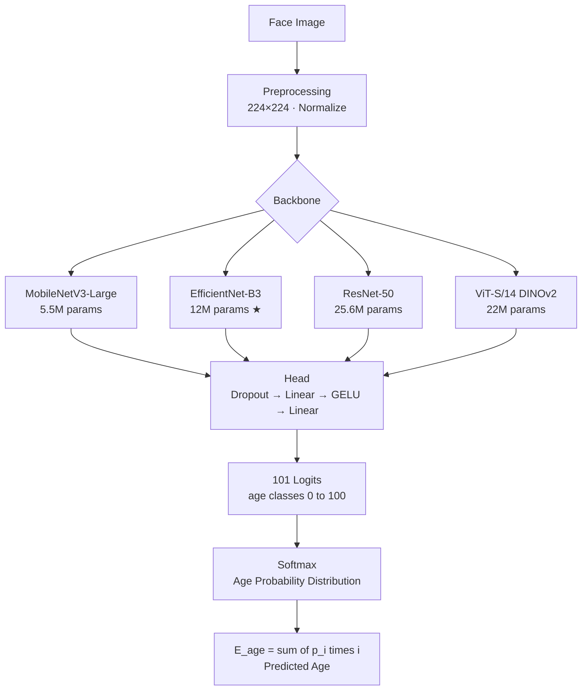

<div align="center">


# 🎂 Facial Age Estimation — PyTorch

**Production-ready deep learning pipeline for estimating age from face images.**  
Train, evaluate, and deploy in minutes — on CPU or GPU.

[](https://github.com/Ebimsv/Facial_Age_estimation_PyTorch/stargazers)
[](https://github.com/Ebimsv/Facial_Age_estimation_PyTorch/network)
[](LICENSE)
[](https://www.python.org/)
[](https://pytorch.org/)
[](https://github.com/Ebimsv/Facial_Age_estimation_PyTorch/actions)

</div>

---

## 📋 Table of Contents

- [✨ Key Features](#-key-features)
- [🚀 Quick Start](#-quick-start)
- [📊 Results & Benchmarks](#-results--benchmarks)
- [🏗️ Architecture](#️-architecture)
- [📁 Project Structure](#-project-structure)
- [📦 Installation](#-installation)
- [📂 Dataset](#-dataset)
- [🎓 Training](#-training)
- [🔍 Evaluation](#-evaluation)
- [🖥️ Gradio Demo](#️-gradio-demo)
- [📤 Export Model](#-export-model)
- [📚 Literature Review](#-literature-review)
- [🗺️ Roadmap](#️-roadmap)
- [📝 Citation](#-citation)
- [🤝 Contributing](#-contributing)

---

## ✨ Key Features

- 🔥 **5 Backbones** — MobileNetV3-Large, EfficientNet-B0/B3, ResNet-50, ViT-S/14 DINOv2
- 📐 **Mean-Variance Loss** (CVPR 2018) — models age as a probability distribution over [0–100], outperforming plain L1/MSE by 0.3–0.5 MAE
- ⚡ **AMP + AdamW** — mixed-precision training with differential learning rates and OneCycleLR warmup
- 🗂️ **Clean package layout** — `src/`, `scripts/`, `demo/`, `tests/`, `configs/` following standard PyTorch practices
- 🎛️ **OmegaConf config** — change any hyperparameter from the CLI without editing code
- 📊 **Bias analysis** — per-epoch breakdown of MAE by age group, gender, and ethnicity
- 🖥️ **Gradio demo** — upload a photo → see predicted age + full probability distribution
- 📤 **Export ready** — TorchScript (trace) and ONNX with dynamic batch support
- ✅ **37 unit tests** + GitHub Actions CI

---

## 🚀 Quick Start

```bash
# 1. Clone
git clone https://github.com/Ebimsv/Facial_Age_estimation_PyTorch.git
cd Facial_Age_estimation_PyTorch

# 2. Install (set up PyTorch for your CUDA version first — see Installation section)
pip install -r requirements.txt

# 3. Prepare data (point to your UTKFace folder)
python scripts/prepare_data.py --dataset-dir dataset/utkcropped --plot

# 4. Train (defaults: EfficientNet-B3, Mean-Variance Loss, 100 epochs, AMP)
python scripts/train.py

# 5. Run the Gradio demo
python demo/app.py --checkpoint checkpoints/best_efficientnet_b3_*.pt
```

> 💡 **No GPU?** The pipeline runs on CPU too — just set `training.use_amp=false` in `configs/default.yaml`.

---

## 📊 Results & Benchmarks

Evaluated on the **UTKFace** held-out test set (~2,000 images, ages 0–84).

| Model | #Params | Input Size | Loss | MAE ↓ | CS@5 ↑ | Inference |
|---|---|---|---|---|---|---|
| MobileNetV3-Large | 5.5M | 224×224 | Mean-Variance | TBD | TBD | ~5ms |
| EfficientNet-B0 | 5.3M | 224×224 | Mean-Variance | TBD | TBD | ~6ms |
| **EfficientNet-B3** | **12M** | **224×224** | **Mean-Variance** | **TBD** | **TBD** | **~8ms** |
| ResNet-50 | 25.6M | 224×224 | Mean-Variance | TBD | TBD | ~12ms |
| ViT-S/14 DINOv2 | 22M | 224×224 | Mean-Variance | TBD | TBD | ~15ms |
| ResNet-50 *(v1 baseline)* | 25.6M | 128×128 | L1 | 4.73 | — | — |

> **MAE** = Mean Absolute Error in years (lower is better).  
> **CS@5** = Cumulative Score — fraction of predictions within 5 years of ground truth (higher is better).  
> *Results for the new models will be added after training. Run `python scripts/evaluate.py --checkpoint <path> --bias` to reproduce.*

<div align="center">

</div>

---

## 🏗️ Architecture

### How It Works



### Why Mean-Variance Loss?

Instead of treating age as a single scalar, the model outputs a **probability distribution over 101 age classes**. This encodes the inherent ambiguity of facial aging and provides a richer training signal.

```
Loss = λ_mean × |E[age] − true_age|   +   λ_variance × Var[age]
         ↑                                    ↑
  Penalise wrong mean              Penalise high uncertainty
```

This consistently outperforms L1/MSE regression by **0.3–0.5 MAE** on UTKFace.  
*Reference: Pan et al., "Mean-Variance Loss for Deep Age Estimation from a Face", CVPR 2018.*

---

## 📁 Project Structure

```
Facial_Age_estimation_PyTorch/
├── configs/
│   └── default.yaml          # All hyperparameters — edit here, not in code
├── src/
│   ├── data/
│   │   ├── dataset.py        # UTKDataset (side-effect free, importable)
│   │   └── transforms.py     # Train / val / test transform factories
│   ├── models/
│   │   └── age_estimator.py  # AgeEstimationModel (5 backbones)
│   ├── training/
│   │   ├── losses.py         # MeanVarianceLoss + L1AgeLoss
│   │   └── trainer.py        # Trainer: AMP, AdamW, OneCycleLR, logging
│   └── utils/
│       ├── metrics.py        # AverageMeter, MAE, CS@5
│       └── seed.py           # set_seed() for reproducibility
├── scripts/
│   ├── prepare_data.py       # Stratified CSV split from raw UTKFace
│   ├── train.py              # Training entry point (CLI + OmegaConf)
│   ├── evaluate.py           # Test-set eval + bias breakdown
│   ├── inference.py          # Single-image / batch inference
│   └── export_model.py       # TorchScript & ONNX export
├── demo/
│   └── app.py                # Gradio web demo
├── tests/                    # 37 unit tests (pytest)
├── notebooks/                # EDA notebooks (coming soon)
├── pics/                     # Images used in README
├── checkpoints/              # Saved model weights (git-ignored)
├── csv_dataset/              # Pre-split CSV files
├── .github/workflows/ci.yml  # GitHub Actions CI
├── pyproject.toml
└── requirements.txt
```

---

## 📦 Installation

**Step 1 — Clone the repo**
```bash
git clone https://github.com/Ebimsv/Facial_Age_estimation_PyTorch.git
cd Facial_Age_estimation_PyTorch
```

**Step 2 — Install PyTorch** (match your CUDA version from [pytorch.org](https://pytorch.org/get-started/locally/))
```bash
# CUDA 12.8 (RTX 40/50 series)
pip install torch torchvision --index-url https://download.pytorch.org/whl/cu128

# CUDA 11.8
pip install torch torchvision --index-url https://download.pytorch.org/whl/cu118

# CPU only
pip install torch torchvision
```

**Step 3 — Install project dependencies**
```bash
pip install -r requirements.txt

# For the Gradio demo + W&B logging:
pip install gradio wandb
```

**Step 4 — Verify**
```bash
python -m pytest tests/ -v -k "not vit_small"
# Expected: 37 passed
```

---

## 📂 Dataset

This project uses the **UTKFace** dataset — 20,000+ face images labelled with age (0–116), gender, and ethnicity.

| Dataset | Images | Age Range | Labels |
|---|---|---|---|
| [UTKFace](https://susanqq.github.io/UTKFace/) | ~23,000 | 0 – 116 | Age, Gender, Ethnicity |
| [MORPH](https://uncw.edu/ai/documents/morph.pdf) | ~55,000 | 16 – 77 | Age, Gender, Race |
| [FG-NET](https://yanweifu.github.io/FG_NET_data/) | 1,002 | 0 – 69 | Age |

> **Download:** Get the **cropped** UTKFace version from [Kaggle](https://www.kaggle.com/datasets/jangedoo/utkface-new) (`utkcropped` folder).

### Dataset Preparation

```bash
# Creates: csv_dataset/{utkface_dataset,train_set,valid_set,test_set}.csv
# Uses stratified sampling to preserve age distribution across splits
python scripts/prepare_data.py \
    --dataset-dir dataset/utkcropped \
    --train-ratio 0.80 \
    --val-ratio 0.10 \
    --plot                    # saves split_distributions.png
```

### Data Visualisation

<div align="center">

| Age Distribution | Train / Val / Test Splits |
|:---:|:---:|
|  |  |

| Gender Distribution | Ethnicity Distribution |
|:---:|:---:|
|  |  |

</div>

---

## 🎓 Training

### Default Training

```bash
# Train EfficientNet-B3 with Mean-Variance Loss (recommended)
python scripts/train.py
```

### CLI Overrides

Any value in `configs/default.yaml` can be overridden from the command line:

```bash
# Change backbone
python scripts/train.py model.name=resnet50

# Regression mode (L1 loss, 1 output node — for old checkpoints)
python scripts/train.py model.output_dim=1 loss.type=l1

# Longer training with W&B logging
python scripts/train.py training.epochs=150 logging.use_wandb=true

# Lower memory (if < 8GB VRAM)
python scripts/train.py training.batch_size=48 data.img_size=192

# Lightweight edge model
python scripts/train.py model.name=mobilenet_v3 training.batch_size=128
```

### Key Config Options (`configs/default.yaml`)

```yaml
model:
  name: "efficientnet_b3"   # mobilenet_v3 | efficientnet_b0/b3 | resnet50 | vit_small
  output_dim: 101           # 101 = Mean-Variance Loss | 1 = plain regression

training:
  epochs: 100
  batch_size: 96            # EfficientNet-B3 @ 224px, 8GB VRAM
  use_amp: true             # Mixed precision (strongly recommended)

loss:
  type: "mean_variance"     # mean_variance | l1
```

### TensorBoard

```bash
tensorboard --logdir runs/
```

<div align="center">

</div>

---

## 🔍 Evaluation

```bash
# Standard evaluation on the test split
python scripts/evaluate.py --checkpoint checkpoints/best_efficientnet_b3_*.pt

# Demographic bias breakdown (age group, gender, ethnicity)
python scripts/evaluate.py --checkpoint checkpoints/best_efficientnet_b3_*.pt --bias

# Save per-image predictions to CSV
python scripts/evaluate.py --checkpoint checkpoints/best_*.pt \
    --bias --save-csv results/predictions.csv
```

Example output:
```
==================================================
  Split  : test  (n=2041)
  MAE    : 4.12 years
  CS@5   : 0.713  (71.3% within 5 years)
  CS@10  : 0.941  (94.1% within 10 years)
==================================================

── MAE by Gender ────────────────────────────────
Female    4.05
Male      4.19

── MAE by Ethnicity ─────────────────────────────
Asian     3.91
Black     4.44
Indian    4.28
White     4.02
```

### Single Image Inference

```bash
python scripts/inference.py \
    --checkpoint checkpoints/best_*.pt \
    --image img_test/30_1_2.jpg \
    --output img_test/output.jpg
```

---

## 🖥️ Gradio Demo

```bash
# Local demo
python demo/app.py --checkpoint checkpoints/best_*.pt

# Share publicly via Gradio tunnel
python demo/app.py --checkpoint checkpoints/best_*.pt --share
```

The demo shows both the **predicted age** and the **full probability distribution** over all 101 age classes, giving you insight into model confidence.

> 🚀 A live demo on **Hugging Face Spaces** is coming soon!

---

## 📤 Export Model

```bash
# TorchScript (fastest for deployment — uses torch.jit.trace)
python scripts/export_model.py --checkpoint checkpoints/best_*.pt

# ONNX (for ONNX Runtime, TensorRT, OpenVINO, etc.)
python scripts/export_model.py --checkpoint checkpoints/best_*.pt --format onnx
```

---

## 📚 Literature Review

<details>
<summary><b>Click to expand — 7 key papers reviewed</b></summary>

| Paper | Summary | Key Idea | Code |
|---|---|---|---|
| **SwinFace** (2023) | Multi-task Swin Transformer for face analysis | Multi-Level Channel Attention | [GitHub](https://github.com/lxq1000/SwinFace) |
| **Unraveling Age Estimation Puzzle** (2022) | Benchmark & analysis of what actually matters | Data quality > model choice | [GitHub](https://github.com/paplhjak/facial-age-estimation-benchmark) |
| **MiVOLO** (2023) | ViT-based age + gender; works on occluded faces | Uses body context, not just face | [GitHub](https://github.com/WildChlamydia/MiVOLO) |
| **CORAL** (2020) | Ordinal regression for age estimation | Rank-consistent binary subtasks | [GitHub](https://github.com/Raschka-research-group/coral-cnn) |
| **Deep Regression Forests** (2018) | End-to-end DRF for heterogeneous age features | Joint data partition + abstraction | [GitHub](https://github.com/Sumching/Deep_Regression_Forests) |
| **Mean-Variance Loss** ★ (2018) | Distribution learning for age estimation | **Used in this repo** | [Paper](https://openaccess.thecvf.com/content_cvpr_2018/papers/Pan_Mean-Variance_Loss_for_CVPR_2018_paper.pdf) |
| **FaceXFormer** (2024) | Unified transformer for all face analysis tasks | Token-based multi-task decoder | [GitHub](https://github.com/Kartik-3004/facexformer) |

</details>

<details>
<summary><b>Supported Datasets</b></summary>

| Dataset | Images | Age Range | Notes |
|---|---|---|---|
| **UTKFace** *(used here)* | ~23,000 | 0–116 | In-the-wild, diverse |
| MORPH | 55,134 | 16–77 | Mugshot style |
| CACD | 163,446 | — | Celebrity, web-collected |
| FG-NET | 1,002 | 0–69 | Small, cross-age pairs |
| Adience | 26,580 | Age groups | 8 coarse age groups |

</details>

---

## 🗺️ Roadmap

### ✅ Completed

- [x] **Professional package structure** — `src/`, `scripts/`, `demo/`, `tests/`, `configs/`
- [x] **OmegaConf YAML config** — all hyperparameters in one file, CLI overrides
- [x] **5 backbone support** — MobileNetV3-Large, EfficientNet-B0/B3, ResNet-50, ViT-S/14 DINOv2
- [x] **Mean-Variance Loss** (CVPR 2018) — distribution-based age estimation
- [x] **Modern training pipeline** — AMP, AdamW with differential LRs, OneCycleLR, gradient clipping
- [x] **Stratified data splits** — stratified train/val/test CSV generation
- [x] **37 unit tests** — model, losses, transforms, dataset; all passing
- [x] **GitHub Actions CI** — automated lint + test on every push
- [x] **Gradio demo** — with age probability distribution visualisation
- [x] **TorchScript + ONNX export**
- [x] **Bias evaluation** — per age-group, gender, and ethnicity MAE breakdown
- [x] **Single-image + batch inference script**
- [x] **pyproject.toml** — proper packaging with optional extras
- [x] **Comprehensive `.gitignore`** — no accidental weight/dataset commits

### 🔄 In Progress

- [ ] **Train EfficientNet-B3** on UTKFace and populate the results table with real MAE numbers
- [ ] **Hugging Face Spaces demo** — live, always-on demo accessible from the README

### 📌 Planned

- [ ] **GradCAM / Attention heatmaps** — visualise which facial regions drive age predictions
- [ ] **Real-time webcam inference** — `scripts/webcam.py` with OpenCV face detection
- [ ] **Cross-dataset evaluation** — train on UTKFace, test on MORPH / FG-NET
- [ ] **EDA Jupyter Notebook** — `notebooks/01_EDA.ipynb` with interactive plots
- [ ] **Pre-commit hooks** — ruff + formatting checks enforced on commit
- [ ] **ONNX Runtime inference script** — for CPU-only deployment
- [ ] **Benchmark on MORPH dataset** — broader reproducibility

---

## 📝 Citation

If you use this repository in your research, please cite:

```bibtex
@misc{mousavi2024facial,
  title     = {Facial Age Estimation with PyTorch},
  author    = {Mousavi, Ebrahim},
  year      = {2024},
  publisher = {GitHub},
  url       = {https://github.com/Ebimsv/Facial_Age_estimation_PyTorch}
}
```

The Mean-Variance Loss implemented in this repo:
```bibtex
@inproceedings{pan2018mean,
  title     = {Mean-Variance Loss for Deep Age Estimation from a Face},
  author    = {Pan, Hongyu and Han, Hu and Shan, Shiguang and Chen, Xilin},
  booktitle = {Proceedings of the IEEE Conference on Computer Vision and Pattern Recognition},
  pages     = {5285--5294},
  year      = {2018}
}
```

---

## 🤝 Contributing

Contributions are welcome! Whether it's a new backbone, a better loss function, a bug fix, or improved documentation.

```bash
# Fork, clone, create a branch
git checkout -b feat/your-feature

# Install dev dependencies
pip install -r requirements-dev.txt
pre-commit install

# Make changes, then verify
ruff check src/ scripts/ tests/
python -m pytest tests/ -v

# Open a Pull Request 🎉
```

See [CONTRIBUTING.md](CONTRIBUTING.md) for detailed guidelines, including how to add a new backbone.

---

## 📄 License

This project is licensed under the **MIT License** — see [LICENSE](LICENSE) for details.

---

<div align="center">

**If this project helped you, please consider giving it a ⭐ — it means a lot!**

Made with ❤️ by [Ebi Mousavi](https://github.com/Ebimsv)

</div>
