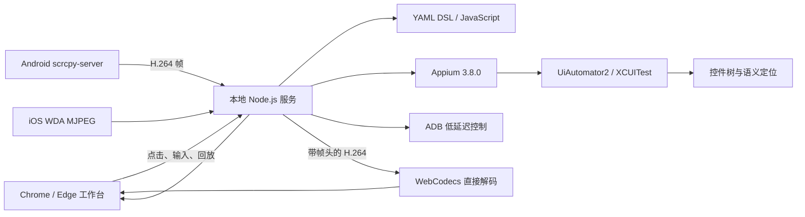

<div align="center">


# EchoBench

_Record. Replay. Echo._

在本机浏览器中操作 Android / iOS 应用，录制步骤、实时校验定位器、操作一台设备并让其他设备同步执行，然后回放。


</div>

[English](README.en.md) | 简体中文

EchoBench 是一个**本机优先**的移动测试工作台。人在浏览器中点击设备镜像，工具同步操作真机或模拟器，通过 Appium 控件树识别目标，并把点击、输入、滑动、返回等动作记录为可编辑、可回放的 YAML DSL。它同时支持多设备实时画面、一台操作多台同步执行、实时定位器校验，以及基于当前步骤的 AI CSV 用例导出。

当前版本既可以通过源码 + 浏览器运行，也可以构建 Electron 桌面版。桌面版复用同一套前端和服务端，自带 Chromium；Electron 桌面版在所有平台都会检查 GitHub Releases，有更新时提示版本、发布说明和下载地址，由用户手动下载安装；Web 模式不检查更新。

## 界面


<sub>录制步骤、断言和候选定位器。截图来自本地 Android 模拟器，示例页面仅用于演示。</sub>

<table>
<tr>
<td width="50%"><br><sub><b>连接设备与实时画面</b></sub></td>
<td width="50%"><br><sub><b>元素树与按节点定位</b></sub></td>
</tr>
<tr>
<td width="50%"><br><sub><b>多端同步</b>：操作一台，其他设备一起执行</sub></td>
<td width="50%"><br><sub><b>AI 用例导出</b></sub></td>
</tr>
<tr>
<td colspan="2" align="center"><br><sub><b>全局设置与 AI 配置</b></sub></td>
</tr>
</table>

<sub>工作台、元素树、多端同步、AI 导出和全局设置；示例页面仅用于演示。</sub>

## 为什么是 EchoBench

- **本地优先** — 数据、设备、日志和 AI 配置留在本机，没有账号、云端队列或第三方设备农场依赖。
- **定位器可解释** — 候选、命中数、推荐/脆弱和回放降级过程全部可见，不只给一个黑盒选择器。
- **多设备同步** — 在一台设备画面上操作，指令广播到所有参与同步的设备一起执行；每台独立实时/同步开关和在线状态。
- **附加而不接管** — 可以连接已有 Appium 会话，脱离时默认不结束外部会话。
- **AI 自主可控** — AI 只是可选能力，支持任意 OpenAI 兼容接口，也可接本地模型。
- **脚本可带走** — YAML、WebdriverIO、Python、Java 都可以离开工具运行。

适合需要本机调试、兼容性对比和从手工步骤过渡到脚本的 QA/开发；不适合大规模云真机矩阵或企业级测试管理。完整对比见 [同类产品对比](docs/comparison.md)。

## 与同类产品对比

| 类别 / 代表产品 | EchoBench 的差异 |
|---|---|
| 元素检查工具（Appium Inspector） | 不止检查元素：还能录制、回放、候选校验、多端同步和 AI CSV |
| 开源流程工具（Maestro） | 有实时设备画面、交互式录制、定位器候选与实时校验、多设备同步 |
| 图像/游戏测试（Airtest / Poco） | 更偏原生控件树和语义定位；目前不做视觉识别 |
| 云设备农场（BrowserStack / Sauce Labs / LambdaTest） | 不上传数据、无云端分钟计费、本地调试方便；没有大规模并发和云设备覆盖 |
| 商业测试套件（Katalon / TestComplete / Ranorex） | 本地、轻量、可审阅、无许可费用；测试管理和企业治理需要后续补齐 |

[完整对比与适用场景](docs/comparison.md)

## 快速开始

前置条件：Node.js `22.12+`、Chrome 或 Edge、Android SDK Platform-Tools、scrcpy `3.2`、JDK；iOS 还需要 macOS 和完整 Xcode。

```bash
npm ci
npm run build
npm start
```

打开 `http://127.0.0.1:4710`，选择设备并点击“连接设备”。Appium 会在第一次连接时由项目自动启动，不需要全局安装 Appium，也不需要再开一个 Appium 终端。

以上是 **Web 模式**。桌面版：

```bash
npm run desktop:dev          # 开发
./local-package.sh --dir     # 生成未签名应用目录
./local-package.sh --dist    # 生成当前系统安装包，macOS 为 DMG
```

macOS 请把 `EchoBench.app` 拖到“应用程序”后再运行，不要直接从 DMG 双击；未签名版本首次打开需要右键 → 打开。

- 完整安装（Windows / macOS / Linux）：[安装与依赖](docs/install.md)
- 连接设备、录制第一条流程、断言和回放：[快速开始](docs/quickstart.md)
- 从打开产品到录制、断言、回放和导出：[EchoBench 使用手册](docs/user-guide.md)
- 桌面版安装包与更新：[GitHub Releases](https://github.com/Echoxiawan/echobench/releases)
- 第一次 iOS 真机连接需要 Xcode / WebDriverAgent 签名配置，见安装文档。

## 核心能力

- **录制与回放** — 点击、输入、滑动、返回、双击、长按、缩放；支持单步调试和从任意步骤开始回放。
- **候选定位器与实时校验** — 每次点击生成多策略候选，用 Appium `/elements` 确认唯一性和元素范围；主定位失效时按唯一安全候选降级。
- **断言** — 出现、可见/隐藏、可用/禁用、选中/未选中、文本匹配、内容为空和页面稳定；可作为独立 `wait` 步骤编辑。
- **手势与键盘** — 设备画面上直接拖拽滑动；键盘输入默认开启，支持中文输入法，连续输入会合并成一条步骤。
- **多端同步** — 操作任意一台设备，其他参与同步的 Android/iOS 设备一起执行点击、滑动、输入和返回；实时/同步开关独立，只操作不录制。
- **附加会话与元素树** — 接管已有 Appium 会话；展开原生控件层级、搜索属性、高亮元素并按节点精确生成定位器。
- **多语言导出** — WebdriverIO JavaScript、Appium Python Client、Appium Java Client 三种可运行脚本。
- **AI 用例导出** — 全局配置 OpenAI 兼容接口，人工填写用例标题，按行导出操作步骤和可选断言 CSV。
- **启动环境自检** — 按操作系统检查 Node、Appium 驱动、adb、scrcpy、JDK、Android SDK 和 Xcode；缺失项提供安装入口。
- **草稿与工作台** — 步骤、项目名、设备配置和回放策略自动缓存；草稿可恢复，步骤可拖拽排序、加标签和备注。

## 平台支持

| 电脑系统 | Android 真机 | Android 模拟器 | iOS 真机 | iOS 模拟器 |
| --- | ---: | ---: | ---: | ---: |
| Windows 10/11 x64 | 支持 | 支持 | 不支持 | 不支持 |
| macOS | 支持 | 支持 | 支持 | 支持 |
| Linux x64 | 支持（未做完整真机矩阵验证） | 支持（未做完整真机矩阵验证） | 不支持 | 不支持 |

iOS 自动化依赖 Xcode、XCUITest 和 iOS Simulator，只能在 macOS 上运行。Windows / Linux 会禁用 iOS 入口并隐藏 Xcode / XCUITest 检查。

## 工作原理



Android 视频不经过 Appium 截图轮询，也不依赖 FFmpeg。scrcpy-server 通过 ADB reverse 将带帧边界和 PTS 的 H.264 发给 Node.js，浏览器通过 WebCodecs 直接解码；解码积压时优先丢弃过期的非关键帧。更多设计见 [工作原理与代码结构](docs/architecture.md)。

## 文档

| 文档 | 内容 |
| --- | --- |
| [文档索引](docs/README.md) | 所有安装、使用、运维和设计文档入口 |
| [EchoBench 使用手册](docs/user-guide.md) | 面向新手的完整操作流程、环境体检、录制、断言、回放、导出和常见问题 |
| [安装与依赖](docs/install.md) | Windows / macOS / Linux、Android SDK、scrcpy、JDK、Xcode、端口 |
| [快速开始](docs/quickstart.md) | 连接设备、录制、断言、回放、草稿和停止 |
| [YAML 脚本格式](docs/yaml.md) | 动作、断言、回放策略、候选定位器结构 |
| [导出脚本](docs/export.md) | WebdriverIO、Python、Java 运行方式 |
| [多端同步](docs/multi-device.md) | 一台操作、多台同步执行；实时/同步开关和平台风险 |
| [附加会话与元素树](docs/inspect-session.md) | Session ID、附加会话、元素树和按节点定位 |
| [AI 用例导出](docs/ai-export.md) | OpenAI 兼容配置、CSV 结构和断言规则 |
| [运行日志与清理](docs/operations.md) | 日志轮转、环境变量、停止顺序和残留进程 |
| [性能与硬件占用](docs/performance.md) | Android/iOS 视频、iOS 延迟优化和多端开销 |
| [常见问题](docs/troubleshooting.md) | 设备连接、iOS 签名、黑屏、定位风险和会话失败 |
| [安全与已知限制](docs/limitations.md) | 本地服务风险、明文输入、功能边界和平台限制 |
| [工作原理与代码结构](docs/architecture.md) | 数据流、目录说明、验证环境和设计取舍 |
| [同类产品对比](docs/comparison.md) | 与元素检查、流程工具、云设备农场和代码框架的差异 |
| [桌面版与在线更新](docs/desktop.md) | Electron 桌面壳、未签名打包、GitHub Releases 和更新策略 |

## 安全与隐私

- 服务只监听 `127.0.0.1:4710`，没有登录鉴权，不要反向代理或暴露到公网。
- Appium 默认也没有认证；Server URL + Session ID 等同于设备控制权。
- YAML、界面和导出脚本会明文保存输入值，不要录制真实密码、令牌或个人敏感信息。`secret: true` 不会隐藏或加密内容。
- 草稿和 AI 配置保存在当前浏览器 localStorage；AI 请求只临时经过本地服务。
- 运行日志可能包含页面 source 和设备信息，提交 Issue 前请脱敏。

漏洞披露方式见 [SECURITY.md](SECURITY.md)，完整限制见 [安全与已知限制](docs/limitations.md)。

## 贡献

欢迎提交 Issue、文档改进和 Pull Request。开始前请阅读：

- [贡献指南](CONTRIBUTING.md) — 开发、测试和提交规范；
- [CLA](CLA.md) — 首次贡献需在 PR 评论中签署；仅勾选 PR 模板不算签署；
- [企业 CLA](CCLA.md) — 公司职务成果使用；
- [行为准则](CODE_OF_CONDUCT.md)。

CI 会运行 `npm run typecheck`、`npm test` 和 `npm run desktop:build`。本地提交前也请执行这三条命令。

## 联系与交流

<table>
<tr>
<td align="center" width="33%">
<br>
<b>作者微信</b><br>
<sub>添加时请备注 EchoBench</sub>
</td>
<td align="center" width="33%">
<br>
<b>公众号</b><br>
<sub>关注获取项目更新与使用文章</sub>
</td>
<td align="center" width="33%">
<a href="https://x.com/AiYouyisi"></a><br>
<b>X (Twitter)</b><br>
<sub>关注获取项目动态</sub>
</td>
</tr>
</table>

<sub>二维码仅用于项目交流；提交问题前请先阅读 <a href="docs/troubleshooting.md">常见问题</a>。</sub>

## 许可证

EchoBench 使用 [Apache License 2.0](LICENSE) 授权，允许个人和商业使用、修改和分发；分发时需保留版权声明、许可证文本和 [NOTICE](NOTICE)，并标注修改。

Apache-2.0 允许商业使用。第三方依赖继续受其各自许可证约束。

## 致谢

EchoBench 建立在 Appium、UiAutomator2、XCUITest、scrcpy、React、Vite 和 lucide-react 之上。感谢这些项目的维护者和所有贡献者。
