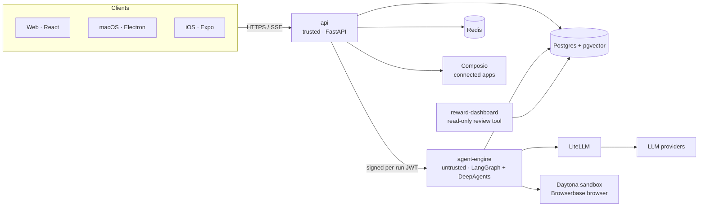

<p align="center">
  <picture>
    <source media="(prefers-color-scheme: dark)" srcset=".github/assets/banner-dark.png">
    
  </picture>
</p>

<p align="center">
  <a href="LICENSE"></a>
  
  
  
</p>

<p align="center">
  <a href="https://proactive-ai-web-prod.fly.dev"><b>Web app</b></a> ·
  <a href="#quick-start">Quick start</a> ·
  <a href="#how-it-works">How it works</a> ·
  <a href="docs/index.mdx">Docs</a> ·
  <a href="CONTRIBUTING.md">Contributing</a>
</p>

PIN AI is an open-source personal AI that works for you in the background. It connects to the apps and devices you already use, builds a long-term memory of your life, and turns what it learns into **proactive cards**: short, actionable suggestions that show up before you think to ask. When you want something done, its agent can search your memory, browse the web, run code and use your connected apps, with you in the loop for anything that can't be undone.

<p align="center">
  
  
</p>

## Features

- **Proactive cards.** A generator agent looks at what changed in your world and decides whether anything deserves your attention. Most runs produce nothing; when something matters, you get a card with the context and a suggested next step.
- **Lifelong memory.** Raw data from your sources (L0) is projected into an append-only, bi-temporal event log (L1) and distilled into a portrait of you (L2). A background *evolve* agent keeps consolidating and curating it.
- **Connectors.** Gmail, Google Calendar, Drive, Docs, Sheets, Slack, GitHub, Notion, LinkedIn, Calendly, Stripe and YouTube through [Composio](https://composio.dev), plus on-device signals such as health data, places you visit and ambient audio from the iOS app.
- **An agent that can act.** Chat with an agent that searches your memory, runs Python in a cloud sandbox, drives a real browser and calls your connected apps. Side-effecting actions need your approval, and clicks on destructive buttons (pay, delete, transfer, ...) always hand control back to you.
- **Web, macOS and iOS.** One shared TypeScript layer powers a React web app, an Electron desktop shell and an Expo / React Native iOS app.
- **Secure by design.** The agent runtime is an untrusted process: it never sees master credentials and talks to the trusted API with short-lived, Ed25519-signed per-run tokens.

## How it works



The backend is a Python [uv](https://docs.astral.sh/uv/) workspace with three services that never import each other:

- **api** (`pinai_api`) is the trusted edge. It owns auth, connectors, billing, scheduling and the product domains, and it is the only process that holds master credentials.
- **agent-engine** (`agent_engine`) runs every LLM agent: chat, card generation, memory evolution. It treats its input as untrusted and reaches your data only through the api with a per-run token.
- **reward-dashboard** (`pinai_reward_dashboard`) backs an internal tool for reviewing generated cards. It reads the product database and holds no master credentials.

All model calls go through [LiteLLM](https://github.com/BerriAI/litellm), so providers can be swapped by configuration. On the frontend, cross-platform logic and UI live in `packages/*` (`core`, `design`, `state`, `ui-kit`), and each app in `apps/*` is a thin platform shell.

## Quick start

**Prerequisites:** Docker Desktop, Node.js 20+, Python 3.12+ with [uv](https://docs.astral.sh/uv/), and Xcode if you want to build the iOS app.

```bash
git clone https://github.com/Edge-AI-HQ/proactive-assistant.git
cd proactive-assistant
(cd backend && uv sync)
npm install
cp backend/.env.example backend/.env           # then fill in your own values
cp ops/litellm/.env.example ops/litellm/.env
make up      # build and start postgres, redis, litellm, api, agent-engine, reward-dashboard and the web app
make urls    # print the local ports of this checkout's stack
```

> [!NOTE]
> The `.env.example` files list every variable the stack reads, with empty values. Fill in the ones you need (for example your own Supabase project and LLM provider keys) and leave integrations you don't use empty. The maintainers' encrypted env files are not part of this public repository.

To work on a single piece without Docker:

```bash
(cd backend && uv run uvicorn pinai_api.asgi:app --reload --port 8000)     # api
(cd backend && uv run uvicorn agent_engine.asgi:app --reload --port 8001)  # agent-engine
(cd apps/web && npm run dev)                                               # web app on :3005
make macos                                                                 # Electron desktop shell
make rn SIM=1                                                              # iOS app in the simulator
```

Run the checks before opening a pull request:

```bash
(cd backend && uv run ruff format --check && uv run ruff check && uv run lint-imports && uv run mypy services libs && uv run pytest)
npm run check:packages
(cd apps/web && npm run type-check && npm test)
```

The full command reference, including which checks to run for each kind of change, is in [AGENTS.md](AGENTS.md#local-development).

## Project structure

```text
backend/                     Python uv workspace
  services/api/              trusted api process (FastAPI)
  services/agent-engine/     untrusted agent runtime (LangGraph + DeepAgents)
  services/reward-dashboard/ backend of the internal card review tool
  libs/contracts/            protocol shared by api and agent-engine
  libs/db/                   shared database foundation
  db/migrations/             forward-only SQL migrations (yoyo)
packages/                    shared TypeScript layer: core, design, state, ui-kit
apps/web/                    web app (Vite + React)
apps/desktop/                macOS shell (Electron), reuses apps/web
apps/mobile/                 iOS app (Expo / React Native)
internal-reward-dashboard/   internal card review tool (Vite + React)
ops/litellm/                 LiteLLM gateway configuration
docs/                        module docs and design plans
```

## Documentation

- [`docs/`](docs/index.mdx) has one document per module (connectors, memory, generation, execution, feedback, background tasks, runtime and deployment) plus design plans. The module docs are in English; the design plans under `docs/plans/` are still in Chinese.
- [`AGENTS.md`](AGENTS.md) is the single source of truth for architecture rules, hard constraints and coding conventions. It is written for both human contributors and AI coding agents.

## Contributing

This repository is a read-only public mirror of the maintainers' development repository, so pull requests are turned off here. Bug reports and feature requests are welcome as [issues](https://github.com/Edge-AI-HQ/proactive-assistant/issues); see [CONTRIBUTING.md](CONTRIBUTING.md). To report a security issue, follow [SECURITY.md](SECURITY.md) instead of opening a public issue.

## License

PIN AI is released under the [MIT License](LICENSE). The license covers the code; the "PIN AI" name and logo are not licensed for use in derived products.

## Acknowledgements

PIN AI is built on top of excellent open-source projects, including [LangChain](https://github.com/langchain-ai/langchain) and [LangGraph](https://github.com/langchain-ai/langgraph), [DeepAgents](https://github.com/langchain-ai/deepagents), [LiteLLM](https://github.com/BerriAI/litellm), [FastAPI](https://github.com/fastapi/fastapi), [Expo](https://github.com/expo/expo), [Electron](https://github.com/electron/electron), [Vite](https://github.com/vitejs/vite) and [TanStack Query](https://github.com/TanStack/query), and on services from [Supabase](https://supabase.com), [Composio](https://composio.dev), [Daytona](https://www.daytona.io) and [Browserbase](https://www.browserbase.com).
