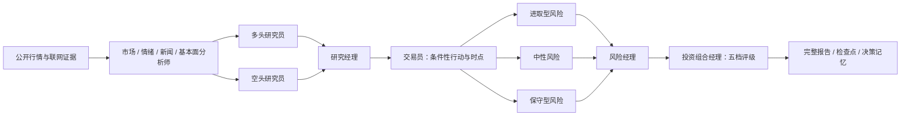

# TradingAgents Codex Native

[](LICENSE)
[](.codex-plugin/plugin.json)
[](#为什么不需要大模型-api-密钥)

一个可直接在 Codex 中运行的 TradingAgents 风格多角色金融研究插件。

它让当前 Codex 模型承担市场、情绪、新闻、基本面、牛熊研究、交易计划、风险审查和投资组合经理等角色，不调用外部大模型供应商，也不要求用户提供 OpenAI、Anthropic、Google 或其他模型 API 密钥。

> [!IMPORTANT]
> 本项目是独立的 Codex 原生适配版，并非 Tauric Research 官方发行版。角色结构和研究思想受到 [TauricResearch/TradingAgents](https://github.com/TauricResearch/TradingAgents) 启发；上游项目及论文引用见[致谢与引用](#致谢与引用)。

> [!WARNING]
> 本项目只用于研究与决策支持，不构成投资建议。它不会连接券商、读取交易账户或执行订单。

## 主要特点

- **Codex 原生推理**：所有角色直接使用当前 Codex 任务中的模型和工具。
- **不需要外部模型密钥**：不调用 OpenAI API、Anthropic API、Gemini API 等外部模型接口。
- **完整多角色流程**：股票分析最多运行 13 个角色阶段；加密资产自动跳过公司基本面角色。
- **公开数据行情快照**：内置 Nasdaq、Yahoo Finance 和 CoinGecko 的无密钥数据回退。
- **联网证据研究**：检索公告、监管文件、公司材料、新闻、宏观与情绪证据，并保存来源清单。
- **牛熊独立辩论**：分别建立最强多头和空头论点，再由研究经理仲裁。
- **多层风险审查**：进取、中性、保守三种风险视角，最终由风险经理裁决。
- **历史截点分析**：可限定“截至某个日期”，排除截止日之后的信息，降低前视偏差。
- **断点续跑**：通过 `run_state.json` 从首个未完成阶段继续。
- **持久决策记忆**：记录同标的历史评级、论点、失效条件和后续结果。
- **完整报告树**：保存各角色报告、证据、状态、总报告和机器可读摘要。
- **零第三方 Python 依赖**：辅助脚本只使用 Python 标准库。

完整说明参见 [CAPABILITIES.zh-CN.md](CAPABILITIES.zh-CN.md)。

## 工作流程



最终评级固定为以下五档之一：

- `Buy`
- `Overweight`
- `Hold`
- `Underweight`
- `Sell`

## 角色能力

| 阶段 | 角色 | 主要输出 |
|---|---|---|
| 独立分析 | 市场分析师 | 趋势、动量、波动率、回撤、成交量、相对基准表现 |
| 独立分析 | 情绪分析师 | 情绪方向、强度、持续性、分歧和来源可信度 |
| 独立分析 | 新闻分析师 | 公司、行业、宏观、监管和地缘催化剂时间线 |
| 独立分析 | 基本面分析师 | 收入、利润率、现金流、资产负债表、估值、指引和会计风险 |
| 研究辩论 | 多头研究员 | 最强上行逻辑、催化剂、市场可能忽略的信息 |
| 研究辩论 | 空头研究员 | 估值、增长、监管、流动性和尾部风险 |
| 研究辩论 | 研究经理 | 比较证据质量并解决事实冲突，保留真实不确定性 |
| 交易规划 | 交易员 | 买入/卖出/减仓/持有/回避、确认条件、风险预算和失效逻辑 |
| 风险辩论 | 进取/中性/保守风险分析师 | 从三种风险偏好审查收益、波动、流动性、集中度与尾部风险 |
| 风险裁决 | 风险经理 | 敞口上限、最大容忍损失、复核触发器和熔断条件 |
| 最终决策 | 投资组合经理 | 五档评级、置信度、行动、仓位指引、风险和监控计划 |

## 行情与技术指标

内置行情脚本可以计算：

- 1、5、20、60、252 个交易周期收益；
- 20、50、200 日简单移动平均线；
- 12/26 日 EMA 差值形式的 MACD；
- RSI(14) 和 ATR(14)；
- 20 日年化历史波动率；
- 252 日最大回撤；
- 52 周高点和低点；
- 最新成交量、20 日平均成交量和量比；
- 相对基准的 5、20、60、252 日超额收益；
- 最近 10 根日线和原始/复权收盘价。

默认基准会随市场调整，例如美股使用 SPY、港股使用恒生指数、日本使用日经指数；也可以在提示词中指定基准。

## 支持的标的

- 美股与 ETF：`NVDA`、`AAPL`、`SPY`
- 港股：`0700.HK`
- 日本：`7203.T`
- 英国：`AZN.L`
- 加拿大：`.TO`
- 澳大利亚：`.AX`
- 印度：`.NS`、`.BO`
- 中国 A 股：`.SS`、`.SZ`
- 加密资产：`BTC-USD`、`ETH-USD` 等
- 常见外汇/商品别名：`EURUSD`、`GBPUSD`、`USDJPY`、`XAUUSD`、`XAGUSD`

实际覆盖取决于公开数据端点是否支持对应代码。

## 安装

### 方法一：让 Codex 安装本仓库

把本仓库 URL 发给 Codex，然后输入：

```text
请使用 $plugin-creator，将这个 GitHub 仓库安装为个人 Codex 插件，
校验插件结构，并把它加入个人 marketplace：<粘贴本仓库 URL>
```

安装完成后，彻底退出并重新打开 ChatGPT/Codex 桌面应用，然后新建任务。

### 方法二：手动安装

将仓库克隆或解压到标准个人插件目录：

```bash
mkdir -p "$HOME/plugins"
git clone <本仓库的 HTTPS 地址> "$HOME/plugins/tradingagents-codex-native"
```

在 `~/.agents/plugins/marketplace.json` 的 `plugins` 数组中加入：

```json
{
  "name": "tradingagents-codex-native",
  "source": {
    "source": "local",
    "path": "./plugins/tradingagents-codex-native"
  },
  "policy": {
    "installation": "AVAILABLE",
    "authentication": "ON_INSTALL"
  },
  "category": "Finance"
}
```

如果这是第一个个人插件，建议使用方法一，让 `$plugin-creator` 生成完整的 marketplace 文件。更多说明见 [INSTALL.zh-CN.md](INSTALL.zh-CN.md)。

## 使用方法

重启桌面应用并新建任务后，显式调用 Skill：

```text
使用 $run-tradingagents-native 分析 NVDA，截至 2026-07-12。
运行全部适用角色，使用 SPY 作为基准，生成中文完整报告，
并保存到当前工作区的 outputs/NVDA 目录。
```

分析国际股票：

```text
使用 $run-tradingagents-native 分析 0700.HK，截至 2026-07-12。
运行全部股票研究角色，使用中文输出，并列出所有关键来源。
```

分析加密资产：

```text
使用 $run-tradingagents-native 分析 BTC-USD，截至 2026-07-12。
运行适用于加密资产的全部角色，重点评估波动、流动性和监管风险。
```

恢复中断的运行：

```text
使用 $run-tradingagents-native 继续这个运行：/绝对路径/run_state.json。
不要重做已经完成的阶段，完成剩余分析并重新生成总报告。
```

## 输出结构

```text
<run-root>/
├── run_state.json
├── analysis_state.json
├── evidence/
│   ├── market_snapshot.json
│   └── sources.json
└── reports/
    ├── 1_analysts/
    ├── 2_research/
    ├── 3_trading/
    ├── 4_risk/
    ├── 5_portfolio/
    ├── complete_report.md
    └── run_summary.json
```

## 为什么不需要大模型 API 密钥

上游 TradingAgents 通过 LangGraph 调用用户选择的外部模型供应商。本项目将角色编排改写为 Codex Skill：当前 Codex 任务本身提供推理能力，因此不再需要额外调用模型 API。

仍然需要网络连接来获取公开行情、公告、新闻和其他证据，但辅助脚本不会读取或请求模型供应商密钥。

## 与上游项目的区别

| 项目 | TradingAgents Codex Native | 上游 TradingAgents |
|---|---|---|
| 推理运行时 | 当前 Codex 任务 | LangGraph + 配置的模型供应商 |
| 模型密钥 | 不需要额外模型密钥 | 根据供应商配置密钥或本地模型 |
| 角色隔离 | Codex 子代理可用时使用子代理，否则分角色顺序执行 | LangGraph 节点与状态图 |
| 辅助依赖 | Python 标准库 | Python 包及项目依赖 |
| 交易执行 | 不执行交易 | 上游包含模拟交易决策流程 |
| 代码关系 | 独立重新实现，不捆绑上游 Python/LangGraph 源码 | 官方实现 |

## 测试

```bash
python3 -m unittest discover -s tests -p 'test_*.py' -v
```

当前测试覆盖：

- 历史日期和未来日期边界；
- 指标计算；
- 标的代码规范化；
- 工作区和检查点；
- 报告渲染和决策记忆；
- 不依赖外部模型密钥。

## 已知限制

- 不是实时逐笔、Level 2 订单簿、高频执行或做市系统。
- 不是完整量化回测、组合优化或税务规划平台。
- 公开数据源可能延迟、限流、缺失或不支持特定标的。
- 报告质量取决于当前 Codex 模型、联网工具、来源覆盖和子代理可用性。
- 大模型研究具有非确定性；相同标的和日期的两次报告可能不完全相同。
- 证据不足或冲突严重时，系统应降低置信度、给出 `Hold` 或建议回避。

## 致谢与引用

本项目的多角色金融研究结构受到以下开源项目启发：

- **原始项目**：[TauricResearch/TradingAgents](https://github.com/TauricResearch/TradingAgents)
- **项目名称**：TradingAgents: Multi-Agents LLM Financial Trading Framework
- **上游许可证**：Apache License 2.0

如果该研究框架对你的工作有帮助，请同时引用原作者的论文：

```bibtex
@misc{xiao2025tradingagentsmultiagentsllmfinancial,
  title={TradingAgents: Multi-Agents LLM Financial Trading Framework},
  author={Yijia Xiao and Edward Sun and Di Luo and Wei Wang},
  year={2025},
  eprint={2412.20138},
  archivePrefix={arXiv},
  primaryClass={q-fin.TR},
  url={https://arxiv.org/abs/2412.20138}
}
```

本适配项目与 Tauric Research 不存在官方隶属或背书关系。详细声明见 [NOTICE.md](NOTICE.md)。

## License

本项目采用 [Apache License 2.0](LICENSE)。
