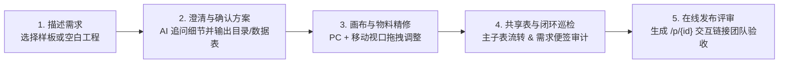
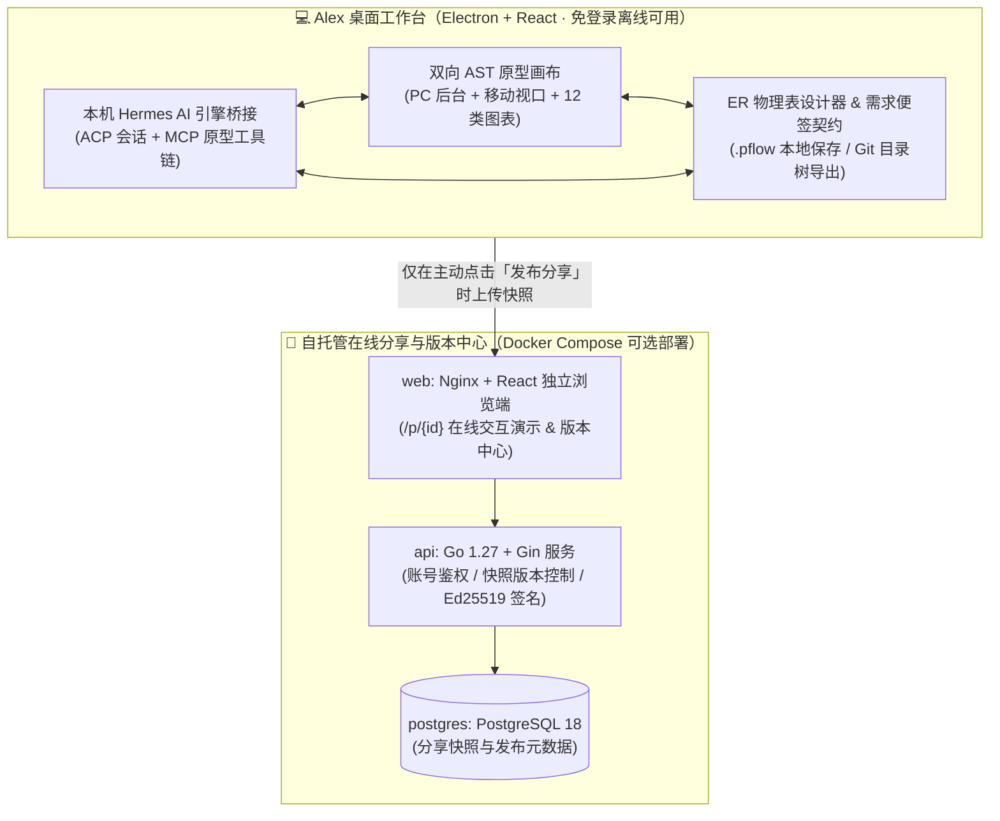

<div align="center">


# ProtoFlow AI

### 开源 AI 原型设计工具 · 把需求做成能跑起来的业务原型

描述你的业务，AI 先澄清细节再规划目录、页面与共享物理表；<br/>
在画布中精修 **PC 中后台** 与 **移动端真机视口**，让表单、列表、图表与审批真正流转起来，并通过 MCP 双向连接 **Claude Code / Cursor / Codex / Antigravity**。

**[浏览器在线试玩 Live Demo](https://alex.xclubai.com/demo/)** · **[访问官方网站](https://alex.xclubai.com/)** · **[MCP 接入指南](https://alex.xclubai.com/mcp/)** · **[加入 Discord 社区](https://discord.gg/YDnKBhmsrR)**（`#chinese` 中文交流 / `#help-and-bugs` 问题反馈）

[](https://alex.xclubai.com/)
[](./LICENSE)
[](https://github.com/EvanClub-Agent/protoflow-ai/actions)
[](https://github.com/EvanClub-Agent/protoflow-ai/releases)
[](./deploy/compose.yml)
[](./.nvmrc)
[](./server/go.mod)

**简体中文** · [English](./README.en.md)

[浏览器在线体验](https://alex.xclubai.com/demo/) · [快速上手](#-60-秒快速上手) · [为什么选 ProtoFlow AI](#-为什么选择-protoflow-ai) · [核心能力](#-核心能力矩阵) · [MCP 接入 Coding Agent](#-mcp-双向设计与规格服务连接-codex--antigravity--claude) · [Docker 私有化部署](#-docker-compose-私有化部署3-步启动) · [模型生态](#-支持的-ai-模型服务) · [参与贡献](#-参与贡献pr-友好)

<br/>


</div>

---

## 💡 为什么选择 ProtoFlow AI？

在真实研发协作中，产品经理与开发团队常常困在两种极端工具之间：要么画**点不动的静态线框图**，要么让 AI 生成**一次性、没法改局部、页面之间数据各编各的孤立网页**。**ProtoFlow AI（原名 Alex）**专为打通从「需求梳理」到「业务闭环验收」而设计：

| 维度 | 传统静态原型工具 | 一次性 AI 生成网页工具 | **ProtoFlow AI（原名 Alex）** |
| :--- | :--- | :--- | :--- |
| **数据流转** | 静态假字，新建记录不会进入列表 | 单页硬编码 Mock，切页即丢状态 | **绑定真实工程物理表（ER），多菜单读写实时互通** |
| **AI 协作方式** | 无原生工程级理解 | 盲猜需求直接吐整页代码，极易跑偏 | **先追问关键业务边界 → 确认目录与表结构方案 → 再生成** |
| **后期精修成本** | 纯手工对齐海量画板 | 改一个字段常把整页布局重洗破坏 | **AST 双向画布可视化拖拽 + 局部无损对话精修** |
| **多端协同** | PC 与移动端分两个文件各自画 | 难以共享同一套后台业务数据 | **同一工程内混排 PC 后台与 iPhone 视口，跨端共表联动** |
| **需求与研发衔接** | 靠长篇离线 Word / 口头解释 | 无字段约束与验收标准 | **组件级黄色需求便签 + 外键影响域分析 + 闭环验收巡检** |
| **数据主权与部署** | 云端强绑定账号 | 依赖厂商闭源 SaaS | **免登录本机离线开箱即用 + Docker 一键自建团队评审服** |

---

## ✨ 核心能力矩阵

<table>
  <tr>
    <td width="50%" valign="top">
      <h3>01 · 项目 AI「先问清楚，再动手」</h3>
      <p>用自然语言描述业务，内置的 Hermes 协同引擎会主动识别模糊规则并向你提问澄清，随后输出模块目录、页面清单与物理表蓝图，经你确认后才批量生成，支持局部增量修改而不破坏既有设计。</p>
    </td>
    <td width="50%" valign="top">
      <h3>02 · AST 双向画布与 134+ 高上限物料</h3>
      <p>内置无弹窗主从列表（Repeater）、多枚举状态泳道看板（Kanban）、排班日历（Calendar）、AI 洞察卡片、Bento 微型趋势指标卡、主子表、抽屉弹窗及沙箱自由组件；支持工程级品牌主题令牌（Design Tokens）与 TSX DSL 实时无损同步。</p>
    </td>
  </tr>
  <tr>
    <td width="50%" valign="top">
      <h3>03 · ER 物理表、Poka-Yoke 防错与 5 秒撤销</h3>
      <p>配备 Navicat 风格数据库设计器，支持跨字段日期/库存上限防错（<code>minField</code> / <code>maxField</code>）、手机号/税号格式校验、多层外键 <code>RESTRICT / CASCADE / SET NULL</code> 保护、单号匹配二次确认及 <code>deleteRow('undo')</code> 5 秒原子撤销恢复。</p>
    </td>
    <td width="50%" valign="top">
      <h3>04 · PC 后台 + iPhone 视口 + UI Stack 五态</h3>
      <p>同一工程混排宽屏管理后台与 iPhone 现场端（含移动看板、周日程流、半屏领料抽屉），两端实时共表；顶部一键切换「理想 / 空白 / 加载 / 极值 / 异常」五态，极值压测文案严格展示隔离不污染底层数据。</p>
    </td>
  </tr>
  <tr>
    <td width="50%" valign="top">
      <h3>05 · 12 类 ECharts 图表 + Axure / Figma 本地导入</h3>
      <p>原生集成 12 类绑定物理表的 Apache ECharts 图表与 Mermaid 图谱；支持免装软件本机离线解析 <strong>Axure RP 9/11（<code>.rp</code>）</strong> 与 <strong>Figma（<code>.fig</code> 归档及链接同步）</strong>，并可按需由 AI 受控升维为数据驱动流式页面。</p>
    </td>
    <td width="50%" valign="top">
      <h3>06 · 需求便签、分屏笔记与闭环审计</h3>
      <p>把字段精度、防超收规则贴在具体按钮或表格上作为「需求便签」，结合富文本项目笔记与思维导图；改动任意表字段即可查看跨页面影响范围，自动巡检未闭环的跳转与外键。</p>
    </td>
  </tr>
  <tr>
    <td width="50%" valign="top">
      <h3>07 · 开箱即用的 AI 引擎管理中心</h3>
      <p>桌面端内置 NousResearch Hermes Agent 自动安装、升级与技能同步。支持按会话自由切换 14+ 云端大模型或本地 Ollama 模型，并支持调节模型推理强度（Reasoning Effort）。</p>
    </td>
    <td width="50%" valign="top">
      <h3>08 · 本机隐私优先 + 团队一键在线分享</h3>
      <p>工程默认以 <code>.pflow</code> 归档及 Git 友好目录树保存在本机，无需登录即可完整使用。连接团队自建服务后，一键生成支持访问密码、有效期、版本更新与撤回的 <code>/p/{id}</code> 评审链接。</p>
    </td>
  </tr>
</table>

---

## 🧭 系统架构与五步工作流

### 五步完成一次高质量需求评审



### 桌面设计器与自托管服务端关系



> [!IMPORTANT]
> **部署形态提示**：**Alex 桌面客户端**负责日常原型设计、数据库建模与本地 AI 协同；Docker Compose 部署的 `web` 容器是**在线原型预览器与团队版本中心**（让同事免装客户端直接在浏览器体验 `/p/{id}` 交互原型），两者职责清晰分离。

---

## 🚀 60 秒快速上手

### 方式 A：下载安装包或本地源码启动设计器（免登录开箱即用）

- **直接安装桌面端**：前往 [**ProtoFlow AI 官网下载页**](https://alex.xclubai.com/#download) 或 [**GitHub Releases**](https://github.com/EvanClub-Agent/protoflow-ai/releases) 下载对应系统的安装包（新版 AppImage 使用 `ProtoFlow_AI-*` 命名，其他安装包沿用 `Alex-*`，支持 macOS Apple Silicon / Intel `.dmg`、Windows `.exe`、Linux `.deb` / `.AppImage`）；或直接打开 [**浏览器在线沙盒**](https://alex.xclubai.com/demo/) 免下载体验【星链设备售后维保与备件履约平台】多端共表活原型。
- **从源码极速运行**（仅需 **Node.js 22+**，无需安装 Go、无需数据库、无需预先配 AI）：

```bash
git clone https://github.com/EvanClub-Agent/protoflow-ai.git
cd protoflow-ai
npm install

# 启动浏览器热更新预览（秒开画布、物理表与内置样板）
npm run dev

# 或启动完整 Electron 桌面应用（解锁本地文件自动保存与 Hermes AI 管理中心）
npm run electron:start
```

打开应用后无需注册登录即可直接新建项目，内置 **3 套高质量脱敏社区样板**供即刻体验：
1. **SaaS 电商进销存后台**：含供应商准入、采购订单确认、到货入库主子表联动、4 张共享物理表与 5 条算税/防超收需求便签。
2. **CRM 销售数据看板**：预置绑定物理表的月度签约趋势折线图、大区 ARR 柱状图与企业客户商机 CRUD 台账。
3. **现代移动应用 / 跨端协同样板**：含 C 端探索瀑布流、B 端移动待办抽屉、AI 助手页与跨端共表演示。

---

## 🐳 Docker Compose 私有化部署（3 步启动 · 多架构 GHCR 镜像）

如果团队需要将原型一键生成在线链接（如 `http://your-server:8088/p/xxx`）发给同事或客户在浏览器中交互体验，仓库在 GitHub Container Registry（GHCR）提供了每次发版自动构建的 **`linux/amd64` + `linux/arm64` 多架构官方镜像**，搭配 `PostgreSQL 18` 开箱即用：

| 容器服务 | 官方预编译镜像（支持 `amd64` / `arm64`） | 说明 |
| :--- | :--- | :--- |
| `api` | `ghcr.io/evanclub-agent/protoflow-ai-api:latest`<br/>（或固定版本 `:v0.1.4`） | Go 1.27 + Gin 发布鉴权、快照校验、远程 HTTP MCP（`/api/v1/mcp/:id`）与版本中心服务 |
| `web` | `ghcr.io/evanclub-agent/protoflow-ai-web:latest`<br/>（或固定版本 `:v0.1.4`） | Nginx + 在线交互原型浏览端（含 UI Stack 五态切换、主题渲染、需求便签与版本管理台） |
| `postgres` | `postgres:18-alpine` | 持久化分享快照、版本记录与发布元数据（启动时由 `api` 自动执行 SQL 迁移） |

```bash
# 1. 复制环境变量配置（按需修改 POSTGRES_PASSWORD 与对外访问地址 PUBLIC_ORIGIN）
cp deploy/.env.example deploy/.env

# 2. 直接拉取 GHCR 预编译镜像并后台秒级启动（自动完成 PostgreSQL 建表迁移；本地改了源码可加 --build）
docker compose --env-file deploy/.env -f deploy/compose.yml up -d

# 3. 检查健康状态（返回 ok 即部署成功）
curl -fsS http://127.0.0.1:8088/healthz
```

**平滑升级已有自托管服务**（拉取最新镜像并滚动重建，PostgreSQL 数据卷完整保留）：

```bash
docker compose --env-file deploy/.env -f deploy/compose.yml pull &&
  docker compose --env-file deploy/.env -f deploy/compose.yml up -d
```

> 如需在生产环境锁定指定镜像版本，可在 `deploy/.env` 中设置 `PROTOFLOW_API_IMAGE=ghcr.io/evanclub-agent/protoflow-ai-api:v0.1.4` 与 `PROTOFLOW_WEB_IMAGE=ghcr.io/evanclub-agent/protoflow-ai-web:v0.1.4`。

### 在客户端连接你的自建服务

1. 打开 Alex 桌面端，点击右上角 **「本地模式 · 连接服务」**（或顶部 **「发布与分享」**）。
2. 在 **「自建服务地址」** 中填入你的 `PUBLIC_ORIGIN`（如本机测试填 `http://localhost:8088`，局域网填 `http://192.168.x.x:8088`，公网域名填 `https://protoflow.your-company.com`）。
3. 直接注册账号并登录，即可发布在线分享链接、设置访问密码、同链接迭代更新或一键撤回！

| 部署场景 | `deploy/.env` 关键配置建议 | 说明 |
| :--- | :--- | :--- |
| **本机快速体验** | 保持默认（`PUBLIC_ORIGIN=http://localhost:8088`） | 仅本机可访问，零额外配置 |
| **团队局域网共享** | `WEB_BIND=0.0.0.0`<br/>`PUBLIC_ORIGIN=http://<服务器内网IP>:8088` | 同一内网同事可直接打开分享链接；如需内网 HTTP 访问管理后台可配 `ADMIN_HTTP_ALLOWED_CIDRS` |
| **公网域名 HTTPS** | `WEB_BIND=127.0.0.1`<br/>`PUBLIC_ORIGIN=https://protoflow.example.com` | 由宿主机 Nginx / Caddy 终结 TLS 后反代至 `127.0.0.1:8088`，详见 [公网 HTTPS 部署指南](./docs/public-server-deployment.md) |

<details>
<summary><b>🔧 查看版本管理中心初始化与多端安装包打包命令</b></summary>

<br/>

**初始化平台管理员账号**（用于登录 `http://127.0.0.1:8089/releases/admin` 托管团队内部客户端安装包与查询运行诊断）：

```bash
docker compose --env-file deploy/.env -f deploy/compose.yml exec api /app/protoflow create-admin admin
```

**从源码打包三端桌面安装程序**（输出至 `release/` 目录）：

```bash
npm run build:mac        # macOS (.dmg + .zip，支持 arm64 / x64)
npm run build:win        # Windows x64 (.exe NSIS 安装向导)
npm run build:linux      # Linux x64 (.deb + .AppImage + .tar.gz)
```

更多架构细节请查阅：
- [在线发布与服务端部署说明](./docs/web-publishing.md)
- [公网 HTTPS 与反向代理部署指南](./docs/public-server-deployment.md)
- [桌面端多平台打包与签名指南](./docs/desktop-packaging.md)
- [本地运行诊断机制说明](./docs/runtime-diagnostics.md)

</details>

---

## 🔌 MCP 双向设计与规格服务（连接 Codex / Antigravity / Claude）

Alex 内置 **MCP（Model Context Protocol）双向设计与只读规格服务**，打通从「AI 直接操控画布生成原型 & 数据库」到「研发阶段按需读取规格写生产代码」的完整闭环（完整配置与 18 个工具文档见官网 [**MCP 接入指南**](https://alex.xclubai.com/mcp/)，支持 **Claude Code**、**Cursor**、**Codex**、**Google Antigravity** 与 **Claude Desktop**）：

- **桌面端双向实时设计（Live Canvas Bridge + 视觉截图复核）**：在桌面端打开 `.pflow` 工程，进入 **「MCP 接入 → 本地 → 双向设计」**，**Codex**、**Google Antigravity**、**Claude Desktop**、**Claude Code** 即可读取当前页面与画布选中组件（`selectedPfId`），调用 18 个契约受控工具直接建表、灌入外键自洽样例数据、生成或无损局部修改桌面/移动端页面、编写需求便签与流程图，并通过 `protoflow_capture_preview` 截取高清画布/手机视口 PNG（自动等待图表与自由组件首帧渲染，支持 `fullPage` 长页检查）自我复核排版；所有外部修改实时上屏落盘并支持顶部提示条与 `Cmd/Ctrl+Z` 逐步撤销。面板内置 **Antigravity 插件一键安装**、**Claude Desktop `.mcpb` 扩展导出** 及三端设计 Skill 安装。
- **远程在线只读直连（研发零安装）**：产品发布 `/p/{id}` 评审链接后，研发无需安装 Alex 或下载 `.pflow` 文件，点击演示页顶部的 **「MCP 接入」** 即可复制远程 Streamable HTTP 配置读取路由树、ER 表、PostgreSQL/MySQL DDL、页面 TSX 与便签规则：
  ```json
  {
    "mcpServers": {
      "protoflow": {
        "url": "https://protoflow.example.com/api/v1/mcp/<shareId>"
      }
    }
  }
  ```
- **本地 `.pflow` 命令行读写 / 热读**：客户端内置运行时**免装 Node.js** 即可直接运行，亦可通过 CLI 连接本地工程（只读 `--project ./app.pflow` 或离线创作 `--mode readwrite --workspace ./projects`，详见 [`packages/protoflow-mcp/README.md`](./packages/protoflow-mcp/README.md)）。

---

## 🤖 支持的 AI 模型服务

在桌面端 **「AI 管理中心」** 一键安装连接 Hermes 后，你可以自由配置熟悉的云端大模型，或通过 **Ollama** 完全离线运行本地模型；**不使用 AI 时，画布设计、数据库建模与在线分享同样 100% 独立可用**。

Alex 默认安装已验证的 Hermes 托管运行时，使用独立的程序、依赖和账号配置。已经连接外部 Hermes 的用户可以在「AI 管理中心」点击「使用 Alex 托管运行时」，然后在新环境中授权账号。旧对话和草稿保存在原环境。原版本与 Alex 兼容时，可在「高级设置」点击「切回原 Hermes 环境」继续使用。

<div align="center">


</div>

---

## 📂 仓库结构与常用脚本

<details>
<summary><b>📁 展开查看完整项目目录说明与开发命令速查表</b></summary>

<br/>

```text
protoflow-ai/
├── src/
│   ├── components/        # 工作台核心界面（欢迎启动器、AI 协同面板、ER 设计器、笔记、在线发布等）
│   ├── proto/             # 原型引擎内核
│   │   ├── dsl/           # TSX AST 解析器、打印器与无损代码同步
│   │   ├── designer/      # 可视化拖拽画布与属性检查器面板
│   │   ├── registry/      # PC 中后台组件物料注册表与契约校验
│   │   ├── mobile/        # 移动端真机视口与现代触控组件物料
│   │   ├── charts/        # 12 类 Apache ECharts 图表模型与数据绑定
│   │   ├── database/      # 物理表关系推导与预览数据引擎
│   │   ├── freeform/      # 沙箱化自由组件运行时
│   │   └── starter/       # 内置社区起点项目模板（CRM 看板等）
│   ├── viewer/            # 独立构建的在线分享浏览端与版本中心界面
│   ├── services/          # 工程持久化、快照生成、需求审计、发布客户端等服务
│   └── store/             # Zustand 状态仓库
├── electron/              # Electron 主进程、OS 安全存储、Hermes ACP/MCP 原生桥接
├── server/                # Go 1.27 + Gin + pgx 在线发布与版本管理后端服务
├── deploy/                # Docker Compose 一键编排、Nginx 配置与 systemd 运维模板
├── website/               # 纯静态产品宣传与多平台下载官网
├── scripts/               # 物料契约编译、自动化测试与打包烟雾校验脚本
└── tests/                 # 600+ 项前端、DSL 契约、Poka-Yoke 防错、桥接与恢复回归测试
```

| 常用命令 | 用途说明 |
| :--- | :--- |
| `npm run dev` | 启动 Vite 本地开发热更新服务 |
| `npm run electron:start` | 启动本地 Electron 桌面应用 |
| `npm test` | 编译物料契约并运行全量回归测试套件 |
| `npm run build` | 构建桌面端前端资源（输出到 `dist/`） |
| `npm run build:viewer` | 构建在线原型浏览端资源（输出到 `dist-viewer/`） |
| `npm run server:dev` | 本地启动 Go 发布服务（读取 `server/.env.local`） |
| `npm run server:test` | 运行 Go 服务端单元测试 |
| `npm run website:preview` | 在 `http://localhost:4173` 本地预览静态官网 |

</details>

<details>
<summary><b>❓ 常见问题 (FAQ)</b></summary>

<br/>

- **如何导入 Axure（`.rp`）与 Figma（`.fig` / 链接）设计稿？** 在欢迎启动页点击「导入设计稿（Figma · Axure RP）」或直接将 `.rp`（Axure RP 9 / 11）与 `.fig` 文件拖入工作台，解析全程在本机 Worker 离线完成（无需安装 Axure，也无需上传云端）；同时支持粘贴 Figma 文件/Frame 链接并通过系统钥匙串（OS Keychain）安全保存 PAT 拉取节点与内嵌图片。导入后不仅能可视化编辑，还可在「项目 AI」中按单页、目录或全工程范围受控升维为绑定共享物理 ER 表的流式交互页面，并保留原设计页对照。

- **Q：我的工程数据与模型 API Key 保存在哪里？会自动上传吗？**  
  **A**：工程文件（`.pflow` 及解包目录）100% 保存在你选择的本机目录；模型账号与 API Key 由本机 Hermes 管理，诊断采集默认仅存本地（Opt-in）。**只有当你主动点击「发布分享」时**，页面结构与演示快照才会上传到你填写的自建服务器。

- **Q：不配置 AI 模型，或者不部署 Docker 服务端，能用 Alex 吗？**  
  **A**：完全可以！Alex 默认免登录启动，不配 AI 依然可以使用全部可视化拖拽画布、ER 物理表建模、ECharts 图表、Mermaid 图谱、需求便签与本地 `.pflow` / HTML 导出功能。

- **Q：macOS 首次打开提示「无法验证开发者」怎么处理？**  
  **A**：社区构建版采用本地签名，首次打开可在「访达 → 应用程序」中右键点击 **Alex** 选择「打开」，或在「系统设置 → 隐私与安全性」底部点击「仍要打开」（仅首次需要）。

</details>

---

## 🤝 参与贡献（PR 友好！）

我们把前端画布、组件物料注册表与后端服务做了彻底解耦——**不需要配置 Go 或 PostgreSQL，只需 `npm install && npm run dev` 就能在 60 秒内开始修改并实时预览效果！**

非常欢迎通过以下方向提交你的第一个 Pull Request：
- 🧩 **扩展原型组件物料**：在 `src/proto/registry/`（PC 端）或 `src/proto/mobile/`（移动端）新增常用业务组件。
- 📦 **贡献行业起点样板 / 图表模板**：在 `src/proto/starter/` 新增开箱即用的行业工程模板，或在 `src/services/mermaidCatalog.ts` 补充流程图模板。
- 🌍 **多语言国际化、模型目录扩展与体验打磨**：修复交互细节、完善文档或补充新模型图标。

开始前请阅读 **[CONTRIBUTING.md（贡献者快速指南）](./CONTRIBUTING.md)**，内含具体修改文件路径与本地一键自检命令。遇到任何问题欢迎提交 [Issue](https://github.com/EvanClub-Agent/protoflow-ai/issues) 交流！

---

## 📄 开源协议与致谢

- 本项目基于 **[Apache License 2.0](./LICENSE)** 协议开源，可免费用于个人学习、商业产品原型设计与企业内部私有化部署。
- AI 协同运行时基于 [NousResearch/hermes-agent](https://github.com/NousResearch/hermes-agent) 构建；模型服务商品牌图标来自 LobeHub Icons（详见 [许可声明](./website/assets/providers/LICENSE)）。

<div align="center">
  <sub>如果 Alex 对你的需求梳理或原型评审有帮助，欢迎点亮右上角的 ⭐ <b>Star</b> 支持项目持续演进！</sub>
</div>
