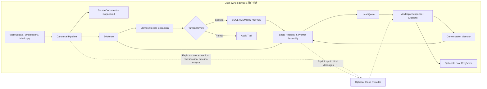
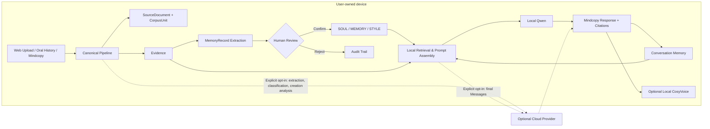

# LifeContext L1

> 把散落的人生数据，变成可追溯、可校正、可运行的数字自我。  
> Turn scattered life data into a traceable, correctable, and runnable digital self.


[中文](#中文) · [English](#english) · [数据主权](#数据主权与全端侧运行) · [开放规范](#lifecontext-开放规范) · [哲学基础](#哲学基础与工程路线) · [项目结构](#项目结构) · [Project structure](#project-structure)

---

<a id="中文"></a>

## 中文

LifeContext L1 是由 [Everlsating AI（生生科技）](https://everlasting.zone)构建的本地优先个人人生上下文操作系统，也是拟议 **LifeContext 开放规范**的首个参考实现。它把用户主动授权的文档、聊天记录、口述史和声音资料，转化为一条可追溯、可校正、可移植的数据链：

```text
原始资料 → SourceDocument / CorpusUnit → Evidence → MemoryRecord → 人工审核
        → SOUL / MEMORY / STYLE → Mindcopy → 对话与 Agent
```

项目试图回答一个具体的工程问题：如果要让 AI 真正理解一个人，我们应该怎样保存个人数据，怎样区分原始证据与模型推断，又怎样让每一项人格和记忆都能够回到来源？更进一步，跨模型、跨设备、跨应用的数字自我，能否共享一套由本人持有和治理的人生上下文格式？

LifeContext 将这一目标称为 **L1 意识上传**：基于个人表达数据，重建可测试的语言风格、记忆线索、价值倾向和决策模式。L1 衡量的是行为与表达层面的相似性，**不声称主观意识已经被转移，也不证明数字代理与生物主体具有严格同一性**。

Everlasting AI 是较早将“人生上下文（Life Context）”作为独立技术对象提出并持续工程化的团队之一。团队成员来自**南京大学、北京理工大学与深圳科创学院（InnoX Shenzhen）**。我们的目标不只是发布一个数字自我产品，而是为数字永生、个性化 Agent 与 L1 意识上传生态提供可以共同实现、检验和演化的基础格式。

> **我们的基本立场：你的数据留在你的设备上；AI 对你的每一项理解都应该有出处；任何模型都不应垄断你的数字自我。**

## 数据主权与全端侧运行

除个人创作分析仅支持云端模式外，LifeContext L1 的核心链路可以完整运行在用户设备上。准备好运行时与模型权重后，聊天、反思、访谈和 Mindcopy 对话的资料导入、文档解析、SourceDocument 与 CorpusUnit 规范化、Evidence 生成、MemoryRecord 提取、本人审核、人格编译、上下文检索、本地模型推理、会话记忆与可选语音服务均可在本机完成。在本地模式中，这些链路从数据进入到 Mindcopy 回应都不要求个人资料离开设备，也不依赖 LifeContext 的云端服务器。

| 环节                                         | 默认位置             | 是否需要离开设备                            |
| -------------------------------------------- | -------------------- | ------------------------------------------- |
| 原始资料、SourceDocument 与 CorpusUnit       | 本地                 | 否                                          |
| Evidence 与 MemoryRecord                     | 本地                 | 否                                          |
| SOUL / MEMORY / STYLE                        | 本地                 | 否                                          |
| 检索、Prompt 组装与会话记忆                  | 本地                 | 否                                          |
| Qwen3-4B / llama.cpp 推理                    | 本地                 | 否                                          |
| CosyVoice 音色与语音生成                     | 本地可选             | 否                                          |
| 云端结构化提取、关系分类、创作分析与最终推理 | 用户主动选择的服务商 | **可选；发送对应任务的资料片段或 Messages** |

“本地优先”是一组产品权利：

- **持有权**：原始资料、记忆与人格结构由本人持有；
- **知情权**：每项记忆和人格判断能够回到证据来源；
- **校正权**：模型推断不会自动成为个人历史，本人可以确认、排除或保留待审核；
- **选择权**：用户自行决定使用本地模型还是云端模型；
- **迁移权**：人生上下文以可读、模型无关的结构保存，不与单一供应商绑定；
- **撤回权**：授权应当具体且可撤回；覆盖派生物的可验证删除仍是项目正在建设的核心能力。

## LifeContext 开放规范

LifeContext L1 不只实现一套应用，也在验证一种标准化的人生上下文操作格式。拟议的 **LifeContext 1.0 开放规范**将定义个人上下文从采集到运行所需的基本对象、字段与生命周期，使采集工具、端侧设备、模型、Agent 和数字自我应用能够在明确授权下互操作。

规范方向包括：

1. **Provenance / 来源**：内容来自哪个文件、设备、会话、人物或采集过程；
2. **Subject / 主体**：内容描述谁、由谁表达，避免把第三方话语归入本人；
3. **Time / 时间**：发生时间、有效时期与认知变化，允许“过去的我”不同于“现在的我”；
4. **Semantics / 语义**：事件、观点、偏好、关系、决定、反思和认知转折等可扩展类型；
5. **Uncertainty / 不确定性**：通过来源类型、显式或推断关系、任务缺口与审核状态区分原文、结构化事实和模型推断，不使用通用 `confidence` 字段；
6. **Review / 本人审核**：`unreviewed`、`confirmed`、`rejected`、`disputed` 等状态及其审计轨迹；当前审核接口接受前三种；
7. **Consent / 授权**：数据的用途、范围、期限、可见性与撤回条件；
8. **Versioning / 演化**：人格、记忆和关系的版本、冲突、回滚与谱系；
9. **Portability / 可移植性**：以模型无关的格式导出，并由不同运行时读取；
10. **Deletion / 删除**：覆盖原文、索引、缓存与派生物的可验证删除语义。

我们希望通过公开 Schema、参考实现、迁移工具和评测集，与开发者、研究机构、硬件团队和数字生命应用共同迭代。

从这个意义上说，LifeContext 是数字永生基础设施中的“上下文协议层”：上游连接聊天、文档、口述史、穿戴设备与未来的多模态采集；下游连接本地模型、云端模型、Agent、数字分身与拟合度评测。无论应用如何变化，个人都应继续拥有同一份可追溯的人生上下文。

## 哲学基础与工程路线

LifeContext 的哲学基础来自 Everlasting AI 创始人刘骁奔撰写的[《意识上传第一范式》](https://cuilingmag.com/article/the_first_paradigm_of_consciousness_uploading)。该范式将“语言作为意识的基本单位”“主体连续性作为意识上传的核心标准”，并提出从个性化语言模型到更高阶意识技术的 L1–L4 路线。

在这一框架中，L1 首先处理可以被工程检验的问题：如何从本人授权的表达数据中形成数字意识体，以及如何量化它与本人在记忆、表达、价值和决策上的拟合程度。LifeContext L1 负责数据、证据、审核与运行；公开、可复现的 L1 Benchmark 将负责检验相似性与边界。

同一哲学基础也启发了开源项目 [soul.md](https://github.com/aeonfun/soul.md)：以 SOUL.md、STYLE.md、MEMORY.md 等可读文件，让不同模型和 Agent 加载一个人的身份、世界观、表达方式与持续记忆。LifeContext OS 在此基础上进一步补全来源、时间、证据、审核、授权和生命周期，使人格文件从手工描述走向可追溯的人生上下文编译结果。

这条 Build in Public 的工程路线可以概括为：

```text
《意识上传第一范式》 → soul.md → LifeContext L1 → L1 Benchmark → LifeContext 1.0 开放规范
     哲学坐标          人格文件       数据与运行时       拟合度尺度          生态互操作
```

哲学为项目限定“我们在上传什么”，数据主权限定“谁拥有它”，开放规范限定“生态如何共同使用它”，Benchmark 则限定“我们如何知道它是否有效”。

### 为什么需要 LifeContext

普通的个人知识库擅长“找到一段资料”，但一个长期数字自我还需要回答更多问题：

- 这段记忆来自哪里，能否定位到原文件？
- 这是本人说过的话，还是模型的推断？
- 这项判断是否经过本人确认？
- 它在什么时期成立，后来是否发生变化？
- 当证据相互冲突时，系统应该怎样表达不确定性？
- 更换模型以后，个人数据和人格结构能否继续使用？

LifeContext 的核心不是训练一个不可迁移的“替身模型”，而是建设一套独立于模型的、可追溯的人生上下文基础设施。

## 核心概念

| 概念               | 作用                                                                                                                                   |
| ------------------ | -------------------------------------------------------------------------------------------------------------------------------------- |
| **SourceDocument** | 一次独立导入的聊天、反思、创作、访谈回答或连续 Mindcopy 对话来源；文件上传由内部 UUID 区分。                                           |
| **CorpusUnit**     | 带说话者、时间、引用与原文定位的消息、段落或回答单元。                                                                                 |
| **Evidence**       | 带来源文件、定位信息和说话者标记的证据片段。                                                                                           |
| **MemoryRecord**   | 从 Evidence 中提取的 Event、Mind、Action、Fact 或 StyleMemory；Fact 保存对象、原始数量表达、步骤和条件，通用 `confidence` 字段已删除。 |
| **CreationWork**   | 每个新创作来源对应一个作品，并保存赏析报告和可审核的 StyleMemory；历史合并作品仍可查看。                                               |
| **SOUL.md**        | 身份、自我认知、价值观、目标和决策原则。                                                                                               |
| **MEMORY.md**      | 已确认的人生经历、重要关系、项目和认知转折。                                                                                           |
| **STYLE.md**       | 语言习惯、表达节奏、交流偏好和风格边界。                                                                                               |
| **Mindcopy**       | 由人格文件、相关证据、会话记忆和运行规则组装出的 L1 数字自我。                                                                         |
| **LifeContext**    | 从原始资料到可运行 Mindcopy 的完整本地数据与上下文系统。                                                                               |

## 当前能力

本仓库仍处于 **Alpha / research prototype** 阶段。下表区分了已经可运行的能力与仍在建设中的部分。

| 能力                     | 状态 | 说明                                                                                                                                           |
| ------------------------ | ---: | ---------------------------------------------------------------------------------------------------------------------------------------------- |
| 可续传资料导入           |   ✅ | 浏览器使用持久化分片上传聊天、反思和个人创作，每次上传由内部 UUID 区分。                                                                       |
| 全端侧运行               |   ✅ | 聊天、反思、访谈和 Mindcopy 链路可在本机闭环运行，包括导入、解析、提取、审核、检索、人格编译、模型对话与记忆；个人创作分析当前仅支持云端模式。 |
| 文档解析                 |   ✅ | 聊天支持 JSON/CSV，反思与个人创作支持 TXT、Markdown 和 DOCX。                                                                                  |
| 上传与原始文件保存       |   ✅ | 未完成分片与上传偏移持久化，校验成功后原子写入 UUID 区分的本地 Inbox。                                                                         |
| Evidence 生成            |   ✅ | 保存来源、定位信息和原始片段。                                                                                                                 |
| MemoryRecord 提取与审核  |   ✅ | 本地或全局选择的云端模型提取；用户可以确认、拒绝或保留待审核状态。                                                                             |
| 事实记忆与覆盖诊断       |   🧪 | 事实参与审核、编辑、检索、M2/M3 和报告；逐窗口复核与有界补提取记录剩余缺口，不代表内容完整性已获验证。                                         |
| 原始文件重提取           |   ✅ | 导入页可重提取聊天与反思文件；原文未变时保留已审核及已编辑记忆，新内容仍待审核。                                                               |
| MemoryRecord 知识图谱    |   ✅ | 在前端查看记忆类型、来源、Evidence 和关联。                                                                                                    |
| 人生时间线               |   ✅ | 根据已提取内容生成可浏览的时间视图。                                                                                                           |
| 人生访谈 / 口述史        |   ✅ | 回答与导入任务在同一 SQLite 事务写入，再进入统一 Evidence/MemoryRecord Pipeline。                                                              |
| 个人创作分析             |   🧪 | 云端分析 TXT/Markdown/DOCX，生成有界赏析报告与待审核 StyleMemory。                                                                             |
| SOUL / MEMORY / STYLE    |   ✅ | 支持查看人格文件，并与动态编译内容共同作用于 Prompt。                                                                                          |
| 本地 Mindcopy 对话       |   ✅ | 使用 llama.cpp 运行 Qwen3-4B GGUF，支持文本流式输出。                                                                                          |
| 多对话与本地历史         |   ✅ | 新建、切换、重命名和删除具名对话；按对话对象与 conversation_id 隔离历史，聊天不自动写入长期记忆。                                              |
| 与创始人聊聊             |   🧪 | 使用本地准备的刘骁奔四份采访及内置 60 份创作材料，带引用的记忆、人格与表达归纳；创作由本地模型分析，独立检索材料，复用本地或云端对话推理。     |
| 云端模型模式             |   ✅ | 支持 OpenAI、DeepSeek、OpenRouter、Anthropic、Gemini 与 CC Switch；全局模式同时用于新导入、关系分类、创作分析和 Mindcopy 推理。                |
| 音色档案与流式语音       |   🧪 | 可连接 CosyVoice 进行授权音色克隆；GPU 环境配置仍较复杂。                                                                                      |
| 词法检索与记忆选择       |   ✅ | 原文与记忆共用中文分词查询计划，结合 FTS 与短词召回，按主题覆盖和独立证据支持选择记忆，并记录测评检索轨迹。                                    |
| L1 自动化评测            |   🧪 | 提供 LongMemEval 框架，以及独立文本测评模式：本地准备的四份采访或自定义文本与题库、M0–M4 对照、批量执行、人工复核和报表导出。                  |
| LifeContext 开放规范     |   🚧 | 领域模型与 SQLite Schema 已实现；独立 1.0 规范、兼容性测试与迁移工具仍在开发。                                                                 |
| 人生上下文导出           |   ✅ | 按经历时间筛选已确认 MemoryRecord，本地／云端模型归纳，带目录分区预览、只读事实、可编辑归纳、最新草稿自动保存及 Markdown／PDF 导出。           |
| 完整数据备份与可验证删除 |   🚧 | 报告仅附精选 MemoryRecord；完整数据备份与删除工作流尚未完成。                                                                                  |

人生上下文报告先将已确认 MemoryRecord 整理为主题目录，再携带对应原始记忆，分节撰写人格与表达风格、人生阶段、关键思想。未被目录分配的适用记忆进入补充主题，长材料按模型容量拆分；输出截断时只拆分受影响的小节，格式错误进行有界重试。模型调用次数随主题数量、材料容量及恢复过程变化，页面显示预计和实际次数。人格使用全时段的本人记忆，经历与思想使用所选时间范围，不再复制 SOUL／STYLE／MEMORY 模板。

正文保留可编辑归纳与只读人格、事实，精选记忆以可读条目展示数量、步骤与条件。预览、Markdown 和 PDF 导出清理空字段、内部标识和来源元数据，不直接展示原始 JSON。PDF 使用与页面预览一致的章节、目录和事实内容，并补充页眉与页码。旧草稿在读取时统一整理展示，重新生成后使用新的写作流程。

报告在经历时间未知或没有有效时间值时，使用可用的聊天记录时间进行日期筛选；展示时区分经历时间与聊天记录时间。仅人生阶段和关键思想归纳可编辑，人格与表达风格及事实分区保持只读。

独立测评模式支持本地准备的四份采访与 `benchmarks/lxb/` 配套题库，也支持批量导入 UTF-8 TXT／Markdown 与同名 JSON 题目、评分规则。四份采访合为一条记录，自定义文本逐份建立独立主体、可选人格与记忆库。M0–M4 分别对比无上下文、原文检索、记忆检索、记忆加证据和全文；M4 超出上下文预算时明确失败，不静默截断。规则与标准答案仅用于评分，不进入提取或答题提示词。

测评模式负责导入、提取和执行，主模式也可浏览、筛选、命名、删除、评分与复核。两者共享 `data/evaluation/` 中的记录，测评回答不回流个人记忆。支持提取后自动执行 M0–M3、取消、失败重试及进程重启后恢复；逐题展示实际发送给模型的上下文。得分统一为 0–1 的 `score`，汇总按题目等权平均，待复核、失败和未开始项保留在分母且不提前得分；复核状态区分暂定与最终成绩。答题进度按整次运行统计，区分已回答、失败、进行中和未开始，与人工复核进度分开。JSON、逐尝试 JSONL 与 HTML 可直接导出；XLSX 需要 Node 和 Artifact Tool 运行时，可通过 `LIFECONTEXT_EVAL_NODE` 与 `LIFECONTEXT_ARTIFACT_MODULES` 指定路径，完整结果超过 32MB 时使用其他导出格式。当前实现仍为实验性测评，不代表已完成正式 L1 效果验证。题库、评分与 CLI 用法见[采访测评说明](benchmarks/lxb/README.md)。

<a id="lxb-data"></a>

## 四篇访谈与本地数据准备

四篇访谈均为微信公众号文章，采访正文不随 Git 仓库或 Python 安装包发布。请在微信中搜索下列完整标题，并将对应文章正文保存为指定文件名：

| 本地文件名     | 微信公众号文章标题                                                                                                  |
| -------------- | ------------------------------------------------------------------------------------------------------------------- |
| `43 Talks.txt` | 当死亡不再是终点，00后用AI重新定义“数字永生”                                                                        |
| `博古睿.txt`   | 专访第二届博古睿论文奖得主刘骁奔：随着人类意识token可记录、可追溯、可计算，我们将有可能实现对意识、信念、价值的建模 |
| `生生科技.txt` | 数字永生的边界与可能：生生科技创始人刘骁奔专访                                                                      |
| `思庐.txt`     | 哲学人创业有多猛？比肩马斯克，复刻《流浪地球》？——“意识上传”是个啥？                                                |

1. 在项目根目录执行以下命令，创建本地资料目录：

   ```powershell
   New-Item -ItemType Directory -Force apps/api/lifecontext_api/resources/founder_lxb/sources
   ```

2. 将四篇文章分别保存为 **UTF-8 纯文本**，放入上述目录，文件名与表格完全一致（包括 `43 Talks.txt` 中的空格）。保留标题、完整问答、发言者标记、标点与段落；去掉公众号菜单、广告和评论，不改写正文。创始人记忆摘要会逐条匹配原文引用，使用节选或改写文本可能导致建库失败。
3. 按下文快速开始完成源码安装并启动。测评页面的默认四篇采访和“与创始人聊聊”共用这个本地目录；首次使用前需准备齐全。也可在已启动的测评服务上运行：

   ```powershell
   .\.venv\Scripts\python.exe -m lifecontext_api.evaluation.cli prepare apps/api/lifecontext_api/resources/founder_lxb/sources
   ```

本地正文目录已加入 `.gitignore`，并从 Python 包的数据文件中排除；不要强制加入 Git。`benchmarks/lxb/` 只保留题库、评分配置和说明，测评生成数据位于 `data/evaluation/`。无需四篇采访时，可按[合成示例](examples/evaluation/sample.json)导入自定义 TXT／Markdown 与同名 JSON 题库。

## 系统架构



### 记忆分层

LifeContext 保留六个边界清晰的层级：

1. **SourceDocument / CorpusUnit**：保留独立来源与可定位的原始内容单元。
2. **Evidence**：可定位、可引用的证据片段。
3. **MemoryRecord**：由模型提取、等待本人审核的语义记忆。
4. **Persona**：经过审核、可版本化的 SOUL / MEMORY / STYLE。
5. **Conversation**：以 `SourceDocument.source_id` 作为 `conversation_id` 隔离本地对话记录，metadata 保存对话对象与标题。
6. **Working Context**：每次推理时临时组装的有限上下文。

模型输出不会自动冒充个人历史。当前聊天仅保存会话记录，不自动提取长期记忆；通过资料导入等提取链路生成的记忆先进入 `unreviewed` 状态，经本人确认后才用于人格编译。

### 事实记忆、覆盖诊断与重提取

Fact 与其他记忆共用领域模型、语义处理、应用流程和存储适配器，不另建绕过审核的事实库。数量保留“不超过二十张”等原始表达，Action 也支持条件字段；合并时保留不同对象、数量、步骤与条件。事实进入 MEMORY，单次情绪与临时意图不直接写入 SOUL。

提取按模型容量计算窗口，复核只读取原文证据与候选，不读取测评题目或答案。每个原始窗口最多增加两次覆盖复核和一次补提取；原文详情及测评报告可查看诊断与剩余缺口。`checked` 仅表示本轮模型未报告缺口，不能视为事实召回率或完整性证明，当前本地模型仍存在遗漏与分类错误。

### 词法检索与记忆选择

原文与记忆检索共用基于 jieba 离线分词的查询计划，先扫描完整问题，再按词项权重和分组分配预算，保留后半句主题、中文短词、英文缩写与数字。FTS 与短词子串召回共同参与，FTS 无结果时补充长词回退；沿用现有 trigram 索引，无需迁移或重建数据库。

生产记忆检索分离候选召回与最终选择，分别考虑记忆陈述、证据支持和新增主题覆盖，避免同一证据关联的重复记忆挤占结果，同时保留不同属性与时间的相关事实。测评记录查询计划、候选、选择原因和预算内实际上下文；旧运行不重写，比较新策略需创建新运行。

### Mindcopy 对话对象与多对话

Mindcopy 默认进入“此刻的数字自我”，可通过“与创始人聊聊”切换到刘骁奔的数字生命。两个对象均支持新建、切换、重命名和删除对话；页面内切换时保留各对话输入草稿。列表按最后消息时间排序，重命名不改变顺序。旧对话仍可查看并重命名，显式创建的对话不会因长时间无消息而拆分。

每次推理只读取当前对话历史，并使用对应对象的人格与检索材料。采访正文需先按[数据准备方法](#lxb-data)在本地准备，记忆摘要、人格与创作材料随 Python 包分发；首次使用时在 `data/builtin/founder_lxb/v2/` 建立独立索引，无需测评数据或云端提取；访客输入不会写回内置材料。60 份创作材料保留体裁、虚构程度和文件名日期，创作背景为空；表达分析与亲历事实分开，译文与他人作品保留署名边界。引用可打开对应对象的原文证据。创始人模式支持文字和语音转文字输入，暂不支持语音朗读或连续语音通话。

内置记忆与人格是根据四份采访整理的归纳，原文引用核对不等于本人逐条审核，也不代表已经验证人格拟合度。删除对话会清除其消息和数据库中的模型响应记录；覆盖缓存与派生文件的可验证删除仍在路线图中。材料边界见 [内置材料说明](apps/api/lifecontext_api/resources/founder_lxb/README.md)。

## 快速开始

### 云端模型容量与任务预算

在设置中的云端连接编辑器展开“模型容量与结构化输出”，可为对话模型和分析模型分别配置上下文容量、最大输出和结构化输出方式。模型 ID 可以手动输入；分析模型留空时使用对话模型。

模型列表会读取服务商实际返回的容量元数据（[Gemini Models](https://ai.google.dev/api/models)、[Claude Models](https://platform.claude.com/docs/en/api/models)、[OpenRouter Models](https://openrouter.ai/docs/api/api-reference/models/get-models)）。手动值优先于服务商元数据；缺失字段使用保守默认值：上下文 16,384 tokens、最大输出至多 4,096 tokens。未确认支持原生结构化输出的模型使用携带 JSON Schema 的文本提示，结果仍按业务结构校验。输入容量与输出容量分别公布的服务商，按输入容量作为总请求容量上限进行保守规划。

所有文本请求共享 `apps/api/lifecontext_api/model_budget.py`：计入系统提示、用户输入、历史、资料、JSON Schema、消息封装与输出预留，云端估算额外保留 10% 上下文余量（至少 128 tokens）。这不是服务商的精确 tokenizer 或计费计数；超出容量时先按业务拆分材料或裁剪旧对话，无法容纳的必需输入会明确报错，不会静默截断当前问题。

Mindcopy 按完整请求的剩余预算选取相关证据和最近的完整对话轮次，不再固定证据条数、历史消息数或证据总字符数。两类材料按实际 token 开销共享容量，一侧不足时另一侧继续使用余额；超长证据在查询匹配附近摘录，并保留来源标识。提示词预览、普通对话和语音对话使用同一组装逻辑，引用只包含实际进入请求的证据。

任务使用独立模型配置与预算快照。新任务使用新配置，进行中的任务保持原模型；文件导入保存不含 Key 的任务配置用于恢复。访谈在提交回答时将模型配置、能力和输出预算与回答一起写入 SQLite，排队和重启恢复继续使用该配置；重复提交等待中的相同回答沿用原任务，显式重试创建新任务并采用重试提交时的配置。恢复所需的原连接凭据已删除时，任务会提示恢复连接，不会改用另一模型。报告和个人创作不再使用独立的固定云端容量表。

结构化抽取遇到模型明确报告输出截断时，按证据单元或句子边界拆分窗口，最多递归两层，保持原模型与输出预算。成功部分继续校验和入库，未恢复部分计入任务缺口；网络、鉴权和普通格式错误不触发这种拆分。恢复轨迹保存在窗口记录中，历史结果不会自动重跑。

### 运行环境

当前本地运行环境面向 **Windows 10/11**：

- Python 3.11 或更高版本；
- Node.js 20.19+ 或 22.12+ 与 npm；
- 仅使用资料管理或云端模型模式不要求独立显卡；
- 本地 Qwen3-4B 使用 GGUF 权重和 Windows CUDA 12.4 x64 llama.cpp 运行时，也可将 GPU layers 设为 `0` 使用 CPU；
- CosyVoice 为可选能力，建议使用兼容 CUDA 的 NVIDIA GPU；
- 首次下载本地模型和运行时需要网络连接。

### 1. 获取源码并启动

```powershell
git clone <your-repository-url>
cd lifecontext
```

首次安装在项目根目录执行以下命令。安装采用可编辑模式，启动入口直接使用当前源码；本地模型和 CosyVoice 权重按需下载。后端读取进程环境变量，不会自动加载 `.env`；`.env.example` 仅作为模板。

```powershell
py -3.11 -m venv .venv
.\.venv\Scripts\python.exe -m pip install --upgrade pip
.\.venv\Scripts\python.exe -m pip install -e .
npm --prefix frontend ci
npm --prefix frontend run build
```

### 2. 选择推理方式

首次打开网页时，向导提供两个选择，选择结果保存在本地：

| 版本     | 自动配置                                                       | 后续操作                                                     |
| -------- | -------------------------------------------------------------- | ------------------------------------------------------------ |
| **Lite** | 使用已安装的公共依赖，不下载本地模型，默认关闭语音             | 在向导中填写云端服务商、模型和 API Key；也可稍后在设置中填写 |
| **Full** | 使用相同公共依赖，选择本地推理并自动下载 Qwen3-4B 与 llama.cpp | 在设置中查看安装进度、失败重试，按需补装语音组件             |

两种版本均支持 DOCX 导入、PDF 报告导出和 SOCKS 代理。Full 默认准备本地文本模型，Whisper 与 CosyVoice 均按需添加、单独启用；已有语音设置在后续启动时保留。Lite 的 AI 功能需要先完成云端配置。

公共直接依赖以 `pyproject.toml` 为准：`fastapi`、`httpx[socks]`、`ijson`、`packaging`、`python-docx`、`pydantic`、`python-multipart`、`reportlab`、`uvicorn`，Windows 另外需要 `tzdata`。SOCKS 所需 `socksio`、DOCX 所需 `lxml` 等传递依赖由 pip 自动安装。轻量安装使用普通 `uvicorn`，无需 `uvicorn[standard]` 的额外依赖；不包含 Torch、ModelScope、本地模型权重或 CosyVoice 独立环境。开发测试才需要 `pip install -e ".[dev]"`。

也可以提前手动下载本地文本模型：

```powershell
.\.venv\Scripts\python.exe -B scripts\download_models.py --only llm
```

如果只使用云端 Provider，可以跳过模型下载。启动后前往“设置 → 云端模型访问”，选择 Provider 和模型并填写 API Key；Base URL 由系统按 Provider 固定。

“设置 → 依赖与组件”统一显示公共依赖和本地组件的状态、缺失项、版本不匹配、安装进度及日志，并支持补装和失败重试。Python 补装使用当前虚拟环境，按完整公共依赖声明重新解析依赖；同一时间只运行一个安装任务。补装后请重启应用。安装状态保存在数据目录，重启后中断的任务可重新提交。

API 无法启动时，先停止应用，再使用不依赖 API 的检查和修复入口：

```powershell
.\.venv\Scripts\python.exe -B scripts\launcher.py --check-dependencies
.\.venv\Scripts\python.exe -B scripts\launcher.py --repair-dependencies
```

Whisper 可在依赖管理中自动下载运行时和权重。CosyVoice 当前需要预先准备 `.runtime/cosyvoice-venv` 独立环境和 `.runtime/CosyVoice` 源码（含 Matcha-TTS），并满足已有 `scripts/cosyvoice-runtime.lock.json` 的环境要求；管理器会明确提示缺失的前置环境，准备后使用该独立 Python 下载权重，不会把 ModelScope 或 Torch 安装到公共环境。首次安装 CosyVoice 完整环境仍需手动准备。

> 云端模式下，SourceDocument、CorpusUnit、Evidence、MemoryRecord、人格文件、会话记忆和检索仍在本地。结构化提取、关系分类、个人创作分析及 Mindcopy 最终 Messages 会发送给所选服务商，并可能包含个人资料片段，请在启用前确认服务商的数据政策。

### 3. 启动 LifeContext

在项目根目录的 PowerShell 中运行：

```powershell
.\.venv\Scripts\python.exe -B scripts\launcher.py
```

启动器会构建前端、启动 API，并打开 <http://127.0.0.1:8787/overview>。使用 `--no-browser` 可不打开浏览器，使用 `--stop` 可停止 API 及其托管模型服务。

独立文本测评：

```powershell
.\.venv\Scripts\python.exe -B scripts\launcher.py --mode evaluation
```

默认打开 <http://127.0.0.1:8788/evaluation>，可与主模式同时运行。两种模式使用独立会话 Cookie、启动令牌和 API 日志，并通过跨进程锁串行协调托管本地模型请求。测评模式仅加载测评与必要的文本模型能力；现有 `data/evaluation/` 数据保持兼容。停止测评模式使用 `--mode evaluation --stop`。详见[采访测评说明](benchmarks/lxb/README.md)与[合成示例](examples/evaluation/sample.json)。

启动器优先使用项目 `.venv`：即使从其他 Python 或 Conda 环境调用，也会先切换到项目环境，再检查、修复依赖和启动 API，避免不同环境的依赖不一致。

Windows 无窗口启动：将快捷方式目标设为项目 `.venv/Scripts/pythonw.exe`，参数设为 `-B "项目绝对路径/scripts/launcher.py"`。仅保留 `launcher.py` 一个入口，通过 `pythonw.exe` 调用时，切换环境不会弹出控制台；启动日志保存在 `.runtime/logs/launcher.log` 和 `launcher.err.log`，API 日志仍为 `api.log` 和 `api.err.log`。命令行诊断继续使用上面的 `python.exe` 调用方式。

开发时可直接使用下方的 Uvicorn 命令和 `--reload`；默认仅监听本机。至少 20 字符的 `LIFECONTEXT_SESSION_TOKEN` 必须通过进程环境显式提供。

本地 Qwen、CosyVoice 和 Whisper 可在网页“运行中心”手动启动或停止，也会在实际请求时按需准备。Whisper 与 CosyVoice 还可以在设置页独立启用或关闭，配置会持久化且无需重启；关闭后对应运行卡片、导航入口、麦克风、实时语音和语音播放入口会自动隐藏，相关 API 也会拒绝新请求。

## 第一次使用

1. 填写姓名、出生日期、身份、个人简介和当前目标。
2. 在资料入口上传本人有权处理的聊天 JSON/CSV、反思 TXT/Markdown/DOCX 或个人创作；聊天处理前需按来源账号确认本人身份，个人创作需要启用云端模式。
3. 在 Inbox/Overview 等待 Canonical Pipeline 完成 SourceDocument、CorpusUnit、Evidence 和 MemoryRecord 处理；`complete_with_gaps` 仍表示任务完成。
4. 在“记忆”页面确认或拒绝模型提取的 MemoryRecord、StyleMemory 与 RelationshipRecord。
5. 在“人生访谈”里补充仅靠历史文件难以获得的自我认识。
6. 打开“数字自我”，检查 SOUL、MEMORY、STYLE 和最终 Prompt。
7. 启动本地模型或配置云端接口，然后进入 Mindcopy 对话。
8. 打开人生上下文报告页，选择全部时间或指定经历日期范围，生成并审阅报告，编辑归纳文字后下载 Markdown 或 PDF。最新草稿自动保存；人格与表达风格依据全时段已确认的本人记忆归纳并保持只读。

## 数据与隐私边界

- 除个人创作分析外，核心链路可以在端侧运行；除首次下载依赖和模型权重外，本地模式的日常运行不需要外部服务。
- LifeContext 不要求用户将人生资料上传到团队服务器；云端模式不是聊天、反思、访谈和 Mindcopy 的默认前提，但当前是个人创作分析的前提。
- `data/`、`models/`、`.runtime/`、`.env` 和语音文件默认被 Git 忽略。
- 不要把真实聊天记录、音频、API Key 或未经授权的第三方资料提交到公开仓库。
- 云端配置和 API Key 一起使用当前 Windows 用户的 DPAPI 加密，原子保存到 `data/cloud/connections.dat`，密钥不以明文写入配置或返回浏览器。旧版配置在下次保存时迁移；凭据损坏只禁用云端功能，可在设置页重新配置。重启自动恢复最近配置；验证成功的配置可命名、修改、删除和一键使用。修改及启用保存配置时重新验证，失败保留原配置。删除当前配置会清除当前密钥并切回本地模式。

记录浏览采用按需连续分页：时间线和记忆页可加载后续记录；时间线切换年份或类型会取消旧请求。记忆页筛选作用于当前已加载的记录。作品合并功能已移除，历史作品仍可查看。

断点上传每块上限为 4 MiB，服务端读取过程中检查大小。DOCX 解压后总量限制为 64 MiB、最多 2048 个条目、单条目压缩比最多 200；超限文件会被拒绝。

- 声音与人格授权相互独立。拥有一个人的文字资料，不代表拥有其声音克隆权。
- 当前会话令牌只提供本地访问保护；版本仍没有完整登录、租户隔离、速率限制和公网安全配置，不适合直接部署到公网。
- 对真实人物构建 Mindcopy 时，应取得明确、具体、可撤回的授权，并清楚标注生成内容。

## 项目结构

```text
lifecontext/
├─ apps/api/lifecontext_api/   # FastAPI、Canonical Pipeline、领域与模型适配层
├─ frontend/                   # Vue 3 / Vite 本地前端
├─ data/                       # 本地 Inbox、SQLite、Persona、语音与配置
├─ resources/persona/          # 人格基线和口述史问题
├─ models/                     # 本地语言模型权重（不进入 Git）
├─ scripts/                    # 启动、重启、下载与 CosyVoice 服务脚本
├─ examples/                   # 人格文件与独立文本测评示例
├─ benchmarks/                 # 评测代码与说明；私有数据和运行结果保存在 data/benchmarks/
└─ tests/                      # 后端与 API 测试
```

## 主要 API

| 方法                        | 路径                                                                    | 作用                                                                                   |
| --------------------------- | ----------------------------------------------------------------------- | -------------------------------------------------------------------------------------- |
| `GET`                       | `/v1/app-summary`、`/v1/ingestion/summary`                              | 查看首屏聚合与导入状态。                                                               |
| `POST/PATCH`                | `/v1/uploads`、`/v1/uploads/{upload_id}`                                | 创建持久化上传会话并追加分片。                                                         |
| `POST`                      | `/v1/ingestion/jobs/{job_id}/reextract`                                 | 排队重提取已有聊天或反思文件。                                                         |
| `GET`                       | `/v1/extraction-diagnostics`                                            | 按 source_id 查看最近提取诊断，history=true 返回历史。                                 |
| `GET/PATCH`                 | `/v1/memories/...`                                                      | 分页查询、查看、编辑和审核 MemoryRecord，保留正文历史并提示版本冲突。                  |
| `GET/PATCH`                 | `/v1/relationships/...`                                                 | 查询和审核证据化 RelationshipRecord。                                                  |
| `POST/GET`                  | `/v1/uploads/{upload_id}/prepare-creation`、`/v1/creations/{source_id}` | 预览个人创作处理方案并查看分析结果。                                                   |
| `GET`                       | `/v1/creation-works/{work_id}`                                          | 查看作品。                                                                             |
| `GET/DELETE`                | `/v1/context-files/...`                                                 | 浏览、读取或删除上下文来源文件。                                                       |
| `GET/PUT`                   | `/v1/profile`                                                           | 读取或更新个人基础信息。                                                               |
| `POST/GET/PUT`              | `/v1/life-report/...`                                                   | 预估记忆数量、生成报告、查询进度、读取或保存最新草稿及下载 Markdown／PDF。             |
| `POST`                      | `/v1/creations/locate-quote`                                            | 将旧版创作赏析引用定位到原文段落。                                                     |
| `GET`                       | `/v1/persona/{document}`                                                | 读取 SOUL、MEMORY 或 STYLE。                                                           |
| `GET/PUT/POST`              | `/v1/oral-history/...`                                                  | 读取问题、事务化保存回答并重试失败任务。                                               |
| `POST`                      | `/v1/mindcopy/chat/stream`                                              | 流式生成 Mindcopy 回答。                                                               |
| `GET/POST`                  | `/v1/mindcopy/conversations`                                            | 按 persona_id 列出或创建对话。                                                         |
| `PUT/DELETE`                | `/v1/mindcopy/conversations/{conversation_id}`                          | 重命名或删除对话及其消息。                                                             |
| `GET`                       | `/v1/mindcopy/conversations/{conversation_id}/messages`                 | 读取指定对话历史。                                                                     |
| `GET`                       | `/v1/mindcopy/evidence/{evidence_id}`                                   | 按 persona_id 读取对应资料库的原文证据。                                               |
| `GET/PUT`                   | `/v1/mindcopy/config`                                                   | 查看或编辑最终 Prompt 与推理参数。                                                     |
| `GET/PUT`                   | `/v1/cloud-model/config`                                                | 配置全局本地/云端模型模式及加密保存的 API Key。                                        |
| `GET/POST/DELETE`           | `/v1/cloud-model/profiles/...`                                          | 查看、验证切换或删除加密保存的云端连接。                                               |
| `GET/PUT`                   | `/v1/capabilities`                                                      | 查询或动态启停 Whisper 与 CosyVoice 可选能力。                                         |
| `GET/POST`                  | `/v1/setup/...`                                                         | 查询依赖状态、选择首次安装方式和提交组件安装任务。                                     |
| `GET`                       | `/v1/app-mode`                                                          | 查询当前应用模式与数据目录。                                                           |
| `GET/POST/PUT/PATCH/DELETE` | `/v1/evaluation/...`                                                    | 文本与题库导入、记录管理、分页查询、运行、人工复核和报表导出；导入与执行需要测评模式。 |
| `GET/POST/DELETE`           | `/v1/voice-profile/...`                                                 | 管理本人授权音色并生成试听。                                                           |

启动后可在 `http://127.0.0.1:8787/docs` 查看由 FastAPI 生成的完整接口文档。所有非 2xx API 响应统一使用 `{"error":{"code","message","details"}}`，不兼容旧 `detail` 格式。

## 关于 Everlasting AI

Everlasting AI（生生科技）是较早提出“人生上下文”概念并将其系统化工程实现的团队之一。团队成员来自南京大学、北京理工大学和深圳科创学院（InnoX Shenzhen），持续研究人工智能哲学、数字自我、个性化 Agent、端侧智能与意识上传的评估和治理。

我们选择 Build in Public：公开哲学框架、人格文件实验、参考实现、Schema 与 Benchmark，让关于数字永生的宏大讨论能够被拆解为可以运行、验证、批评和共同改进的工程问题。

## 贡献

欢迎围绕以下方向提交 Issue 或 Pull Request：

- 聊天记录、日记、邮件和社交平台导入器；
- Evidence 与 MemoryRecord 数据规范；
- LifeContext Schema、授权语义、版本演化与跨运行时兼容性；
- 本地检索、上下文压缩和记忆演化；
- L1 评测数据集和对照实验；
- 隐私、安全、授权、撤回与数字遗产治理；
- Windows 之外的安装和端侧推理支持；
- 中文与其他语言的文档、界面和测试。

---

<a id="english"></a>

## English

LifeContext L1 is a local-first operating system for personal life context built by **Everlasting AI**, and the first reference implementation of the proposed **open LifeContext specification**. It turns authorized documents, conversation exports, oral histories, and voice data into a traceable, correctable, and portable chain:

```text
Raw data → SourceDocument / CorpusUnit → Evidence → MemoryRecord → Human review
         → SOUL / MEMORY / STYLE → Mindcopy → Conversation & Agents
```

The project addresses a practical engineering question: if an AI is expected to understand a person over time, how should personal data be preserved, how do we separate source evidence from model inference, and how can every memory or personality claim remain traceable to its origin? More broadly, can digital selves running across models, devices, and applications share a life-context format that remains owned and governed by the person?

We call this scope **L1 consciousness uploading**: reconstructing testable language style, memory cues, value tendencies, and decision patterns from a person's expression data. L1 measures behavioral and expressive similarity. It **does not claim that subjective consciousness has been transferred, nor that a digital agent is strictly identical to the biological person**.

Everlasting AI is among the earlier teams to define **life context** as a distinct technical object and turn it into a working system. Team members come from **Nanjing University, Beijing Institute of Technology, and InnoX Shenzhen**. Our goal extends beyond a single digital-self product: we want to provide a shared foundation for digital immortality, personalized agents, and the broader L1 consciousness-uploading ecosystem.

> **Our position: your data stays on your device; every AI claim about you should be traceable; no model provider should own your digital self.**

## Data sovereignty and fully on-device operation

Except for personal-creation analysis, which is cloud-only, the core LifeContext L1 pipeline can run entirely on a user-owned device. Once the runtime and model weights are available, chat, reflection, oral-history, and Mindcopy-dialogue ingestion, parsing, SourceDocument and CorpusUnit normalization, Evidence creation, MemoryRecord extraction, human review, persona compilation, retrieval, local inference, conversation memory, and optional voice services can all operate locally. In local mode, those paths run from data ingestion through Mindcopy response without personal material leaving the device or depending on an Everlasting AI cloud service.

| Stage                                                                                 | Default location       | Must data leave the device?                                   |
| ------------------------------------------------------------------------------------- | ---------------------- | ------------------------------------------------------------- |
| Raw material, SourceDocuments, and CorpusUnits                                        | Local                  | No                                                            |
| Evidence and MemoryRecords                                                            | Local                  | No                                                            |
| SOUL / MEMORY / STYLE                                                                 | Local                  | No                                                            |
| Retrieval, prompt assembly, and conversation memory                                   | Local                  | No                                                            |
| Qwen3-4B / llama.cpp inference                                                        | Local                  | No                                                            |
| CosyVoice profile and speech generation                                               | Optional local service | No                                                            |
| Cloud extraction, relationship classification, creation analysis, and final inference | User-selected provider | **Optional; sends excerpts or Messages required by the task** |

Here, local-first represents a set of product rights:

- **Possession** — the person holds the raw sources, memories, and persona structure;
- **Transparency** — every memory and personality claim can be traced to evidence;
- **Correction** — model inference never becomes personal history automatically;
- **Choice** — the person chooses local or cloud inference;
- **Portability** — life context remains model-agnostic and readable across providers;
- **Revocation** — consent must be specific and revocable; verifiable deletion across derived artifacts remains a core roadmap item.

## The open LifeContext specification

LifeContext L1 is both an application and an experiment toward a standardized life-context operating format. The proposed **LifeContext 1.0 open specification** will define the objects, fields, and lifecycle needed to move personal context from collection to runtime, allowing capture tools, edge devices, models, agents, and digital-self applications to interoperate under explicit consent.

The specification direction includes:

1. **Provenance** — the file, device, session, speaker, or capture process behind a record;
2. **Subject** — who a record describes and who expressed it;
3. **Time** — occurrence time, validity period, and cognitive change;
4. **Semantics** — extensible types for events, claims, preferences, relationships, decisions, and reflections;
5. **Uncertainty** — source types, explicit or inferred relationships, task gaps, and review states separate source text, structured fact, and model inference without a generic `confidence` field;
6. **Review** — `unreviewed`, `confirmed`, `rejected`, and `disputed`, with the current review APIs accepting the first three;
7. **Consent** — purpose, scope, duration, visibility, and revocation conditions;
8. **Versioning** — lineage, conflict, diff, rollback, and evolution of memory and persona;
9. **Portability** — model-independent export and loading across runtimes;
10. **Deletion** — verifiable deletion semantics covering sources, indexes, caches, and derived artifacts.

The current domain models and SQLite schema are an early engineering starting point, not a finished or industry-certified standard; the repository does not yet publish a standalone `specs/` artifact. We intend to iterate in public through schemas, a reference implementation, migration tools, compatibility tests, and reproducible evaluations.

In this model, LifeContext becomes the **context protocol layer** of digital-immortality infrastructure. Upstream, it connects chats, documents, oral history, wearables, and future multimodal capture. Downstream, it connects local and cloud models, agents, digital selves, and fidelity benchmarks. Applications may change; the person should retain the same traceable life context.

## Philosophical foundation and engineering path

LifeContext is grounded in [_The First Paradigm of Consciousness Uploading_](https://cuilingmag.com/article/the_first_paradigm_of_consciousness_uploading), written by Everlasting AI founder Liu Xiaoben. The framework treats language as a basic unit of consciousness, subject continuity as a central criterion for consciousness uploading, and proposes an L1–L4 development path.

Within that framework, L1 addresses questions that can be engineered and tested today: how to construct a digital consciousness from privately authorized expression data, and how to quantify its similarity to the person across memory, expression, values, and decisions. LifeContext L1 provides the data, evidence, review, and runtime layers; a public, reproducible L1 Benchmark will test similarity and expose its limits.

The same philosophical foundation also inspired the open-source [soul.md](https://github.com/aeonfun/soul.md) project. Its SOUL.md, STYLE.md, and MEMORY.md files allow different models and agents to load identity, worldview, voice, and continuity in a readable form. LifeContext OS extends that approach with provenance, time, evidence, review, consent, and lifecycle, turning persona files into outputs compiled from traceable life context.

Our Build in Public path is:

```text
The First Paradigm → soul.md → LifeContext L1 → L1 Benchmark → LifeContext 1.0 open specification
  philosophy          persona       data & runtime      fidelity metric       ecosystem interoperability
```

Philosophy defines what we are attempting to upload. Data sovereignty defines who owns it. The open specification defines how an ecosystem can use it. The Benchmark defines how we know whether it works.

### Why LifeContext

A conventional personal knowledge base can retrieve a passage. A long-lived digital self must answer harder questions:

- Where did this memory come from?
- Was it stated by the person or inferred by a model?
- Has the person reviewed it?
- During which period was it valid, and did it later change?
- How should conflicting evidence and uncertainty be represented?
- Can the data and identity structure survive a model or provider change?

LifeContext is therefore not primarily an attempt to train an irreplaceable replica model. It is model-agnostic infrastructure for a portable and traceable life context.

## Core concepts

| Concept            | Role                                                                                                                                                                                                    |
| ------------------ | ------------------------------------------------------------------------------------------------------------------------------------------------------------------------------------------------------- |
| **SourceDocument** | One independently imported chat, reflection, creation, oral-history answer, or continuous Mindcopy dialogue source; file uploads use internal UUIDs.                                                    |
| **CorpusUnit**     | A message, paragraph, or answer with speaker, time, references, and a source locator.                                                                                                                   |
| **Evidence**       | Source excerpts with file, locator, and speaker metadata.                                                                                                                                               |
| **MemoryRecord**   | An Event, Mind, Action, Fact, or StyleMemory extracted from Evidence; Fact preserves the object, original quantity expressions, steps, and conditions. The generic `confidence` field has been removed. |
| **CreationWork**   | Each new creation source has its own work, appreciation report, and reviewable StyleMemories; historical merged works remain readable.                                                                  |
| **SOUL.md**        | Identity, self-understanding, values, goals, and decision principles.                                                                                                                                   |
| **MEMORY.md**      | Reviewed experiences, relationships, projects, and cognitive transitions.                                                                                                                               |
| **STYLE.md**       | Language habits, expression rhythm, interaction preferences, and style boundaries.                                                                                                                      |
| **Mindcopy**       | An L1 digital self assembled from persona files, retrieved Evidence, conversation memory, and runtime rules.                                                                                            |
| **LifeContext**    | The complete local data and context system from raw sources to a runnable Mindcopy.                                                                                                                     |

## What works today

This repository is an **alpha research prototype**. The table intentionally distinguishes working features from planned product capabilities.

| Capability                                 | Status | Notes                                                                                                                                                                                                                                                    |
| ------------------------------------------ | -----: | -------------------------------------------------------------------------------------------------------------------------------------------------------------------------------------------------------------------------------------------------------- |
| Resumable source ingestion                 |     ✅ | The browser persistently uploads chats, reflections, and personal creations in chunks; every upload has an internal UUID.                                                                                                                                |
| Fully on-device operation                  |     ✅ | Chat, reflection, oral-history, and Mindcopy paths can run locally through ingestion, parsing, extraction, review, retrieval, persona compilation, model chat, and memory; personal-creation analysis is currently cloud-only.                           |
| Document parsing                           |     ✅ | JSON/CSV chats and TXT/Markdown/DOCX reflections and personal creations.                                                                                                                                                                                 |
| Upload and source storage                  |     ✅ | Incomplete chunks and offsets persist until validation atomically publishes a UUID-addressed local Inbox file.                                                                                                                                           |
| Evidence generation                        |     ✅ | Preserves source, locator, and raw excerpts.                                                                                                                                                                                                             |
| MemoryRecord extraction and review         |     ✅ | Local or globally selected cloud extraction with confirm, reject, and unreviewed states.                                                                                                                                                                 |
| Fact memories and coverage diagnostics     |     🧪 | Facts participate in review, editing, retrieval, M2/M3, and reports; bounded coverage checks and supplemental extraction record remaining gaps without proving completeness.                                                                             |
| Source re-extraction                       |     ✅ | Re-extract archived chats and reflections from the inbox; unchanged sources preserve reviewed or edited memories, while new memories await review.                                                                                                       |
| MemoryRecord graph                         |     ✅ | Visualizes memory types, sources, Evidence, and relationships.                                                                                                                                                                                           |
| Life timeline                              |     ✅ | Browsable temporal view derived from extracted context.                                                                                                                                                                                                  |
| Guided oral history                        |     ✅ | Each answer and its ingestion job are written in one SQLite transaction before entering the shared Evidence/MemoryRecord Pipeline.                                                                                                                       |
| Personal creation analysis                 |     🧪 | Cloud analysis of TXT/Markdown/DOCX produces a bounded appreciation report and reviewable StyleMemories.                                                                                                                                                 |
| SOUL / MEMORY / STYLE                      |     ✅ | Inspectable persona files combined with dynamically compiled memory.                                                                                                                                                                                     |
| Local Mindcopy chat                        |     ✅ | Qwen3-4B GGUF through llama.cpp with streamed text.                                                                                                                                                                                                      |
| Multiple conversations and local history   |     ✅ | Create, switch, rename, and delete named conversations; history is isolated by persona and conversation_id. Chat does not automatically create long-term memories.                                                                                       |
| Chat with the founder                      |     🧪 | Four locally prepared interviews and 60 bundled creative works by or associated with Liu Xiaoben, with cited memory and expression summaries; locally pre-analyzed creations and separate retrieval materials with shared local or cloud chat inference. |
| Global cloud model mode                    |     ✅ | OpenAI, DeepSeek, OpenRouter, Anthropic, Gemini, and CC Switch; the selected mode covers new imports, relationship classification, creation analysis, and Mindcopy inference.                                                                            |
| Voice profile and streaming TTS            |     🧪 | Authorized voice cloning through CosyVoice; setup remains hardware-sensitive.                                                                                                                                                                            |
| Lexical retrieval and memory selection     |     ✅ | Raw text and memories share a Chinese query plan, combine FTS and short-term retrieval, and select memories by topic coverage and independent evidence support, with evaluation traces.                                                                  |
| Automated L1 evaluation                    |     🧪 | A LongMemEval framework and a standalone text evaluation mode with locally prepared interviews or custom documents and questions, M0–M4 comparisons, batch execution, manual review, and report export.                                                  |
| Open LifeContext specification             |     🚧 | Domain models and the SQLite schema exist; the standalone 1.0 specification, compatibility suite, and migration tools are in progress.                                                                                                                   |
| Life context export                        |     ✅ | Local/cloud report generation from confirmed memories, date filtering, section navigation, read-only persona and facts, editable stage and thought summaries, latest-draft autosave, and Markdown/PDF download.                                          |
| Complete data backup and verified deletion |     🚧 | Reports include selected MemoryRecords; full backup and verifiable deletion workflows remain in development.                                                                                                                                             |
| Multi-user or public deployment            |     ❌ | This release is a single-device prototype and must not be exposed directly.                                                                                                                                                                              |

Reports organize confirmed memories into a topic catalog, then write sections using the corresponding original memories. Eligible memories omitted from the catalog receive fallback topics. Long materials are split to fit model capacity; truncated sections are split independently, and format errors receive bounded retries. Call counts vary with topics, capacity, and recovery. Persona writing uses all-time personal memories, while stages and thoughts use the selected period.

Report date filtering falls back to available chat timestamps when the experience time is unknown or has no usable value. Displayed dates distinguish experience time from chat time. Only life-stage and key-thought summaries are editable; persona, expression style, and factual sections remain read-only. Selected memories display readable facts, quantities, steps, and conditions. Preview and Markdown/PDF exports remove empty fields, internal identifiers, and provenance metadata instead of displaying raw JSON. PDF export includes contents, page headers, and page numbers; existing drafts receive the same presentation cleanup when read.

The standalone evaluation mode supports the four locally prepared interviews with questions from `benchmarks/lxb/`, or batches of UTF-8 TXT/Markdown files paired with same-name JSON question and rubric files. The four interviews form one record; each custom document gets its own subject, optional persona, and memory store. M0–M4 compare no context, raw-text retrieval, memory retrieval, memory plus Evidence, and full text. M4 fails explicitly when full text exceeds the context budget. Rubrics and reference answers are used only for scoring, never for extraction or answer prompts.

Evaluation mode handles import, extraction, and execution; main mode also supports browsing, filtering, renaming, deleting, scoring, and reviewing records. Both share `data/evaluation/`, and evaluation answers never enter personal memory. Runs support automatic M0–M3 execution after extraction, cancellation, failed-item retries, and recovery after a process restart. Each attempt shows the context actually sent to the model. Scores use a single 0–1 `score`, averaged equally across questions; pending, failed, and unstarted items remain in the denominator without receiving advance credit. Review status distinguishes provisional from final scores. Run-wide answer progress separates answered, failed, active, and pending items from manual-review progress. JSON, per-attempt JSONL, and HTML export are available directly. XLSX requires Node and Artifact Tool, configurable through `LIFECONTEXT_EVAL_NODE` and `LIFECONTEXT_ARTIFACT_MODULES`; use the other formats for full results over 32MB. This remains an experimental workflow, not a completed formal L1 effectiveness validation. See the [interview evaluation guide](benchmarks/lxb/README.md) (Chinese).

<a id="lxb-data-en"></a>

## Interview sources and local data preparation

The four interviews are WeChat public-account articles. Their full texts are excluded from Git and Python distributions. Search WeChat for the exact titles below and save each article under its corresponding filename:

| Local filename | Original WeChat article title                                                                                       |
| -------------- | ------------------------------------------------------------------------------------------------------------------- |
| `43 Talks.txt` | 当死亡不再是终点，00后用AI重新定义“数字永生”                                                                        |
| `博古睿.txt`   | 专访第二届博古睿论文奖得主刘骁奔：随着人类意识token可记录、可追溯、可计算，我们将有可能实现对意识、信念、价值的建模 |
| `生生科技.txt` | 数字永生的边界与可能：生生科技创始人刘骁奔专访                                                                      |
| `思庐.txt`     | 哲学人创业有多猛？比肩马斯克，复刻《流浪地球》？——“意识上传”是个啥？                                                |

1. From the repository root, create `apps/api/lifecontext_api/resources/founder_lxb/sources/`.
2. Save all four articles there as **UTF-8 plain text** with the exact filenames above. Preserve titles, complete questions and answers, speaker labels, punctuation, and paragraphs; remove navigation, ads, and comments. Do not paraphrase: founder memory citations must match the original passages.
3. Follow the source-installation steps below. Default interview evaluation and founder chat read this same local directory. Prepare all four files before using either feature. With evaluation mode running, CLI import is also available:

   ```powershell
   .\.venv\Scripts\python.exe -m lifecontext_api.evaluation.cli prepare apps/api/lifecontext_api/resources/founder_lxb/sources
   ```

The local source directory is ignored by Git and excluded from Python package data. Do not force-add it. `benchmarks/lxb/` contains only questions, scoring configuration, and documentation; generated evaluation data lives under `data/evaluation/`. Custom TXT/Markdown documents with same-name JSON definitions can instead follow the [synthetic example](examples/evaluation/sample.json).

## Architecture



### Memory layers

LifeContext keeps six explicit memory boundaries instead of mixing everything into one vector database:

1. **SourceDocument / CorpusUnit** — distinct sources and locatable raw content units.
2. **Evidence** — traceable and citable excerpts.
3. **MemoryRecord** — model-extracted semantic memory awaiting human review.
4. **Persona** — reviewed and versionable SOUL / MEMORY / STYLE.
5. **Conversation** — local turn history isolated by `conversation_id`, using `SourceDocument.source_id` with persona and title stored in metadata.
6. **Working Context** — the bounded context assembled for a single inference call.

Model output is never automatically promoted into personal history. Chat currently saves conversation records without automatically extracting long-term memories. Memories produced by ingestion pipelines begin as `unreviewed` candidates and require human confirmation before persona compilation.

### Fact memories, coverage diagnostics, and re-extraction

Facts use the same domain, semantic, application, and storage layers as other memories, including human review. Quantities retain their original wording, and actions also support conditions. Consolidation preserves distinct objects, quantities, steps, and conditions. Facts enter MEMORY; temporary emotions and intentions do not directly enter SOUL.

Extraction windows account for model capacity. Coverage checks use source evidence and candidates without evaluation questions or answers, adding at most two reviews and one supplemental extraction per original window. Source details and evaluation reports expose diagnostics and remaining gaps. `checked` means only that the model reported no gaps in that review; it is not a recall metric or proof of completeness. The current local model still misses details and misclassifies some statements.

SQLite migrates incrementally to v21 with a pre-migration backup. Historical sources are not automatically re-extracted. Manual re-extraction preserves reviewed or edited memories and their evidence when the original source is unchanged; source replacement does not carry that guarantee.

### Lexical retrieval and memory selection

Raw-text and memory retrieval share an offline jieba query plan. It scans the complete question before allocating terms by weight and clause coverage, preserving later topics, short Chinese words, English abbreviations, and numbers. FTS and short-term substring retrieval both contribute candidates, with long-term substring fallback when FTS returns no results. The existing trigram index stays compatible without database migration or rebuilding.

Production memory retrieval separates candidate recall from final selection, considering memory statements, evidence support, and new topic coverage. Duplicate memories backed by the same evidence do not crowd out useful results; relevant facts with different attributes or times remain eligible. Evaluation records include query plans, candidates, selection reasons, and the actual context within budget. Existing runs remain unchanged; create a new run to compare the new strategy.

### Mindcopy personas and multiple conversations

Mindcopy opens with your digital self. The founder entry switches to Liu Xiaoben's digital persona. Both personas support creating, switching, renaming, and deleting conversations, with separate input drafts retained while the page stays open. Conversations are ordered by their latest message; renaming does not change that order. Existing history remains readable and can be renamed, and explicitly created conversations do not split after inactivity.

Each inference request uses only the active conversation's history and the selected persona's materials. Interview originals must be [prepared locally](#lxb-data-en); memory summaries, persona notes, and creative works ship with the Python package. These materials are indexed separately under `data/builtin/founder_lxb/v2/` on first use, without benchmark data or additional model analysis. The 60 creations retain genre, fiction level, and filename dates, with background fields left empty. Creative expression is kept separate from lived facts, and translations or others' works retain attribution boundaries. Visitor messages do not modify the bundled materials. Citations open evidence from the selected persona's store. Founder mode supports text and speech-to-text input, but not spoken replies or continuous voice calls.

Bundled memories and persona notes summarize four interviews. Checking citations against those sources does not constitute the founder's personal review or validated persona fidelity. Deleting a conversation removes its messages and database response records; verifiable deletion across caches and derived files remains on the roadmap. See the [bundled material notes](apps/api/lifecontext_api/resources/founder_lxb/README.md) (Chinese).

## Quick start

### Cloud model capacity and task budgets

Expand **Model capacity and structured output** in the cloud connection editor to configure context capacity, maximum output, and structured-output handling separately for the chat and analysis models. Model IDs can be entered manually; when the analysis model is blank, it uses the chat model.

Model lists read capacity metadata returned by the provider ([Gemini Models](https://ai.google.dev/api/models), [Claude Models](https://platform.claude.com/docs/en/api/models), and [OpenRouter Models](https://openrouter.ai/docs/api/api-reference/models/get-models)). Manual values override provider metadata. Missing fields use conservative defaults: a 16,384-token context and at most 4,096 output tokens. Models without confirmed native structured-output support receive a text prompt carrying the JSON Schema, and the result is still validated against the business schema. When a provider publishes separate input and output capacities, the input capacity is conservatively treated as the total request limit.

All text requests share `apps/api/lifecontext_api/model_budget.py`, which accounts for the system prompt, user input, history, source material, JSON Schema, message framing, and reserved output. Cloud estimates keep an additional 10% context margin, with a minimum of 128 tokens. This is not an exact provider tokenizer or billing count. Over-capacity requests first split business material or trim older dialogue; required input that still cannot fit fails explicitly instead of silently truncating the current question.

Mindcopy uses the remaining full-request budget to select relevant Evidence and the latest complete dialogue turns instead of fixed Evidence counts, history counts, or total Evidence characters. Both materials share capacity according to their actual token cost, and unused capacity from either side remains available to the other. Oversized Evidence is excerpted near the query match while preserving its source identity. Prompt preview, text chat, and voice chat use the same assembly path, and citations include only Evidence that entered the request.

Tasks snapshot their own model configuration and budget. New tasks use the new configuration while in-progress tasks retain their original model. File-ingestion jobs persist a key-free task configuration for recovery. Oral-history submission writes the model configuration, capabilities, output budget, answer, and job in one SQLite transaction; queued and restarted work continues with that configuration. Re-submitting the same pending answer reuses its task, while an explicit retry creates a new task using the configuration active at retry time. If the original connection credentials required for recovery have been deleted, the task asks for that connection to be restored instead of switching models. Reports and personal-creation analysis no longer use separate fixed cloud-capacity tables.

When a model explicitly reports truncated structured extraction output, the processor splits the window by Evidence units or sentence boundaries, up to two recursive levels, retaining the model and output budget. Successful parts continue through validation and storage; unrecovered parts count as task gaps. Network, authentication, and ordinary formatting errors do not trigger this splitting. Window records retain the recovery trace, and historical results are not rerun automatically.

### Requirements

The current local runtime targets **Windows 10/11**:

- Python 3.11 or newer;
- Node.js 20.19+ or 22.12+ and npm;
- no discrete GPU is required for data management or cloud model mode;
- local Qwen3-4B uses GGUF weights and the Windows CUDA 12.4 x64 llama.cpp runtime, with CPU operation available by setting GPU layers to `0`;
- CosyVoice is optional and an NVIDIA CUDA-capable GPU is recommended;
- internet access is required for the initial runtime and model downloads.

### 1. Clone and start

```powershell
git clone <your-repository-url>
cd lifecontext
```

Run the following commands from the project root for first-time setup. Editable installation runs the current source checkout; model weights are downloaded separately as needed. The backend reads process environment variables and does not automatically load `.env`; `.env.example` is a template only.

```powershell
py -3.11 -m venv .venv
.\.venv\Scripts\python.exe -m pip install --upgrade pip
.\.venv\Scripts\python.exe -m pip install -e .
npm --prefix frontend ci
npm --prefix frontend run build
```

### 2. Choose an inference mode

The first-run wizard offers **Lite** (cloud API, no local model downloads, speech off) and **Full** (local inference with automatic Qwen3-4B and llama.cpp installation). Both include DOCX, PDF export and SOCKS support. Enter a provider, model and API key to enable Lite AI features. Full installs the text model; speech components can be added later.

Common dependencies are `fastapi`, `httpx[socks]`, `ijson`, `packaging`, `python-docx`, `pydantic`, `python-multipart`, `reportlab`, plain `uvicorn`, and `tzdata` on Windows. Pip installs transitive dependencies such as `socksio` and `lxml`. Torch, ModelScope and local model runtimes are excluded from the common environment. Use `pip install -e ".[dev]"` only for development/testing.

Optionally pre-download the local text model:

```powershell
.\.venv\Scripts\python.exe -B scripts\download_models.py --only llm
```

If you only want a cloud provider, skip the model downloads. After startup, open **Settings → Cloud model access**, select the provider and model, and enter the API key; the system fixes each provider's base URL.

**Settings → Dependencies & components** shows missing packages, incompatible versions, installation status and logs. Installations are serialized, interrupted jobs can be retried, and Python repairs resolve the common manifest using the current virtual environment. Restart after Python repairs. When the API cannot start, stop it and run:

```powershell
.\.venv\Scripts\python.exe -B scripts\launcher.py --check-dependencies
.\.venv\Scripts\python.exe -B scripts\launcher.py --repair-dependencies
```

Whisper supports automatic runtime and model installation. CosyVoice currently requires a separately prepared `.runtime/cosyvoice-venv` and `.runtime/CosyVoice` source tree with Matcha-TTS, compatible with `scripts/cosyvoice-runtime.lock.json`. The manager reports missing prerequisites and uses that isolated Python for model downloads. Bootstrapping the complete CosyVoice environment remains manual.

> SourceDocuments, CorpusUnits, Evidence, MemoryRecords, persona files, conversation memory, and retrieval remain local in cloud mode. Structured extraction, relationship classification, personal-creation analysis, and final Mindcopy Messages are sent to the selected provider and may contain personal excerpts, so review the provider's data policy before enabling this mode.

### 3. Start LifeContext

Run from PowerShell in the project root:

```powershell
.\.venv\Scripts\python.exe -B scripts\launcher.py
```

The launcher builds the frontend, starts the API, and opens <http://127.0.0.1:8787/overview>. Use `--no-browser` to avoid opening a browser and `--stop` to stop the API and its managed model services.

Start standalone text evaluation with:

```powershell
.\.venv\Scripts\python.exe -B scripts\launcher.py --mode evaluation
```

It opens <http://127.0.0.1:8788/evaluation> and can run alongside main mode. The modes use separate session cookies, launch tokens, and API logs, with cross-process locks serializing managed local model requests. Evaluation mode loads only evaluation and necessary text-model capabilities. Existing `data/evaluation/` records remain compatible. Use `--mode evaluation --stop` to stop evaluation mode. See the [interview evaluation guide](benchmarks/lxb/README.md) and [synthetic example](examples/evaluation/sample.json).

The launcher prefers the project's `.venv`. Invoking it from another Python or Conda environment switches to the project environment before checking or repairing dependencies and starting the API.

For windowless startup on Windows, point a shortcut to the project's `.venv/Scripts/pythonw.exe` with arguments `-B "absolute-project-path/scripts/launcher.py"`. The same launcher preserves windowless mode when switching environments and hides subprocess consoles. Launcher output is saved to `.runtime/logs/launcher.log` and `launcher.err.log`; API output remains in `api.log` and `api.err.log` in the same directory. Use the `python.exe` command above for command-line diagnostics.

During development, use the Uvicorn command below with `--reload`; it binds to localhost by default. A `LIFECONTEXT_SESSION_TOKEN` of at least 20 characters must be supplied explicitly through the process environment.

Local Qwen, CosyVoice, and Whisper can be started or stopped manually from the Runtime Center and are also prepared on demand by real requests. Whisper and CosyVoice can also be enabled independently in Settings without restarting; disabling either feature hides its runtime card and related navigation, microphone, live-call, or speech-playback controls and rejects new requests to the disabled API.

## First run

1. Enter your name, birth date, role, biography, and current goals.
2. Upload authorized JSON/CSV chats, TXT/Markdown/DOCX reflections, or personal creations through the source entry. Chat processing requires confirmation of the subject's source account, and personal creations require cloud mode.
3. Wait in Inbox/Overview for the Canonical Pipeline to create SourceDocuments, CorpusUnits, Evidence, and MemoryRecords; `complete_with_gaps` still means the job completed.
4. Confirm or reject extracted MemoryRecords, StyleMemories, and RelationshipRecords in Memories.
5. Add self-knowledge that is missing from historical files through the Oral History flow.
6. Inspect SOUL, MEMORY, STYLE, and the final prompt in Digital Self.
7. Start the local model or configure a cloud endpoint, then open Mindcopy.
8. Open the life context report page, choose all dates or an experience-date range, generate and review the report, edit the summaries, and download Markdown or PDF. The latest draft is saved automatically; persona and expression style draw on confirmed personal memories across all dates and remain read-only.

## Data and privacy boundaries

- Except for personal-creation analysis, the core pipeline can run on-device. Apart from initial dependency and model downloads, routine local operation requires no external service.
- LifeContext does not require people to upload life data to an Everlasting AI server. Cloud mode is not a prerequisite for chat, reflection, oral-history, or Mindcopy use, but it is currently required for personal-creation analysis.
- `data/`, `models/`, `.runtime/`, `.env`, and voice recordings are ignored by Git by default.
- Never commit real conversations, recordings, API keys, or third-party data without authorization.
- Cloud configuration and API keys are encrypted for the current Windows account with DPAPI and atomically saved to `data/cloud/connections.dat`; plaintext keys are never returned to the browser. The latest connection is restored after restart. Verified connections can be named, edited, deleted, and activated with one click. Edits and activation are verified before replacing the current connection. Deleting the current connection clears its key and switches to local mode.

Timeline and memory browsing use on-demand continuous pagination. Both pages can load later records, and changing the timeline year or type cancels the stale request. Memory filters apply to the records currently loaded. Creation-work merging has been removed, while historical works remain readable.

Each resumable upload chunk is limited to 4 MiB and checked while the server reads it. DOCX packages are limited to 64 MiB after decompression, 2,048 entries, and a maximum per-entry compression ratio of 200; files beyond those limits are rejected.

- Voice permission and persona permission are independent. Possessing someone's writing does not grant the right to clone their voice.
- The current session token provides local access protection only; the release still lacks complete login, tenant isolation, rate limiting, and public hardening and must not be exposed directly to the public internet.
- Building a Mindcopy of a real person requires explicit, specific, and revocable consent, plus clear labeling of generated output.

<a id="project-structure"></a>

## Project structure

```text
lifecontext/
├─ apps/api/lifecontext_api/   # FastAPI, Canonical Pipeline, domain, and model adapters
├─ frontend/                   # Vue 3 / Vite local frontend
├─ data/                       # Local Inbox, SQLite, Persona, voice, and configuration
├─ resources/persona/          # Persona baseline and oral-history questions
├─ models/                     # Local model weights, excluded from Git
├─ scripts/                    # Launch, restart, download, and voice scripts
├─ examples/                   # Persona files and standalone text evaluation examples
├─ benchmarks/                 # Evaluation code and docs; private data and runs live in data/benchmarks/
└─ tests/                      # Backend and API tests
```

## API overview

| Method                      | Path                                                                    | Purpose                                                                                                                                              |
| --------------------------- | ----------------------------------------------------------------------- | ---------------------------------------------------------------------------------------------------------------------------------------------------- |
| `GET`                       | `/v1/app-summary`, `/v1/ingestion/summary`                              | Inspect the bounded app bootstrap and ingestion state.                                                                                               |
| `POST/PATCH`                | `/v1/uploads`, `/v1/uploads/{upload_id}`                                | Create a persistent upload session and append chunks.                                                                                                |
| `POST`                      | `/v1/ingestion/jobs/{job_id}/reextract`                                 | Queue re-extraction of an archived chat or reflection.                                                                                               |
| `GET`                       | `/v1/extraction-diagnostics`                                            | Read latest diagnostics by source_id; history=true includes previous runs.                                                                           |
| `GET/PATCH`                 | `/v1/memories/...`                                                      | Page, inspect, edit, and review MemoryRecords with content history and version conflict detection.                                                   |
| `GET/PATCH`                 | `/v1/relationships/...`                                                 | Inspect and review evidence-backed RelationshipRecords.                                                                                              |
| `POST/GET`                  | `/v1/uploads/{upload_id}/prepare-creation`, `/v1/creations/{source_id}` | Preview personal-creation processing and inspect its analysis.                                                                                       |
| `GET`                       | `/v1/creation-works/{work_id}`                                          | Inspect creation works.                                                                                                                              |
| `GET/DELETE`                | `/v1/context-files/...`                                                 | Browse, read, or delete context source files.                                                                                                        |
| `GET/PUT`                   | `/v1/profile`                                                           | Read or update the basic profile.                                                                                                                    |
| `POST/GET/PUT`              | `/v1/life-report/...`                                                   | Estimate memory counts, generate reports, track progress, read/save the latest draft, and download Markdown/PDF.                                     |
| `POST`                      | `/v1/creations/locate-quote`                                            | Locate legacy creation-analysis citations in source paragraphs.                                                                                      |
| `GET`                       | `/v1/persona/{document}`                                                | Read SOUL, MEMORY, or STYLE.                                                                                                                         |
| `GET/PUT/POST`              | `/v1/oral-history/...`                                                  | Read questions, save answers transactionally, and retry failed jobs.                                                                                 |
| `POST`                      | `/v1/mindcopy/chat/stream`                                              | Stream a Mindcopy response.                                                                                                                          |
| `GET/POST`                  | `/v1/mindcopy/conversations`                                            | List or create conversations for a persona_id.                                                                                                       |
| `PUT/DELETE`                | `/v1/mindcopy/conversations/{conversation_id}`                          | Rename or delete a conversation and its messages.                                                                                                    |
| `GET`                       | `/v1/mindcopy/conversations/{conversation_id}/messages`                 | Read one conversation's history.                                                                                                                     |
| `GET`                       | `/v1/mindcopy/evidence/{evidence_id}`                                   | Read original evidence from the store selected by persona_id.                                                                                        |
| `GET/PUT`                   | `/v1/mindcopy/config`                                                   | Inspect or edit the final prompt and inference parameters.                                                                                           |
| `GET/PUT`                   | `/v1/cloud-model/config`                                                | Configure the global local/cloud mode and encrypted API key.                                                                                         |
| `GET/POST/DELETE`           | `/v1/cloud-model/profiles/...`                                          | Inspect, verify and activate, or delete encrypted cloud connections.                                                                                 |
| `GET/PUT`                   | `/v1/capabilities`                                                      | Query or dynamically enable Whisper and CosyVoice.                                                                                                   |
| `GET/POST`                  | `/v1/setup/...`                                                         | Inspect dependencies, select the first-run profile, and start component installation.                                                                |
| `GET`                       | `/v1/app-mode`                                                          | Read the current application mode and data directory.                                                                                                |
| `GET/POST/PUT/PATCH/DELETE` | `/v1/evaluation/...`                                                    | Import documents and questions, manage records, paginate results, run evaluations, review, and export; import and execution require evaluation mode. |
| `GET/POST/DELETE`           | `/v1/voice-profile/...`                                                 | Manage an authorized voice profile and preview.                                                                                                      |

After startup, open `http://127.0.0.1:8787/docs` for the complete FastAPI-generated API reference. Every non-2xx API response uses `{"error":{"code","message","details"}}`; the legacy `detail` shape is not supported.

## Development

```powershell
# Tests
.\.venv\Scripts\python.exe -m pytest -q

# Lint
.\.venv\Scripts\python.exe -m ruff check .

# API development server
.\.venv\Scripts\python.exe -m uvicorn lifecontext_api.main:app `
  --app-dir apps/api --reload --host 127.0.0.1 --port 8787
```

The frontend lives in `frontend/`, is built with Vue 3 and Vite into `frontend/dist/`, and is then served by FastAPI.

## Roadmap

- [ ] Publish the LifeContext 1.0 open specification, JSON Schema, compatibility suite, and migration tools.
- [x] Add long-chat import with source-account subject confirmation and time normalization.
- [x] Add SQLite FTS5, temporal filtering, and an offline Hybrid/Reranker strategy framework; production vector retrieval remains pending.
- [x] Add an isolated, reproducible LongMemEval retrieval benchmark; the formal L1 fidelity benchmark remains in progress.
- [x] Implement life context report generation, section review and editing, draft persistence, and Markdown/PDF export.
- [ ] Implement Mindcopy version diff, signing, and rollback.
- [ ] Add verifiable deletion across indexes, caches, and derived artifacts.
- [x] Provide Lite/Full first-run guidance and local component installation management.
- [ ] Provide cross-platform installers and a Docker development environment.
- [ ] Extend low-risk personal Agents with per-action consent and audit logs.

On-chain identity, NFT trading, posthumous autonomous agents, and brain-computer interfaces are not early product promises. They should be treated as separate research and governance topics.

## About Everlasting AI

Everlasting AI is among the earlier teams to propose **life context** as a distinct category and implement it as a system. Team members come from Nanjing University, Beijing Institute of Technology, and InnoX Shenzhen. Our work spans AI philosophy, digital selves, personalized agents, on-device intelligence, and the evaluation and governance of consci