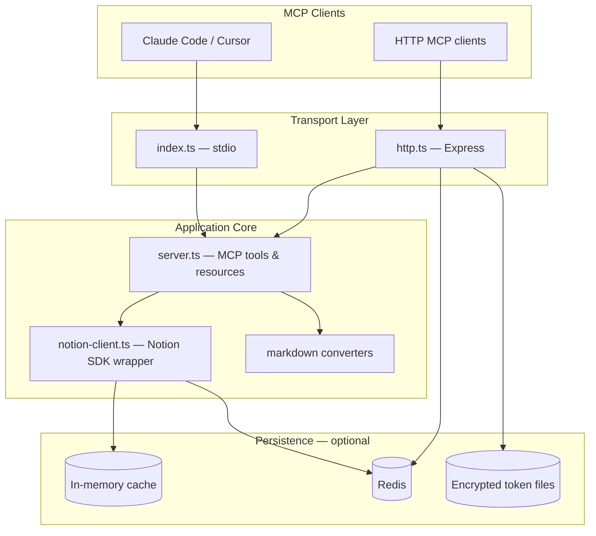
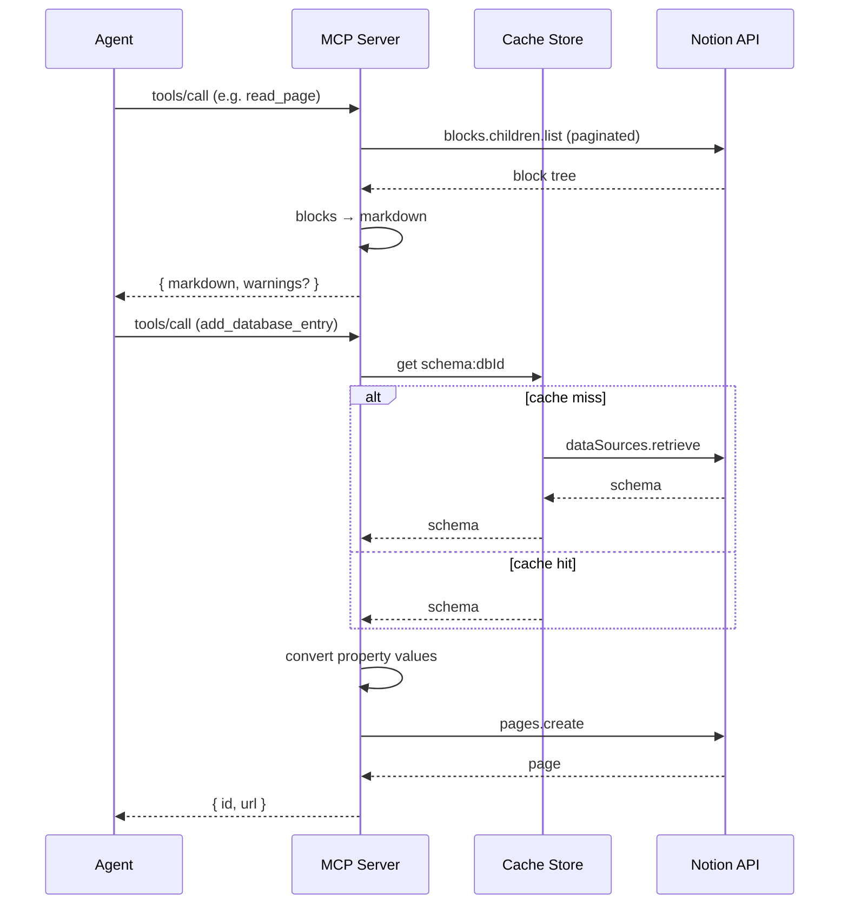

# easy-notion-mcp

Production-oriented MCP server that connects AI agents to Notion through standard markdown instead of raw API JSON.

Agents read and write GFM markdown. The server handles block conversion, database schema mapping, OAuth, and optional Redis-backed persistence for multi-instance deployments.

---

## Feature highlights

| Capability | Details |
|------------|---------|
| **Markdown-first I/O** | 42 MCP tools; agents never construct Notion block JSON |
| **Round-trip fidelity** | 24 block types including toggles, columns, callouts, tables, uploads |
| **Database ergonomics** | Write `{ "Status": "Done" }` — schema conversion is automatic |
| **Dual transport** | Stdio (API token) and HTTP (OAuth or bearer-protected static token) |
| **Security defaults** | Content-notice prefix, URL sanitization, workspace-root file containment |
| **Optional Redis** | Shared schema cache and OAuth token persistence with graceful fallback |
| **CLI profiles** | Low-context Notion access via `easy-notion` with readonly/readwrite modes |

---

## Architecture



### Request workflow (tool call)



---

## Project structure

```
easy-notion-mcp/
├── src/
│   ├── index.ts              # Stdio entry point
│   ├── http.ts               # HTTP/OAuth entry point
│   ├── cli.ts                # Profile-based CLI
│   ├── server.ts             # MCP tool & resource handlers
│   ├── notion-client.ts      # Notion SDK integration
│   ├── config/env.ts         # Typed environment parsing
│   ├── logging/logger.ts     # Structured logging
│   ├── persistence/          # Cache + Redis integration
│   │   ├── cache-store.ts
│   │   ├── init.ts
│   │   └── redis/
│   └── auth/                   # OAuth token storage
├── tests/                    # Vitest unit & integration tests
├── docs/AUDIT.md             # Engineering audit notes
├── skills/                   # Agent skill definitions
└── dist/                     # Compiled output (generated)
```

**Design decisions**

- **Single server module** — tool handlers remain in `server.ts` to preserve the stable public MCP contract; supporting modules handle cross-cutting concerns.
- **Pluggable cache** — `CacheStore` abstraction allows in-memory (default) or Redis backends without changing Notion client logic.
- **Fail-open Redis** — if Redis is configured but unreachable, the server logs a warning and continues with in-memory/file persistence.

---

## Installation

### Prerequisites

- Node.js 20+
- A [Notion integration](https://www.notion.so/my-integrations) with pages shared to it

### From source

```bash
git clone https://github.com/Grey-Iris/easy-notion-mcp.git
cd easy-notion-mcp
npm install
npm run build
```

### Via npx (published package)

```bash
npx -y easy-notion-mcp
```

### MCP client configuration (stdio)

```json
{
  "mcpServers": {
    "notion": {
      "command": "npx",
      "args": ["-y", "easy-notion-mcp"],
      "env": {
        "NOTION_TOKEN": "ntn_your_integration_token"
      }
    }
  }
}
```

---

## Configuration

Copy `.env.example` to `.env` when running from a cloned checkout:

```bash
cp .env.example .env
```

### Core variables

| Variable | Required | Default | Description |
|----------|----------|---------|-------------|
| `NOTION_TOKEN` | Yes (stdio) | — | Notion integration token |
| `NOTION_ROOT_PAGE_ID` | No | — | Default parent for `create_page` |
| `NOTION_TRUST_CONTENT` | No | `false` | Disable content-notice prefix on reads |
| `NOTION_MCP_WORKSPACE_ROOT` | No | `cwd` | Root for local `file://` uploads |
| `LOG_LEVEL` | No | `info` | Logging verbosity |

### Redis persistence (optional)

| Variable | Default | Description |
|----------|---------|-------------|
| `REDIS_ENABLED` | `false` | Enable Redis when `true` or when `REDIS_URL` is set |
| `REDIS_URL` | — | Full connection URL |
| `REDIS_HOST` | `127.0.0.1` | Host (when URL not set) |
| `REDIS_PORT` | `6379` | Port |
| `REDIS_PASSWORD` | — | Auth password |
| `REDIS_DB` | `0` | Database index |
| `REDIS_KEY_PREFIX` | `easy-notion:` | Key namespace prefix |
| `REDIS_CONNECT_TIMEOUT_MS` | `10000` | Connection timeout |
| `REDIS_MAX_RETRIES` | `3` | Retry attempts before fallback |

Example with local Redis:

```bash
REDIS_ENABLED=true REDIS_URL=redis://127.0.0.1:6379/0 npm start
```

### HTTP transport

| Variable | Required | Default | Description |
|----------|----------|---------|-------------|
| `NOTION_MCP_BEARER` | Yes (static HTTP) | — | Shared secret for `/mcp` requests |
| `NOTION_OAUTH_CLIENT_ID` | OAuth mode | — | Public integration client ID |
| `NOTION_OAUTH_CLIENT_SECRET` | OAuth mode | — | OAuth client secret |
| `PORT` | No | `3333` | Listen port |
| `NOTION_MCP_BIND_HOST` | No | `127.0.0.1` | Bind address |

---

## Development

```bash
# Install dependencies
npm install

# Watch mode
npm run dev

# Run stdio server locally
NOTION_TOKEN=ntn_... npm start

# Run HTTP server
NOTION_TOKEN=ntn_... NOTION_MCP_BEARER=$(openssl rand -hex 32) npm run start:http
```

### Quality gates

```bash
npm run build      # Compile TypeScript
npm run typecheck  # Type check without emit
npm run lint       # ESLint
npm test           # Vitest unit tests
```

---

## Testing

```bash
# Full unit suite (~850 tests)
npm test

# Watch mode
npm run test:watch

# Live Notion E2E (requires dedicated test workspace)
cp .env.example .env   # set E2E_ROOT_PAGE_ID
npm run test:e2e
```

Symlink-dependent security tests are automatically skipped on platforms where symlink creation is unavailable (common on Windows without Developer Mode).

---

## Troubleshooting

| Symptom | Likely cause | Fix |
|---------|--------------|-----|
| `NOTION_TOKEN is required` | Missing env var | Set token in MCP config `env` block or `.env` |
| `401 invalid_token` (HTTP) | Missing/wrong bearer | Set `NOTION_MCP_BEARER` on server; send `Authorization: Bearer …` |
| `outside the allowed workspace root` | File path escapes root | Set `NOTION_MCP_WORKSPACE_ROOT` or use absolute paths inside it |
| Redis warning on startup | Redis unreachable | Start Redis or set `REDIS_ENABLED=false` |
| Unknown property name | Stale/wrong schema | Call `get_database` first; check case sensitivity |
| Symlink tests skipped | OS restriction | Enable Windows Developer Mode or run on Linux/macOS |

Enable debug logging:

```bash
LOG_LEVEL=debug npm start
```

---

## Contributing

1. Fork the repository and create a feature branch from `main`
2. Make focused changes with tests where behavior changes
3. Run `npm run build && npm run lint && npm test`
4. Open a pull request with a clear description and test plan

See [docs/AUDIT.md](docs/AUDIT.md) for architecture context and known improvement areas.

---

## FAQ

**How is this different from the official Notion MCP server?**  
The official server returns raw Notion JSON (~6–7× more tokens per page read). This server converts to markdown agents already understand, with round-trip fidelity for 24 block types.

**Do I need Redis?**  
No. Redis is optional and improves horizontal scaling (shared schema cache, OAuth tokens across HTTP instances). Single-process stdio deployments work fine without it.

**Is markdown round-trip lossless?**  
For supported block types, yes. Unsupported native blocks (e.g. `synced_block`, embedded databases) emit warnings so agents avoid destructive rewrites.

**Does file upload work over HTTP?**  
No. `file://` uploads are stdio-only for security. Use HTTPS URLs or stdio transport for local files.

**What Node version is required?**  
Node.js 20 or later.

---

## License

MIT — see [LICENSE](LICENSE).
