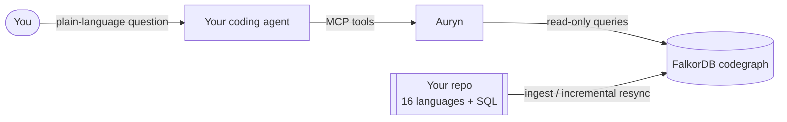
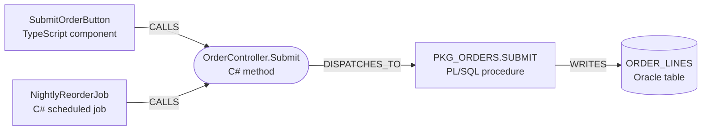

<div align="center">

<picture>
  <source media="(prefers-color-scheme: dark)" srcset="docs/images/auryn-wordmark-dark.png">
  
</picture>

### The codegraph for your coding agents

Auryn turns any codebase into a queryable codegraph in FalkorDB.<br>
Your agent traverses it over MCP and answers from real structure, with file and line citations, instead of grepping and guessing.

<br>

**[Quickstart](#quickstart)** &nbsp;·&nbsp; **[Connect your agent](#connect-your-agent)** &nbsp;·&nbsp; **[Languages](#what-it-can-read)** &nbsp;·&nbsp; **[Docs](#documentation)** &nbsp;·&nbsp; **[Website](https://www.falkordb.com/products/codegraph-auryn)**

<br>

[](https://www.python.org/)
[](https://modelcontextprotocol.io/)
[](https://www.falkordb.com/)
[](https://badge.fury.io/py/falkordb-auryn)
[](https://github.com/orgs/FalkorDB/discussions)

<sub>WORKS WITH</sub><br>
**Claude Code** &nbsp;·&nbsp; **Cursor** &nbsp;·&nbsp; **Copilot** &nbsp;·&nbsp; **Codex** &nbsp;·&nbsp; **Gemini** &nbsp;·&nbsp; **Windsurf** &nbsp;·&nbsp; **VS Code** &nbsp;·&nbsp; **Aider** &nbsp;·&nbsp; any agent that reads AGENTS.md

</div>

---

## Results

Claude Code on Django, hard structural questions (transitive closure and impact), with and without Auryn:

| | Without Auryn | With Auryn | Change |
|---|---|---|---|
| **Accuracy** (key facts covered) | 22% | 92% | **4x** |
| **Run time** per task | 208s | 70s | **-66%** |
| **Cost** per task | $0.48 | $0.38 | **-21%** |
| **Tokens** per task | 466k | 355k | **-24%** |

The agent stops reading its way through the tree. It asks the graph who calls a function, what a change reaches, or how a request gets from a button to a table, and gets an answer it can cite.

## How it works



1. **Parse.** Auryn reads every file and builds a codegraph of functions, types, tables and endpoints, plus the edges between them (`CALLS`, `EXTENDS`, `READS`/`WRITES`, `DEPENDS_ON`).
2. **Store.** The codegraph lives in [FalkorDB](https://www.falkordb.com/), on your machine or a server you run.
3. **Query.** Your agent traverses it through MCP and cites file and line for every claim.

## Quickstart

Two commands, zero infrastructure. You'll be looking at a real graph in about a second.

```bash
pip install falkordb-auryn
auryn quickstart
```

This boots FalkorDB **embedded** (in-process, no daemon), ingests a small payments API that ships inside the package, and opens the viewer at <http://127.0.0.1:8080>.


Your own project is the same command with a path:

```bash
auryn quickstart path/to/your/repo
```

Find a path between any two symbols and the viewer shows every hop, with the edge it followed:


The codegraph persists at `<path>/.auryn/graph.db`, so re-running reuses it.

> **Requirements:** Python ≥ 3.12. `falkordb-auryn` includes every language plugin out of the box. The in-process database is fetched automatically on first `auryn quickstart` on macOS and Linux (recent glibc). On native Windows or older-glibc Linux, point at a remote FalkorDB with `auryn install --backend remote`. Add live-DB drivers with `"falkordb-auryn[all]"`. For an isolated tool install, include the DB up front: `uv tool install "falkordb-auryn[embedded]"`. From a clone: `uv sync`, then `uv run auryn quickstart`.

## Connect your agent

The viewer is a one-shot look. The real payoff is your agent querying the graph itself. Install once:

```bash
auryn install
```

This asks for a FalkorDB backend, **local** (bundled server, starts on demand) or **remote** (host, port, credentials), and how to keep the graph fresh (manual, on commit, or on save). It then registers the `auryn` MCP server and skill with every agent it detects. It writes only to `~/.auryn` and the agent's own config. Nothing is written to your repositories.

Restart your agent and ask:

> **You:** What breaks if I change the signature of `charge_card`?

```text
● auryn_status()          → no graph for this repo yet
● index_repository(path=".")   → indexed: functions, calls, endpoints, inheritance
● locate(name="charge_card")   → Function  app/billing.py:9  id: python://…charge_card(...)
● impact_of(id="python://…charge_card(...)", edge_types=["CALLS"])
    → create_charge (app/api.py) -[EXPOSES_ENDPOINT]->  POST /charges
```

> **Agent:** One direct caller: `create_charge` in `app/api.py`, which handles **POST /charges**, so the endpoint's contract changes with it. `charge_card` itself calls `get_account`, `_guard_limit` and `Connection.execute`. None of them are affected by a signature change. Update `create_charge` and the `/charges` request shape together.
> *(cites `app/api.py:15`, `app/billing.py:9`)*

No raw Cypher, no file dumps, no guessing. One hop, id-backed. Each repo gets its own graph.

<details>
<summary><b>The tools your agent gets</b></summary>

<br>

| Tool | | What it does |
|---|---|---|
| `auryn_status` | read | Is there a graph yet, and what's in it? **Called first.** |
| `index_repository` / `ingest_repository` | **write** | Build or update the graph for a local dir or git repo. |
| `locate` | read | Find symbols by name. The entry point: other tools take the `id` it returns. |
| `search_code` | read | Semantic (vector) search by meaning when you don't know the name. Run `auryn embed` first. |
| `get_context` | read | One node's properties, source, and 1-hop neighbours. |
| `who_calls` / `callees` | read | Inbound callers / outbound callees within N hops. |
| `find_path` | read | Shortest path between two nodes: does X reach Y, and how. |
| `impact_of` | read | Blast radius over `CALLS`/`DEPENDS_ON`/`READS`/`WRITES`. |
| `trace_entrypoint` | read | Full call closure of an entry point, plus every table it touches. |
| `get_schema` / `run_cypher` | read | The meta-model, and arbitrary **read-only** Cypher. |

`list_graphs` / `use_graph` switch between multiple graphs on one instance.

</details>

## Why a graph

| Question | grep | Auryn |
|---|---|---|
| Who calls this? | every textual match, no callers of callers | exact inbound edges, N hops deep |
| What breaks if I change it? | you read and hope | traversal with file:line citations |
| Does this endpoint touch that table? | unanswerable | one path query |
| How does a request get from the UI to the database? | open files one by one | one path, across languages |
| Is the answer current? | always re-read | incremental resync on every commit |

One query traces a change across languages. Changing `OrderController.Submit` (C#):



Blast radius: the two callers on the left. Closure: everything it reaches on the right.

## Under the hood

- **Stored in a graph database.** The graph lives in [FalkorDB](https://www.falkordb.com/) and stays loaded, so caller and impact lookups are a query, not a file scan.
- **Incremental resync.** On a commit or branch switch, Auryn re-parses only the changed files and the code they affect. On Django that is about 150x faster than a full re-ingest. See [ADR 0002](docs/adr/0002-incremental-resync.md).
- **Two levels of analysis.** Every language gets a fast structural pass. Python (Jedi) and C# (Roslyn) also get a deep semantic pass, inline or in the background, so calls land on the code that actually runs.
- **Search plus structure.** Semantic search finds the code. The graph returns what that code calls, imports and depends on.
- **Cross-repo references.** When code points at a symbol in another repository, Auryn records it and links it once that repo is ingested. See [ADR 0004](docs/adr/0004-cross-repo-symbol-resolution.md).
- **One vocabulary for every language.** Every ingestor writes the same node and edge types, so a single query follows a request from a TypeScript button, through a C# API, to the PL/SQL procedure and table it writes.

## Your code stays yours

> [!NOTE]
> Parsing runs locally. The graph lives on your machine or on a FalkorDB server you run, with no hosted service in the path and no telemetry. Read tools issue only `GRAPH.RO_QUERY`, so an agent cannot write to your graph, and `install` touches nothing but `~/.auryn` and your agent's config. `auryn uninstall --purge` also deletes `~/.auryn`, including config and graphs.

## What it can read

Sixteen languages plus live SQL and Oracle schemas, all **auto-detected** by `auryn ingest` in a single pass. Live databases are read with `auryn run <name>`. `pip install falkordb-auryn` includes every language. For a lean, single-language install, use `pip install auryn-python` (each plugin pulls `auryn-core`).

<details>
<summary><b>All sources and engines</b></summary>

<br>

| Source | Extra | Engine |
|---|---|---|
| Python | `[python]` | tree-sitter → Jedi (deep) |
| TypeScript / JavaScript | `[typescript]` | tree-sitter |
| C# | `[csharp]` | Roslyn (deep), tree-sitter fallback |
| Java · C · C++ · CUDA | `[java]` `[c]` `[cpp]` `[cuda]` | tree-sitter |
| Go · Rust · PHP · Julia | `[go]` `[rust]` `[php]` `[julia]` | tree-sitter |
| Ruby · Kotlin · Swift · Bash | `[ruby]` `[kotlin]` `[swift]` `[bash]` | tree-sitter |
| PL/SQL files | `[oracle]` | vendored ANTLR |
| Oracle (live DB) | `[oracle-live]` | oracledb + ANTLR |
| SQL schema (live DB) | `[sql]` `[sql-all]` | SQLAlchemy, any dialect |

The deep C# engine needs the [.NET SDK](https://dotnet.microsoft.com/) on `PATH`. Without it, C# falls back to tree-sitter automatically.

</details>

## CLI

```bash
auryn ingest dir /path/to/repo --project-name MyApp   # auto-detect every language
auryn ingest repo https://github.com/you/repo.git --ref main
auryn sync                    # incremental resync of a repo's graph
auryn view                    # open the viewer against the configured backend
auryn serve | stop            # run/stop the local FalkorDB daemon explicitly
auryn uninstall [--purge]     # reverse install
```

Omit `--host`/`--port` and it uses the backend from `auryn install`. Full reference: [docs/cli.md](docs/cli.md), or `auryn <command> --help`. Runnable walkthroughs live in [`demo/`](demo/).

## Documentation

| | |
|---|---|
| [Architecture](docs/architecture.md) | Plugin discovery, the ingest pipeline, delta-sync, backends. |
| [Graph model](docs/graph-model.md) | Labels, edges, ids, provenance, cross-repo linkage, and what each ingestor extracts. |
| [CLI reference](docs/cli.md) | Every command and flag. |
| [Adding a language](docs/adding-a-language.md) | A worked, line-by-line new ingestor. |
| [Docs index](docs/README.md) | Everything, including the ADRs. |

## Contributing

```bash
uv sync --group dev
uv run pytest --cov=auryn --cov-report=term-missing
```

Tests run against embedded FalkorDB by default, with no server and no Docker. Set `AURYN_TEST_BACKEND=server` for a real one. New language ingestors are very welcome: start at [CONTRIBUTING.md](CONTRIBUTING.md). Issues and pull requests are welcome too.

<p align="center">If Auryn helps your agent, a ⭐ helps other developers find it.</p>

<div align="center">
<br>

Built by [FalkorDB](https://www.falkordb.com/) · [falkordb.com/products/codegraph-auryn](https://www.falkordb.com/products/codegraph-auryn)

</div>
