<div align="center">

# Agentic Knowledge Graphs over PubMed

**A citation and ontology knowledge graph across the full PubMed 2026 baseline,
with every answer traceable to a source path, and anything untraceable refused
rather than generated.**

[](#4-results)
[](#3-architecture)
[](#31-graph-construction)
[](#2-quick-start)
[](notebook/agentic_kg_40m.ipynb)

</div>

---

> ### Headline
>
> **83.2%** on 600 held-out PubMedQA questions (95% CI 80.2 to 86.2), against a
> **53.3%** majority-class floor and **37.2%** for the same model given no evidence.
>
> The knowledge graph is built from **929,824,202 edges** with **zero LLM calls**,
> against a published cost of roughly $33,000 in API spend for comparable
> LLM-extracted graphs on a *single* dataset.
>
> Every number below is reproducible on a laptop in about ten seconds.
> No GPU, no corpus download, no API key.

---

## Table of contents

1. [What this is](#1-what-this-is)
2. [Quick start](#2-quick-start)
3. [Architecture](#3-architecture)
4. [Results](#4-results)
5. [Evaluation protocol](#5-evaluation-protocol)
6. [Key findings](#6-key-findings)
7. [Repository layout](#7-repository-layout)
8. [Reproducing the analysis](#8-reproducing-the-analysis)
9. [Rebuilding the GPU pipeline](#9-rebuilding-the-gpu-pipeline)
10. [Limitations and open questions](#10-limitations-and-open-questions)
11. [Data sources and licensing](#11-data-sources-and-licensing)
12. [Engineering notes](#12-engineering-notes)

---

## 1. What this is

Retrieval-augmented generation over a very large corpus has a governance problem
before it has a quality problem. A system that answers 90% of questions well and
fabricates the other 10% without signalling which is which is unusable in a
clinical or regulatory setting. The interesting question is not "how do we make
the answers better" but "how do we make the system's entitlement to answer
*legible*".

This project builds that system over the whole of PubMed and then tries hard to
break its own claims.

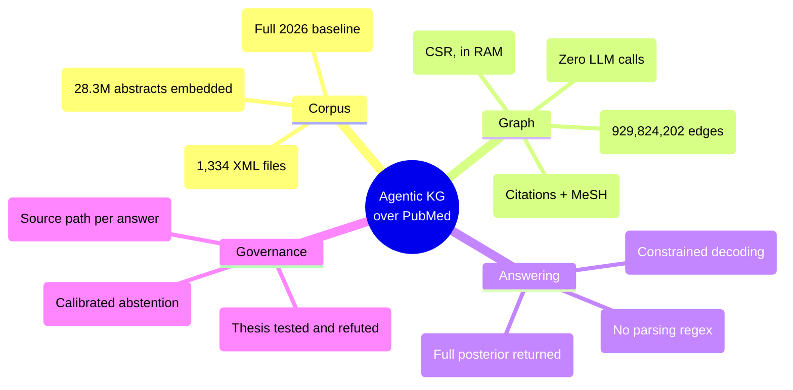

**What makes it unusual:** the study is adversarial toward itself. Four
previously reported conclusions were overturned by later measurement, including
the project's own founding thesis. Section [6](#6-key-findings) documents each
one, what produced it, and what the corrected number is. Negative results are
reported at the same prominence as positive ones.

---

## 2. Quick start

**Read it** (no setup at all):

```
notebook/agentic_kg_40m.ipynb
```

196 cells, already executed, with all output and 29 figures inline.

**Run it** (about ten seconds, CPU only):

```bash
python -m venv .venv
source .venv/bin/activate          # Windows: .venv\Scripts\activate
pip install -r requirements.txt
python analysis/run_all.py
```

Expected tail:

```
ALL ANALYSES COMPLETE in 10.4s
  configurations built         139  (137 selectable; oracle + blind excluded)
  split                        DEV 400 / TEST 600
  winner                       p0|concat|ce_k1
  no-evidence floor            37.2%
  majority-class floor         53.3%
  graph certification AUROC    0.500  (chance)
  free confidence AUROC        0.810

  TEST accuracy (argmax)       82.3%
  TEST accuracy                83.2%

  reproduces the published 83.2%: YES
```

Exit code 0 means the shipped numbers reproduced. Outputs are written to
`reproduced/`, leaving `results/` untouched so the two can be diffed.

Only `numpy` and `matplotlib` are required. The GPU work is pre-computed and
cached, which is why this is fast; see [section 8](#8-reproducing-the-analysis).

---

## 3. Architecture

### 3.0 End to end

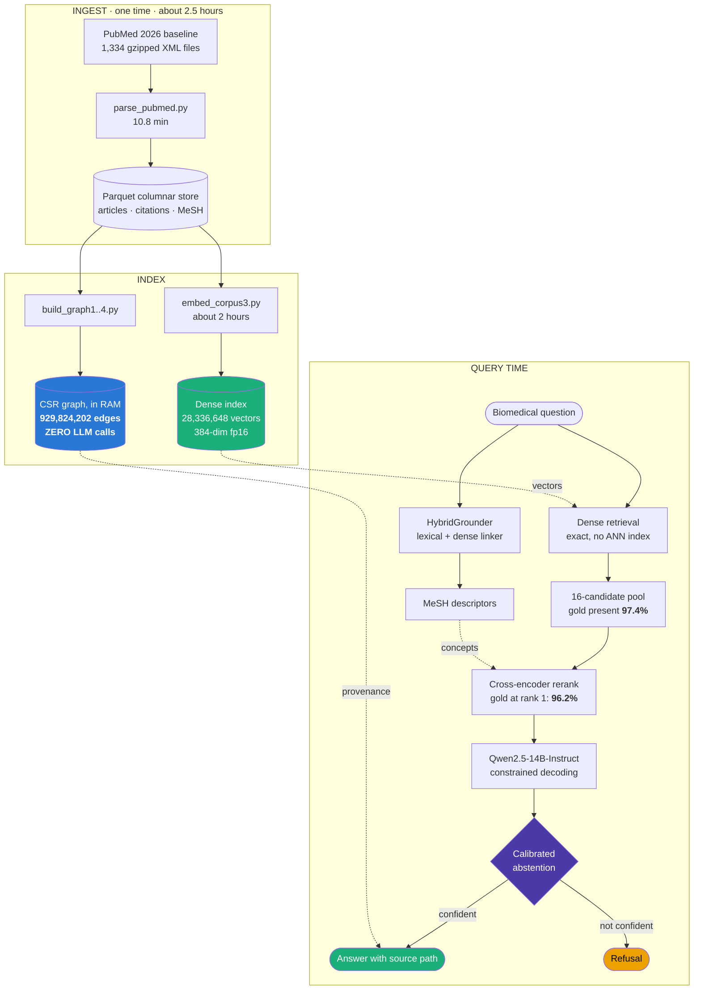

<details>
<summary>Plain-text version of the same diagram, for viewers without Mermaid</summary>

```
                 PubMed 2026 baseline · 1,334 gzipped XML files
                                    |
                       [ parse_pubmed.py · 10.8 min ]
                                    v
                  Parquet columnar store · articles, citations,
                            MeSH headings, qualifiers
                                    |
              +---------------------+----------------------+
              v                                            v
   [ build_graph1..4.py ]                         [ embed_corpus3.py ]
   CSR adjacency, in RAM                          bge-small-en-v1.5
   ------------------------                       -------------------------
   CITES / CITED_BY                               28,336,648 abstract vectors
   ARTICLE <-> MeSH descriptor                    384 dimensions, fp16
   929,824,202 edges total                        exact search, no ANN index
   ZERO LLM calls
              |                                            |
              +---------------------+----------------------+
                                    v
   question ->  [ HybridGrounder ]  ->  MeSH descriptors (lexical + dense)
                       |
                       v
   [ dense retrieval ] -> 16-candidate pool -> [ cross-encoder rerank ]
                       |
                       v
   [ Qwen2.5-14B-Instruct · constrained decoding over {yes, no, maybe} ]
                       |
                       v
   [ calibrated abstention ]  ->  answer + source path, or refusal
```

</details>

### 3.1 Graph construction

The graph is built entirely from **structured metadata that NLM already
publishes**: citation edges and human-assigned MeSH indexing. No language model
reads a document to extract entities or relations.

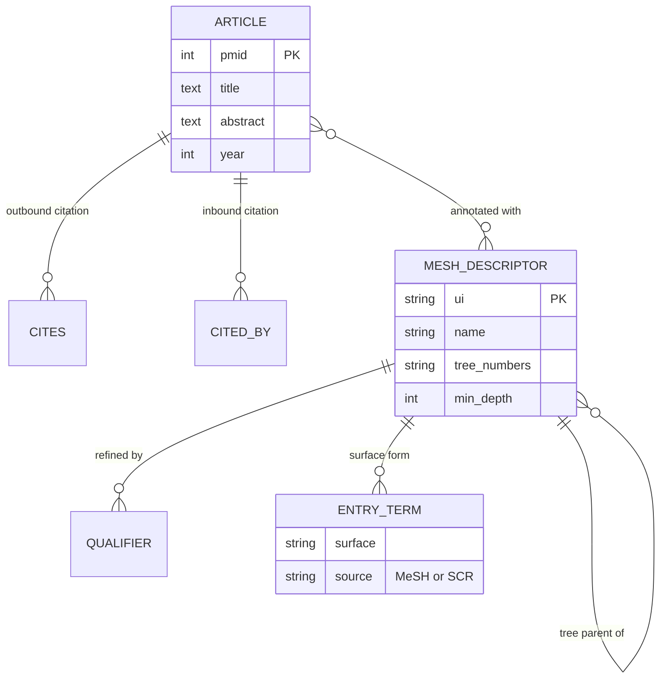

| property | value |
|---|---|
| total edges | **929,824,202** |
| build time | 10.8 minutes |
| LLM calls | **0** |
| representation | Compressed Sparse Row, in RAM |
| edge types | `CITES`, `CITED_BY`, `ARTICLE <-> MeSH descriptor` |

This matters for cost and for provenance. An LLM-extracted graph over one
dataset has been reported at roughly $33,000 in API spend, and its edges are
model assertions. Here every edge is a fact NLM published, so a path through the
graph is a citable claim about the literature rather than a model's opinion
about it.

CSR was chosen over a graph database deliberately. The workload is
breadth-first neighbourhood expansion over a static graph, which is an
`indptr[i]:indptr[i+1]` slice in CSR and a query planner round trip in a
database. The whole structure fits in RAM on a single machine.

### 3.2 Query path, step by step

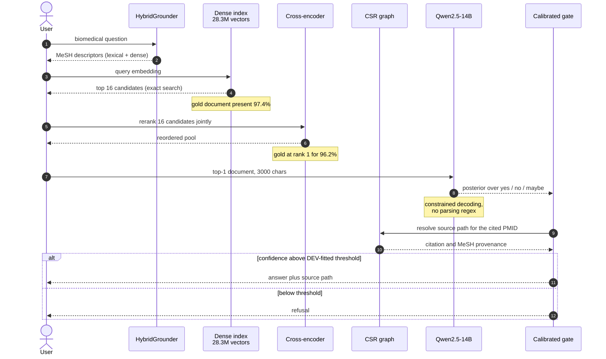

### 3.3 Retrieval

Dense retrieval uses `BAAI/bge-small-en-v1.5` over title plus abstract, with
**exact** search (a full matrix product against all 28.3M vectors on GPU) rather
than an approximate index. At this scale exact search is affordable and removes
recall loss as a confounder from every downstream measurement.

| retrieval property | value |
|---|---|
| gold document inside 16-candidate pool | **97.4%** |
| gold document at rank 1 after rerank | **96.2%** |
| residual error attributable to retrieval | **1.3%** |

Retrieval is effectively solved for this benchmark. That fact is what makes the
rest of the study meaningful: when retrieval is not the bottleneck, differences
between arms are differences in *reading and deciding*, not in *finding*.

### 3.4 Answering

The generator is `Qwen2.5-14B-Instruct`, run locally in bf16. Labels are obtained
by **constrained decoding**: a single forward pass, reading the softmax mass on
the `yes`, `no` and `maybe` token ids (both lower and capitalised forms) at the
first generated position, then renormalising over those three.

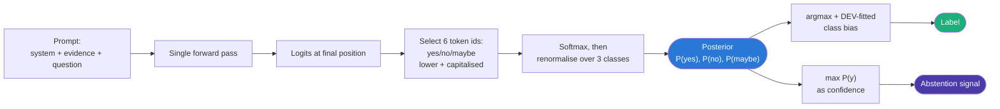

This removes an entire class of evaluation bug. A free-text regex such as
`\b(yes|no|maybe)\b` misreads hedged prose ("there is **no** clear indication
that...") as a label. Constrained decoding makes that failure mode structurally
impossible, and it returns a full posterior rather than a point prediction, which
is what makes the calibration and abstention analysis possible at all.

---

## 4. Results

### 4.1 Headline

All figures below are on the **600-question held-out TEST split**. Configuration
and decision rule were fitted on a disjoint 400-question DEV split.

| system | accuracy | 95% CI |
|---|---:|---|
| No evidence (question only) | 37.2% | |
| Majority class (constant `yes`) | 53.3% | |
| Previous best, before correction | 68.8% | 65.0 to 72.5 |
| **Cross-encoder top-1, argmax** | **82.3%** | 79.3 to 85.3 |
| **Cross-encoder top-1, calibrated** | **83.2%** | 80.2 to 86.2 |

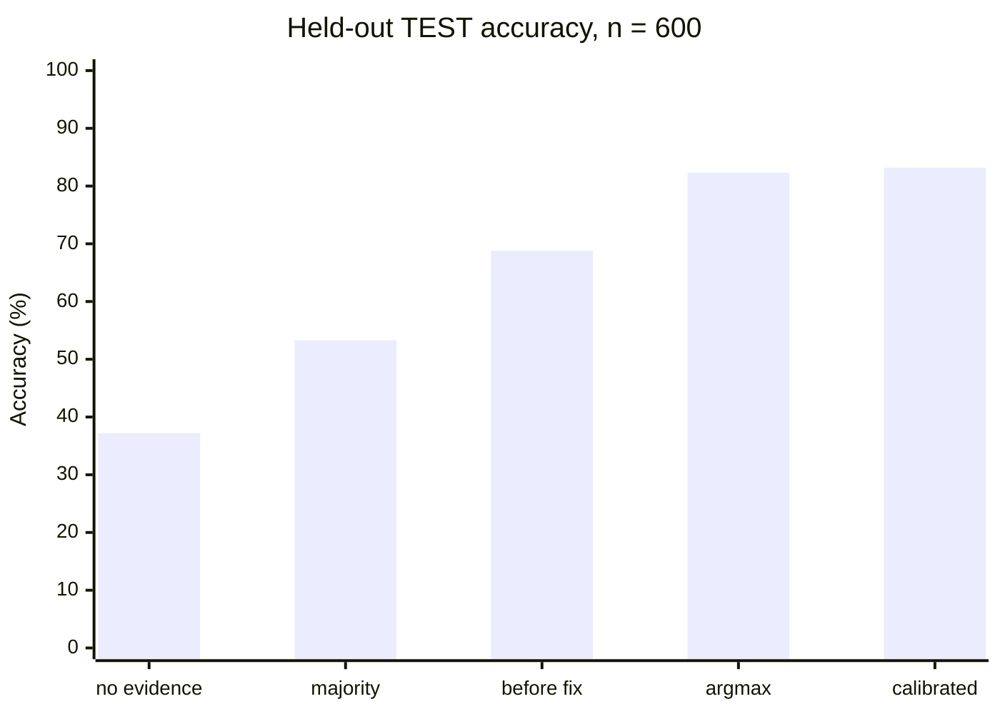

The winning configuration, selected on DEV out of 137 candidates, is
`p0|concat|ce_k1`: a single cross-encoder-reranked document in the prompt, with a
class-prior bias fitted on DEV. It is the simplest arm in the search space.

### 4.2 Error budget

Every error on TEST assigned to exactly one cause:

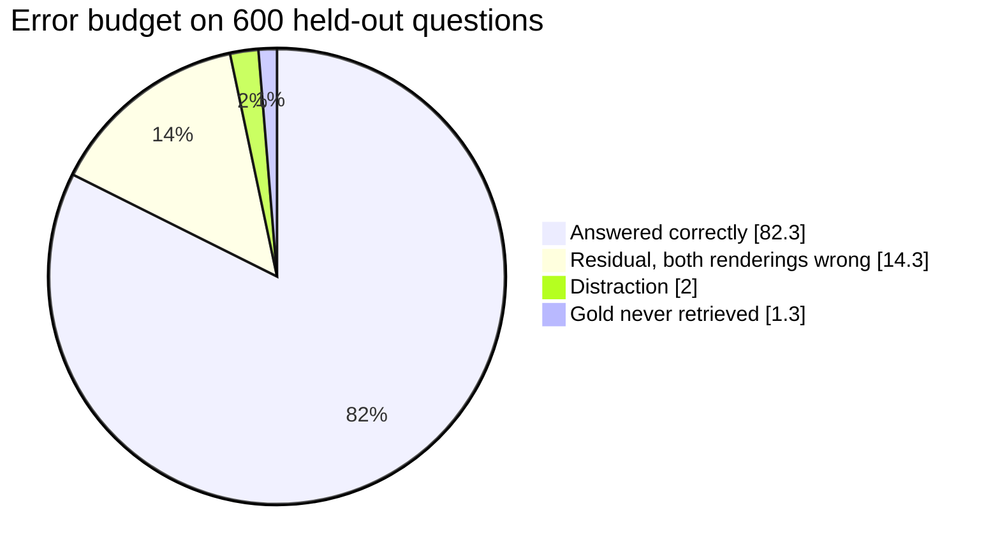

| bucket | share | what would fix it |
|---|---:|---|
| Answered correctly | 82.3% | |
| Gold never retrieved | 1.3% | better retrieval |
| Distraction (gold retrieved, answer still wrong) | 2.0% | better ranking or reading |
| Residual (both renderings wrong) | 14.3% | reading or label limit |

### 4.3 Where the residual lives

| gold class | n | correct | retrieval | distraction | residual |
|---|---:|---:|---:|---:|---:|
| `yes` | 320 | 90.0% | 1.2% | 2.5% | 6.2% |
| `no` | 218 | 94.5% | 0.9% | 1.8% | 2.8% |
| `maybe` | 62 | **0.0%** | 3.2% | 0.0% | **96.8%** |

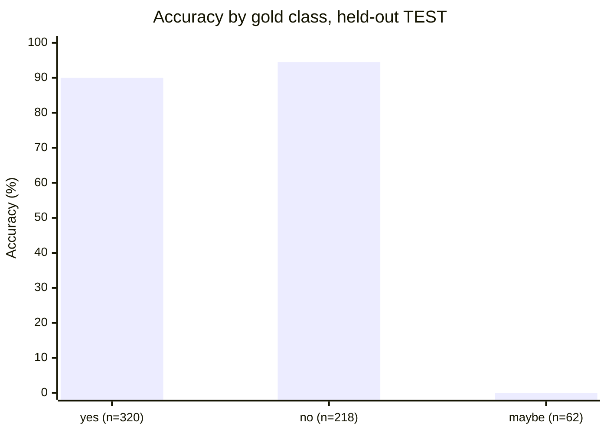

Almost the entire remaining error budget is one class. `maybe` is 10.3% of the
benchmark and argmax scores zero on it.

This is not because the signal is absent. The posterior ranks `maybe` questions
correctly at **AUROC 0.755**, so the information is present and the decision rule
discards it. DEV-fitted calibration recovers part of it (0.0% to 8.1% recall),
but the accuracy-optimal rule still suppresses the class: an upper bound on *any*
class bias, fitted on TEST itself, is 84.5% overall, only 2.2 points above
argmax. Recovering `maybe` costs more `yes`/`no` accuracy than it buys. That is a
property of the benchmark, not a defect in the system.

### 4.4 Model scale

| reader | truncated evidence | corrected evidence |
|---|---:|---:|
| Qwen2.5-14B-Instruct | 67.9% | **82.4%** |
| Qwen2.5-32B-Instruct | 55.1% | **82.4%** |

Identical once the evidence is intact. See finding [6.3](#63-model-scale-bought-nothing-and-the-apparent-deficit-was-an-artefact).

---

## 5. Evaluation protocol

The protocol is stricter than the result needs, because the cached-posterior
design makes trying thousands of configurations free, and *free* is exactly the
condition under which selection bias becomes invisible.

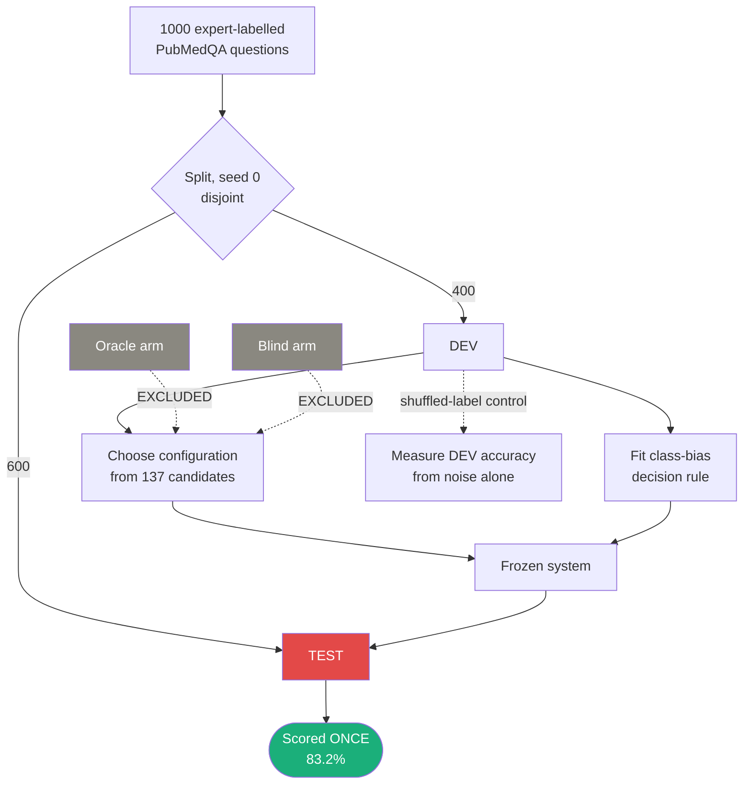

| control | how it is enforced |
|---|---|
| **Held-out split** | 1000 expert-labelled questions, DEV 400 / TEST 600, seed 0, disjoint |
| **Fit on DEV only** | both the configuration choice *and* the class-bias decision rule |
| **Report once** | TEST is scored a single time, with no refitting |
| **Ceilings excluded** | oracle and blind arms cannot be selected; they are references, not systems |
| **Trivial baselines** | majority-class and no-evidence floors printed beside every result |
| **No parsing** | constrained decoding, so no regex sits between the model and the score |
| **Uncertainty** | 95% paired bootstrap CIs (4,000 resamples) |
| **Paired testing** | exact McNemar on disagreements, not unpaired accuracy differences |
| **Selection-bias control** | the full sweep is re-run against *shuffled labels* to measure how much DEV accuracy best-of-N buys from noise alone |

The DEV to TEST rank correlation across all configurations is **0.990**, so the
selection is stable rather than lucky.

> **Why the oracle exclusion is not pedantry.** An earlier draft of the sweep left
> the oracle arm in the selectable pool. The search did the obvious thing and
> "discovered" that the best configuration was oracle plus calibration at 77.2%,
> a number that cannot be produced at inference time because having the gold
> document is the entire problem. Excluding ceilings explicitly, rather than
> trusting a search not to pick them, is the only version of this that stays
> honest.

---

## 6. Key findings

### 6.1 A single harness constant was worth 14 accuracy points

Every experiment truncated retrieved documents to **1100 characters**, a value
inherited from an early script and never examined. The oracle arm used **4000**.

Rank-1 PubMed abstracts in this evaluation average **1718 characters** (median
1720, p90 2187). So the truncation removed text from **94.2% of documents**, on
average the final **628 characters**.

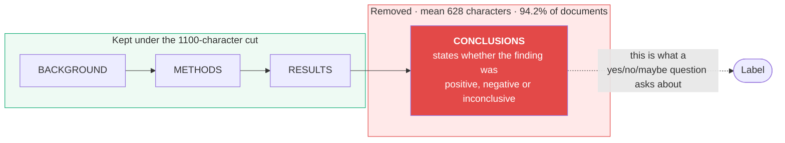

| truncation | documents losing text | accuracy |
|---:|---:|---:|
| 1100 | 94.2% | 67.9% |
| 2000 | 18.9% | 81.6% |
| 3000 | 0.4% | **82.4%** |
| 4000 | 0.0% | 82.4% |

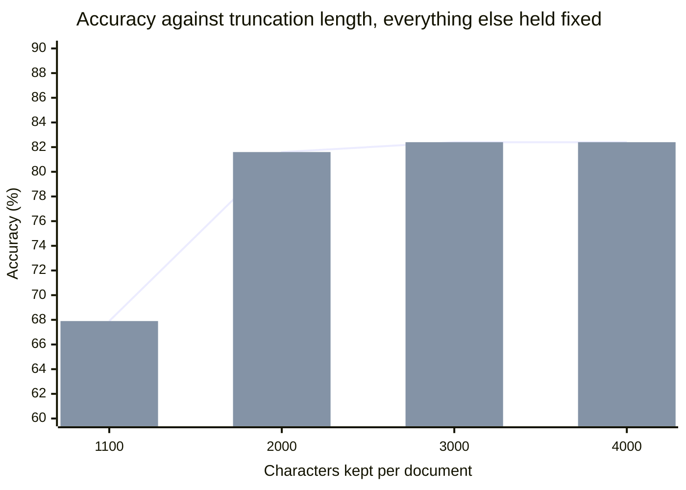

The flat 3000 to 4000 segment is the control. By 3000 characters 99.6% of
abstracts are already complete, so there is nothing left to add. That is what
distinguishes this from "more context is better".

The comparison that had defined the project's "distraction gap" was therefore
never *one document against eight*. It was *a complete abstract against eight
truncated ones*.

### 6.2 The bug had manufactured three conclusions, all flattering

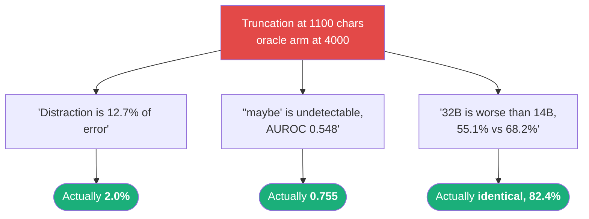

| previously reported | corrected |
|---|---|
| distraction accounts for 12.7% of error | **2.0%** |
| `maybe` is undetectable, AUROC 0.548 | **0.755** |
| 32B is worse than 14B (55.1% against 68.2%) | **identical, 82.4% both** |

Each pointed toward the story already being told. A measurement error does not
merely make results wrong, it makes them wrong *in a direction*.

### 6.3 Model scale bought nothing, and the apparent deficit was an artefact

On truncated abstracts, Qwen2.5-32B answered `maybe` on 34.1% of questions and
was scored wrong for it. But with the conclusion cut off, `maybe` *is* the correct
reading of the evidence. The larger model was penalised for correctly judging
that what it had been given was inconclusive.

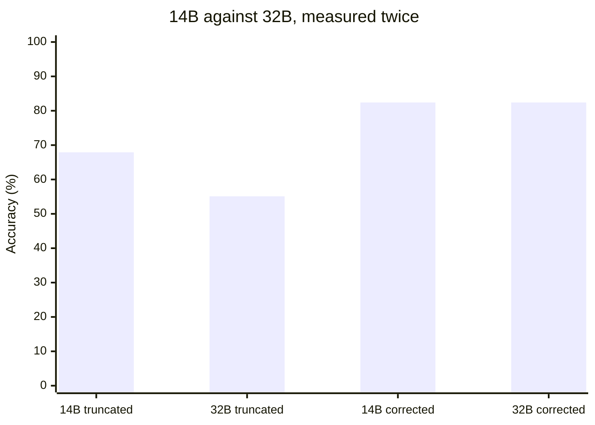

With evidence intact, 14B and 32B both score 82.4%. There is a general lesson
here: **comparing two models by argmax silently compares their decision
thresholds as well as their knowledge.** Calibrating each model separately moved
32B by 12.8 points and reversed the ranking on two of three arms.

### 6.4 137 configurations, none better than the simplest

Per-document marginalisation, reciprocal-rank fusion, max-confidence selection,
hybrid mixtures, prompt engineering, class calibration. On held-out data, none
beat a plain cross-encoder top-1 prompt.

That uniform null was itself the diagnostic signal for finding 6.1. When a dozen
reasonable interventions all produce nothing, the likely explanation is not that
every intervention is bad, but that the thing being measured is not what you
think it is.

The marginalisation result held at *both* truncation settings, which is why it is
the one prior conclusion that survived: it compared arms that shared the same
defect.

### 6.5 The governance thesis does not survive

This is the project's founding claim: that graph certification does not buy
accuracy, it buys the **right to refuse**. The original measurement supported it,
at 200 questions on truncated evidence.

Re-running the same three-route admissibility rule verbatim on 1000 questions
with evidence intact:

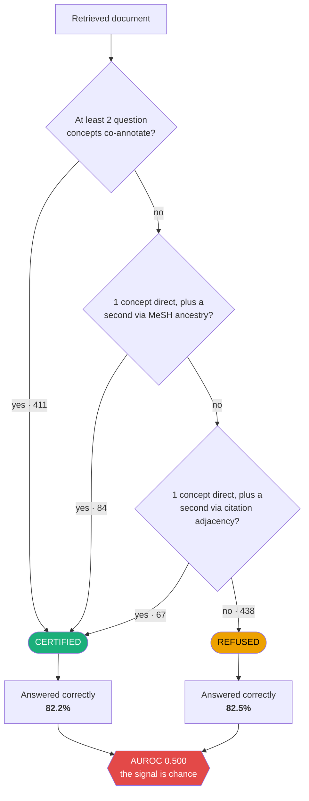

**Does certification predict whether the answer is correct?**

| signal | AUROC |
|---|---:|
| Path certification, rank-1 document | **0.500** (chance) |
| Path certification, best of top-8 | 0.497 |
| Concept overlap only | 0.519 |
| **Model confidence, `max P(y)`, free** | **0.810** |

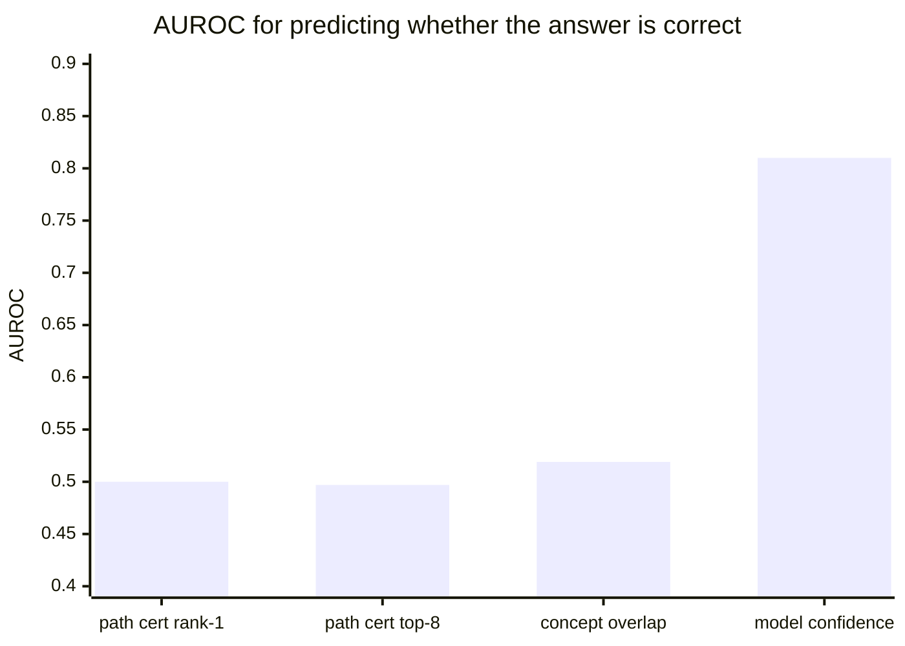

At matched coverage, the free signal wins everywhere:

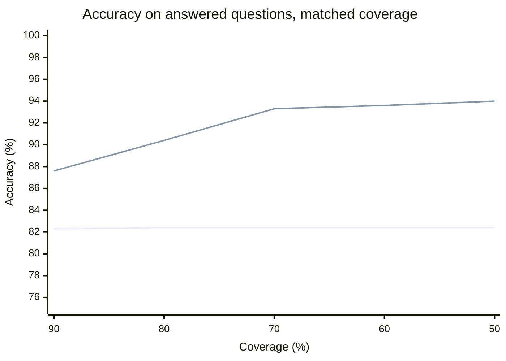

*Flat line: graph certification. Rising line: model confidence.*

| policy | coverage | accuracy | selective accuracy |
|---|---:|---:|---:|
| Answer everything | 100.0% | 82.3% | **82.3%** |
| Path certification, top-8 | 54.2% | 82.2% | 44.5% |
| Model confidence, matched coverage | 54.2% | **93.8%** | 50.8% |

Certified questions are answered correctly 82.2% of the time. **Refused questions
are answered correctly 82.5% of the time.** Certification is declining questions
the system would have got right, and choosing them at random. Adding the two
graph-specific routes moved AUROC from 0.519 to 0.497, which is what adding more
of a signal that carries no information looks like.

> **The corrected architecture statement:**
> **graph for retrieval and provenance, calibrated confidence for abstention.**
>
> The graph's contribution is real and measured: gold into a 16-candidate pool
> 97.4% of the time, 1.3% residual retrieval error, 929M edges for zero LLM
> calls, and every answer traceable to a source path. It is simply not the
> refusal mechanism.

**Scope limit, stated precisely.** This tests certification as *abstention over a
fixed answer*. The original design additionally *filtered the evidence set*
before generating, and that half was not re-run. It could still improve the
answer. It cannot rescue the refusal claim, which is what was tested and what
failed.

---

## 7. Repository layout

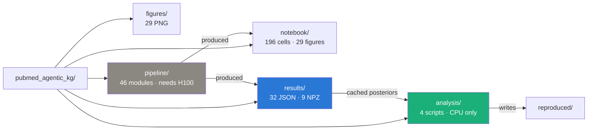

```
pubmed_agentic_kg/
├── README.md
├── requirements.txt
├── notebook/
│   ├── agentic_kg_40m.ipynb     196 cells, executed, 29 figures inline
│   └── agentic_kg_40m.py        jupytext source, for readable diffs
├── figures/                     29 PNGs
├── results/                     32 JSON result sets + 9 NPZ posterior caches
├── analysis/                    CPU only, runs anywhere
│   ├── run_all.py               one-command reproduction
│   ├── analyze_fusion.py
│   ├── analyze_maybe.py
│   └── analyze_governance.py
└── pipeline/                    46 modules, needs an H100 and the full corpus
```

| directory | contents | requirements |
|---|---|---|
| `notebook/` | the complete study, executed | none, just open it |
| `figures/` | every figure the notebook produces | none |
| `results/` | all result sets and cached posteriors | none |
| `analysis/` | re-runs every analysis from the caches | numpy, matplotlib |
| `pipeline/` | corpus parsing, graph build, embedding, GPU experiments | H100 80GB, ~400GB disk |

---

## 8. Reproducing the analysis

### 8.1 What each script answers

| script | question | runtime |
|---|---|---:|
| `analyze_fusion.py` | Do any of 137 selectable configurations beat a plain cross-encoder top-1 prompt? | ~8 s |
| `analyze_maybe.py` | Where does the remaining error live, and is `maybe` recoverable? | ~2 s |
| `analyze_governance.py` | Does graph certification select answerable questions better than free confidence? | ~0.2 s |

Run individually, or `python analysis/run_all.py` for all three plus a summary
that asserts the published 83.2% reproduced.

Paths are overridable: `OUT=` for inputs, `REPRO=` for outputs.

### 8.2 Why this is fast

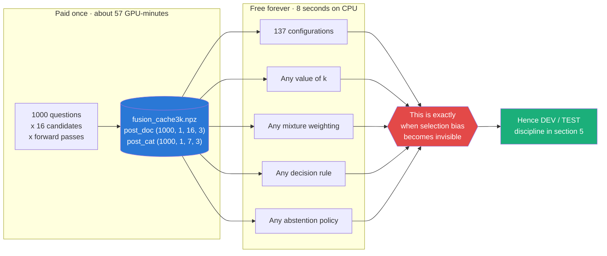

`results/fusion_cache3k.npz` holds the full posterior tensor:

```
post_doc   (1000, 1, 16, 3)    P(y | question, document) for each pool document, scored alone
post_cat   (1000, 1,  7, 3)    P(y | question, evidence set) for seven concatenated arms
pool       (1000, 16)          candidate PMIDs
dsc/csc/gsc (1000, 16)         dense, cross-encoder and graph scores
```

Producing it took about 57 GPU-minutes. Once cached, **every** decision rule,
mixture weighting, value of *k*, ranker ordering and abstention policy is pure
arithmetic over that tensor. This is what lets 137 configurations be evaluated in
eight seconds on a laptop.

It is also the reason the protocol in [section 5](#5-evaluation-protocol) is as
strict as it is. When the marginal cost of trying another configuration is zero,
nothing except discipline stops you from reporting the maximum of several hundred
noisy estimates.

### 8.3 One analysis needs the graph

`pipeline/analyze_pathcert.py` reproduces finding [6.5](#65-the-governance-thesis-does-not-survive).
Certification is a graph computation, so it needs the CSR files and the MeSH
tree, which are not shipped here (they are hundreds of gigabytes and fully
regenerable). It needs a rebuilt box but no GPU inference: it loads no language
model and takes about four minutes.

---

## 9. Rebuilding the GPU pipeline

Roughly 2.5 hours, mostly unattended, on a single H100 80GB with ~400GB of disk.

```mermaid
gantt
    title Rebuild timeline on one H100
    dateFormat  mm
    axisFormat  %M min
    section Corpus
    parse_pubmed.py            :a1, 00, 11m
    parse_mesh.py              :a2, after a1, 3m
    parse_scr.py               :a3, after a2, 3m
    section Graph
    build_graph1.py  REQUIRED  :crit, b1, after a3, 6m
    build_graph2 3 4.py        :b2, after b1, 9m
    build_concept_index.py     :b3, after b2, 1m
    section Embedding
    embed_corpus3.py  long pole :crit, c1, after b3, 120m
    consolidate_index.py       :c2, after c1, 1m
    section Verify
    exp_verifier2.py           :d1, after c2, 2m
    exp_fusion2.py  cache      :d2, after d1, 57m
```

**1. Provision** an H100 with Ubuntu 24.04 and CUDA 12.8.

**2. Environment.** Create a virtualenv and install PyTorch with an explicit
backend pin:

```bash
uv venv && uv pip install --torch-backend=cu128 torch transformers datasets duckdb
```

> The `cu128` pin is not optional. On driver 570.x the cu130 wheels install
> cleanly and then report `torch.cuda.is_available() == False`, with no error and
> no warning. vLLM is unusable on this driver for the same reason: its wheels
> link `libcudart.so.13`.

**3. Corpus.** Fetch the PubMed 2026 baseline politely:

```bash
aria2c -j 4 -x 1 -s 1 --continue=true --max-tries=5 --retry-wait=10 \
       -i pubmed_file_list.txt
```

> Higher parallelism gets you rate-limited. 12 parallel workers with 4
> connections each returned HTTP 503 from NCBI after 58 of 1,334 files.

**4. Build**, in this order, from `pipeline/`:

| step | script | time |
|---|---|---|
| 1 | `parse_pubmed.py` | 10.8 min |
| 2 | `parse_mesh.py` | |
| 3 | `parse_scr.py` | |
| 4 | **`build_graph1.py`** | |
| 5 | `build_graph2.py`, `build_graph3.py`, `build_graph4.py` | |
| 6 | `build_concept_index.py` | 41 s |
| 7 | `embed_corpus3.py` | **~2 h, the long pole** |
| 8 | `consolidate_index.py` | 52 s |
| 9 | `exp_verifier2.py` | 100 s |

> `build_graph1.py` is easy to skip and everything downstream fails without it.
> It creates `pmids.npy` and the citation CSR. Do not use the older monolithic
> `build_graph.py`: it hangs materialising 396M descriptor strings into numpy.

**5. Regenerate** the posterior cache with `exp_fusion2.py` (~57 min), after
which everything in `analysis/` runs against it.

---

## 10. Limitations and open questions

**Sections 20 to 25 of the notebook contain superseded numbers.** They were
produced at 1100-character truncation. They are flagged in §26 and §27.0 and
corrected wherever §26 gives a replacement figure, but they were not themselves
re-run. `pipeline/exp_accuracy.py`, `exp_accuracy14.py`, `exp_certified.py` and
`exp_distractor.py` still carry `[:1100]`; `kg_answer.py:157` uses `[:1200]`.

**The filtered-evidence half of the governance design is untested.** Certification
failed as an abstention signal. Whether generating over only certified documents
improves the answer itself is a separate experiment that was not run.

**PubMedQA is close to exhausted as an instrument.** Its questions are written
*from* their gold abstract, so at 82.4% with gold retrieved 97.4% of the time it
largely measures document identification, which is the task least in need of a
graph. Any strong claim about graph-structured retrieval needs a benchmark that
tests evidence *synthesis* across multiple documents. BioASQ is the right target
and is registration-gated.

**The cross-encoder sees only the first 900 characters** of each candidate
(`max_length=384`). This affects ranking rather than reading, and gold already
reaches rank 1 for 96.2% of questions, so the ceiling on its impact is small. But
it is the same class of unexamined constant as finding [6.1](#61-a-single-harness-constant-was-worth-14-accuracy-points)
and it has not been swept.

**The `maybe` class remains structurally unreachable** under an
accuracy-maximising decision rule, as quantified in [section 4.3](#43-where-the-residual-lives).

---

## 11. Data sources and licensing

| asset | source | terms |
|---|---|---|
| PubMed 2026 baseline | [NCBI FTP](https://ftp.ncbi.nlm.nih.gov/pubmed/baseline) | US Government work, public domain. NLM does not endorse derived products. |
| MeSH 2026 | [NLM MeSH](https://nlmpubs.nlm.nih.gov/projects/mesh/MESH_FILES/xmlmesh) | Free use, attribution to NLM |
| PubMedQA | Jin et al., EMNLP 2019 | MIT |
| `BAAI/bge-small-en-v1.5` | Hugging Face | MIT |
| `cross-encoder/ms-marco-MiniLM-L-6-v2` | Hugging Face | Apache 2.0 |
| `Qwen2.5-14B-Instruct` | Hugging Face | Apache 2.0 |

No PubMed article full text is redistributed here. The `results/` caches contain
model output probabilities and PMIDs, not article content.

This repository contains no credentials, keys, tokens, IP addresses or personal
data. It has been scanned for all of the above.

---

## 12. Engineering notes

A selection of failures worth recording, because each one produced a plausible
number before it was caught.

**Every serious bug in this project shared one signature: a metric improved, or a
hypothesis was confirmed, while the system got worse or stayed the same.**

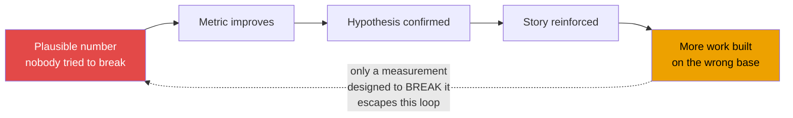

| issue | symptom | resolution |
|---|---|---|
| Truncation constant | 137 interventions all produced nothing | 1100 to 3000 characters, +14.4 points |
| Oracle arm in the config search | search "discovered" a 77.2% winner | ceilings excluded from selection explicitly |
| CUDA wheel mismatch | `torch.cuda.is_available()` false, silently | pin `--torch-backend=cu128` |
| Tokenizer fork deadlock | 14 processes, 0% GPU, no error | `TOKENIZERS_PARALLELISM=false` |
| Array misalignment | 342.7M flags against 367.5M CSR indices | derive both from one sorted frame, assert alignment |
| Verifier scoring concatenated evidence | 0.97 neutrality on true claims, silent refusals | score against the best single source, 0.97 to 0.02 |
| Stale ranker cache | every question after the first scored -1.0 | PMID-sorted memmap index with `searchsorted` |
| Citation regex | `[123, 456]` unmatched, "0 fabrications" was vacuous | match the bracket, then split |
| Variable shadowing | `edges` clobbered 150 cells later | renamed; caught by the closing manifest |
| Bias grid clipped at boundary | fitted bias sat exactly on the grid edge | widen until the optimum is interior |

Two performance notes that mattered at scale:

- **`logits_to_keep=1`.** A causal LM computes logits at every position. For a
  batch of 4 at 3500 tokens that materialises 4.0 GiB of logits, all discarded
  except the final row. Restricting to one position drops it to 1.2 MiB and skips
  the vocabulary projection entirely.
- **Length-sorted batching.** Padding is charged at the longest item in a batch.
  Sorting by length before batching and restoring order afterwards removed most
  of that cost. Together these gave roughly a 5x speedup across 46,000 forward
  passes.

---

<div align="center">

**Built on the full PubMed corpus. Every claim measured against a trivial
baseline. Every overturned conclusion documented.**

</div>
