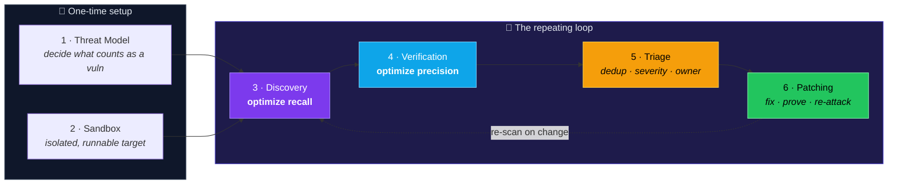
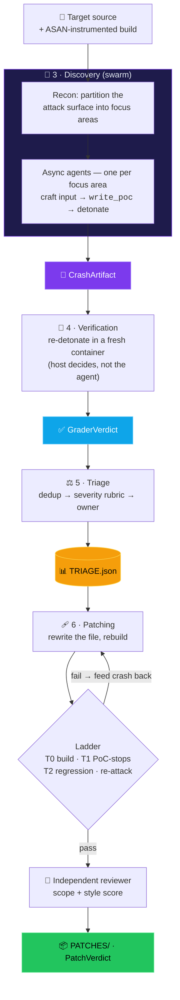

<div align="center">

# 🛡️ Agentic Security Pipeline

### An autonomous loop that **finds**, **proves**, and **patches** real C memory-safety vulnerabilities — driven end-to-end by a single **7B open-source LLM** on one GPU.

<br/>

[](LICENSE)
[](https://www.python.org/)
[](https://huggingface.co/Qwen/Qwen2.5-Coder-7B-Instruct)
[](https://github.com/vllm-project/vllm)
[](https://github.com/google/sanitizers/wiki/AddressSanitizer)
[](secure_code_with_llms.ipynb)
[](https://medium.com/@fareedkhandev/building-an-agentic-security-pipeline-that-finds-proves-and-patches-vulnerabilities-6156aeb4b46f)

<br/>

**Result on the canary target → `3 / 3` bugs discovered · `3 / 3` proven by re-detonation · `3 / 3` patched through a full build → PoC-stop → regression → re-attack ladder · `0` error cells.**

</div>

---

## ✨ What this is

This repository is a **complete, from-scratch re-implementation of [Anthropic's "defender's loop"](https://www.anthropic.com/research)** — the six-step practice of using LLMs to find and fix vulnerabilities in source code — but with one deliberate twist:

> Anthropic drives the loop with Claude. **We drive the exact same loop with an open-source model**, `Qwen2.5-Coder-7B-Instruct`, served locally by **vLLM**. Nothing in this notebook talks to a cloud model API. The only network call the whole pipeline makes is to our own vLLM server on `localhost`.

The pipeline targets **C memory-safety bugs** (buffer overflows, use-after-free) compiled with **AddressSanitizer (ASAN)**. That choice is what makes the whole thing trustworthy: ASAN gives us a **ground-truth oracle**. A finding is "real" if and only if a crafted input makes the instrumented binary actually abort with a precise crash trace inside a hardened sandbox. Verification is never the model second-guessing itself — it's a real program crashing in a real container.

Everything lives in **one literate, runnable notebook** — [`secure_code_with_llms.ipynb`](secure_code_with_llms.ipynb) — built one function per cell, printing its inputs and outputs as it goes, so you can read the entire system top to bottom.

📖 **Companion article:** [*Building an Agentic Security Pipeline That Finds, Proves, and Patches Vulnerabilities*](https://medium.com/@fareedkhandev/building-an-agentic-security-pipeline-that-finds-proves-and-patches-vulnerabilities-6156aeb4b46f)

---

## 🔭 The six-step defender's loop

The first two steps are a one-time setup. The last four are the repeating loop.



| # | Stage | What it does | Optimizes for |
|---|-------|--------------|---------------|
| 1 | **Threat model** | Decide what counts as a vulnerability *before* scanning. Scopes discovery and calibrates severity. | Focus |
| 2 | **Sandbox** | Build an isolated, runnable environment so agents can detonate proofs-of-concept safely. | Safety |
| 3 | **Discovery** | A swarm of agents crafts inputs and detonates them, hunting for crashes. | **Recall** |
| 4 | **Verification** | Independently re-detonate every candidate in a fresh container. | **Precision** |
| 5 | **Triage** | Deduplicate by root cause, score severity from evidence, route to an owner. | Prioritization |
| 6 | **Patching** | Fix the root cause, prove the PoC is nullified, hunt for variants. | Closure |

> 💡 **The central insight:** discovery is now cheap to parallelize, so the bottleneck has shifted to *everything after it* — verification, triage, and patching. This pipeline feels that directly: spinning up more discovery agents is trivial, but **proving and ranking** what they find is where the real engineering lives.

---

## 🧬 How the data flows

Each stage hands a strict, well-defined record to the next. Defining these contracts up front keeps the whole pipeline honest — every stage knows exactly what it consumes and what it must produce.



---

## 🎯 The canary: a known target with planted bugs

Before pointing a model at real code, we need a target whose bugs we already know, so we can tell whether the pipeline actually works. That's the **canary** — a tiny C program that reads a file, looks at the first byte to pick a parser, and hands the rest of the bytes to it. Three parsers hide a deliberate, classic memory-safety bug:

| Dispatch byte | Parser | Planted bug | Crash class |
|:---:|--------|-------------|-------------|
| `A` | `parse_alpha` | copies an attacker-controlled count into an 8-byte heap buffer | **heap-buffer-overflow** |
| `B` | `parse_bravo` | copies the whole payload into a 16-byte stack array | **stack / memcpy-param-overlap** |
| `C` | `parse_charlie` | frees a record on a sentinel byte, then writes through the freed pointer | **heap-use-after-free** |

Three independent, reachable bugs behind one trivial entry point. The full loop must rediscover **all three**.

---

## 🏆 Results

### Canary scoreboard

```
CANARY SCOREBOARD
============================================================
  focus areas from recon     : 3
  crashes discovered (swarm) : 3
  crashes verified           : 3
  distinct signatures        : 3
      - heap-buffer-overflow     @ parse_alpha   /work/canary.c:14
      - heap-use-after-free      @ parse_charlie /work/canary.c:46
      - memcpy-param-overlap     @ parse_bravo   /work/canary.c:29
  triaged findings           : 3
  patches passing the ladder : 3 / 3
============================================================
```

### Patches — every one climbed the full ladder

| Finding | Bug class | Location | Patch iterations | T0 build | T1 PoC stops | T2 no regression | Re-attack | Reviewer |
|:---:|---|---|:---:|:---:|:---:|:---:|:---:|:---:|
| **F-001** | heap-buffer-overflow | `parse_alpha` `:14` | 1 | ✅ | ✅ | ✅ | ✅ clean | **ACCEPT** (6/10) |
| **F-002** | memcpy-param-overlap | `parse_bravo` `:29` | 2 | ✅ | ✅ | ✅ | ✅ clean | **ACCEPT** (8/10) |
| **F-003** | heap-use-after-free | `parse_charlie` `:46` | 3 | ✅ | ✅ | ✅ | ✅ clean | **ACCEPT** (7/10) |

> The iteration counts tell the real story: the use-after-free took **three** patch→grade rounds. On each failed tier, the loop re-detonates the patched binary and feeds the **new** crash trace back to the patch agent — exactly how a human would iterate. Browse the diffs and grader verdicts under [`results/PATCHES/`](results/PATCHES/).

### Pointing the same pipeline at real code: cJSON

The identical pipeline was then aimed at **[cJSON](https://github.com/DaveGamble/cJSON)** pinned to `v1.7.10`. The swarm partitioned the surface into four focus areas (deep nesting, long strings, number parsing, unicode escapes) and reported **0 proven crashes**:

> This is the **honest** outcome, and it's the point. A 7B model on production-shaped recursive-descent code is far weaker than on the canary, and cJSON 1.7.10 already has a nesting-depth guard. So instead of faking a crash, the loop reports the four areas as **UNPROVEN candidates** for a human or a stronger model to follow up — keeping recall high while refusing to invent precision. **Faking a crash would be less faithful, not more.**

---

## 🧠 What makes a 7B model usable as an agent

A 7B model is capable, but it is not Claude. Three engineering choices did most of the work:

1. **🔒 Structured output instead of native tool calling.** Every agent turn is forced to match a tiny JSON Schema via vLLM's `guided_json`, so the model is *physically unable* to emit anything but a valid action. (`Qwen2.5-Coder` doesn't emit the Hermes `<tool_call>` format that vLLM's parser expects — a silent failure we sidestep entirely.)

   ```json
   {"thought": "why I am doing this", "action": "read_file", "args": {"path": "/work/canary.c"}}
   ```
   The `action` field is an enum of known tool names plus `final`, so the model can never invent a tool.

2. **🧾 A host that never trusts the agent's claims.** The agent's only job is to make the program crash. It writes its PoC to a fixed path; then the **host independently re-detonates** and reads the crash. The host — not the model — decides whether a finding is real.

3. **🔢 A precise way to express binary inputs.** A dedicated `write_poc` tool lets the model describe attack bytes directly, instead of hoping a small model hand-encodes base64 correctly.

---

## 📁 Repository structure

```
agentic-security-pipeline/
├── secure_code_with_llms.ipynb          # 📓 the pipeline — read this top to bottom
├── results/                             # 🏁 evidence from the 3/3 canary run
│   ├── executed_secure_code_with_llms.ipynb   # the notebook WITH all outputs
│   ├── THREAT_MODEL.md                  # generated threat model (stage 1)
│   ├── TRIAGE.json                      # deduplicated, severity-ranked findings (stage 5)
│   └── PATCHES/                         # accepted fixes (stage 6)
│       ├── F-001/  patch.diff · patch_result.json
│       ├── F-002/  patch.diff · patch_result.json
│       └── F-003/  patch.diff · patch_result.json
├── scripts/
│   ├── validate.py                      # static check — syntax + undefined names, no GPU needed
│   └── run_on_vm.sh                     # headless reproduction runner (vLLM + nbconvert)
├── requirements.txt
├── LICENSE
└── README.md
```

> 🔎 **Start with [`results/executed_secure_code_with_llms.ipynb`](results/executed_secure_code_with_llms.ipynb)** if you just want to *read* the pipeline and see every printed input/output without running anything.

---

## 🚀 Getting started

### Prerequisites

- A **Linux box with one NVIDIA GPU** (a single H100 is what the results were produced on; any GPU with enough VRAM for a 7B model works) — vLLM serves the model locally.
- **Docker** on the host — the sandbox is built on hardened, throwaway containers.
- **Python 3.11**.

The notebook is **cloud-agnostic**. It reads the machine's facts from an optional `vm_settings.json` and falls back to sensible defaults, so it runs anywhere that satisfies the three prerequisites above.

### 1 · Clone and install

```bash
git clone https://github.com/FareedKhan-dev/agentic-security-pipeline.git
cd agentic-security-pipeline

# On a CUDA 12.8 host (uv handles the torch backend cleanly):
uv pip install --torch-backend=cu128 -r requirements.txt
# (or use pip after installing a CUDA-matched torch wheel)
```

### 2 · Static-check the notebook (no GPU required)

```bash
python scripts/validate.py
# -> OK: 67 code cells, 0 syntax error(s), 0 undefined name(s).
```

### 3 · Run it

**Interactive** — open `secure_code_with_llms.ipynb` in JupyterLab (over an SSH tunnel to the GPU box) and run the cells top to bottom. The notebook starts its own vLLM server in the background and warms it before the first agent runs.

**Headless** — copy the notebook onto the GPU box and let the runner serve vLLM and execute it end to end:

```bash
scp secure_code_with_llms.ipynb root@YOUR_GPU_HOST:/root/work/
ssh root@YOUR_GPU_HOST 'sudo bash /root/work/run_on_vm.sh'   # see scripts/run_on_vm.sh
```

The executed notebook and all artifacts are written next to it, mirroring what you see in [`results/`](results/).

---

## 🛠️ Tech stack

| Layer | Choice | Why |
|-------|--------|-----|
| **Model** | `Qwen2.5-Coder-7B-Instruct` | Strong open code model that fits on one GPU |
| **Serving** | `vLLM` (OpenAI-compatible) | One endpoint, many agent roles; `guided_json` structured output |
| **Sandbox** | Docker (`--network none`, dropped caps, read-only rootfs) | Safe detonation of attacker-controlled bytes |
| **Oracle** | AddressSanitizer + `gcc:14` | Ground-truth crash signal → near-zero false positives |
| **Target** | C (canary) + cJSON `v1.7.10` | Reachable, well-understood memory-safety bugs |
| **Orchestration** | `asyncio` swarm, bounded by a semaphore | Cheap, parallel discovery |

---

## ⚠️ Honest limitations

This project is built for **clarity and faithfulness**, not to be a turnkey scanner. A few things to keep in mind:

- **A 7B model on real code is weak.** It shines on the canary because the bugs are reachable and obvious; on production code it leans on recall and will report unproven candidates (see the cJSON run).
- **Single-model verification.** The guide recommends verifying with a *different* model than discovery. Here, one model plays every role — the ASAN oracle is what keeps precision high.
- **Plain Docker, not gVisor.** Anthropic's harness uses gVisor (`runsc`) for stronger isolation. For a single-purpose teaching box, `--network none` + dropped capabilities is a sound boundary; swapping in `--runtime runsc` is a one-line change.

---

## 🧭 Where this goes next

- **Stronger isolation** — swap plain Docker for gVisor by adding `--runtime runsc` in `docker_run_isolated`.
- **Model diversity for verification** — serve a second small model and point the adversarial verifier at it.
- **More targets & re-scanning** — point the packaged `run_discovery_verify_triage()` at your own service, re-scan on every change, and feed verified findings back into `THREAT_MODEL.md` so each cycle is better informed.
- **Bigger models, same harness** — nothing in the pipeline assumes a small model. Raise `model_id` and discovery/patching quality rise with it; the sandbox, the oracle, and the data contracts are unchanged.

---

## 🙏 Credits & references

- **Anthropic** — for the original *Using LLMs to secure source code* defender's-loop methodology this project re-implements.
- **[Qwen2.5-Coder](https://huggingface.co/Qwen/Qwen2.5-Coder-7B-Instruct)** · **[vLLM](https://github.com/vllm-project/vllm)** · **[AddressSanitizer](https://github.com/google/sanitizers/wiki/AddressSanitizer)** · **[cJSON](https://github.com/DaveGamble/cJSON)**.
- 📖 Full write-up: [*Building an Agentic Security Pipeline That Finds, Proves, and Patches Vulnerabilities*](https://medium.com/@fareedkhandev/building-an-agentic-security-pipeline-that-finds-proves-and-patches-vulnerabilities-6156aeb4b46f).

---

## 📜 License

Released under the [MIT License](LICENSE).

<div align="center">
<br/>
<sub>Built by <a href="https://github.com/FareedKhan-dev">Fareed Khan</a> · If this was useful, consider leaving a ⭐</sub>
</div>
