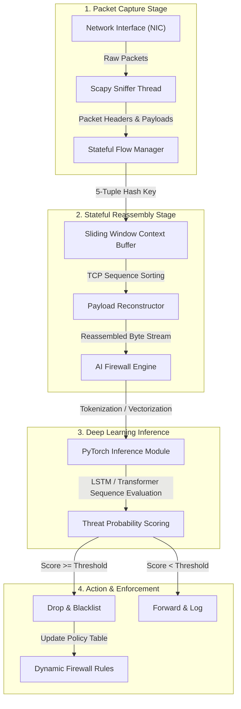
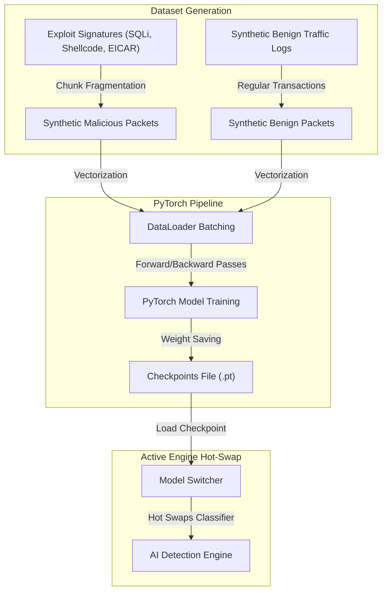

<h1 align="center">Context-Aware AI Firewall</h1>
<p align="center">
  <strong>A stateful, Deep Learning-powered Intrusion Prevention System (IPS) built to detect and terminate evasive, fragmented network attacks.</strong><br/>
  <em>Sniff traffic flows → buffer packet sequences → reconstruct TCP streams in-order → predict threats via PyTorch → execute dynamic rules — all in real-time.</em>
</p>

<p align="center">
  
  
  
  
  
  
  
</p>

---

## Table of Contents

- 🔍 [Overview](#overview)
- 🎯 [Why Context-Aware AI Firewall?](#why-context-aware-ai-firewall)
- ✨ [Core System Features](#core-system-features)
- 🏗 [Architecture](#architecture)
- 🔄 [Network Processing Flow](#network-processing-flow)
- 📊 [Model Pipeline and Datasets](#model-pipeline-and-datasets)
- 🎨 [Visual UI Guide](#visual-ui-guide)
- 🚀 [Quick Start](#quick-start)
- 🐳 [Docker Deployment](#docker-deployment)
- 📁 [Repository Directory Structure](#repository-directory-structure)
- ⚠️ [Troubleshooting and Failsafes](#troubleshooting-and-failsafes)
- [Author](#author)

---

## 🔍 Overview

Traditional packet-filtering firewalls inspect network packets independently, making them blind to modern malware that fragments payloads into multiple harmless-looking packets. Only after reconstructing the entire sequence does the malicious exploit emerge. 

This system captures packet flows, buffers them per-flow, reassembles them based on TCP sequence numbers (handling out-of-order, duplicates, overlaps, and gaps), extracts sequence features, and uses PyTorch deep learning networks (LSTM or Transformer) to dynamically block malicious sessions at the firewall gateway level.

<p align="center">
  
</p>

---

## 🎯 Why Context-Aware AI Firewall?

> **Traditional firewalls check packets in isolation. This system tracks TCP sequence flows over time, detecting attacks that hide inside split fragments.**

| Capability | Traditional Packet Filters | Stateful Inspection (SPI) | Context-Aware AI Firewall |
|---|---|---|---|
| **Packet Reassembly** | None — inspects packets individually. | Basic — tracks connection state (SYN/ACK). | Deep — reconstructs full payload byte streams in sequence order. |
| **Out-of-Order Handling** | Vulnerable to evasion. | Basic buffering. | Full sliding window reordering, overlap resolving, gap null-filling. |
| **Detection Method** | Static port/IP rules & basic signatures. | Port/IP rules & protocol verification. | Deep learning sequence analysis (Shannon entropy, packet intervals, headers, payloads). |
| **Malware Evasion Resistance** | Zero — blind to payload fragmentation. | Low — easily bypassed by slow/irregular packet intervals. | High — analyzes temporal sequences (LSTM/Transformer) to block split payloads. |
| **Enforcement Action** | Static Drop/Reject. | Connection termination. | Dynamic flow termination & temporary 1-hour attacker IP blacklisting. |

---

## ✨ Core System Features

*   **TCP Flow Reconstruction**: A bidirectional, stateful manager that groups packets by 5-tuple keys `(IPs, Ports, Protocol)`, reassembling fragmented streams in sequence order while dealing with overlapping offsets, duplicates, and missing segments.
*   **Dual-Mode Capture Engine**: Supports live network interface capture using Scapy and playback analysis of standard Wireshark PCAP logs.
*   **High-Fidelity Traffic Simulator**: Generates background web interactions and supports interactive injection of fragmented cyber attacks (SQL Injection, EICAR Test File, Shellcode, Reverse Shells).
*   **State-of-State Deep Learning**: Real-time evaluation using PyTorch Bidirectional LSTM and Self-Attention Transformer models.
*   **Dynamic Policy Rules**: Implements dynamic IP blacklists, whitelists, and temporary rule expirations, executing automated drops on connections classified as threats.
*   **Cybersecurity Operations Dashboard**: A CrowdStrike-inspired, dark-themed dashboard built with React, Vite, Framer Motion, and Recharts.

---

## 🏗 Architecture

The system is separated into a high-performance **FastAPI backend** (running the sniffing, reassembly, and PyTorch inference pipelines) and a **React dashboard** (visualizing packet streams, topology flows, hex dumps, and rule configurations).

```mermaid
graph TD
    subgraph UI ["UI Layer (React + Vite)"]
        DASH["Dashboard.tsx\nKPIs & Real-time Gauges"]
        FLOW["FlowViewer.tsx\nInteractive SVG Topology Map"]
        MON["PacketMonitor.tsx\nLive Packet Stream"]
        PAY["PayloadViewer.tsx\nHex Dump & ASCII Inspector"]
        RULES["RulesManager.tsx\nAccess Control Lists (ACL)"]
        TRAIN["TrainingPanel.tsx\nLoss curves & metrics"]
    end

    subgraph Core ["FastAPI Backend"]
        CAP["Capture Engine\npacket_capture.py"]
        MGR["Flow Manager\nflow.py"]
        BUF["Context Buffer\nbuffer.py"]
        RECON["Reconstructor\nreconstructor.py"]
        FE["Feature Extractor\nfeature_extractor.py"]
        AI["AI Engine (lstm.py / transformer.py)\nActive Inference Classifier"]
        DB["Database Client\ndb.py & models.py (SQLite)"]
        ENG["Firewall Engine\nengine.py"]
    end

    CAP -->|Raw Scapy Packets| MGR
    MGR -->|Track 5-Tuple| BUF
    BUF -->|In-Order Packets| RECON
    RECON -->|Reassembled Bytes| ENG
    BUF -->|Sequence Features| FE
    FE -->|Feature Vector (100, 16)| AI
    AI -->|Predict Threat Score| ENG
    ENG -->|Insert Blocked Flow / Log Threat| DB
    ENG -->|WebSocket Broadcast Alert| UI
    UI -->|API Requests| DB
```

<details>
<summary>ASCII fallback (click to expand)</summary>

```
+-------------------------------------------------------------------------+
|                          AI Firewall System                             |
|                                                                         |
|   +-----------------------+              +--------------------------+   |
|   |   React Frontend      |              |      FastAPI Backend     |   |
|   |                       |              |                          |   |
|   |  * Dashboard (KPIs)   |   API Query  |  * Scapy Packet Sniffer  |   |
|   |  * Packet Monitor     |<------------>|  * Stateful Flow Manager |   |
|   |  * Flow Topology Map  |  WebSockets  |  * Reassembly Engine     |   |
|   |  * Payload Hex/ASCII  |<-------------|  * PyTorch Model (LSTM/  |   |
|   |  * ACL Rule Manager   |  Real-time   |    Transformer)          |   |
|   |                       |   Alerts     |  * SQLite DB (Acls/Logs) |   |
|   +-----------------------+              +--------------------------+   |
+-------------------------------------------------------------------------+
```
</details>

---

## 🔄 Network Processing Flow

The diagram below maps the sequence of a packet from physical network ingestion to AI classification and dynamic rule enforcement:



<details>
<summary>ASCII fallback (click to expand)</summary>

```
Raw Packet 
   │
   ▼
[Scapy Sniffer] ──────► [Flow Manager] ──────► [Context Buffer]
                             │                       │ (Sliding Window)
                             ▼                       ▼
                    [5-Tuple Hash Lookup]    [TCP Sequence Ordering]
                                                     │
                                                     ▼
                                            [Payload Reconstructor]
                                                     │
                                                     ▼
                                            [Feature Extractor]
                                                     │ (16-D Features)
                                                     ▼
                                            [PyTorch Inference] (LSTM/Transformer)
                                                     │
                                                     ▼
                                            [Threat Score Evaluate]
                                            /                     \
                                     >= 0.75?                      < 0.75?
                                      /                                 \
                                     ▼                                   ▼
                            [Block Connection]                    [Forward Flow]
                            [Log Threat to DB]
                            [WebSocket Alert]
```
</details>

---

## 📊 Model Pipeline and Datasets

The firewall supports continuous training and dynamic model swapping at runtime:



<details>
<summary>ASCII fallback (click to expand)</summary>

```
[Exploit Payloads] ──► [Chunk Split] ─────┐
                                           ├─► [Feature Extract] ─► [PyTorch Trainer] ─► [best_model.pth] ─► [Hot Swap Engine]
[Benign Payloads] ───► [Normal Session] ──┘
```
</details>

---

## 🎨 Visual UI Guide

The frontend provides an operators' console structured as follows:

| View Panel | Interactive Elements | Visual Indicator / Gauge |
|---|---|---|
| **Dashboard** | Simulation triggers (`Rev Shell Chunk`, `SQLi Chunk`, `EICAR Test`), Active AI model switcher. | System online status, Throughput speed, Active flow counts, Average threat score, AI confidence gauge. |
| **Packet Monitor** | Search bar (filter by IP/Port), Protocol filters (ALL, TCP, UDP), Pause/Resume controls, Packet Inspector inspector. | Color-coded protocol tags, TCP sequence flags highlight, scrollable raw ASCII payload preview. |
| **Flow Viewer** | Interactive topology nodes, SVG flow lines click trigger, Manual `Unblock Flow` override button. | Pulsing green dots representing benign packet transit, glowing animated red dashed paths representing blocked connections. |
| **Payload Viewer** | Flow list sidebar, address offset explorer. | Hex dump layout, reconstructed ASCII stream window with red blinking highlight on malware signatures. |
| **Firewall Rules** | Rule creator form, notes text-area, delete rule button. | ACL type labels (Blacklist/Whitelist), Expiration tags (Permanent/Temporary timestamps), Seed protection shields. |
| **Model Training** | Epoch sliders, architecture select dropdown, `Initiate Model Training` button. | Convergence loss line charts, evaluation score bar charts (Accuracy, Precision, Recall, F1). |
| **Settings** | Sniffing interface text input, mode selectors (Simulation/Live), PCAP file drop zone, threshold sliders. | PCAP upload state feedback (Completed/Failed alerts), Timeout range displays. |

---

## 🚀 Quick Start

### Prerequisites
*   **Python 3.9+** (Tested on Python 3.13)
*   **Node.js 18+**
*   *For Live Sniffing*: Npcap/WinPcap (Windows) or root capabilities (Linux).

### A. Run Backend from Source
1.  Navigate to the repository root directory.
2.  Install dependencies:
    ```powershell
    pip install -r backend/requirements.txt
    pip install torch --index-url https://download.pytorch.org/whl/cpu
    ```
3.  Boot the FastAPI server:
    ```powershell
    $env:PYTHONPATH="."
    python backend/main.py
    ```
    The backend server binds to `http://127.0.0.1:8000`.

### B. Run Frontend Dashboard
1.  Open a separate terminal window at the repository root.
2.  Navigate to the frontend folder:
    ```powershell
    cd frontend
    npm install
    npm run dev
    ```
3.  Access the console via browser at `http://localhost:5173`.

---

## 🐳 Docker Deployment

To launch the entire stack using container orchestration, run the following from the root directory:
```bash
docker-compose up --build
```
*   **Dashboard Console**: `http://localhost`
*   **API Gateway**: `http://localhost:8000`

> [!NOTE]
> Inside the Docker container, packet sniffing defaults to simulation mode to prevent privilege restrictions on raw socket capture.

---

## 📁 Repository Directory Structure

-   [backend/](./backend) — Core application code.
    -   [backend/main.py](./backend/main.py) — Application entry point.
    -   [backend/config.py](./backend/config.py) — Pydantic system settings.
    -   [backend/capture/](./backend/capture) — Network capture loops.
        -   [packet_capture.py](./backend/capture/packet_capture.py) — Sniffer and PCAP reader.
    -   [backend/flow_manager/](./backend/flow_manager) — Flow management state.
        -   [flow.py](./backend/flow_manager/flow.py) — Bidirectional flow dictionaries.
    -   [backend/context_buffer/](./backend/context_buffer) — Buffer arrays.
        -   [buffer.py](./backend/context_buffer/buffer.py) — Sliding window packet queues.
    -   [backend/payload_reconstructor/](./backend/payload_reconstructor) — TCP reassembly.
        -   [reconstructor.py](./backend/payload_reconstructor/reconstructor.py) — Sequence ordering algorithms.
    -   [backend/firewall/](./backend/firewall) — Firewall rules.
        -   [engine.py](./backend/firewall/engine.py) — Dynamic policy check.
    -   [backend/ai/](./backend/ai) — Machine learning resources.
        -   [feature_extractor.py](./backend/ai/feature_extractor.py) — Feature normalization.
        -   [models/](./backend/ai/models) — Model structures.
            -   [lstm.py](./backend/ai/models/lstm.py) — Bidirectional LSTM networks.
            -   [transformer.py](./backend/ai/models/transformer.py) — Attention network models.
        -   [training/](./backend/ai/training) — Model trainers.
            -   [trainer.py](./backend/ai/training/trainer.py) — Gradient optimization loops.
        -   [datasets/](./backend/ai/datasets) — Synthetics generation.
            -   [synthetic_generator.py](./backend/ai/datasets/synthetic_generator.py) — Payloads splits.
    -   [backend/database/](./backend/database) — Relational client.
        -   [db.py](./backend/database/db.py) — SQLAlchemy local sessions.
        -   [models.py](./backend/database/models.py) — Tables definitions.
    -   [backend/api/](./backend/api) — Routing interfaces.
        -   [server.py](./backend/api/server.py) — REST endpoints & WebSockets.
-   [frontend/](./frontend) — Operator dashboards.
    -   [frontend/src/App.tsx](./frontend/src/App.tsx) — Main React coordinate logic.
    -   [frontend/src/pages/](./frontend/src/pages) — View dashboards.
        -   [Dashboard.tsx](./frontend/src/pages/Dashboard.tsx) — KPI & alerts consoles.
        -   [FlowViewer.tsx](./frontend/src/pages/FlowViewer.tsx) — Topologies visualizer maps.
        -   [PacketMonitor.tsx](./frontend/src/pages/PacketMonitor.tsx) — Stream tracking tables.
        -   [PayloadViewer.tsx](./frontend/src/pages/PayloadViewer.tsx) — Reconstructed hex readers.
        -   [RulesManager.tsx](./frontend/src/pages/RulesManager.tsx) — Manual rule CRUD.
        -   [TrainingPanel.tsx](./frontend/src/pages/TrainingPanel.tsx) — Convergence dashboards.
        -   [Settings.tsx](./frontend/src/pages/Settings.tsx) — Parameters configuring.

---

## ⚠️ Troubleshooting and Failsafes

### Troubleshooting Guide

| Issue | Root Cause | Resolution |
|---|---|---|
| **Scapy live capture permission error** | Capture engine running in `live` mode without administrator privileges. | On Windows, run PowerShell as Administrator. On Linux, run the command with `sudo` or grant `CAP_NET_RAW` capabilities to Python. Alternatively, switch sniffing mode to `simulation` in Settings. |
| **PyTorch imports fail or crash** | Missing C++ redistributable runtimes, wrong PyTorch version, or mismatch of CPU/CUDA dependencies. | Install CPU-only torch: `pip install torch --index-url https://download.pytorch.org/whl/cpu`. Verify your Python architecture is 64-bit. |
| **WebSockets connection lost / SYSTEM: OFFLINE** | FastAPI backend server has crashed, is not running, or is blocked by local firewalls. | Verify the backend is running at `http://127.0.0.1:8000`. Check server console outputs for exceptions. Verify no other app occupies port 8000. |
| **Database seed/write failures** | `firewall.db` SQLite database is locked, corrupted, or has wrong permissions. | Stop the backend server, delete the local `firewall.db` file from the directory root, and restart the backend server to regenerate a fresh schema database. |
| **Reassembly hex dump is empty** | Packets inside the buffer contain zero payload bytes (e.g. empty TCP keep-alives or handshake packets). | This is expected for clean connections. Perform a simulated attack (like `SQLi Chunk`) to verify reassembly and payload highlights. |

### Core Safety Failsafes
*   **Loopback Protection**: The firewall seeds a permanent whitelist rule for `127.0.0.1` at launch to prevent administrators from locking themselves out of the management panel.
*   **Gap Threshold Caps**: The sequence reconstructor caps TCP gap null-padding to `1024` bytes to prevent malicious sequence numbering tricks from triggering Out-Of-Memory exceptions.
*   **Rate-Limited WebSocket Broadcast**: Frame updates to the UI are throttled to a maximum of 7 transmissions per second (`0.15s` delay) to prevent UI thread lockups during high network throughput.
*   **Early Stopping**: Model training includes validation check thresholds that trigger early stops after 3 epochs of flat performance to avoid overfitting and excessive resource utilization.

---

## Author

**Felix-au** (Harshit Soni)

- 🔗 GitHub: [github.com/Felix-au](https://github.com/Felix-au)
- 📧 Email: [felixaugum@gmail.com](mailto:felixaugum@gmail.com)

---

<p align="center">
  <sub>Built for security operations teams who need context-aware intrusion prevention at the gateway level.</sub>
</p>
