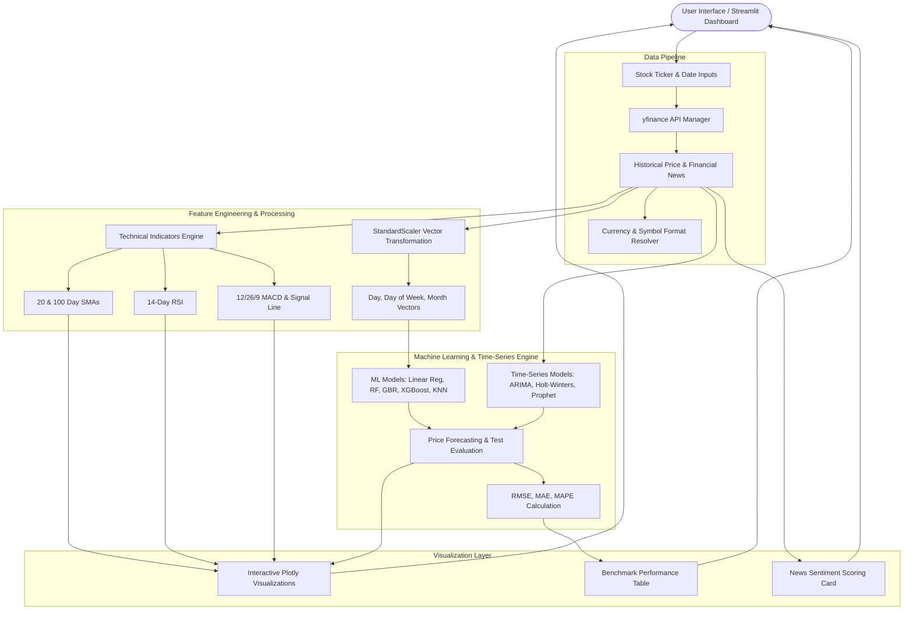

<p align="center">
  
</p>

<h1 align="center">QuantX: Stock Analysis and Forecast</h1>

<p align="center">
  <strong>An elegant, high-fidelity AI-powered dashboard to analyze stock trends, compute technical indicators, and forecast stock prices using optimized Machine Learning.</strong>
</p>

<p align="center">
  <em>Real-time market analytics, automated sentiment scoring, and multi-model financial forecasting driven by Python and Streamlit.</em>
</p>

<p align="center">
  
  
  
  
  
  
</p>

---

## Table of Contents

- [Overview](#overview)
- [Competitive Comparison](#competitive-comparison)
- [System Architecture](#system-architecture)
- [Visual UI Guide](#visual-ui-guide)
- [Machine Learning Forecasting Engine](#machine-learning-forecasting-engine)
- [Technical Indicators and Metrics](#technical-indicators-and-metrics)
- [Access and Launch Instructions](#access-and-launch-instructions)
  - [Open Source Source Run](#open-source-source-run)
  - [Web Access](#web-access)
  - [Custom Domain Deployment](#custom-domain-deployment)
- [Directory Structure](#directory-structure)
- [Troubleshooting and Failsafes](#troubleshooting-and-failsafes)
- [Author](#author)

---

## Overview

**QuantX** is an open-source financial analytics and machine learning forecasting tool. Built with modern modular Python and managed via the Rust-based **`uv`** package manager, QuantX provides real-time market overviews for global indices and individual stocks (including Indian NSE stocks with `.NS` suffixes).

### Core Highlights
* **Modular Codebase**: Fully refactored into a modular package (`src/`) separating UI components, mathematical indicators, predictions, and helpers.
* **8 Forecasting Algorithms**: Includes Linear Regression, Random Forest, Gradient Boosting, XGBoost, K-Nearest Neighbors, ARIMA, Exponential Smoothing, and Facebook Prophet.
* **Benchmarking Suite**: A single-click "Run All and Compare" mode that benchmarks all 8 algorithms simultaneously and highlights top performers based on RMSE, MAE, and MAPE.
* **Automated News Sentiment**: Analyzes recent financial news articles using a dictionary-based sentiment scoring algorithm.
* **Currency Adaptability**: Dynamically detects Indian stock tickers (`.NS`) and formats currency outputs between INR (₹) and USD ($).

---

## Competitive Comparison

| Feature | QuantX Dashboard | Traditional Web Portals (Yahoo/Google Finance) | Standard Python Scripts |
|---|---|---|---|
| **Multi-Model Forecasting** | ✅ 8 ML & Time-Series Models | ❌ None (Historical Only) | ⚠️ Manual Script Setup |
| **Model Benchmarking** | ✅ Automated side-by-side comparison table | ❌ N/A | ❌ Requires custom evaluation scripts |
| **Sentiment Analysis** | ✅ Integrated live news scoring | ⚠️ News listing only | ❌ N/A |
| **Package Management** | ✅ Modern fast `uv` lockfile | N/A | ⚠️ Slow standard pip/requirements |
| **Technical Indicators** | ✅ Interactive RSI, MACD & SMAs | ⚠️ Static / Paywalled basic charts | ⚠️ Requires manual matplotlib plots |
| **Deployment Options** | ✅ Cloud Cloud run, Streamlit Cloud & Custom Domain support | N/A | ❌ CLI-only |

---

## System Architecture



<details>
<summary>ASCII fallback (click to expand)</summary>

```text
+-----------------------------------------------------------------------------------+
|                            USER INTERFACE (Streamlit)                             |
+-----------------------------------------------------------------------------------+
                                         |
                                         v
+-----------------------------------------------------------------------------------+
|                                 DATA ACQUISITION                                  |
|   - Ticker Resolution (.NS Indian Stocks -> INR ₹, Global Tickers -> USD $)       |
|   - Historical Daily Prices & Company Info via yfinance                           |
|   - Live Business News Articles                                                   |
+-----------------------------------------------------------------------------------+
                                         |
             +---------------------------+---------------------------+
             |                                                       |
             v                                                       v
+---------------------------+                       +-------------------------------+
| TECHNICAL INDICATORS      |                       | FEATURE ENGINEERING & ML      |
| - 20 & 100 Day SMAs       |                       | - StandardScaler Vectorizing  |
| - 14-Day RSI              |                       | - Calendar Features           |
| - MACD Line & Signal Line |                       | - 8 Models (XGB, Prophet, etc)|
+---------------------------+                       +-------------------------------+
             |                                                       |
             +---------------------------+---------------------------+
                                         |
                                         v
+-----------------------------------------------------------------------------------+
|                               VISUALIZATION LAYER                                 |
|   - Plotly Interactive Price Charts with Buy/Sell Crossover Annotations           |
|   - Live Market Overview Ticker Sidebar                                           |
|   - Multi-Model Benchmarking Matrix (RMSE, MAE, MAPE)                             |
|   - News Sentiment Analysis Cards                                                 |
+-----------------------------------------------------------------------------------+
```
</details>

---

## Visual UI Guide

### Dashboard Panels & Tabs

| Panel / Tab | Components & Interactive Controls | Purpose |
|---|---|---|
| **Sidebar Market Overview** | Global market indices ticker (`Nifty 50`, `Sensex`, `S&P 500`, `Dow Jones`, `NASDAQ`, `Russell 2000`). | Provides instant macro market context with live percentage changes. |
| **Tab 1: Stock Analysis** | Stock code text input, Company Summary card, Market Cap & 52-Week Range metrics, 5-Year SMA chart, Live News feed. | Comprehensive high-level stock analysis and recent market sentiment. |
| **Tab 2: Technical Indicators** | Start/End date selectors, Indicator dropdown (`RSI`, `MACD`), Plotly chart with overbought/oversold lines & signal crossover labels. | Momentum and trend strength visualization. |
| **Tab 3: Stock Price Prediction** | Algorithm selector (8 individual models or `Run All and Compare`), Forecast duration slider (1-60 days), Forecast chart, Benchmark table. | Machine learning-based future price projection and model error evaluation. |

---

## Machine Learning Forecasting Engine

The forecasting engine (`src/predictions.py`) prepares historical stock price vectors and evaluates predictive models across custom forecast horizons.

### Feature Pipeline
1. **Feature Construction**: Constructs temporal feature matrices containing day indexes, day of the week, and month numbers.
2. **Standardization**: Features are scaled using `StandardScaler` to ensure optimal convergence for regression models.
3. **Train-Test Partitioning**: Partitions 90% training data and 10% sequential test evaluation data without data leakage (`shuffle=False`).

### Algorithm Matrix

| Algorithm | Model Type | Key Configuration / Parameters |
|---|---|---|
| **Linear Regression** | Linear Model | Baseline ordinary least squares regressor |
| **Random Forest** | Tree Ensemble | `n_estimators=100`, `max_depth=5`, `random_state=42` |
| **Gradient Boosting** | Boosting Ensemble | `n_estimators=100`, `max_depth=5`, `learning_rate=0.1` |
| **XGBoost** | Extreme Gradient Boosting | `n_estimators=100`, `max_depth=5`, `learning_rate=0.1` |
| **K-Nearest Neighbors** | Non-parametric | `n_neighbors=5`, distance-weighted interpolation |
| **ARIMA** | Time-Series | Autoregressive Integrated Moving Average `ARIMA(5,1,0)` |
| **Exponential Smoothing** | Time-Series | Holt-Winters model with additive trend |
| **Prophet** | Additive Seasonality | Facebook Prophet with daily seasonality modeling |

### Evaluation Metrics
When running individual models or multi-model comparisons, three standard statistical error metrics are evaluated against test data:
- **RMSE (Root Mean Squared Error)**: Penalizes larger prediction variance.
- **MAE (Mean Absolute Error)**: Average absolute deviation from ground-truth price.
- **MAPE (Mean Absolute Percentage Error)**: Percentage error deviation relative to price scale.

---

## Technical Indicators and Metrics

1. **Simple Moving Average (SMA)**:
   $$\text{SMA}_k = \frac{1}{k} \sum_{i=0}^{k-1} P_{t-i}$$
   Computes 20-day (short-term) and 100-day (long-term) moving averages to identify golden and death crossovers.

2. **Relative Strength Index (RSI)**:
   $$\text{RSI} = 100 - \frac{100}{1 + \text{RS}}, \quad \text{where } \text{RS} = \frac{\text{Average Gain}}{\text{Average Loss}}$$
   Oscillates between 0 and 100. Values above **70** indicate overbought conditions, while values below **30** indicate oversold conditions.

3. **Moving Average Convergence Divergence (MACD)**:
   $$\text{MACD Line} = \text{EMA}_{12}(\text{Close}) - \text{EMA}_{26}(\text{Close})$$
   $$\text{Signal Line} = \text{EMA}_{9}(\text{MACD Line})$$
   Generates automatic **Buy** annotations when the MACD line crosses above the Signal line and **Sell** annotations when it crosses below.

---

## Access and Launch Instructions

### Open Source Source Run

Ensure **Python 3.13+** and **`uv`** are installed.

```bash
# 1. Clone the repository
git clone https://github.com/Felix-au/QuantX-Stock-Analysis-and-Forecast.git
cd QuantX-Stock-Analysis-and-Forecast

# 2. Run the application (uv auto-installs dependencies into virtualenv)
uv run streamlit run main.py
```

---

### Web Access

Access the hosted web application directly without local installation:
👉 **[https://quantx.streamlit.app/](https://quantx.streamlit.app/)**

---

### Custom Domain Deployment

Streamlit Community Cloud (`streamlit.app`) does not natively support binding custom DNS domain names directly on its free hosting platform. If you wish to serve QuantX under your custom domain (e.g. `quantx.felixau.in`), use one of the following deployment approaches:

#### Approach 1: Cloudflare Reverse Proxy / CNAME Masking (Hosted on Streamlit)
- Keep the app deployed on Streamlit Community Cloud (`quantx.streamlit.app`).
- Set up a CNAME record or Cloudflare Worker for your custom domain pointing to `quantx.streamlit.app` with HTTP Host header rewriting enabled.

#### Approach 2: Deploy to Container Cloud Platforms (Native Custom Domain Support)
Deploy the application to platforms that support automatic SSL and custom domain mapping out of the box:
- **Google Cloud Run**
- **Render**
- **AWS App Runner**
- **Railway / Hugging Face Spaces**

#### Approach 3: Self-Hosted VPS Deployment (Nginx / Caddy Reverse Proxy)
Deploy on any Linux virtual private server:
```bash
# Start Streamlit in background on port 8501
uv run streamlit run main.py --server.port 8501 --server.address 127.0.0.1
```
Configure **Caddy** (`/etc/caddy/Caddyfile`) for automatic HTTPS and domain routing:
```caddy
quantx.yourdomain.com {
    reverse_proxy 127.0.0.1:8501
}
```

---

## Directory Structure

```text
QuantX-Stock-Analysis-and-Forecast/
├── .streamlit/           # Streamlit configuration settings
├── assets/               # Brand assets & logo images
├── pyproject.toml        # Modern uv project specifications & dependencies
├── uv.lock               # Auto-generated lockfile for reproducible builds
├── main.py               # Application entry point & tab coordinator
├── guide.md              # Companion quick run & deployment guide
├── README.md             # Project documentation specification
└── src/                  # Core package modules
    ├── __init__.py       # Package boundary & module exports
    ├── components.py     # UI cards, sidebar ticker, and live news feed
    ├── helpers.py        # Currency & NSE ticker helpers
    ├── indicators.py     # Math calculation engine for SMA, RSI, & MACD
    └── predictions.py    # Feature engineering & ML forecasting engine
```

### Key Components Mapping

| File | Primary Functions / Classes | Responsibilities |
|---|---|---|
| [`main.py`](file:///c:/Users/Felix/Documents/ML/QuantX-Stock-Analysis-and-Forecast/main.py) | Main script | Orchestrates theme CSS, tab navigation, and user input workflows |
| [`src/components.py`](file:///c:/Users/Felix/Documents/ML/QuantX-Stock-Analysis-and-Forecast/src/components.py) | `display_market_overview()`, `display_news()`, `plot_technical_indicator()` | Renders sidebar tickers, sentiment-scored news, and Plotly charts |
| [`src/predictions.py`](file:///c:/Users/Felix/Documents/ML/QuantX-Stock-Analysis-and-Forecast/src/predictions.py) | `get_prepared_data()`, `predict()` | Preprocesses data, trains ML models, and computes error metrics |
| [`src/indicators.py`](file:///c:/Users/Felix/Documents/ML/QuantX-Stock-Analysis-and-Forecast/src/indicators.py) | `calculate_technical_indicators()`, `calculate_sma()` | Vectorized computations for RSI, MACD, and SMAs |
| [`src/helpers.py`](file:///c:/Users/Felix/Documents/ML/QuantX-Stock-Analysis-and-Forecast/src/helpers.py) | `is_nse_stock()` | Detects `.NS` stock codes for dynamic currency formatting |

---

## Troubleshooting and Failsafes

| Issue / Error | Cause | Recommended Solution |
|---|---|---|
| **`No stock data available`** | Incorrect ticker symbol or non-existent stock code | Verify symbol on Yahoo Finance. For Indian stock exchange, append `.NS` (e.g. `TCS.NS`). |
| **`Empty DataFrame` in Indicators** | Date range falls entirely on market holidays or weekend | Select a wider date range (at least 30-60 days) in Tab 2. |
| **Prophet Timezone Warning** | Pandas datetime index includes timezone offsets | Automatically sanitized in `src/predictions.py` via `.dt.tz_localize(None)`. |
| **Slow initial prediction run** | Model fitting across 8 algorithms in "Run All" mode | "Run All and Compare" computes 8 separate models sequentially. Use individual algorithms for instant single-model results. |

---

## Author

**Felix-au** (Harshit Soni)

- 🔗 GitHub: [github.com/Felix-au](https://github.com/Felix-au)
- 📧 Email: [felixaugum@gmail.com](mailto:felixaugum@gmail.com)

---

<p align="center">
  <sub>Empowering intelligent financial insights with modular Python AI.</sub>
</p>
