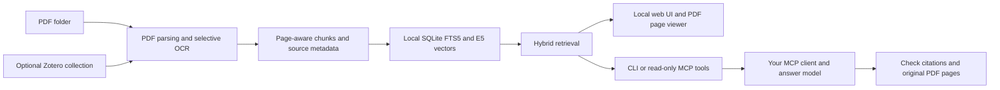

# Epilepsy Research RAG

**Turn a PDF folder into a searchable research library. Retrieve evidence in English or Chinese, inspect original pages, and connect your preferred MCP client.**

[](https://github.com/FrankPan-30/epilepsy-research-rag/actions/workflows/tests.yml)
[](LICENSE)
[](https://www.python.org/downloads/)

**English** | [简体中文](README.zh-CN.md)

A local literature-retrieval toolkit built around an epilepsy-prediction research workflow. **Start with a PDF folder, or optionally connect Zotero.** Parsing, embeddings and retrieval run locally. Use the bilingual local web interface or CLI, or expose evidence through nine read-only MCP tools to Codex or another compatible client. The client handles answer generation; evidence sent to a cloud model is processed by that provider.

> “Compare alarm postprocessing across cross-patient studies. Show the validation protocol, smoothing and threshold rules, false-alarm definition, and original PDF pages.”

## Start with the local web interface

Install Python **3.12**, download and unzip this repository ([ZIP](https://github.com/FrankPan-30/epilepsy-research-rag/archive/refs/heads/main.zip)), then double-click **`Start Web.bat` on Windows x64** or **`Start Web.command` on macOS**. The launcher installs missing dependencies and opens your browser. Keep its terminal window open while using the app. Existing installations can use the same launcher.

1. Choose PDFs or a folder, or drag PDF files into the import area.
2. On first use, click **Download local model** (free public weights, about 470 MB), then **Build / update index**.
3. Search in Chinese or English, open **View source**, browse PDF pages and copy a citation or download the original PDF.

Switch **English / 中文** at the top right; the preference is remembered. Controls, status and common errors are bilingual. Paper titles, source passages and raw diagnostic logs retain their original language.


*The screenshot uses a fictional test document, not published research findings.*

Web imports are copied into a separate local library under `data/web/`. **Existing library** lets you search your current CLI/Zotero index without changing it. Both libraries stay out of Git. The UI runs only at `127.0.0.1`; no API key or paid cloud service is used. It retrieves evidence and displays sources; answer generation remains available through your MCP client.

Windows setup and PowerShell commands: [Windows guide / Windows 使用指南](WINDOWS.md). For Linux or an existing terminal workflow, run `bash start_web.sh`, or `.venv/bin/python web_app.py` after installing dependencies. Detailed setup, storage, troubleshooting and optional MCP access to web imports: [Web UI guide / 网页使用指南](WEB_UI.md).

## Try it without a Zotero library

With Python 3.12 on macOS or Linux:

```bash
git clone https://github.com/FrankPan-30/epilepsy-research-rag.git
cd epilepsy-research-rag
python3 demo.py
python3 demo.py 'LOPOCV validation'
```

No package installation, model download or API key is required for this demo. It runs the real keyword-search path against three **synthetic notes**, in a temporary index that is automatically removed. Example output:

```text
SYNTHETIC DEMO | keyword retrieval | no model download | no API call
Question: 误报后处理中的平滑和阈值

1. Synthetic note: alarm postprocessing [DEMO-ALARM]
Record false alarm rate together with threshold, smoothing, consecutive confirmation, and refractory period. Compare alarm settings under the same evaluation protocol.
```

The demo illustrates retrieval mechanics. Real-paper search, embeddings, PDF extraction and MCP require the full setup below.

## What it does

| Research need | Implemented support |
|---|---|
| Find methods across languages | SQLite FTS5 keyword search, Chinese-to-English domain expansion, local multilingual E5 embeddings and reciprocal rank fusion |
| Work without CLI commands | Bilingual local web UI: PDF uploads, index jobs, search, original-page viewer and citation copying |
| Import your papers | Recursive PDF-folder import, exact-file deduplication and optional metadata sidecars; Zotero collections remain supported |
| Check an answer against its source | Document IDs, original file paths, PDF page numbers, source passages and PDF-page images; Zotero links when applicable |
| Compare evaluation protocols | Candidate evidence maps for validation, prediction horizons, alarm postprocessing, metrics and limitations |
| Keep evidence types distinct | Separate full text, OCR, metadata-only entries, user notes and project guidance; paper search excludes personal notes by default |
| Update a growing collection | Manual incremental sync, PDF hashes, cached parsing/embeddings and atomic index generation switches |
| Record research decisions | Versioned experiment records, separate window/event metrics, and five research workflow guides |

The domain workflow pays particular attention to **within-patient leave-one-seizure-out versus cross-patient leave-one-patient-out**, and to **window metrics versus event sensitivity, FA/h and alarm rules**. Terminology and definitions still need checking in each source paper.

## How it works



Defaults: `intfloat/multilingual-e5-small`, 420-token chunks, 45-token overlap, 40 candidates per retrieval route, eight returned chunks and at most three chunks per paper. RRF combines rankings; it is not a neural reranker. Ranking scores are not confidence estimates.

## Import your papers

Supported targets are **Windows 10/11 x64, macOS and Linux with Python 3.12**. Native Windows CI verifies fresh dependency installation, the launcher and complete synthetic PDF/web/MCP pipelines. The complete pipeline is also tested on macOS Apple Silicon; Ubuntu runs portable checks. Windows desktop/client UIs and every Linux distribution have not each been exercised. The commands below use macOS/Linux paths; Windows equivalents are in [WINDOWS.md](WINDOWS.md).

```bash
python3 -m venv .venv
.venv/bin/python -m pip install -r requirements.lock.txt
```

### Option A: a PDF folder — no Zotero required

```bash
.venv/bin/python configure.py --pdf-dir '/absolute/path/to/My Papers'
.venv/bin/python download_model.py
.venv/bin/python rag.py inventory
.venv/bin/python rag.py sync
.venv/bin/python rag.py status
```

The scanner includes subfolders and `.pdf`/`.PDF` files. Hidden paths and symbolic links are skipped. Exact duplicate bytes form one record, with duplicate paths retained in metadata. IDs use the PDF's SHA256: moving or renaming an unchanged file preserves its ID; editing its contents creates a new ID. Different PDF versions of the same paper are separate records.

Titles come from embedded PDF metadata, falling back to the filename. The embedded author string is kept as an unverified entry. Publication year, DOI, journal and abstract remain empty unless supplied; a PDF creation date is not used as a publication date. To improve metadata, put an optional `paper.pdf.json` next to `paper.pdf`:

```json
{
  "title": "Your paper title",
  "authors": ["First Author", "Second Author"],
  "date": "2024",
  "doi": "",
  "journal": "",
  "abstract": "",
  "tags": ["alarm-postprocessing"]
}
```

All fields are optional. Text fields accept strings; `authors` and `tags` accept lists of strings. Field provenance records embedded metadata, filename fallback or sidecar input. Duplicate PDFs can share compatible sidecar fields; conflicting values stop the sync for correction. Invalid sidecars and empty/missing folders leave the active index unchanged. Corrupt or password-protected PDFs remain visible as records with extraction failures in `status`; check them after syncing. Folder names are available to `--collection` filtering.

### Option B: Zotero — existing commands still work

```bash
.venv/bin/python configure.py --zotero-dir "$HOME/Zotero" --collection-name 'Epilepsy Prediction'
.venv/bin/python download_model.py
.venv/bin/python rag.py sync
```

Choose **one** initialization option in a fresh clone. `configure.py` writes ignored `config.json` and refuses to overwrite an existing file. Existing installations and configs without `library_source` continue using Zotero; existing Codex connections and Zotero keys are preserved.

Replace `Epilepsy Prediction` with your own collection name. The collection and its descendants are included. Use `--collection-key YOUR_KEY` if names are ambiguous. The template retains the original Zotero defaults for compatibility.

The reader takes a read-only SQLite snapshot of the local Zotero database and never writes to Zotero. Stored PDF attachments are supported. Zotero `attachments:` linked-base paths are not currently resolved. Dependencies and the pinned public embedding model need an initial download; parsing, embedding and retrieval then run locally without a paid API.

To deliberately switch an existing clone, edit `config.json`: set `library_source` to `pdf_folder` and `pdf_dir` to an absolute folder path, or set `library_source` to `zotero` with your collection settings, then run `sync`. The main CLI/MCP workspace has one active source/index; switching replaces that snapshot. Web imports have a separate workspace. Use separate clones for additional libraries, and distinct client-side MCP entry names if registering both in one client.

## Connect an MCP client (optional)

The server uses local **stdio MCP**. All clients launch the same Python server; no Codex-specific generation API is used. Generate the appropriate command or configuration:

```bash
# Existing Codex setup, unchanged
.venv/bin/python configure.py --print-mcp
# Other local clients
.venv/bin/python configure.py --print-mcp --mcp-client claude-desktop
.venv/bin/python configure.py --print-mcp --mcp-client cursor
.venv/bin/python configure.py --print-mcp --mcp-client vscode
```

Run the printed Codex command, or merge the generated JSON into your client's configuration. These commands only print settings and never overwrite client files. See [MCP_CLIENTS.md](MCP_CLIENTS.md) for configuration locations, the VS Code compatibility format, verification and troubleshooting.

The stdio transport and tool calls are exercised by an SDK client. The Claude Desktop, Cursor and VS Code guides follow official configuration formats; their desktop UIs have not been individually tested. Remote-only/web clients need a separate HTTP deployment or bridge, which this release does not include.

Ask your client to use `epilepsy_research`, for example:

> Search my epilepsy research library for alarm postprocessing in cross-patient studies. Compare protocols and cite original PDF pages. Separate paper evidence from proposed experiments.

### Use the CLI

```bash
.venv/bin/python rag.py search 'false alarm smoothing threshold' --limit 8
.venv/bin/python rag.py search '跨患者预测中的误报和报警后处理' --limit 8
.venv/bin/python rag.py paper PAPER_KEY
.venv/bin/python rag.py read CHUNK_ID --neighbors 1
.venv/bin/python rag.py catalog --field alarm_postprocessing
```

Use actual paper keys and chunk IDs from your results: PDF-folder keys begin with `PDF-`; Zotero retains its original item keys. Keep the returned generation identifier with citations; rerun a search after rebuilding before reusing chunk IDs. CLI retrieval needs no chat client or generation API key.

For a systematic comparison, enumerate the catalog and record per-paper coverage. Ranked top-k search alone does not establish that every relevant paper has been reviewed.

### Update code and papers

```bash
git pull --ff-only
.venv/bin/python rag.py sync
```

Resolve your own uncommitted code changes before pulling. `sync` reads your configured source, reuses unchanged parsing and vectors, builds a separate generation, and switches the active index only on success. Removed files/items drop out of the new index; old generations and caches remain until you explicitly clean them up. An empty PDF folder is rejected to prevent accidental index clearing. Code updates and local library updates are separate operations.

See the [Chinese maintenance guide](UPDATING.md) for push, migration and recovery steps. Experiment records are created explicitly with `experiments.py`; templates are plans, not completed results.

## Evidence boundaries and validation

- Field maps locate keyword-matched passages. They are **candidates for source checking**, not verified study classifications or normalized results.
- PDF text, formulas and table layout can be imperfect. Selective local OCR saves its own provenance; inspect the PDF image for table columns, equations and model diagrams.
- Metadata-only records are labeled. Local method-review notes describe the specific checked claims and PDF hashes, rather than certifying an entire paper.
- The original development corpus contains 125 bibliographic items, 76 PDFs, 1,077 pages and 4,982 chunks. **These private documents and their index are not distributed.**
- On eight source-anchored development queries, both keyword-only and hybrid retrieval found the target paper within 12 returned chunks: **8/8 for each**. This small tuning set does not measure generated-answer accuracy or demonstrate a hybrid-search advantage. A further 22 review questions are provided but not scored.

This is a research literature tool, not a seizure prediction model or a clinical decision system.

Run the public checks:

```bash
python3 demo.py --check
# PyMuPDF is the only external dependency needed for these unit tests.
python3 -m pip install pymupdf==1.26.7
python3 -m unittest tests.UnitTests tests.PDFSourceTests test_web test_runtime -v
```

With full dependencies and the local model installed, `.venv/bin/python -m unittest test_pdf_pipeline test_web_pipeline -v` creates synthetic PDFs in a disposable clone and checks real parsing, hybrid search, incremental updates, MCP page/image tools, and the web upload/build/search/source workflow. It does not use Zotero or change your active library. `.venv/bin/python check_mcp.py` checks your own indexed PDFs through the stdio protocol.

The original Zotero corpus can additionally use `.venv/bin/python validate.py`. Its corpus tests and `evaluation_cases.json` contain corpus-specific keys; adapt them for other collections. See [BUILD_REPORT.md](BUILD_REPORT.md) for validation scope. Full dependency installation on a fresh machine is separate from the small public CI checks.

## Data, costs and licensing

PDFs, `*.pdf.json` sidecars, `data/`, `models/`, `.venv/`, personal configuration and credentials are excluded from Git. CLI originals stay in their PDF folder or Zotero storage; web imports make ignored local copies in `data/web/uploads/`. Original PDFs are never modified. Keep private notes and unpublished results out of public issues and pull requests.

The toolkit makes no paid embedding, OCR or generation API calls. Your chosen chat client/model follows your account's billing arrangement. The local embedding model is separate from the answer model: changing a chat client does not require rebuilding the index. The included CI uses a standard runner on this public repository, with no model download, paid AI API, or artifact/cache storage.

Project source and original synthetic examples are licensed under **[GNU AGPL v3.0](LICENSE)**. Copyright © 2026 FrankPan-30 and contributors. See [third-party components](THIRD_PARTY.md), including the AGPL PDF stack. Papers and user-supplied data retain their own rights.

## Contribute

Useful contributions include English workflow translations, redistributable retrieval fixtures, held-out evaluation cases, and Linux installation reports. See [CONTRIBUTING.md](CONTRIBUTING.md) and the [roadmap](ROADMAP.md).

- [Report a bug or suggest a feature](https://github.com/FrankPan-30/epilepsy-research-rag/issues/new/choose)
- [Discuss research workflows](https://github.com/FrankPan-30/epilepsy-research-rag/discussions)

If this helps your research, a star makes the project easier for other researchers to discover. Feedback on a real workflow is especially welcome.

Built with [Zotero](https://www.zotero.org/), [PyMuPDF4LLM](https://github.com/pymupdf/PyMuPDF4LLM), [multilingual E5](https://huggingface.co/intfloat/multilingual-e5-small), [Sentence Transformers](https://github.com/huggingface/sentence-transformers), [RapidOCR](https://github.com/RapidAI/RapidOCR) and the [MCP Python SDK](https://github.com/modelcontextprotocol/python-sdk).
