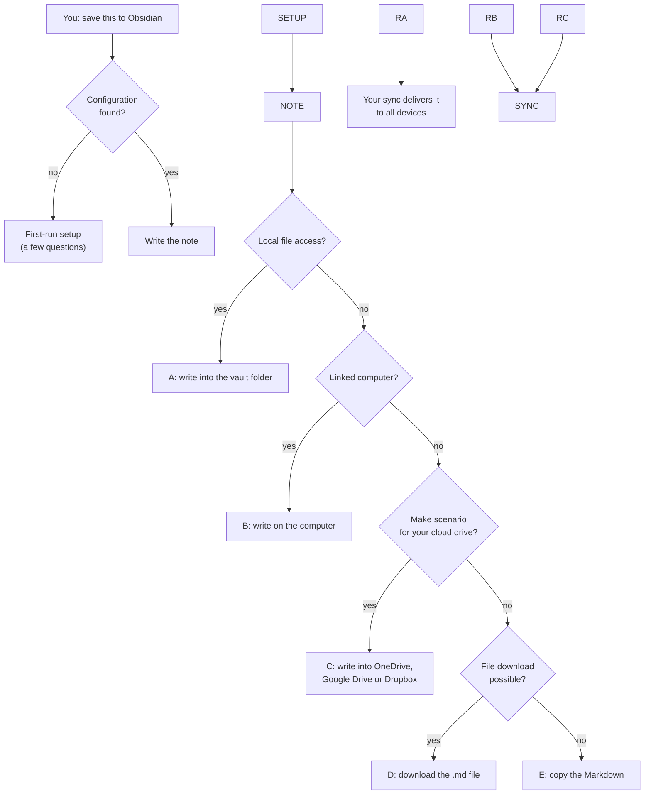
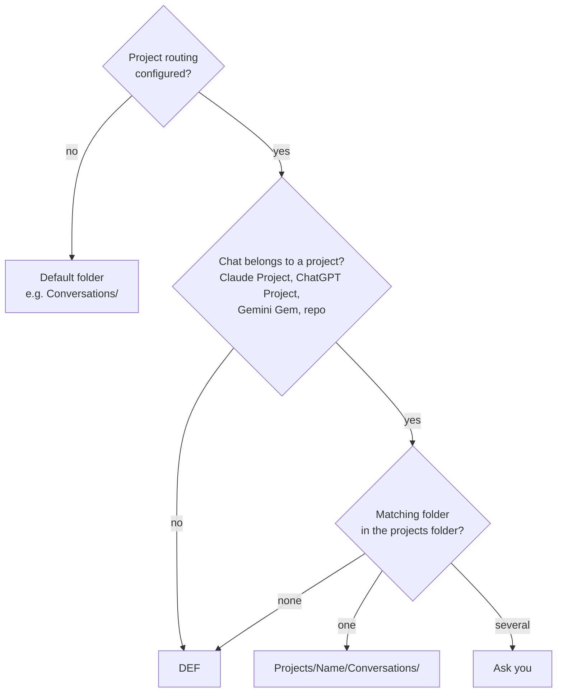
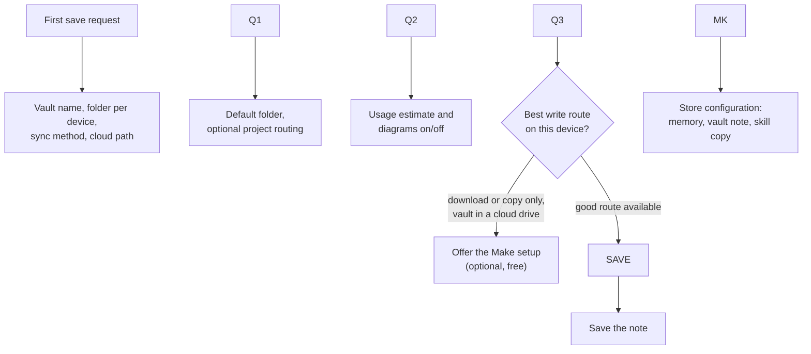

# Save Conversation to Obsidian

An AI skill that turns the conversation you just had with Claude, ChatGPT, Gemini or a coding agent into a clean, structured note in your Obsidian vault, on desktop **and** on your phone.

Say *"save this to Obsidian"* and you get a note with a summary, the decisions you made, open action items, the commands and code that came out of the session, links, commits, a usage estimate and, where it helps, Mermaid diagrams. The note is filed in the right project folder automatically.

\---

## Why I built this

I use several AI assistants every day, on my PC and on my Android phone. Many of those conversations end with something worth keeping: a decision and why I made it, a working command, a config snippet, a list of next steps. My knowledge lives in Obsidian, so that is where these results belong.

In practice they rarely got there. Copying a long chat by hand is tedious, and a raw transcript is not a useful note anyway. What I wanted was a summary written by the assistant that had the whole conversation in front of it, formatted like the rest of my vault, and saved without any extra work.

On the desktop that was easy to build. On the phone it turned out to be surprisingly hard: the AI apps simply can't write into your vault folder ([here's why](docs/why-mobile-is-hard.md)). This skill is the result of working through that problem. It always finds the best way that is available on the device you are using, and it never fails: in the worst case you get the finished note as a file or as Markdown to paste.

I suspect many Obsidian users who work with LLMs have the same problem, so here it is.

\---

## What you get

A note like this, in `Projects/MyApp/Conversations/2026-09-27 Sync Conflict Fix.md` (full example: [examples/example-note.md](examples/example-note.md)):

```markdown
---
title: Sync Conflict Fix
date: 2026-09-27T14:05
type: conversation-summary
assistant: Claude
model: claude-opus-5-5
source-project: MyApp
tags:
  - claude-conversation
  - myapp
---

# Sync Conflict Fix

## Summary
We tracked down why edits made offline were overwritten after reconnecting ...

## Key decisions
- \\\\\\\*\\\\\\\*Last-writer-wins replaced by field-level merge\\\\\\\*\\\\\\\* — keeps offline edits

## Action items
- \\\\\\\[ ] Add a migration for existing conflict records
```

### Features

* **Works with any assistant.** Claude, ChatGPT, Gemini, Copilot, coding agents (Claude Code, Codex CLI, Gemini CLI). The skill is plain instructions, not code.
* **Works on any device.** Desktop, Android, iOS, the web.
* **Learns your setup on first use.** A short interview about your vault, sync method and folder layout. Nothing is hard-coded.
* **Smart filing.** A chat inside a Claude Project, ChatGPT Project or Gemini Gem goes to the matching project folder; everything else goes to a default folder.
* **A consistent note format.** Frontmatter with date, time, assistant and model; an assistant tag (`claude-conversation`, `chatgpt-conversation`, …); your existing project tag if there is one; clear heading hierarchy; copyable code blocks; a commit table; optional Mermaid diagrams and a token/cost estimate.
* **Never overwrites** an existing note.
* **Always succeeds.** If nothing better is available, you get a downloadable `.md` file or copyable Markdown.

\---

## How it works

Every run has two parts that never block each other: **write the note** (always possible) and **deliver it to the vault** (using the best route available right now).



|Route|When it's used|Setup needed|
|-|-|-|
|**A. Local file access**|The assistant runs on the device with the vault: coding agents, desktop apps with folder access, an agent in Termux on Android|None|
|**B. Linked computer**|The assistant can reach a computer with the vault, e.g. a Claude chat linked to the Claude desktop app, or a filesystem MCP server|The computer must be on and its app running|
|**C. Cloud drive via Make**|Your vault syncs through OneDrive, Google Drive or Dropbox|Free Make account, one scenario, the Make connector ([guide](docs/make-setup.md))|
|**D. Download**|The assistant can hand you files|Move the file into the vault ([automatic on Android](docs/android-automate.md))|
|**E. Copy**|Always|Paste into a new note|

### Where the note goes



Matching ignores case, spaces, hyphens and punctuation, and also accepts partial matches ("SketchAlchemy Plugin" → `SketchAlchemy`). If you name a project yourself ("save it to MyApp"), that wins.

### What goes into the note

|Section|Content|
|-|-|
|Frontmatter|title, date and time, assistant, model, source project, usage estimate, tags|
|Summary|one paragraph: goal, what was done, outcome, open points|
|Key decisions|each with a short reason, optionally as a decision diagram|
|Action items|Obsidian checkboxes|
|Workflow|the process that was set up or discussed, with a diagram where useful|
|Commands / Code \& configuration|fenced code blocks, one command per block so each can be copied|
|Files|created and modified files|
|Commits|table with linked commit, message, repo/branch and push status|
|Links|existing vault notes and external sources|
|Session usage|token and cost estimate, clearly marked as an estimate|

Empty sections are left out. The assistant tag follows the assistant, so you can filter your vault by `claude-conversation`, `chatgpt-conversation` and so on. A project tag is only added if you already use it somewhere in your vault, so no near-duplicate tags appear.

\---

## Why mobile needs extra help

On a phone, the AI app is only a chat client: the model and its tools run in the provider's cloud, and Android and iOS keep apps out of each other's folders. So no app setting or permission lets the assistant write into your vault. The note has to travel through a computer, through the cloud drive your vault syncs with, or through you. The full explanation, with a diagram, is in [docs/why-mobile-is-hard.md](docs/why-mobile-is-hard.md).

\---

## Installation

The skill lives in [`skills/save-conversation-to-obsidian/`](skills/save-conversation-to-obsidian/): `SKILL.md` plus two reference files the assistant reads when needed.

|Assistant|How to install|
|-|-|
|**Claude** (web, desktop, mobile)|Download `save-conversation-to-obsidian.zip` from the [latest release](../../releases/latest) and upload it in Claude's settings under *Skills*. Skills sync to all your Claude apps.|
|**Claude Code**|As a plugin: `/plugin marketplace add Friendship7/save-conversation-to-obsidian`, then `/plugin install save-conversation-to-obsidian@obsidian-conversation`. Or copy the skill folder to `\\\\\\\~/.claude/skills/`.|
|**ChatGPT**|If your plan offers skills, upload the ZIP. Otherwise add `SKILL.md` and the two files from `references/` to a Project's files and put this in the project instructions: *"When I ask to save the conversation to Obsidian, follow SKILL.md."*|
|**Gemini**|Create a Gem, add the same three files as knowledge and use the same instruction.|
|**Codex CLI, Gemini CLI and other agents**|Put the skill folder in your repo or home folder and reference it from `AGENTS.md` / `GEMINI.md` with the same instruction.|

Menu names change often; if something is not where this table says, look for "skills", "knowledge" or "instructions" in your assistant's settings.

\---

## First run and configuration

The first time you say *"save this to Obsidian"*, the assistant asks a few questions (at most three rounds), then saves the conversation right away.



The configuration is stored wherever possible, so you are only asked once: in the assistant's **memory** (if it has memory and you agree), as `save-conversation-config.md` in your **vault root** (if the assistant can write there), or in the **Configuration** block at the end of `SKILL.md`. It holds only names, paths and switches, never passwords or tokens.

Every field is explained in the [configuration reference](skills/save-conversation-to-obsidian/references/config-schema.md); a complete example is in [examples/example-config.yaml](examples/example-config.yaml).

\---

## Saving from your phone or tablet: the Make route

If your vault syncs through **OneDrive, Google Drive or Dropbox**, a free [Make](https://www.make.com) account turns phone saves into direct saves: the assistant calls a small Make scenario, the scenario writes the note into your cloud drive, and your normal sync does the rest.

* **Cost:** free for this purpose (Make's free plan currently has 1,000 credits a month; one save uses a handful).
* **You need:** a Make account, one scenario and the Make connector in your assistant.
* **Time:** about 15 minutes, and the assistant can guide you.

Guides: [Make setup](docs/make-setup.md) · [OneDrive scenario](make/onedrive/README.md) (with importable blueprint) · [Google Drive scenario](make/google-drive/README.md)

Without Make, phone saves end in a download; on Android you can [file those automatically](docs/android-automate.md).

\---

## Documentation

* [Why mobile is the hard part](docs/why-mobile-is-hard.md)
* [Setting up the Make route](docs/make-setup.md)
* [Android: file downloads automatically](docs/android-automate.md)
* [Troubleshooting](docs/troubleshooting.md)
* [Configuration reference](skills/save-conversation-to-obsidian/references/config-schema.md)
* [Changelog](CHANGELOG.md)

## Repository layout

```text
.claude-plugin/          Claude Code plugin and marketplace manifests
.github/workflows/       release workflow that builds the skill ZIP
skills/
  save-conversation-to-obsidian/
    SKILL.md             the skill
    references/          setup guide and config reference, read on demand
make/
  onedrive/              OneDrive scenario guide, blueprint and interface
  google-drive/          Google Drive scenario guide
docs/                    background, setup guides, troubleshooting
examples/                example note and configuration
assets/                  images for the documentation
```

## Contributing

Issues and pull requests are welcome, especially Make scenarios for other storage providers, installation notes for more assistants, and improvements to the note format.

## License

MIT, see [`LICENSE`](LICENSE).

## Other interesting Obsidan helpers from Friendship7

### SketchAlchemy

[SketchAlchemy](https://sketchalchemy.io) is an AI-tool that can convert your handwritten notes and sketches, as well as pictures of whiteboards into clean editable and searchable Excalidraw scenes and/or Obsidian/Excalidraw notes.

