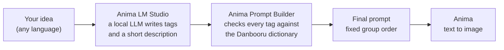

# Anima Prompt Generator for ComfyUI

[Русская версия](README.ru.md)

Write a short idea in any language. A local LLM turns it into Danbooru tags and a short description, and a builder checks every tag against a dictionary and assembles the prompt for the **Anima** image model in a fixed order.

The tags written by an LLM are often almost right: `misato katsuragi` instead of `katsuragi misato`, `side view` instead of `from side`, a hair color the character does not have. The builder fixes such things automatically and tells you what it changed.

## How it works



1. **Anima LM Studio (prompt LLM)** sends your idea and a system prompt to a local LM Studio server and gets back lines like `character: ...`, `action: ...`, `description: ...`.
2. **Anima Prompt Builder** parses the answer, fixes or removes tags with the help of the dictionary, puts the groups in a fixed order with a blank line between them and adds the description at the end.
3. The prompt goes into your Anima workflow.

## Example

Idea (Russian: "Misato Katsuragi drinks beer on the balcony"):

```
Misato Katsuragi пьёт пиво на балконе
```

A real answer of `gemma-4-26b` (recorded in the test suite):

```
rating: safe
count: 1girl
character: misato katsuragi
series: evangelion
appearance: long hair, purple hair
emotion: smile, relaxed
action: drinking, holding bottle, sitting, looking at viewer
location: balcony
environment: apartment, city, night, sky
angle: upper body
lighting: moonlight, city lights
description: Misato Katsuragi relaxes on her balcony at night, enjoying a bottle of beer. The city lights glow in the background under the moonlight.
```

The prompt after the builder:

```
masterpiece, best quality, score_7, safe,

1girl,

katsuragi misato,

neon genesis evangelion,

long hair,

smile, relaxing,

drinking, holding bottle, sitting, looking at viewer,

balcony,

apartment, city, night, sky,

upper body,

moonlight, city lights.

Misato Katsuragi relaxes on her balcony at night, enjoying a bottle of beer. The city lights glow in the background under the moonlight.
```

What the builder changed (this is the `report` output of the node):

```
alias: evangelion -> neon genesis evangelion
name order fixed: misato katsuragi -> katsuragi misato
hair/eye color of the named character removed: purple hair
alias: relaxed -> relaxing
```

## What it does

- Checks every tag against a dictionary of about 33,800 Danbooru tags and about 7,500 aliases.
- Finds the character as `name (series)` using the series and the popularity of the tag, and fixes the order of the name (`misato katsuragi` -> `katsuragi misato`).
- Fixes hyphenated tags (`close up` -> `close-up`) and near-miss tags that differ only by a common ending (`indoor` -> `indoors`).
- Removes tags that are not in the dictionary (except in `character` and `series`, where rare names are kept).
- Moves gaze tags (`looking at viewer`, `looking away`, ...) to the action group.
- Removes hair and eye colors written for a named character, because the model already knows the character (can be switched off).
- Drops quality, year and artist tags written by the LLM; you set quality and artist tags yourself.
- Keeps a fixed group order: quality and rating, count, character, series, artist tag, appearance, emotions, state, action, location, environment, camera angle, lighting, description.
- Caches LLM answers, so the same request with the same settings does not start the model again.
- Loads the model on demand and can unload it after the answer, so the VRAM is free for image generation.
- Three prompt profiles: `sfw`, `nsfw` and `custom`.

## Requirements and hardware

- ComfyUI with the Anima model files (see the note inside the example workflow).
- [LM Studio](https://lmstudio.ai/) with its local server enabled. Only LM Studio has been tested. Servers that offer `/v1/models` and `/v1/chat/completions` (Ollama, llama.cpp server and similar) may work if you type the model name into `model_override`, but this is untested: the model list will not show their models, and the status may contain a harmless note that the model could not be unloaded.
- No extra Python packages are needed.

Tested on **NVIDIA GeForce RTX 3060 12 GB, 32 GB DDR5**, LM Studio, thinking off, temperature 0.5. Other hardware has not been tested.


| Model | File size | Cases passed | Median answer | Mean answer |
|---|---|---|---|---|
| `google/gemma-4-26b-a4b-qat` | 15.6 GB | 23 of 23 | 4.8 s | 5.5 s |
| `google/gemma-4-12b-qat` | 7.2 GB | 23 of 23 | 3.5 s | 4.6 s |
| `huihui-qwen3-8b-abliterated-v2` | 5.0 GB | 18 of 23 | 10.5 s | 12.2 s |

How to read this:

- The test suite has 35 cases; 23 of them call the LLM, the other 12 check the builder on fixed answers. The table counts the 23 cases that call the LLM. The raw numbers are in `docs/models_benchmark.json`.
- The first request of every run includes loading the model, so the median is the fairer number.
- The tests check the **structure** of the result: the format, the rating, required and forbidden tags, no duplicates, no leaked service text, not too many removed tags, a finished description. They do **not** measure how well a model knows characters. Two models with the same score can still differ in that.
- The Qwen model failed on one character, on one empty answer, on one long request that lost details, and on both explicit requests in the `sfw` profile.
- Gemma 26B-A4B is a mixture-of-experts model; on a 12 GB card part of it runs from RAM, and it still answered in about 5 s. Gemma 12B fits into VRAM completely and is a bit faster.

## Installation

1. Put the folder `Anima-Prompt-Generator` into `ComfyUI/custom_nodes/` (download the ZIP or run `git clone https://github.com/GUntilB/Anima-Prompt-Generator` there) and restart ComfyUI. Or install it from the ComfyUI Registry: search for "Anima Prompt Generator" in ComfyUI Manager, or run.
2. Install LM Studio, download a model and start the local server (the Developer tab). The default address is `http://127.0.0.1:1234`.
3. Put the Anima model files into your ComfyUI model folders (the example workflow lists them).

## Quick start

1. Open the example workflow `Anima_Prompt_Generator_basic` from the template browser (the section of this node pack), or load the file from `example_workflows/`.
2. In the **Anima Prompt Generator** subgraph choose your `model` in the list. Press the icon in the corner of the subgraph to open it and see the LLM answer, the report and the final prompt.
3. Write an idea, press Run.


This is what you see after opening the subgraph: the LLM node and the builder, with previews of the LLM answer, the status, the final prompt and the report.

Set `artist_tag` if you use a LoRA or an artist tag that must be in every prompt. Leave it empty otherwise.

## Nodes

### Anima LM Studio (prompt LLM)

Outputs: `llm_text` (the LLM answer) and `status` (cache hit, generation time, model load and unload).

| Parameter | What it does |
|---|---|
| `idea` | What should be in the picture, in any language. |
| `system_prompt` | Your own instructions for the LLM. Used only when `prompt_profile` is `custom`. |
| `model` | Model on the server. The list is read when the node loads; press `R` to refresh it. |
| `temperature` | Randomness of the answer. Default 0.5. |
| `unload_after` | Unload the model after the answer to free VRAM. |
| `use_cache` | Reuse the previous answer if the request and all settings are unchanged. |
| `seed` | Seed sent to the server. Part of the cache key. |
| `server_url` | Address of the LM Studio server. |
| `max_tokens` | Answer length limit. Raise it if the status says the answer was cut off. |
| `context_length` | Context size when the node loads the model itself. |
| `model_override` | A model name typed by hand; used instead of the list. |
| `api_key` | Only if the server requires one. |
| `prompt_profile` | `sfw`, `nsfw` or `custom`. |

### Anima Prompt Builder

Outputs: `prompt` (the final prompt) and `report` (what was changed).

| Parameter | What it does |
|---|---|
| `text` | The LLM answer; connect `llm_text` here. |
| `quality_tags` | Quality tags at the very start. Default `masterpiece, best quality, score_7`. |
| `artist_tag` | Artist or LoRA trigger tag added after the series. Empty by default. |
| `default_rating` | Rating used when the LLM gives none: `safe`, `sensitive`, `nsfw`, `explicit` or `none`. |
| `drop_unknown` | Remove tags that are not in the dictionary. |
| `fuzzy_fix` | Fix near-miss tags that differ only by a common ending. |
| `strip_canonical_appearance` | Remove hair and eye colors written for a named character. |

## Prompt profiles

The system prompt that tells the LLM how to answer lives in text files:

- `prompts/sfw.txt` (default): only the ratings `safe` and `sensitive`; if an explicit scene is requested, a clothed, non-sexual version is described.
- `prompts/nsfw.txt`: all four ratings.
- `custom`: the text of the `system_prompt` field of the node is used, the files are ignored. In `sfw` and `nsfw` the field is ignored.

Both built-in prompts tell the model to write adult characters only (18+). The files are read on every run, so you can edit them and the change works at once; the cache notices the new text.

## Languages

- The documentation is in English (`README.md`) and Russian (`README.ru.md`).
- If the ComfyUI interface language is Russian, the node descriptions and parameter tooltips are shown in Russian (files in `locales/`). Parameter names stay in English everywhere, so they match this documentation.
- The `status` and `report` outputs follow the interface language as well (the language is read from the ComfyUI settings; anything but Russian gives English). To force a language, set the environment variable `ANIMA_PG_LANG` to `en` or `ru` before starting ComfyUI.

## Dictionary

The dictionary lives in `data/`:

- `data/auto/tags.csv` and `data/auto/aliases.csv`: generated files, an updater may overwrite them. At the moment 17,541 general tags, 673 artists, 3,347 series, 12,067 characters and 214 meta tags.
- `data/manual/tags.csv` and `data/manual/aliases.csv`: your own edits. They are read after the generated files and always win; updates never touch them.

Add your own tag to `data/manual/tags.csv` (columns `tag,category,post_count`; category 0 general, 1 artist, 3 series, 4 character, 5 meta):

```
tag,category,post_count
looking away,0,32000
```

Add an alias to `data/manual/aliases.csv` (columns `alias,tag`):

```
alias,tag
swimwear,swimsuit
```

Restart ComfyUI after editing the files. Where the data comes from is described in `data/SOURCES.md`. Updating the dictionary from Danbooru is planned.

## Cache

LLM answers are stored in the ComfyUI user folder (`user/anima_promptgenerator/lmstudio_cache.json`), so updating the node pack does not lose them. The key is built from your request, the system prompt text, the model, the temperature, `max_tokens` and `seed`. Delete the file to clear the cache.

## Tests

```
python tests/run_tests.py                              # fast mode: fixed answers and recorded LLM answers, no LLM
python tests/run_tests.py --live                       # real requests to LM Studio
python tests/run_tests.py --live --record              # save the LLM answers to tests/recorded/
python tests/run_tests.py --live --model NAME --out last_run_NAME.txt   # compare models
```

The log with the final prompts is written to `tests/last_run.txt`. Do not use `--record` when you compare models, it overwrites the recorded answers.

## Troubleshooting

| Message | What to do |
|---|---|
| `cannot reach the LLM server (...)` | Start the LM Studio server and check `server_url`. |
| `(LLM server unavailable: start it and press R)` in the model list | Start the server, then press `R` in ComfyUI to refresh the node. |
| `Model '...' not found on the server. Available: ...` | Choose a model from the list or type its exact name into `model_override`. |
| `answer cut off by max_tokens, raise the limit` | Increase `max_tokens`. |
| `prompt_profile is 'custom' but system_prompt is empty.` | Fill in `system_prompt` or choose `sfw` / `nsfw`. |
| A tag disappeared from the prompt | Read the `report` output; add the tag to `data/manual/tags.csv` if it is valid. |


## License and credits

Code: GNU General Public License v3.0 or later, see `LICENSE`. Copyright (c) 2026 GUntilB.

- The Anima model and its files: circlestone-labs (Hugging Face).
- Tag names, categories and post counts come from Danbooru; this project is not affiliated with Danbooru.
- The dictionary was completed with the dataset `newtextdoc1111/danbooru-tag-csv` (MIT), see `data/SOURCES.md`.
- LM Studio and ComfyUI are products of their respective authors.

## Ideas for later

Full support for OpenAI-compatible servers (model list read from `server_url`, no unload attempt where the server has none, retries for stricter servers) and an updater for the dictionary from Danbooru.
