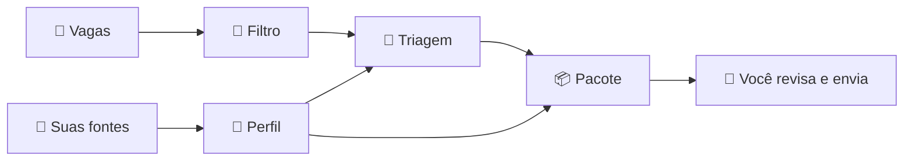

<p align="center">
  
</p>

<h1 align="center">auto-job-finder</h1>

<p align="center">
  <strong>Seu agente de candidaturas, para qualquer área e qualquer vaga.</strong><br>
  Encontra vagas, avalia se combinam com você e prepara currículo, carta e mensagens — sem inventar nada.
</p>

<p align="center">
  <a href="https://github.com/GabrielMello1407/auto-job-finder/actions/workflows/ci.yml"></a>
  <a href="LICENSE"></a>
  
</p>

<p align="center">
  <a href="docs/guia-de-uso.md">Guia de uso</a> ·
  <a href="docs/como-funciona.md">Como funciona</a> ·
  <a href="CONTRIBUTING.md">Contribuir</a>
</p>


## O que ele faz

1. **Monta o seu perfil** a partir do que você tiver: currículo (PDF ou DOCX), PDF do LinkedIn, portfólio, GitHub, um texto, ou respondendo a perguntas.
2. **Busca vagas** em sites de vagas, no portal da Gupy e na web (LinkedIn, Indeed) e **avalia cada uma** contra o seu perfil: aderência, lacunas e sinais de golpe. A mesma vaga publicada em vários sites aparece uma vez só, e vaga que já acabou é descartada antes de virar pacote. Vaga que chegou por indicação, e-mail ou WhatsApp, mesmo sem link, também entra: o agente procura o anúncio oficial e a empresa na web e confere se a vaga é real.
3. **Prepara o pacote** de cada vaga boa:
   - currículo adaptado no padrão ATS, em PDF;
   - carta de apresentação, quando o mercado pede;
   - e-mail de candidatura, mensagens para o recrutador, follow-up e agradecimento, com o e-mail pronto para abrir no seu programa de e-mail (já com o currículo anexado) ou no Gmail;
   - a ficha com os campos que os formulários das plataformas pedem (Gupy, InHire, Greenhouse...), prontos para copiar;
   - o passo a passo para se candidatar pelo canal certo;
   - respostas para as perguntas do formulário ("Por que você quer trabalhar aqui?"), que você ajusta conversando.
4. **Acompanha as candidaturas:** lembra do follow-up, prepara um guia de entrevista e registra oferta ou recusa.
5. **Cuida do seu LinkedIn:** monta um plano para atrair recrutadores e confere o seu perfil de hoje, mostrando o que já está certo, o que falta e o que corrigir.
6. **Acompanha a sua carreira:** conte uma novidade (projeto, emprego, curso) e a IA propõe as mudanças no perfil. Você confere o antes e o depois, e os currículos são refeitos.

Funciona com a IA que você **já tem**: assinatura do **Claude**, do **ChatGPT** (Codex) ou conta **Google** (Gemini), sem chave de API. Também aceita APIs: Anthropic, OpenAI ou compatível (OpenRouter, Groq, Ollama), Gemini, Amazon Bedrock e Google Vertex.

> **Você continua no controle.** O agente prepara; você revisa e envia. Ele nunca se candidata, não manda e-mail e não mexe no seu LinkedIn.

## Experimente em 1 minuto

Sem configurar IA nem perfil, com dados fictícios:

```bash
git clone https://github.com/GabrielMello1407/auto-job-finder.git
cd auto-job-finder
npm install
npm run demo
```

Abre a interface com uma pessoa e vagas inventadas, em todas as etapas.

## Começando de verdade

Você precisa de:
- [Node.js 22.12+](https://nodejs.org);
- Chrome, Edge, Chromium ou Brave (para os PDFs);
- **uma** IA:

| Você tem | Como ativar | Custo |
|---|---|---|
| Claude Pro/Max | instale o [Claude Code](https://claude.com/claude-code) e rode `claude` para entrar | já incluso na assinatura |
| ChatGPT Plus/Pro | `npm i -g @openai/codex` e `codex login` | já incluso na assinatura |
| Conta Google | `npm i -g @google/gemini-cli` e rode `gemini` para entrar | cota da conta |
| Uma chave de API | coloque no `.env` (veja o [`.env.example`](.env.example)) | por uso |

O agente encontra sozinho a IA instalada. Depois:

```bash
npm link    # uma vez: libera o comando `ajf`
ajf         # abre a interface no navegador
```

Na primeira vez, ele abre no **cadastro do perfil**: arraste o seu currículo e responda o que a IA perguntar. Depois é o dia a dia:

1. **🔎 Buscar vagas** ou **🚀 Piloto automático**: busca, avalia e gera os pacotes das melhores. Recebeu uma vaga de alguém? **➕ Colar vaga**, mesmo sem link.
2. Em **Para decidir**, gere o pacote das vagas que valem a pena.
3. Em **Prontas**, confira o currículo, candidate-se e clique em **✅ Já me candidatei**.
4. Em **Em andamento**, mande o follow-up e registre entrevista, oferta ou recusa.
5. Quando a sua carreira mudar, use **Perfil → ➕ Contar uma novidade**.

O passo a passo completo, com cada tela, está no **[guia de uso](docs/guia-de-uso.md)**.

## Por dentro

| | |
|---|---|
|  |  |
| **Detalhes da vaga:** o que você já tem, com evidência no seu perfil, e as lacunas | **E-mails e mensagens:** candidatura, LinkedIn e follow-up, com botão de copiar |
|  |  |
| **Atualizar o perfil:** conte uma novidade e confira o antes e o depois antes de salvar | **LinkedIn:** o que corrigir, o que do plano falta e o que já está certo |
|  |  |
| **Vaga sem link:** cole o que você recebeu e peça a pesquisa na web | **Pesquisa na web:** anúncio oficial, site da empresa e se a vaga é real |
|  |  |
| **Perfil:** a fonte única de fatos, com o que falta confirmar | **Ctrl+K:** ache qualquer vaga ou ação digitando |



### Não inventa nada

Tudo o que o agente escreve sobre você sai do seu perfil (`profile/profile_truth.md`). Travas **em código**, que não dependem da IA "se comportar", barram:
- número sem fonte;
- cargo ou data alterados;
- experiência, certificação ou projeto inventados;
- as frases que você marcou como "nunca afirmar" (por exemplo, "inglês fluente" quando o seu é intermediário).

Requisito da vaga sem evidência no seu perfil vira **lacuna**, nunca preenchimento. Detalhes em [como funciona](docs/como-funciona.md#anti-invenção).

### Seus dados ficam com você

- Perfil, vagas e pacotes ficam **só na sua máquina**, fora do git (`profile/`, `data/`, `output/`).
- A interface só funciona no seu computador (`127.0.0.1`) e só abre pelo link com token que o terminal mostra.
- As CLIs de IA rodam isoladas numa pasta temporária vazia.
- Golpes miram quem procura emprego: a triagem marca com 🚩 vagas que pedem pagamento, documentos ou para baixar e rodar código.

### Custos

- **Assinatura:** sem cobrança extra; o uso conta no limite da sua conta. Cada pacote faz de 6 a 10 chamadas.
- **API:** por volta de US$ 0,02–0,05 por vaga avaliada e US$ 0,50–2,00 por pacote completo com modelos de ponta.
- O arquivo `data/usage.jsonl` registra os tokens de cada chamada.

## Documentação

| | |
|---|---|
| [Guia de uso](docs/guia-de-uso.md) | Instalação, cadastro, cada tela, atalhos, preferências, arquivos, comandos do terminal e dúvidas |
| [Como funciona](docs/como-funciona.md) | Perfil, busca, triagem, pacote, travas anti-invenção, IAs, interface e organização do código |
| [CONTRIBUTING.md](CONTRIBUTING.md) | Como rodar, testar e contribuir |
| [SECURITY.md](SECURITY.md) | Como reportar uma falha de segurança |

Prefere o terminal? `ajf menu` abre um menu com as mesmas ações, e `ajf --help` lista todos os comandos ([referência](docs/guia-de-uso.md#11-pelo-terminal)).

## Contribuindo

Contribuições são bem-vindas, principalmente de quem é de **outras áreas**: novas fontes de vagas, textos que funcionem melhor para a sua profissão, provedores de IA, melhorias na interface. Veja o [CONTRIBUTING.md](CONTRIBUTING.md). Para bugs e ideias, abra uma [issue](https://github.com/GabrielMello1407/auto-job-finder/issues), sem dados pessoais.

Ideias de base vieram do [R238Company/meu-emprego-novo](https://github.com/R238Company/meu-emprego-novo): perfil-mestre, "a IA propõe, você decide", loop de avaliação, revisão de cobertura e checklist anti-golpe.

## Licença

[MIT](LICENSE). Use, modifique e distribua à vontade, mantendo o aviso de autoria. O software é fornecido sem garantia: o agente prepara o material, e cada pessoa revisa e responde pelo que envia.
