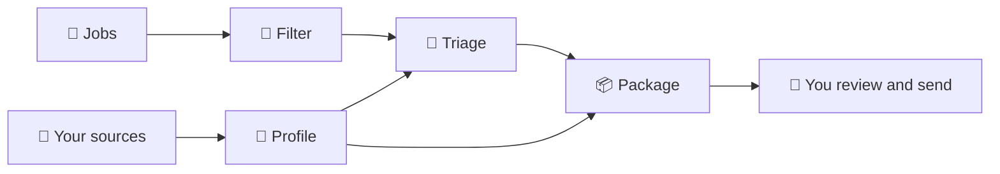

<p align="center">
  
</p>

<h1 align="center">auto-job-finder</h1>

<p align="center">
  <strong>Your job-application agent, for any field and any job.</strong><br>
  It finds jobs, checks whether they fit you and prepares your resume, cover letter and messages, without making anything up.
</p>

<p align="center">
  <a href="https://github.com/GabrielMello1407/auto-job-finder/actions/workflows/ci.yml"></a>
  <a href="LICENSE"></a>
  
</p>

<p align="center">
  <strong>English</strong> · <a href="README.pt-BR.md">Português</a>
</p>

<p align="center">
  <a href="docs/user-guide.md">User guide</a> ·
  <a href="docs/how-it-works.md">How it works</a> ·
  <a href="CONTRIBUTING.md">Contributing</a>
</p>


> **Language note:** the interface comes in English and Brazilian Portuguese (🌐 at the bottom of the sidebar). Resumes, cover letters and e-mails come out in the language of each job (Portuguese or English). The terminal and the files the agent writes for you in each package folder are in Portuguese for now.

## What it does

1. **Builds your profile** from whatever you have: a resume (PDF or DOCX), your LinkedIn PDF, a portfolio, GitHub, some text, or by answering questions.
2. **Finds jobs** on job boards, on the Gupy portal (Brazil) and across the web (LinkedIn, Indeed), and **scores each one** against your profile: fit, gaps and scam signals. The same job posted on several sites shows up once, and jobs that already closed are dropped before a package is made. A job you got through a referral, an e-mail or WhatsApp works too, even without a link: the agent looks for the official posting and the company on the web and checks whether the job is real.
3. **Prepares a package** for every good job:
   - an ATS-friendly resume tailored to the job, in PDF;
   - a cover letter, when the market expects one;
   - the application e-mail, messages for the recruiter, a follow-up and a thank-you note, with the e-mail ready to open in your mail program (resume already attached) or in Gmail;
   - a sheet with the fields that application platforms ask for (Gupy, InHire, Greenhouse...), ready to copy;
   - step-by-step instructions to apply through the right channel;
   - answers to application-form questions ("Why do you want to work here?"), typed or read from a screenshot of the form, which you refine in a chat.
4. **Tracks your applications:** reminds you to follow up, prepares an interview guide and records offers and rejections.
5. **Looks after your LinkedIn:** writes a plan to attract recruiters and reviews your current profile, showing what is right, what is missing and what to fix.
6. **Keeps up with your career:** tell it about something new (a project, a job, a course) and the AI proposes the profile changes. You review the before and after, and your resumes are rebuilt.

It works with the AI you **already have**: a **Claude**, **ChatGPT** (Codex) or **Google** (Gemini) subscription, no API key needed. It also takes APIs: Anthropic, OpenAI or compatible (OpenRouter, Groq, Ollama), Gemini, Amazon Bedrock and Google Vertex.

> **You stay in control.** The agent prepares; you review and send. It never applies for you, never sends e-mails and never touches your LinkedIn.

## Try it in 1 minute

No AI or profile setup, with made-up data:

```bash
git clone https://github.com/GabrielMello1407/auto-job-finder.git
cd auto-job-finder
npm install
npm run demo
```

It opens the interface with a fictional person and fictional jobs, in every stage.

## Getting started for real

You need:
- [Node.js 22.12+](https://nodejs.org);
- Chrome, Edge, Chromium or Brave (for the PDFs);
- **one** AI:

| You have | How to turn it on | Cost |
|---|---|---|
| Claude Pro/Max | install [Claude Code](https://claude.com/claude-code) and run `claude` to sign in | included in the subscription |
| ChatGPT Plus/Pro | `npm i -g @openai/codex` and `codex login` | included in the subscription |
| A Google account | `npm i -g @google/gemini-cli` and run `gemini` to sign in | your account's quota |
| An API key | put it in `.env` (see [`.env.example`](.env.example)) | pay per use |

The agent finds the installed AI on its own. Then:

```bash
npm link    # once: makes the `ajf` command available
ajf         # opens the interface in your browser
```

The first time, it opens the **profile setup**: drop in your resume and answer what the AI asks. After that, day to day:

1. **🔎 Buscar vagas** (search jobs) or **🚀 Piloto automático** (autopilot): searches, scores and builds packages for the best jobs. Got a job from someone? **➕ Colar vaga** (paste a job), even without a link.
2. In **Para decidir** (to decide), build the package for the jobs worth it.
3. In **Prontas** (ready), check the resume, apply and click **✅ Já me candidatei** (I applied).
4. In **Em andamento** (in progress), send the follow-up and record interviews, offers or rejections.
5. When your career changes, use **Perfil → ➕ Contar uma novidade** (Profile → tell something new).

The full walkthrough, screen by screen, is in the **[user guide](docs/user-guide.md)**.

## Inside

| | |
|---|---|
|  |  |
| **Job details:** what you already have, with evidence from your profile, and the gaps | **E-mails and messages:** application, LinkedIn and follow-up, with copy buttons |
|  |  |
| **Profile update:** tell something new and review the before and after before saving | **LinkedIn:** what to fix, what is missing from the plan and what is already right |
|  |  |
| **Job without a link:** paste what you received and ask for a web search | **Web search:** official posting, company site and whether the job is real |
|  |  |
| **Profile:** the single source of facts, with what still needs confirming | **Ctrl+K:** find any job or action by typing |



### It doesn't make things up

Everything the agent writes about you comes from your profile (`profile/profile_truth.md`). Guards **in code**, which don't rely on the AI "behaving", block:
- numbers without a source;
- changed job titles or dates;
- made-up experience, certifications or projects;
- the claims you marked as "never claim" (for example, "fluent English" when yours is intermediate).

A job requirement with no evidence in your profile becomes a **gap**, never something to fill in. Details in [how it works](docs/how-it-works.md#no-made-up-facts).

### Your data stays with you

- Profile, jobs and packages stay **only on your machine**, out of git (`profile/`, `data/`, `output/`).
- The interface only runs on your computer (`127.0.0.1`) and only opens through the tokened link the terminal shows.
- The AI CLIs run isolated in an empty temporary folder.
- Scams target job seekers: the triage flags with 🚩 jobs that ask for payment, documents, or to download and run code.

### Costs

- **Subscription:** no extra charge; usage counts against your plan's limits. Each package makes 6 to 10 calls.
- **API:** about US$ 0.02 to 0.05 per scored job and US$ 0.50 to 2.00 per full package with frontier models.
- `data/usage.jsonl` logs the tokens of every call.

## Documentation

| | |
|---|---|
| [User guide](docs/user-guide.md) ([pt-BR](docs/guia-de-uso.md)) | Install, setup, every screen, shortcuts, preferences, files, terminal commands and FAQ |
| [How it works](docs/how-it-works.md) ([pt-BR](docs/como-funciona.md)) | Profile, search, triage, package, anti-fabrication guards, AIs, interface and code map |
| [CONTRIBUTING.md](CONTRIBUTING.md) | How to run, test and contribute |
| [SECURITY.md](SECURITY.md) | How to report a security issue |

Prefer the terminal? `ajf menu` opens a menu with the same actions, and `ajf --help` lists every command ([reference](docs/user-guide.md#11-from-the-terminal)).

## Contributing

Contributions are welcome, especially from people in **other fields**: new job sources, wording that works better for your profession, AI providers, interface improvements, and translations. See [CONTRIBUTING.md](CONTRIBUTING.md). For bugs and ideas, open an [issue](https://github.com/GabrielMello1407/auto-job-finder/issues), with no personal data.

Some core ideas came from [R238Company/meu-emprego-novo](https://github.com/R238Company/meu-emprego-novo): a master profile, "the AI proposes, you decide", an evaluation loop, coverage review and an anti-scam checklist.

## License

[MIT](LICENSE). Use, modify and distribute freely, keeping the copyright notice. The software comes with no warranty: the agent prepares the material, and each person reviews and is responsible for what they send.
