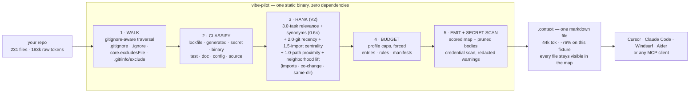

<p align="center">
  
</p>

<h1 align="center">vibe-pilot</h1>

<p align="center"><strong>The context optimizer for AI engineers.</strong></p>

<p align="center">
  <a href="https://github.com/Gatsuke/vibe-pilot/actions/workflows/ci.yml"></a>
  <a href="https://deps.rs/repo/github/Gatsuke/vibe-pilot"></a>
  
  <a href="LICENSE"></a>
</p>

---

Your AI coding assistant is eating your repo whole. A single `package-lock.json` is **100k+ tokens**. Generated API clients, vendor trees, boilerplate comments — all of it goes into the prompt, and you pay for it on every request, or you hit the context window and the model quietly forgets your codebase exists.

**vibe-pilot prunes your codebase into a hyper-focused `.context` file before you feed it to Cursor, Claude Code, Windsurf, or Aider.** It deletes the noise, ranks what matters for what you're building *right now*, and shows you an honest receipt for the tokens — including the cases where it can't help.

## Quick Start in 60 seconds

```bash
npm i -g vibe-pilot        # or: cargo install vibe-pilot
cd your-repo

vp report                  # 1. see your token bill (writes nothing)
vp prune --profile cursor  # 2. write .context — the pruned repo
vp context fix the login bug   # 3. task-focused context, ranked
```

Paste `.context` into your assistant — or let it call vibe-pilot itself over [MCP](#mcp-let-your-agent-call-vibe-pilot-itself).


*Real sessions, real colors: every GIF in this README is a pty capture of the release binary (`scripts/make-demos.py` regenerates them).*

## How it works



**Ranking is boring on purpose** — and fully documented in [`docs/CONTEXT-SPEC.md`](docs/CONTEXT-SPEC.md):

```
score = 3.0·task_relevance + 2.0·git_recency + 1.5·import_centrality
      + 1.0·path_proximity + neighborhood_lift + bonuses
```

Files you touched this week outrank files you forgot in 2023. Files your task mentions outrank everything (word-level, IDF-weighted — `auth` never matches `author.ts`), and **semantic ranking V2** goes two steps further without an embedding model in sight: an engineering synonym lexicon folds naming variations into the match (`fix the signin` finds `login.ts`, `auth.ts`, `session.ts` at 0.6× weight — synonyms support, never outrank, your words), and a capped neighborhood lift propagates strong matches through the dependency structure — the model file your matched controller imports, the files that habitually land in the same git commit, the directory where the work is. Lockfiles, generated code, and binaries never make it in — but they all stay visible in the map, priced in tokens, so nothing is hidden from the model. It can ask for any file by path.


## The math nobody does

At 40 prompts a day on Claude Sonnet 5.5 (20 workdays a month), that "small" 231-file app above burns **$0.37 of input on every prompt** — **$294/month** just to re-explain the same repo to the same model. On Opus 5.5 it's $587/month. Switch to the `cursor` profile and the same repo costs **$0.05 a prompt**. The lockfile was never going to help the model fix your bug.

vibe-pilot makes the invisible bill visible, then makes it smaller — **when there is noise to remove**. See the honest benchmarks below for when it can't.

## Install

```bash
# npm / npx — prebuilt binary for your platform, no compile
npm i -g vibe-pilot

# or the 5-second curl installer (macOS / Linux release binary)
curl -fsSL https://raw.githubusercontent.com/Gatsuke/vibe-pilot/main/install.sh | bash

# or cargo — zero dependencies means this compiles in seconds, not minutes
cargo install vibe-pilot

# or from source
git clone https://github.com/Gatsuke/vibe-pilot && cargo install --path vibe-pilot

# the two heavy features are opt-in (the default build stays zero-dep):
cargo install vibe-pilot --features compress   # tree-sitter outlines
cargo install vibe-pilot --features tui        # interactive TUI
```

<details>
<summary><strong>npm specifics — blocked postinstall, air-gapped machines</strong> (click)</summary>

The npm package is a **thin launcher plus a postinstall script** that downloads the prebuilt `vp` binary from the GitHub release of the same version. It adds nothing else.

- **`npm config` blocking lifecycle scripts** (`ignore-scripts`, or the newer npm security prompts)? Then no binary is downloaded, and `vp` will tell you clearly and **exit 1** — never fail silently. Your options:
  1. allow scripts for this package: `npm_config_yes=true npm i -g vibe-pilot` (or answer the prompt), then reinstall;
  2. point at an existing binary: `VP_BINARY=/usr/local/bin/vp npm i -g vibe-pilot`;
  3. skip the download entirely: `VP_SKIP_DOWNLOAD=1 npm i -g vibe-pilot` (for caches/CI images that provide `vp` some other way);
  4. or install the binary directly: `cargo install vibe-pilot` / the curl installer above.
- **No GitHub access?** Set `VP_BINARY` to a `vp` you ship yourself, or build from source — the crate has zero dependencies.
- The escape hatches are documented in the postinstall banner and in `npm/scripts/postinstall.js`.

</details>

<details>
<summary><strong>GitHub Packages — installing the scoped variant</strong> (click)</summary>

The same launcher is also published as **`@gatsuke/vibe-pilot`** on
GitHub Packages, for orgs that standardize on the GitHub registry:

```bash
npm i -g @gatsuke/vibe-pilot --registry=https://npm.pkg.github.com
```

GitHub Packages requires authentication even for public packages: a
PAT with `read:packages` in your `~/.npmrc`
(`//npm.pkg.github.com/:_authToken=ghp_…`). The public `vibe-pilot` on
npmjs needs none of that.

</details>

Don't want a global install? `npx vibe-pilot report` works too. The binary is `vp`.

<details>
<summary><strong>All distributions</strong> (click)</summary>

| Channel | Package | Notes |
| --- | --- | --- |
| npm | [`vibe-pilot`](https://www.npmjs.com/package/vibe-pilot) | prebuilt binary, no compile |
| GitHub Packages | [`@gatsuke/vibe-pilot`](https://github.com/Gatsuke/vibe-pilot/pkgs/npm/vibe-pilot) | same launcher, org registry |
| crates.io | [`vibe-pilot`](https://crates.io/crates/vibe-pilot) | `cargo install vibe-pilot` |
| Release binaries | [Releases](https://github.com/Gatsuke/vibe-pilot/releases) | curl installer / manual download |

Homebrew and WinGet manifests are prepared under [`packaging/`](packaging/)
and ship with every release; they go live once the tap repository and
the winget-pkgs PR are accepted — watch [the issues](https://github.com/Gatsuke/vibe-pilot/issues)
for the announcement rather than trusting an early `brew install`.

</details>

## Profiles

| Profile | Budget | Comments | Tests | Docs | For |
| --- | --- | --- | --- | --- | --- |
| `lean` | 8k tok | stripped | no | no | tiny windows, quick asks |
| `cursor` | 24k tok | kept | no | yes | Cursor's effective attention |
| `windsurf` | 24k tok | kept | no | yes | Windsurf + rules files |
| `aider` | 12k tok | stripped | no | no | repo-map style workflows |
| `claude` | 60k tok | kept | yes | yes | Claude Code's big window |
| `full` | no cap | kept | yes | yes | everything except noise |

Override any budget in `vibe-pilot.toml` (`vp init` writes one for you):

```toml
[vp]
profile = "claude"
model = "claude-sonnet-5.5"
ignore = ["docs/legacy/", "fixtures/"]

[profiles.lean]
max_tokens = 4096
```

## Benchmarks — both halves of the story

Reproducible: `make bench` (fixtures in [`bench/`](bench/), binary from this repo, nothing else). Savings depend on how much noise your repo carries; run `vp report` on yours before trusting any percentage from any tool — including this one.

**legacy-shop** — 231-file TypeScript app, 17.3k LOC, one lockfile, one generated API client. *This is the case vibe-pilot was built for:*

| Profile | Tokens | Reduction | Cost / prompt | Saved / month |
| --- | ---: | ---: | ---: | ---: |
| raw paste | 183,542 | — | $0.3671 | — |
| `lean` | 7,926 | **-95.7%** | $0.0159 | **$281 / month** |
| `aider` | 11,743 | **-93.6%** | $0.0235 | $275 / month |
| `cursor` | 23,344 | **-87.3%** | $0.0467 | $256 / month |
| `claude` | 43,891 | **-76.1%** | $0.0878 | $223 / month |
| `claude` + `--compress` | 26,364 | **-85.6%** | $0.0527 | $251 / month |

`--compress` compounds with the budget: same 60k window, but bodies become
syntax-aware outlines so 227 of 231 files fit instead of the top slices.
(26,364 tok with the built-in heuristic engine; tree-sitter via
`--features compress` keeps a little more structure. Same run: 19 ms either
way.)

**tiny-ts** — 13-file TypeScript app, 59 LOC, zero noise. *The honest counterweight — there is nothing to prune, so the map and file wrappers only add:*

| Profile | Tokens | vs raw (603) | What this means |
| --- | ---: | ---: | --- |
| `lean` | 876 | **+45.3%** | bigger than pasting the files |
| `cursor` | 953 | **+58.0%** | bigger |
| `claude` / `full` | 986 | **+63.5%** | bigger — but the model also gets the scored map and task ranking |


**When vibe-pilot grows your bill.** On repos with no lockfile, no generated code and no vendor trees, a `.context` file is *larger* than the raw source: the map (one line per file) and per-file wrappers are pure overhead when there is no noise to remove. vibe-pilot does not hide this:

- `vp report` shows the real projection per profile — growth renders as amber `+n%`, savings as green `-n%`.
- `vp prune` / `context` / `diff` print a **warning** when the result is larger than the raw repo, with the two ways out.
- Rules of thumb: under ~1k raw tokens, paste the files. Want the scored map anyway (useful for large-model navigation)? Use `--profile lean --lean --compress` and know the cost.
- Every number in the receipt prices the **whole file** — map, headers and wrappers included, within ~1% of the file you can `wc` yourself (test-pinned).

*(Sonnet 5.5 input pricing, Oct 2026. Monthly savings: 40 prompts/day × 20 workdays. On Opus 5.5 ($4/MTok) the cursor-profile saving is ~$513/month.)*

**Speed**: ~19 ms to walk + classify + rank + project all six profiles on the 231-file fixture (release build). Zero dependencies by default, so `cargo install` takes seconds and the dependency tree adds exactly nothing to your audit surface.

**vibe-pilot on itself** — 74 files, 16.1k LOC: 26 ms full scan, raw 154,701 tok, **-94.8%** at `lean` (8,017 tok) — binaries (the GIFs above) show up in the map but are never billed as text.

## MCP: let your agent call vibe-pilot itself

```bash
# Claude Code
claude mcp add vibe-pilot -- vp mcp
```

```jsonc
// Cursor / any MCP client — .cursor/mcp.json
{
  "mcpServers": {
    "vibe-pilot": { "command": "vp", "args": ["mcp"] }
  }
}
```

Your agent gains four tools: `vp_report`, `vp_prune`, `vp_context`, `vp_diff`. A typical loop — ask Claude to `use vp_context` before a big change and `vp_diff` between prompts — keeps context lean without you thinking about it.

## The `.context` format

One markdown file. Stats receipt, task focus, git changes, a **complete scored map of every file**, and pruned bodies of the winners:

````markdown
## map
- `src/auth/session.ts` · source · 81 tok · score 4.8
- `CLAUDE.md` · rules · 18 tok · score 3.2
- `package-lock.json` · lockfile · 105k tok · NOT included (lockfile - always skipped)

## files
### `src/auth/session.ts` — 81 tok · score 4.8
```ts
// session handling — we are fixing the refresh bug here
export type Session = { id: string; token: string; exp: number };
...
```
````

It is an open spec ([`docs/CONTEXT-SPEC.md`](docs/CONTEXT-SPEC.md), now **v0.2**). Adopt it, generate it with your own tooling, argue about the scoring formula — the format is deliberately boring markdown so every agent on earth can already read it.

## Go further

Seven power features, all optional, none of them break the zero-dep default:

**`vp watch` — the context that refreshes itself.** One terminal, zero
ritual: watch regenerates `.context` every time your repo settles after
a save (debounced, `.git`/`target`/`node_modules`-aware, its own output
never triggers it). Ctrl+C stops it; the file is written atomically, so
there is never a torn `.context` — even mid-kill. Works with profiles,
tasks (`vp watch fix the login bug`) and `--strict-secrets`.

```bash
vp watch                          # plain watching
vp watch fix the session bug      # task-focused, re-ranked on every save
```

**`vp bench` — a CI gate for context weight.** Measures the raw token
bill and every profile's optimized weight, saves a deterministic
baseline, and fails the build when a change makes your context
significantly larger. `--json` for machines.

```bash
vp bench --save                   # write .vp-bench.json, commit it
vp bench                          # compare — exit 1 on regression
```

```yaml
# .github/workflows/context-weight.yml
- run: cargo install vibe-pilot   # or npm i -g vibe-pilot
- run: vp bench --threshold 10    # red when raw or any profile grows >10%
```

**`--compress` — syntax-aware outlines.** File bodies become signatures
plus docs: bodies over 4 lines elide behind counted markers
(`// ... 12 lines elided`), braces stay balanced, doc comments, Python
docstrings and TODO/FIXME survive, data files (json/md/yaml/toml) pass
through untouched. Real syntax trees for Rust, TypeScript, TSX,
JavaScript, Python, Go, Java, C, C++ with the `compress` feature; a
pure-std heuristic engine in the default build — same CLI, same
guarantees, gracefully weaker structure detection.

```bash
vp prune --compress                     # outlines in the default build
cargo install vibe-pilot --features compress   # tree-sitter precision
```

**`vp tui` — the cockpit.** A live terminal UI: report tab (totals, token
sinks), files tab (the ranked table, Enter to preview any body), config
tab (cycle profile `p`, model `m`, type a task, toggle compression `c`).
`g` writes `.context` on the spot. Needs `--features tui`; without it
`vp tui` prints exact build instructions and exits non-zero (test-pinned).

**`--template <file.hbs>` — your own format.** Render the same data
(same selection, same budgets) through a Handlebars template: HTML
digests, chat-friendly summaries, whatever your agent prefers. The
engine is a hand-rolled Handlebars subset — `{{#if}}`/`{{#each}}`, dot
paths, `@index`, `../`, whitespace control — file bodies are values,
never re-parsed, and errors carry byte positions.

**`vp diff --base main --head feature` — branch review.** Compare two
refs the GitHub-PR way (`merge-base...head`): every change kind,
renames as `old` -> `new`, totals in the header, bodies read from the
head ref (a dirty worktree cannot leak in), weird filenames (spaces,
quotes, unicode) survive byte-exact. Also exposed to MCP agents as
`vp_diff` with `base`/`head`.

## Safety

- **Secrets are never read by name — and now not shipped by content either.** `.env`, `*.pem`, keys, credentials are excluded by filename before a byte is read. On top of that, every body that is about to ship gets a **content scan**: AWS/GitHub/GitLab/Slack/Google/OpenAI-shaped tokens, private key blocks, credentials embedded in URLs, and `password = "…"`-style assignments — including qualified key names like `AWS_SECRET_ACCESS_KEY` or `JWT_SECRET` (with a placeholder filter and an entropy floor to keep the false positives livable). Warnings carry a **redacted preview only** — the value is never printed — plus `file:line` so you can jump there. `--strict-secrets` makes any finding a hard CI failure: exit 1, no `.context` written. The MCP tools run the same gate: findings ride along (redacted) in the tool result, and a `strictSecrets` argument refuses to ship the artifact at all.
- **Comment stripping is conservative.** Full-line comments only (a `//` inside a string can't start a line), lint directives like `// eslint-disable` always survive, and pruning never changes program meaning. Test-enforced.
- **Nothing is deleted.** vibe-pilot writes one new file (`.context`) and reads everything else — and never re-scans its own output, so a stale `.context` can't inflate the bill. Add `.context` to `.gitignore` anyway so it stays out of git.

## Commands

| Command | What it does |
| --- | --- |
| `vp report` | token + cost analysis, per-profile projections, biggest sinks (`--json` for machines) |
| `vp prune` | write `.context` using a profile |
| `vp context <task...>` | rank the repo around what you're about to build |
| `vp watch [task]` | regenerate `.context` on every save, until Ctrl+C |
| `vp bench` | context weight tracking — `--save` a baseline, compare, gate CI (exit 1) |
| `vp diff` | only what changed vs HEAD — or `--base <ref> [--head <ref>]` for a branch-to-branch review |
| `vp tui` | interactive terminal UI (install with `--features tui`) |
| `vp mcp` | run as an MCP stdio server |
| `vp init` / `vp profiles` | config file / list profiles |

`prune` / `context` / `diff` / `watch` all take `--compress` (outline
bodies), `--template <file.hbs>` (custom presentation), `--strict-secrets`
(scan what ships for credentials) and every profile flag.

## Why not just…

| Tool | What it does | What vibe-pilot does differently |
| --- | --- | --- |
| `cat` / paste | everything, every time | measures the bill, then cuts it — and tells you when cutting isn't possible |
| [repomix](https://github.com/yamadashy/repomix) | packs the repo for AI | packer, not pruner: no ranking, no budgets, no cost receipt |
| `.cursorrules` / `CLAUDE.md` | static instructions | per-task, ranked, generated fresh |
| your IDE's indexing | helps the IDE, not the prompt | works on the prompt itself, any assistant |
| prompt caching | discounts *repeated* context | shrinks the context *before* it's ever sent (they stack) |

## Contributing

PRs welcome — read [`CONTRIBUTING.md`](CONTRIBUTING.md) first (it has the module map and a list of good first issues). The one rule: **zero runtime dependencies.** It's the whole point.

## License

MIT — see [LICENSE](LICENSE).
