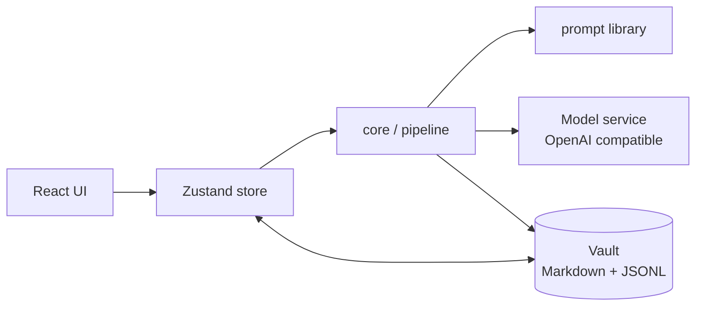

<h1 align="center">Axonota Studio</h1>

<p align="center">
  Turn “learn a subject” into a local notebook you can read, question and revisit.
</p>

<p align="center">
  <a href="README.zh-CN.md">中文</a> ·
  <a href="#english">English</a> ·
  <a href="../../releases/latest">Download</a> ·
  <a href="#quick-start">Quick start</a>
</p>

<p align="center">
  
  
  
  
  
  
</p>

---

## English

### What it is

Axonota Studio is a **local-first AI study notebook** for Windows.

Give it a topic. It first agrees with you on scope, drafts an editable outline, and then writes chapter by chapter, section by section. What you get is not a long chat log — it is a structured book you can re-read, question, and export.

Everything is stored on your machine as plain Markdown and JSONL. Your model only receives the content needed for the request you make. No cloud sync, no telemetry.

### Screenshots

**Workspace — one topic, an outline first, then the book**


**Mind map view — structure, progress and component pages at a glance**


### Highlights

- **Structure before prose**: topic → scope & goals → chapter/section outline → section bodies. Edit the outline before generating, so a whole book never drifts off-target.
- **Batch generation**: queue ungenerated siblings or an entire chapter/book; already-produced text stays readable while the rest streams in.
- **Two views of the same notebook**: a mind map for the big picture and a tree for progress. Nodes can be dragged, renamed, and restructured by AI.
- **Reading and source modes**: bodies are standard Markdown with LaTeX support. Switch between rendered reading and direct editing; autosaves when you stop typing.
- **Study component pages**: flashcards, a glossary, and custom pages. Their JSON shape is fixed and the model only fills content, so they stay reliable and reusable.
- **Chat with the notebook**: conversations carry the notebook's structure and bodies as context. Toggle web search per notebook; answers cite the pages and local files they rely on.
- **Selection actions**: highlight, ask AI, copy — or use AI follow-ups for an example, an analogy, a quick quiz, step-by-step breakdown, or a counterexample.
- **Sources and attachments**: attach local files and web pages to any section and jump back to the evidence from an answer.
- **Import / export**: archive a notebook as zip, export PDF, print, import zip, and restore deleted notebooks from the system recycle bin.
- **Bilingual UI and light/dark themes**: choose a language on first launch, switch anytime in Settings; AI output follows the UI language.
- **Bring your own model**: any OpenAI-compatible Chat Completions endpoint works, with a connectivity test before saving.

### Quick start

#### Option 1 — installer

Download `Axonota Studio_x.y.z_x64-setup.exe` from [Releases](../../releases/latest) and run it.

Requirements: Windows 10/11 with WebView2 (preinstalled on modern Windows).

#### Option 2 — from source

Requires Node.js ≥ 20, Rust ≥ 1.77, and Visual Studio Build Tools with the C++ desktop workload.

```bash
git clone https://github.com/Guchigagu/axonota-studio.git
cd axonota-studio
npm install
npm run tauri dev -w @nb/desktop
```

Build the installer:

```bash
npm run tauri build -w @nb/desktop
# output: apps/desktop/src-tauri/target/release/bundle/nsis/
```

> Tip: if your project path contains characters such as `#`, the Rust/Tauri build may fail. Build from a plain path.

#### Configure a model

Open **Settings → Models → Add model** and fill in:

| Field | Notes |
|---|---|
| Name | Display name, e.g. “DeepSeek” |
| Base URL | OpenAI-compatible endpoint, e.g. `https://api.deepseek.com/v1` |
| API Key | Stored only in local `settings.json`, never uploaded |
| Model ID | e.g. `deepseek-chat` |

Run the built-in connectivity test before saving. OpenAI, DeepSeek, Moonshot, and self-hosted gateways all work.

#### Three steps

1. On the workspace, write the topic and requirements (deadline, purpose, deliverable), then press ↑ to draft an outline.
2. Adjust the outline and confirm; generation starts.
3. Open any section and read. Select text to ask AI, or generate flashcards / a glossary for review.

No model yet? Click **“No model? See an offline demo”** to explore the full structure and component pages without any API key.

### Data and privacy

- Data directory: `%APPDATA%\com.axonota.studio\vault`
- One folder per notebook:

```text
notebooks/<id>/
├── notebook.md      # topic, style, outline and node index
├── nodes/<id>.md    # section bodies (Markdown)
├── files/           # attachments
├── chat.jsonl       # conversation log
└── settings.json    # model and UI settings
```

- API keys stay on this device. During generation and chat, only the relevant context is sent to the model service you configured.
- No accounts, no cloud sync, no telemetry. Backup = copy the `vault` folder.

### Stack and layout

<p align="center">
  
</p>

```text
axonota-studio/
├── apps/desktop/        # Tauri 2 + React 18 + Vite + Tailwind + Zustand
│   ├── src/             # workspace, notebook, reader, chat, mind map
│   └── src-tauri/       # Rust side: files, recycle bin, export, system calls
├── packages/core/       # dependency-free engine: vault, pipeline, prompt assembly, AI client
├── prompts/             # prompt library, split per feature and easy to review
├── scripts/             # self-test
└── docs/assets/         # README images
```



- **Frontend**: React 18, TypeScript, Vite, Tailwind, Zustand, CodeMirror, KaTeX
- **Desktop**: Tauri 2 (Rust, WebView2, rusqlite, trash)
- **Engine**: `packages/core` has no third-party dependencies and can run its self-test in Node

### Commands

```bash
npm run dev -w @nb/desktop       # frontend only (browser mode with injected demo data)
npm run typecheck                # type-check core + desktop
npm run selftest                 # core engine self-test
npm run tauri dev -w @nb/desktop # full desktop app
npm run tauri build -w @nb/desktop
```

### Known limitations

- Built and verified on Windows only (Tauri is cross-platform, but some system calls are Windows-specific).
- Models must be OpenAI Chat Completions compatible and support streaming.
- No cloud sync or collaboration by design — local files are the source of truth.

### Contributing

Issues and PRs are welcome. Before submitting, run:

```bash
npm run typecheck && npm run selftest
```

If you change prompts, update `prompts/README.md` too.

### License

[MIT](LICENSE)
