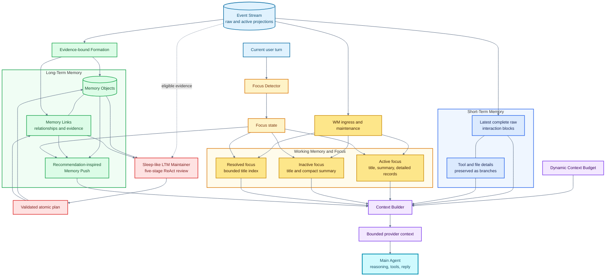

**English** | [简体中文](README.zh-CN.md)

# Sema

**A persistent, memory-native AI agent.**

> **Beyond sessions. Beyond context windows.**
> Sema treats conversations as interaction surfaces, not as the boundary of an
> agent's memory.

Sema is a Windows-first experimental AI agent built around an original Memory
Engine. Instead of attaching memory as a generic database or recall tool, Sema
co-designs memory, attention, context construction, and the agent runtime as one
system.

> **Memory is not merely a tool Sema calls. It is part of the runtime that
> shapes what Sema can perceive.**

The Memory Engine preserves source evidence, maintains different layers of
active state, automatically activates relevant long-term context, and performs
most memory work outside the Main Agent's attention. The Main Agent can focus
on understanding the user, reasoning, and acting instead of continuously
deciding when and how to manage memory.

## Why Sema Exists

Many agents are organized around a session and a model context window:

```text
start a conversation -> fill the context window -> summarize or truncate -> start again
```

That model makes the user responsible for remembering which conversation
contains a fact, deciding when old information should be recalled, and
re-explaining context when a new task or session begins. A memory plugin can
help, but the agent often still has to notice that something is missing and
choose to call a recall tool.

Sema starts from a different premise:

- a conversation is an interface, not a long-term memory container;
- a context window is temporary cognitive workspace, not durable storage;
- storing information and deciding what the model should see are different
  problems;
- the normal memory lifecycle should not depend on the Main Agent remembering
  to manage it; and
- users should not have to manage the agent's memory boundaries themselves.

The current implementation provides this continuity within a workspace. The
longer-term goal is a persistent personal agent whose state can remain coherent
across tasks, applications, and devices.

## What Makes the Memory Engine Different

Sema is not an agent with a memory plugin. It is a memory-native agent whose
runtime behavior is organized around memory.

| Common plugin or tool pattern | Sema's memory-native design |
| --- | --- |
| Memory is an optional interface beside the agent loop | Memory participates in context construction and the runtime lifecycle |
| The user or model decides when to search | Memory Push automatically evaluates relevant memories for the current turn |
| The Main Agent spends reasoning effort managing recall | Dedicated memory pipelines perform candidate generation, ranking, formation, and maintenance |
| History is reduced to chunks or rolling summaries | Raw evidence and derived memory projections coexist |
| Stored information and visible context are treated similarly | Event history, working state, attention, long-term storage, and model-visible context have separate boundaries |
| Context uses a largely fixed layout | A Dynamic Context Budget adapts allocation to the current interaction |

The individual ingredients—vector retrieval, layered memory, ranking, and
background maintenance—are not claimed as isolated inventions. Sema's original
contribution is their integration into an evidence-preserving,
session-independent memory lifecycle that is native to the agent runtime.

## Recommendation-Inspired Memory Push

Memory Push is inspired by recommendation systems. A recommendation engine
does not wait for a user to search for every relevant item; it builds a
candidate set, ranks it against the current situation, filters noise, and
delivers a small selection. Sema applies the same design intuition to memory.

```text
Current input + Working Memory + Focus state
                     |
                     v
           candidate generation
                     |
                     v
        retrieval, ranking, validation
                     |
                     v
          selected memory context
                     |
                     v
        injected before the Main Agent call
```

This changes who is responsible for remembering:

- the user does not need to know where a fact originally appeared;
- the Main Agent does not need to first realize that it should search memory;
- relevant long-term context can be activated without an explicit Recall Tool
  call;
- retrieval and ranking can evolve independently from Main Agent prompting;
- full refresh work can run in the background without blocking the current
  reply; and
- the same memory infrastructure can be measured for relevance, latency,
  noise, and token cost as its own subsystem.

Explicit retrieval and memorization tools still exist for deliberate control
and complex cases. They supplement the automatic lifecycle; the lifecycle does
not depend on the Main Agent choosing to call them.

## Integrated With the Runtime, Isolated From Main-Agent Attention

Sema deliberately combines two properties:

1. **Deep runtime integration.** Memory state influences context construction,
   attention, background work, long-term formation, retrieval routing, and
   available capabilities. Memory is not bolted on after the agent loop.
2. **Separation of cognitive responsibility.** The Main Agent consumes the
   resulting context but does not normally orchestrate STM, WM, Focus, LTM,
   Memory Push, Formation, or maintenance.

This lets the Main Agent spend its limited attention on the user's task while
specialized memory processes maintain continuity behind the scenes. The Memory
Engine remains internally modular and testable even though it is a first-class
part of Sema's behavior.

## Brain-Inspired Memory and Attention

The Memory Engine is functionally inspired by human memory and attention. It is
not intended to be a biologically faithful simulation. The inspiration is the
separation of cognitive roles rather than a claim about neuroscience.

| Functional inspiration | Sema subsystem | Role |
| --- | --- | --- |
| Continuous experience | Event Stream | Preserves the ordered factual record and source evidence |
| Recent precise memory | Short-Term Memory | Keeps recent interaction blocks available with minimal loss |
| Active mental workspace | Working Memory | Maintains compact, usable state for ongoing work |
| Selective attention | Focus System | Organizes which working state deserves detailed activation |
| Durable knowledge | Long-Term Memory | Stores structured objects, evidence, and relationships outside the immediate window |
| Memory consolidation | Formation and LTM Maintainer | Creates first-pass memories, then reorganizes and validates them through offline review |
| Associative activation | Retrieval and Memory Push | Brings relevant long-term information back into current context |

The important distinction is that **storage, activation, attention, and model
visibility are not the same operation**. Sema can retain far more information
than a model should receive in one call, while selecting the layers that matter
for the current task.

## The Context Window as a Dynamic Attention Budget

Sema treats the context window as a scarce cognitive resource rather than as
the memory system itself. Recent evidence, Working Memory, Focus, long-term
memory, and tool results all compete for limited space.

The Dynamic Context Budget adjusts how much capacity different layers receive
as interaction conditions change. This avoids relying on one fixed prompt
layout for every situation and separates three questions:

1. What must remain available exactly?
2. What can be compacted while remaining useful?
3. What can leave the active window while remaining recoverable?

Context Builder combines the selected projections into the provider request.
The result is a bounded view of a much larger persistent state, not an attempt
to place the entire history into every model call.

## Evidence Before Summaries

Sema does not treat a generated summary as a complete replacement for the
history from which it was derived.

- Event Stream preserves an ordered raw projection.
- STM and WM provide purpose-specific views of that evidence.
- Focus controls detailed versus compact working-state visibility.
- LTM Formation creates durable objects through evidence-bound writes.
- Retrieval can return structured memory without rewriting the store.
- Background maintenance can update derived organization while source records
  and references remain available for inspection.

This design supports compression without making compression irreversible. It
also creates a foundation for auditing, correcting, and reinterpreting memory
as the system evolves.

## Sleep-Like LTM Maintenance

Long-term memory is not finished when an object is first written. New evidence
can duplicate an older memory, refine it, contradict it, reveal a more useful
abstraction, or turn a sequence of events into a meaningful episode. Sema uses
an offline, sleep-like LTM Maintainer to revisit this larger structure after
normal interaction has produced new memory material.

The sleep analogy is functional: the system temporarily leaves ordinary task
interaction and performs consolidation over accumulated experience. It is not
a claim that the implementation simulates biological sleep.

The Maintainer is an isolated, five-stage ReAct Agent—not a single summary
prompt:

```text
recent review
    -> global duplicate review
    -> abstraction
    -> episode review
    -> completion and mechanical Final Check
```

During these stages it can inspect Event Stream evidence, retrieve related
memory, query objects and links, traverse bounded graph neighborhoods, and
check mechanical store health. It can then propose structured actions such as:

- merge, split, replace, or abstract Memory Objects;
- retag or relink knowledge;
- mark support and contradiction relationships;
- update titles and summaries; and
- create bounded episode memories from meaningful multi-step processes.

The model does not write directly to SQLite or indexes. It submits a strict
maintenance plan to a deterministic Compiler, which validates references,
expands semantic intents, detects conflicts, assigns idempotency keys, and
hands the complete plan to the Store for an atomic commit. Semantic completion
still has to pass continuous coverage and a mechanical Final Check.

Maintenance pressure grows with the eligible, unmaintained Event Stream
backlog. Increasing pressure produces progressively stronger internal sleep
signals; at full pressure, the TUI starts maintenance before accepting another
ordinary Main Agent turn. Progress and Maintainer reasoning stay outside the
normal conversation and Event Stream.

After a successful run, Runtime preserves a bounded summary of the four
semantic stages and wakes the Main Agent with a `maintenance_completed` event.
The user-facing result can be recounted as a short dream-like memory of what was
consolidated, while the canonical memories remain the validated objects, links,
and evidence—not the dream summary.

This process gives Sema a memory lifecycle rather than a write-only memory
database:

```text
experience -> Formation -> first-pass LTM -> sleep-like review
                                          -> consolidation
                                          -> validation
                                          -> maintained LTM
```

See [LTM Memory Maintainer](docs/memory-engine/ltm/ltm-memory-maintainer.md)
and [Maintainer Runtime](docs/memory-engine/ltm/ltm-memory-maintainer-runtime.md)
for the complete protocol and recovery rules.

## Memory Architecture

The context path can be read without a diagram renderer:

```text
Current turn -> Focus Detector -> Focus state
                                |-- controls WM visibility
                                `-- routes Memory Push

Event Stream
|-- STM -> latest complete raw interaction blocks
|          `-- Tool and File details remain attached as branches
|-- WM  -> Focus-aware projection
|          |-- active:   title + summary + detailed records
|          |-- inactive: title + compact summary
|          `-- resolved: bounded title index
`-- Formation -> LTM objects + links
                     |-- Memory Push -> ranked long-term context
                     `-- LTM Maintainer -> consolidate and validate

STM projection -----------+
WM projection ------------+--> Context Builder --> bounded context --> Main Agent
Memory Push --------------+
Dynamic Context Budget ---+
```

The colored diagram expands the same path with the implemented Formation and
Maintainer write flows:



See the [Memory Engine documentation](docs/memory-engine/README.md) for the
implementation map and subsystem contracts.

## System Architecture

The Memory Engine is the center of Sema's design, while a shared Backend/Core
keeps user interfaces replaceable.

```text
TypeScript / React / Ink TUI --+
                               +--> Windows Named Pipe --> Python Backend/Core
Telegram Gateway (optional) ---+                              |
                                                              +-- Agent runtime
                                                              +-- Tool safety
                                                              +-- Persistence
                                                              +-- Event Stream
                                                              +-- Memory Engine
```

Python owns model execution, tool permissions, persistence, configuration, and
memory behavior. Clients render structured state and return user choices over
a JSON-RPC 2.0 boundary. The TUI and optional Telegram Gateway therefore share
the same workspace runtime rather than implementing separate agents.

See [Architecture](docs/architecture.md), the [Code Map](docs/code-map.md), and
[Tool Calling and Safety](docs/tool-calling.md) for the current boundaries.

## Implemented Today

- workspace-local continuous Event Stream with raw and active projections;
- Short-Term Memory, Working Memory, Focus Segments, and structured LTM;
- automatic Memory Push with candidate generation, ranking, validation,
  incremental reuse, and background refresh;
- evidence-bound Formation, explicit Memorize, structured Retrieval, and a
  five-stage ReAct LTM Maintainer with pressure, coverage, atomic plans, and
  mechanical Final Check;
- dynamic context budgeting and provider-context assembly;
- background memory work scheduled outside the final-answer critical path;
- TypeScript, React, and Ink terminal interface;
- shared per-workspace Python Backend/Core over a Windows Named Pipe;
- streaming responses, structured tool calls, confirmation, and permissions;
- project-local persistence, trajectories, undo data, and memory state;
- optional Telegram remote control and Tavily search; and
- pytest, Vitest, and isolated external evaluation infrastructure.

## Long-Term Vision

Sema begins as a coding and local task agent, but a better coding assistant is
not its final destination. The longer-term vision is **one persistent personal
agent**: an agent that can remain coherent across tasks, interruptions,
applications, and devices instead of being recreated inside every new chat.
In that model, a session is an interaction boundary, not the lifetime of the
agent, and each client is an entrance to the same continuing identity and
state.

The central question is therefore not only:

> How can an agent complete the task currently in front of it?

It is also:

> How can one agent continue to understand its user, manage memory and
> attention, preserve unfinished work, accumulate experience, and act
> reliably in an open-ended and changing environment?

### Why Persistence Changes the Architecture

That question creates problems that a larger prompt or a vector-search plugin
cannot solve by itself:

- **Finite context, unbounded history.** A long-lived agent may accumulate
  years of interactions, but every model call has a limited context window.
  The system must distinguish durable history, currently active memory, and
  the evidence needed for the present decision.
- **Continuity beyond sessions.** Goals, task state, memory, and execution
  progress cannot exist only inside a chat transcript. They must survive
  interruption, restart, model changes, and eventually different clients.
- **Unified memory, selective attention.** A user can have many concurrent
  projects and concerns. Completely isolated sessions lose useful connections,
  while one global summary mixes unrelated work. Focus and layered memory let
  Sema preserve a common history while changing what is active now.
- **Reliability over repeated compression.** A system intended to operate for
  a long time cannot treat recursively rewritten summaries as unquestionable
  truth. It needs retained raw evidence, structured memories, explicit links,
  and paths back to the interactions from which claims were formed.
- **Autonomy requires state and authority.** A proactive agent must know which
  goals remain active, what changed, what is unfinished, and whether it is
  authorized to act. Remembering an old intention must never be confused with
  receiving current permission.

These requirements are why Memory, Focus, Event Stream, persistence, the
independent Runtime, and the client/Core boundary are architectural concerns
rather than optional conveniences. The Memory Engine keeps a clear internal
module boundary so it can be tested and evolved, but it is co-designed with
the Agent Runtime: Sema does not reduce memory to a detachable plugin that the
Main Agent must remember to call.

### Toward an Agent Operating Layer

If this foundation succeeds, Sema can grow from a local coding interface into
an **agent operating layer**: not a replacement for Windows, Linux, or existing
applications, but a persistent layer of memory, state, reasoning, and execution
above them. Desktop tools, mobile clients, applications, and services would be
different interfaces to the same agent rather than independent assistants that
forget one another.

This vision may eventually require continuous event-driven operation without
continuous LLM inference, long-lived goal and unfinished-task maintenance,
proactive action within explicit authorization, continuity across devices and
applications, and procedural memory that preserves reusable methods and
lessons from completed work. These are consequences of the vision, not a
feature checklist or claims about the current release.

The complexity of Sema's architecture is a consequence of this ambition, not
an end in itself. A long-term direction can justify keeping the right system
boundaries open, but it cannot justify every mechanism in advance. Each layer
must ultimately earn its place through measurable improvements in continuity,
recall, reliability, efficiency, or useful autonomy.

> [!IMPORTANT]
> Sema 0.0.1 is an early Windows-first developer snapshot intended primarily
> for code and architecture review. It is installed from source, is not
> production-ready, and has not yet passed installation acceptance on a
> separate clean Windows machine.

## Source Installation

Requirements:

- Windows;
- Python 3.11 or 3.12;
- Node.js 24 LTS; and
- access to a supported LLM provider or local compatible endpoint.

From PowerShell in the repository root:

```powershell
py -3.12 -m venv .venv
.\.venv\Scripts\Activate.ps1
python -m pip install -r requirements.txt
python -c "import tiktoken; tiktoken.get_encoding('cl100k_base')"
npm --prefix tui ci
npm --prefix tui run build
.\install-sema.ps1
```

Open a new PowerShell window, reactivate the environment, and run `sema`.
The PATH script registers the launcher but does not install dependencies or
activate the Python environment.

Long-term memory additionally requires local copies of `BAAI/bge-m3` and
`Qwen/Qwen3-Reranker-0.6B`. Model weights are not included in this repository.
Sema can be started without LTM after the LLM configuration passes its test;
Event Stream, STM, and Working Memory remain available in that mode.

Read [Installation and first-run setup](docs/installation.md) before attempting
to run the project.

## Cost, Data, and Local State

- Requests sent to a configured remote LLM provider may contain conversation
  context and may incur provider charges.
- LLM configuration tests make real requests and can also incur charges.
- Tavily search and Telegram are optional external integrations with their own
  data handling.
- Embedding and reranking run locally when their models are configured.
- User configuration, including saved credentials, is stored as plaintext in
  the user-level `~/.sema/config.json`; protect it and never commit it.
- Runtime state, model weights, caches, and local configuration are excluded
  from the repository.

Review the policies of each configured provider before sending private data.

## Verification

Run the main test suites from the repository root:

```powershell
python -m pytest -q
npm test --prefix tui
npm run build --prefix tui
```

Some integration and model tests require separately configured services or
local models. The commands above have not yet been validated from a separate
clean-machine clone. See [Testing](docs/testing.md) for focused suites and
environment requirements.

## Documentation

- [Installation](docs/installation.md)
- [TUI](docs/tui.md)
- [Architecture](docs/architecture.md)
- [Code Map](docs/code-map.md)
- [Tool Calling and Safety](docs/tool-calling.md)
- [Testing](docs/testing.md)
- [Evaluation](docs/eval.md)
- [Remote Control](docs/remote-control.md)
- [Memory Engine](docs/memory-engine/README.md)

## Contributing and Security

Issues and pull requests are welcome. Read [CONTRIBUTING.md](CONTRIBUTING.md)
before proposing a change. Report vulnerabilities privately as described in
[SECURITY.md](SECURITY.md), not through a public issue.

## License

Original Sema code and documentation are available under the
[MIT License](LICENSE). Third-party and adapted components remain subject to
their respective licenses and attribution requirements. Model weights and
downloaded datasets are not covered by Sema's MIT License.

The TUI attribution chain and retained upstream license texts are documented
in [tui/NOTICES.md](tui/NOTICES.md). Direct install dependencies and their
license families are summarized in
[THIRD_PARTY_NOTICES.md](THIRD_PARTY_NOTICES.md).
