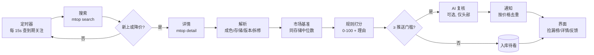

# 闲鱼猎手 · RuiC-GoofishHunter

> 不是「监控到就通知你」，而是「告诉你这条值不值得去聊」。

一个跑在自己电脑上的闲鱼捡漏决策台：每 5 分钟扫一遍你关心的关键词，
把每件商品算成 0–100 分，拆开告诉你**为什么**：比同规格市场价低多少、成色几分、卖家像不像个人、有没有坑。
只有过线的才推送，并且同一个商品同一个价格只推一次。


重点不在多抓几条，而在判断：抓取走页面驱动 + 响应拦截，判断走可解释的规则分，
AI 只在你真的要看的那几条上出现。接口协议、参数编码和风控边界都记在
[docs/PROTOCOL.md](docs/PROTOCOL.md)。

---

## 设计取舍

- **抓取**：让闲鱼页面自己发搜索、我们拦响应；只有新商品才为它开一个临时详情页，拿到数据立刻关。接口签名方式变了也不影响。
- **判断**：规则分先行（0–100，可解释），AI 只复核头部候选。没配 key 也能完整使用。
- **价格**：按存储容量分桶，取同规格中位数和四分位，去极端值；不是拿整页均价硬算。
- **去重**：商品按 `item_id` 全局去重，同一件商品被多个关注命中只抓一次详情。
- **结构化**：成色、存储、版本、拆修、卖家回复率全部落库，不靠模型从描述里猜。
- **后台**：默认无头运行，自动扫描不弹任何窗口；只有主动扫码登录时才开一次窗口。
- **登录**：扫码一次，登录态只存本机；自动扫描无窗口，后台静默运行。

---

---|---|
| 抓取方式 | 点页面筛选按钮 + 每个商品开一个详情页 | 页面驱动搜索/详情 + 拦响应，只有新商品才开临时详情页 |
| 一轮耗时 | 约 14 秒/商品 | 30 条一轮 ≈ 40 秒（含详情），热缓存 3–4 秒 |
| 判定 | 大模型回 `true/false`，标准一严就一条都不推 | 规则分 0–100（免费、可解释）+ AI 只复核头部 |
| 去重 | 按关键词结果集 | 按商品 ID 全局去重 |
| 价格基准 | 当前页均价 | 按存储容量分桶的同规格中位数 + 四分位 |
| 结构化信息 | 只用标题/价格/地区 | 成色、存储、版本、拆修、卖家回复率全部落库 |
| 登录 | 装浏览器插件导出 JSON | 点一下，浏览器里扫码，自动保存 |

---

## 快速开始

```bash
git clone https://github.com/HRuiCcc/RuiC-GoofishHunter.git
cd RuiC-GoofishHunter
python3 -m venv .venv
.venv/bin/pip install -r requirements.txt
# 机器上没有 Edge 时，装 Playwright 自带的 Chromium
.venv/bin/python -m playwright install chromium

# 1) 扫码登录（会弹一个浏览器窗口，登完自动保存）
.venv/bin/python -m hunter login

# 2) 建一个关注
.venv/bin/python -m hunter add --name "vivo X200 Pro" \
    --keyword "vivo x200 pro" --pages 2 --min-score 65 --interval 300

# 3) 先跑一次看看
.venv/bin/python -m hunter run --watch 1

# 4) 起 Web 界面（含定时调度）
cd webui && npm install && npm run build && cd ..
./start.sh
# → http://127.0.0.1:7801
```

命令行也可以只看状态：

```bash
.venv/bin/python -m hunter ls        # 关注列表
.venv/bin/python -m hunter doctor    # 环境自检
```

> **默认无头，不弹窗口**：抓取走移动端仿真的无头浏览器，启动时先让闲鱼页面自己
> 完成一次搜索做「预热」；搜索和详情都由页面自己发请求、我们拦响应。浏览器进程常驻复用，
> 扫描、详情、卖家查询全在后台完成；只有点「打开登录窗口」扫码时会开一次可见窗口。

---

## ⚙️ 工作原理



核心链路要点：

1. **搜索参数直接拼**：个人闲置、包邮、价格区间、最新发布都是请求体字段，
   不依赖页面按钮（参数格式见 [docs/REVERSE-ENGINEERING.md](docs/REVERSE-ENGINEERING.md) 第 6 节）。
2. **详情只抓一次**：按 `item_id` 全局去重，6 小时缓存，价格变化才重抓。
3. **市场基准分桶**：12+256 和 16+512 各自和自己的同类比；样本不足 4 条就退回全量，并注明依据。
4. **规则分先行**：分数能拆成价格/成色/卖家/风险/加分项，界面上逐项可见；AI 只做补充。
5. **告警去重**：同一商品同一价格只推一次，静默时段只进站内收件箱。

---

## 打分怎么算

```
50 基础分
 + 价格分（-30 ~ +32）  比同规格中位价低 25% 吃满
 + 成色分（-5.5 ~ +11） 几乎全新 / 95新 / 9成新 / 7成新
 + 卖家分（-9 ~ +9）    信用等级、芝麻、实名、注册年限、回复率、在售数量
 + 新鲜度（-2 ~ +6）    2 小时内发布加分
 + 加分项（-6 ~ +6）    包邮、全套、电池健康
 - 风险扣分（0 ~ -30）  进水、非原装、有锁、主板维修、仅自提、疑似商家
```

- 命中「进水 / 非原装 / 有锁 / 主板维修」→ 直接「放弃」。
- 成色 ≤7 成新，分数封顶 60；≤9 成新，封顶 74。
- 分档：≥80 强烈推荐 · 65–79 值得看 · 50–64 观望 · <50 放弃。

「无拆修」「二手贩子勿扰」「同城也可自提（且包邮）」这些否定语境不会被误判——有单测盯着。

---

## 界面

浅色暖纸底的控制台，一张奶油色「今日最强一笔」是视觉锚点；表格与卡片两种视图，点开右侧抽屉看完整判断。

| 商品库 | 商品详情 |
|---|---|
|  |  |

| 卡片视图 | 运行日志 |
|---|---|
|  |  |

| 新建关注（先试抓） | 设置 |
|---|---|
|  |  |

- **概览**：今日新货 / 推送 / 平均分 / 在跑关注；捡漏榜；关注下次运行；近 14 天价格。
- **关注**：建关注前可以「试抓一次」，先看到条数、中位数和样例，再决定要不要保存。
- **商品库**：表格 / 卡片切换，按分数/价格/折扣排序；抽屉里有评分构成、AI 结论、该问卖家什么。
- **运行**：每轮抓了多少、评了多少、推了几条，SSE 实时日志。
- **设置**：账号扫码登录、通知渠道、静默时段、AI 与阈值。

---

## 配置

| 环境变量 | 默认 | 说明 |
|---|---|---|
| `HUNTER_PORT` | `7801` | Web 端口（避开抖音服务占用的 8000） |
| `HUNTER_DATA_DIR` | `~/.ruic-goofish-hunter` | 数据库、登录态、日志 |
| `HUNTER_HEADLESS` | `true` | 无头抓取（移动端仿真 + 页面预热）；设 `false` 仅用于调试 |
| `HUNTER_MINIMIZE` | `true` | 有头调试时把窗口收进 Dock，不影响扫描 |
| `HUNTER_BROWSER_CHANNEL` | `msedge` | `msedge` / `chrome` / `chromium` |
| `HUNTER_COOLDOWN` | `900` | 命中风控后静默冷却秒数，期间不再打网关 |
| `HUNTER_PROXY` | 空 | 留空=直连并绕过系统代理（本机代理挂掉时不会连累浏览器） |
| `HUNTER_DETAIL_CONCURRENCY` | `3` | 详情并发 |
| `HUNTER_CALL_INTERVAL` | `0.35` | mtop 调用最小间隔（秒） |

通知渠道、AI key、阈值都在 Web 的「设置」里改，存 SQLite。

> **隐私**：登录态、浏览器 profile、数据库都只落在 `~/.ruic-goofish-hunter/`，
> 不会进仓库（`.gitignore` 已排除 `states/`、`profiles/`、`*.db`、`.env`）。
> 仓库里的截图只含公开商品信息，不含 cookie、账号 ID 或密钥。

AI 复核默认走 DeepSeek（`https://api.deepseek.com`，`deepseek-flash`），
也可以填任何 OpenAI 兼容接口；不填 key 时整条链路照常工作，只是少了 AI 那段补充。

---

## 目录

```
hunter/            后端（Python 3.10+ / FastAPI）
  goofish/         浏览器会话、搜索参数、解析
  scoring/         市场基准、规则打分、AI 复核
  web/             API + SSE + 静态资源
webui/             前端（Vue 3 + Vite + Tailwind）
tests/             34 个测试，吃真实接口响应
docs/              接口笔记 / 架构 / 接口契约
```

更细的设计见 [docs/ARCHITECTURE.md](docs/ARCHITECTURE.md)；
本次真实环境跑了什么、结果如何，见 [docs/VERIFICATION.md](docs/VERIFICATION.md)。

---

## 后台运行（macOS）

```bash
# 装成登录即启动的后台服务（无窗口、崩溃自动拉起）
./scripts/install_service.sh

# 看状态 / 日志
launchctl print gui/$(id -u)/com.ruic.goofishhunter | head -20
tail -f ~/.ruic-goofish-hunter/logs/service.log

# 卸载
./scripts/uninstall_service.sh
```

后台服务默认监听 `127.0.0.1:7801`，浏览器界面随时打开看就行。

## 自检

```bash
.venv/bin/python -m pytest -q          # 后端 35 个测试
.venv/bin/python scripts/ui_smoke.py   # 界面：导航 / 抽屉 / 卡片视图 / Toast
```

## 常见问题

**Q：能不能后台运行、不弹任何窗口？**
A：可以，默认就是。抓取用无头浏览器（移动端 UA + 触摸仿真），先导航到搜索页让页面
自己发一次搜索完成「预热」；搜索、详情都走页面驱动，卖家资料走软调用，失败不影响整轮。
`launchd` 服务常驻，关掉终端也不影响；整个扫描过程没有可见窗口，只有你主动点
「打开登录窗口」扫码时才会弹一次。

**Q：登录态多久过期？**
A：通常几天到两周。过期时界面会把账号标成 `expired`，点「打开登录窗口」重扫即可。

**Q：会不会被封号？**
A：只读公开搜索与详情，调用间隔 0.35 秒、单轮页数受限、命中验证码立即停。
但任何自动化都有风险，请自己控制频率，别用来做批量倒卖。

**Q：能远程访问吗？**
A：默认只绑 `127.0.0.1`。要远程请自己套反向代理 + 鉴权，不要直接把端口暴露到公网。

---

## 免责声明

本项目仅供学习与技术研究，不提供任何担保。请遵守闲鱼用户协议，
不要高频请求、不要用于非法用途。因使用本项目导致的账号限制或损失，作者不承担责任。

## 赞赏支持

<p align="center">
  
</p>

<p align="center">微信扫码赞赏</p>
