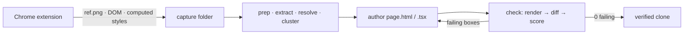

> Rebuild any interface — then prove the rebuild is right, one pixel at a time.

Every tool in this category claims pixel-perfect. `clone` is the one that checks.

A Chrome extension captures a live site's screenshot, DOM, and computed styles. A Claude Code plugin rebuilds the page from that capture, renders its own output back into headless Chromium, and diffs it against the original screenshot. Every region gets a score. Nothing is finished until every score clears its floor.

**[See the measurements →](https://www.officeos.co/clone)** · **[Read a teardown →](https://www.officeos.co/teardowns)**

## 📊 Six products, graded

Each row is a live production page, rebuilt from scratch and diffed against its own reference at the same size and device pixel ratio. `exact` is the share of pixels identical to the original on all three channels, with no tolerance whatsoever.

| Capture | Frame | Pixels exact | Within 8/255 | Mean Δ | |
|---|---|---|---|---|---|
| **Doppler** — Team settings | 1920×937 | **97.69%** | 98.05% | 1.27 | [Teardown](https://www.officeos.co/blog/doppler-team-settings) |
| **Tailscale** — Access rules | 1534×921 | **97.58%** | 98.80% | 0.65 | |
| **Cal.com** — Bookings | 1921×937 | **94.67%** | 97.88% | 1.41 | |
| **Stripe** — Dashboard | 1920×929 | **94.45%** | 94.86% | 1.70 | |
| **Cloudflare** — Dashboard | 1920×929 | **91.88%** | 95.46% | 3.87 | |

Doppler and Tailscale sit near 97.6% because token-driven product surfaces are exactly what the pipeline is built for. Cloudflare is the floor of the set, and the gap is almost entirely antialiasing along small-glyph edges plus the image content every rebuild deliberately replaces with neutral placeholders — a part that can never reach 100% by design, which is why the within-8 column is the more useful read on dense screens.

<details>
<summary><strong>Every capture, side by side</strong></summary>

### Doppler — Team settings · 97.69% exact

| Original | Clone | Pixel diff |
|---|---|---|
|  |  |  |

Written up in full: **[Doppler's team settings page, measured to the pixel](https://www.officeos.co/blog/doppler-team-settings)** — an eleven-value grey ramp, a radius ladder tied to element size, and an accent color used exactly four times.

### Tailscale — Access rules · 97.58% exact

| Original | Clone |
|---|---|
|  |  |

### Cal.com — Bookings · 94.67% exact

| Original | Clone | Pixel diff |
|---|---|---|
|  |  |  |

### Stripe — Dashboard · 94.45% exact

| Original | Clone | Pixel diff |
|---|---|---|
|  |  |  |

### Cloudflare — Dashboard · 91.88% exact

| Original | Clone | Pixel diff |
|---|---|---|
|  |  |  |

In every diff, dark means agreement. Color appears only where the clone and the original disagree — chiefly the brand marks and photographic content the pipeline deliberately refuses to reproduce.

</details>

## 🌟 What makes it different

- **A real oracle, not eyeballing.** The clone renders in headless Chromium at the capture's exact DPR, is cropped to the reference's exact size, and is diffed per pixel. The oracle is plain Python — PIL and Playwright, no model in it — so it cannot be talked out of a failing score.
- **Two targets, one engine.** `/clone:html` emits a static `page.html`. `/clone:react` emits shadcn/ui components with the site's captured states (hover, focus, dialogs) as real props. Same measurement code underneath.
- **Causes, not symptoms.** A 3px sidebar offset that breaks 200 boxes reports as *one* upstream cause. You fix the sidebar, not the two hundred things downstream of it.
- **Behaviour a screenshot can't hold.** The React target inherits command palettes, focus traps, and keyboard navigation from Radix.
- **Honest by construction.** Fonts are self-hosted and gated — a fallback font fails the run. Icons ship as verified files. Brand marks are dropped and photos become neutral placeholders, and neither is ever asserted against.

## ℹ️ Why measure at all

Ask an agent to copy a UI and it will invent a 13px gap, pick a grey that's two steps off, and tell you it's done. The fix isn't a better prompt — it's removing the agent's opinion from the acceptance decision.

So the capture is treated as ground truth (a real PNG bitmap plus the computed styles that produced it), and the rebuild is graded against it every cycle until it passes. Drift stops being a matter of taste and becomes a number that either clears the floor or doesn't.

**What you keep afterwards is not the clone.** Nobody should ship one — it has no data, no responsive behaviour, and no reason to exist. What survives is the layer above it: the real token ramp, the type scale, the elevation model, the exact grey that reads as a border instead of a line. That's the part a team takes years to converge on, and the part a generative tool approximates badly and confidently. Wiring a database to a table component was never the hard bit.

### How it works



1. **Capture** — the extension takes a full-page screenshot (one shot via CDP device-metrics override, never stitched) plus a recursive tree of every node's rect, text, ~50 computed style properties, and its `:hover`/`:focus` states.
2. **Prep / extract / resolve / cluster** — validate the capture, derive a shared design system (`base.css`, tokens, self-hosted fonts, open-source icon glyphs), and cluster repeated subtrees into components.
3. **Author** — build one route by hand from the extracted `layout.md`. The only step where anything is guessed.
4. **Check** — render, diff, score every box. Anything below its floor goes back to step 3.

Full architecture: [docs/CODEBASE_MAP.md](docs/CODEBASE_MAP.md) · pipeline design rationale: [docs/PIPELINE_GRAPH.md](docs/PIPELINE_GRAPH.md).

## 📦 Install

`clone` is a Claude Code plugin. Install it from this repo's marketplace:

```shell
/plugin marketplace add HarKro753/claude-copy
/plugin install clone@clone-marketplace
```

Enabling the plugin puts the `clone` CLI on your Bash PATH and loads the `/clone:html` and `/clone:react` skills. See [Requirements](#️-requirements) for the Python, Node, and Chrome pieces.

### Capture extension

The capture side is a Chrome MV3 extension in [`capture-extension/`](capture-extension/), loaded unpacked — no Web Store, no account:

1. Open `chrome://extensions`.
2. Toggle **Developer mode** (top right).
3. **Load unpacked** → select the `capture-extension/` folder.

The **copy-website capture** action then appears in your toolbar and writes a capture folder that `clone prep` consumes.

## 🚀 Usage

```shell
clone prep <session> --target html|react   # target recorded in routes.json
clone extract                              # layout.md, tree.json, shared/*
clone resolve                              # fetch/recolor open-source icon glyphs
clone cluster                              # detect repeated components
clone init | map | build                   # react target only
clone check [route]                        # render → diff → score, loop until 0 failing
```

Static HTML is one line per phase. React adds `init` (scaffold + theme), `map` (a shadcn component per node), and `build` (vite → self-contained `page.html`).

A web app is not one capture — it's one capture per screen. Capture the dashboard, then billing, then settings; each becomes its own verified route, and the shared design system is derived across all of them so the routes agree with each other instead of drifting apart.

## ❓ Known limits

Worth knowing before you install, rather than after:

- **No responsive output.** A capture is one viewport and the clone is verified at that one resolution. Original breakpoints are not recovered. Capturing the same route at three widths and scoring all three in parallel is the obvious fix and isn't built yet.
- **No functionality.** No backend, no data, no business logic. The HTML target preserves hover and focus and nothing else; the React target adds Radix behaviour on top of screens that are still static.
- **Not a migration tool.** It rebuilds from a rendered page and its computed styles, so it knows nothing about the source framework and reproduces none of its logic.
- **The check loop is slow.** By design — it re-renders and re-scores every cycle. Making that cheaper without making it more forgiving is the most valuable open problem in the repo.

## ⬇️ Requirements

- Python 3 with **PIL** and **Playwright** (Chromium) on the system `python3` — the oracle.
- Node + a package manager for the React target (React + Vite + Tailwind v4 + shadcn/ui).
- Chrome — load `capture-extension/` as an unpacked Manifest V3 extension.
- [Claude Code](https://claude.com/claude-code) with the `clone` plugin enabled.

## 🗂️ Structure

```
assets/               README banner + the measured gallery (original · render · diff)
example/              a live static clone (render.html + its fonts/css/svg)
capture-extension/    Chrome MV3 capture tool
skills/clone/         the pipeline plugin (engine/ + html & react targets)
docs/                 CODEBASE_MAP.md · PIPELINE_GRAPH.md
```

## 🛠️ Development

The engine is `skills/clone/engine/` — one module per concern, with both artifacts behind a shared `Target` interface, so adding a third is one file in `targets/`, not a fork. After touching the engine, run all four test files:

```shell
cd skills/clone/tests
python3 -m pytest test_engine.py test_react.py test_hook.py test_e2e.py
```

## 📚 Teardowns

Rebuilding a page to within a pixel means reading every decision its designers made. Those readings are written up at **[officeos.co/teardowns](https://www.officeos.co/teardowns)** — type ramps, spacing grids, the exact border greys, and why each choice does what it does, all sourced from values that had to be right for the diff to pass.

- [Doppler's team settings page, measured to the pixel](https://www.officeos.co/blog/doppler-team-settings)

## ⚠️ Disclaimer

The products above are used purely as technical subjects for measurement and design analysis. This project is not affiliated with, endorsed by, or sponsored by any of them; all trademarks and brand marks belong to their respective owners. Brand marks are dropped from every rebuild, photographic content is replaced with neutral placeholders, and clones are rendered locally for measurement only — never deployed or served as live sites.

## 📄 License

[MIT](LICENSE) © Harro Krog. See [CONTRIBUTING](CONTRIBUTING.md), [Code of Conduct](CODE_OF_CONDUCT.md), and [Security Policy](SECURITY.md).

---

<sub>Built by [OfficeOS](https://www.officeos.co) — we design, build, launch and operate subscription apps for creators, and are paid only from what they earn.</sub>
