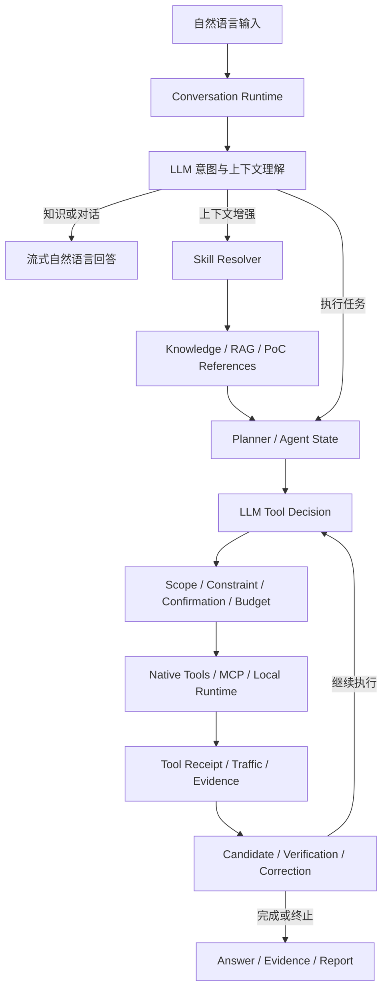

# YunkunSec

## 云鲲安全全栈式自动化网络安全智能体平台

YunkunSec 是面向企业安全团队、专业安全服务机构与授权研究场景构建的智能化安全测试平台。平台以大语言模型为认知与决策核心，将自然语言交互、任务规划、专业 Skills、知识检索、工具调度、执行控制、证据管理、结果验证与报告生成整合为统一的自动化工作流。

YunkunSec 旨在提升复杂安全任务的理解效率、执行一致性和过程可审计性。用户可以通过自然语言描述目标、范围和任务要求，由平台结合会话上下文、运行状态与安全策略完成任务拆解、能力选择和后续执行。

> 当前版本：YunkunSec v0.4.0 Commercial

## 产品定位

YunkunSec 面向授权范围内的网络安全评估和安全工程自动化，主要适用于：

- 企业内部安全评估与攻击面管理。
- Web 应用、API、网络服务和主机环境安全检查。
- 红队测试、安全运营与应急分析任务编排。
- 漏洞知识、PoC 参考、威胁情报与专业 Skills 检索。
- 安全测试证据采集、发现验证和报告生成。
- 本地安全研发、配置审查与文件自动化处理。
- 可恢复、可追踪的持续安全任务执行。

平台通过统一的 Agent Runtime 管理对话、计划、工具和证据，使知识问答与实际执行共享同一套上下文和状态体系。

## 核心能力

### LLM-first 自然语言交互

YunkunSec 以配置的大语言模型作为自然语言理解与回答入口：

- 根据当前问题、会话历史和运行状态生成自然语言回答。
- 识别知识问答、能力咨询、文件操作、安全任务和持续执行请求。
- 支持多轮上下文、短回复承接和待续问题恢复。
- 支持流式响应，降低长内容生成过程中的等待时间。
- 根据任务语义判断是否需要检索知识或调用工具。
- 在模型服务不可用时提供明确的配置与连接诊断。

平台不使用固定问候语或预设能力模板替代正常的模型回答。

### 智能任务规划

对于需要执行的任务，YunkunSec 会形成公开、可审计的执行计划，内容包括：

- 用户意图与任务目标。
- 当前目标和执行阶段。
- 计划步骤与阶段推进关系。
- Skills、知识库和工具使用策略。
- 风险、约束与确认要求。
- 预期证据和任务终止条件。

公开计划用于帮助用户了解平台准备执行的工作，不包含模型内部隐藏推理。

### Agent Loop

YunkunSec 采用状态驱动的 Agent Loop 持续推进任务：

```text
理解任务
  → 加载上下文
  → 生成计划
  → 选择工具
  → 执行安全门禁
  → 调用工具
  → 记录回执与证据
  → 验证结果
  → 纠偏或继续
  → 输出结论与报告
```

Agent Loop 支持：

- 多步骤连续执行。
- 工具结果回填 LLM 上下文。
- 新增证据与状态进展判断。
- 无效重复检测和自动停环。
- 阶段、预算和执行次数限制。
- 用户中断、任务阻断和异常恢复。
- 持久化运行与断点续接。

### Skills 专业能力系统

YunkunSec 使用结构化 Skills 描述安全任务方法、适用范围、执行流程和参考资料。

Skills 系统支持：

- 自动发现 `SKILL.md`。
- 按目标类型、任务类型和漏洞类别进行路由。
- 选择一个主要 Skill 和必要的辅助 Skills。
- 按需加载 references，减少无关上下文占用。
- 在终端显示本轮实际选择的 Skill 和加载依据。
- 与工具、知识检索、证据和报告流程协同工作。

### 统一知识与 RAG

平台将多种本地安全数据源接入统一知识检索层：

- Skills。
- 漏洞知识库。
- PoC 参考资料。
- Payload 数据。
- 威胁情报。
- 安全 Wiki。
- 字典资源。

检索结果作为受控参考上下文提供给 Agent。知识库中的描述或 PoC 资料不会被直接视为目标存在漏洞的证明。

### 工具调度与运行时

YunkunSec 通过统一 Tool Registry 管理可调用能力：

- 本地文件与目录工具。
- 受控本地命令。
- HTTP 与网络检查工具。
- 知识库与 PoC 检索工具。
- 报告与证据工具。
- MCP Server 工具。
- 外部安全工具适配能力。

平台可与 Nmap、FFUF、SQLMap 等通用安全工具协同工作。相关工具仅在实际调用对应能力时需要安装。

### 工具回执与证据链

每次工具执行均生成结构化回执，记录：

- 工具名称与来源。
- 执行状态。
- 参数公开摘要。
- Call ID。
- 执行耗时。
- Evidence ID。
- 公开结果摘要。

工具输出、网络流量和验证结果可以关联到统一 Evidence，便于任务追踪、结果复核和报告生成。

### 候选发现与结果验证

YunkunSec 将安全发现划分为不同状态：

- **候选发现**：模型或工具识别到的可疑信号。
- **证据记录**：可追溯的工具输出、响应、差异或流量。
- **已验证发现**：满足验证规则并具备足够证据的结果。

模型生成的结论不会自动升级为已验证漏洞。验证流程会结合工具结果、流量记录、响应差异和受控 PoC 结果进行判断。

### 本机文件与目录操作

平台支持通过自然语言完成常规本机操作：

- 查看当前目录。
- 读取和写入普通文件。
- 创建文件和目录。
- 搜索文件及内容。
- 复制、移动和重命名文件或目录。
- 删除普通文件和空目录。

递归删除、非空目录删除、系统目录操作、批量不可逆操作以及可能改变系统状态的命令将进入确认或阻断流程。

### 持久化与恢复

YunkunSec 支持任务运行状态持久化：

- 命名运行实例。
- 会话状态保存。
- Checkpoint 与 Snapshot。
- 异常中断恢复。
- Run Resume。
- Writer Lease。
- 目标状态记录与比较。

## 系统架构



### 核心组件

| 组件 | 主要职责 |
| --- | --- |
| `Mode1ConversationRuntime` | 多轮会话、上下文承接与任务入口协调 |
| `AgentEngine` | Agent 状态、规划、工具循环、证据和终止控制 |
| `LLMClient` | OpenAI-Compatible API 调用、流式响应和重试 |
| `SkillLoader` | Skills 发现、内容加载与 Prompt 注入 |
| `SkillResolver` | Skills 路由、主要能力和辅助能力选择 |
| `KnowledgeIndexService` | 本地安全数据索引、搜索和状态管理 |
| `ToolRegistry` | 原生工具、网络工具、主机工具和 MCP 工具注册 |
| `ConstraintPolicy` | Scope、风险、阶段、确认和执行资格控制 |
| `EvidenceManager` | Evidence 创建、关联、脱敏和摘要管理 |
| `Verifier` | 候选发现验证和已验证结果管理 |
| `RunContext` | 运行状态、持久化、恢复和生命周期管理 |

更详细的技术说明见 [`docs/ARCHITECTURE.md`](docs/ARCHITECTURE.md)。

## 安全控制体系

### Scope

网络类任务必须在明确的目标范围内执行。平台会检查目标、主机、端口、协议和重定向后的地址，避免请求超出授权边界。

### Constraint

任务约束用于描述允许和禁止的行为，例如：

- 仅执行只读检查。
- 禁止登录或凭据尝试。
- 禁止写入目标。
- 禁止执行 PoC。
- 限制请求数量、并发和执行时间。

### Confirmation

高风险或可能改变目标状态的动作需要有效确认。确认信息与当前会话、运行实例和目标绑定，不能跨目标复用。

### Budget

平台通过请求预算、步骤预算、时间预算和最大循环次数控制自动化执行规模。

### 动作等级

| 等级 | 典型能力 | 默认处理方式 |
| --- | --- | --- |
| L0 | 本地只读、知识检索、普通文件操作 | 自动执行或低风险处理 |
| L1 | 只读 HTTP 与基础可达性 | Scope 内执行 |
| L2 | 指纹、TLS 与安全响应头 | Scope 内执行并记录流量 |
| L3 | 轻量路径发现 | 受预算和速率控制 |
| L4 | 登录、Fuzz 与 PoC 验证 | 需要确认或有效授权 |
| L5 | 写入目标、命令执行与破坏性验证 | 严格确认或阻断 |

## 专业安全控制台

YunkunSec CLI 使用语义化颜色区分不同信息：

| 区域 | 颜色 | 内容 |
| --- | --- | --- |
| Brand | 青色 | YUNKUNSEC Banner 与平台标识 |
| PLAN | 蓝色 | 目标、步骤、约束与终止条件 |
| THINK | 紫色 | 可公开执行摘要与 Trace |
| ANSWER | 亮白色 | 流式 LLM 回答 |
| TOOL | 黄色 | 工具、命令、参数和回执 |
| SUCCESS | 绿色 | 成功、完成与证据记录 |
| BLOCKED / FAILED | 红色 | 阻断、失败与错误 |
| CONTEXT / TURN STATUS | 青色与暗灰色 | Skills、知识和运行统计 |

终端不支持 ANSI 或 Unicode 时，可以启用 ASCII 模式：

```bash
python main.py --ascii-ui
```

也可以设置：

```powershell
$env:NO_COLOR="1"
$env:YUNKUNSEC_ASCII_UI="1"
```

## 系统要求

- Python 3.10 至 3.12。
- Windows 10/11、Linux 或 macOS。
- 可访问的 OpenAI-Compatible LLM 服务。
- 运行网络任务时具备对应目标的授权和网络可达性。

## 安装

### Windows PowerShell

```powershell
Set-ExecutionPolicy -Scope Process Bypass
.\install.ps1
```

### Windows CMD

```bat
install.bat
```

### 手动安装

```bash
python -m venv .venv
```

Windows：

```powershell
.\.venv\Scripts\python.exe -m pip install --upgrade pip setuptools wheel
.\.venv\Scripts\python.exe -m pip install -r requirements.txt
.\.venv\Scripts\python.exe -m pip install -e .
```

Linux 或 macOS：

```bash
./.venv/bin/python -m pip install --upgrade pip setuptools wheel
./.venv/bin/python -m pip install -r requirements.txt
./.venv/bin/python -m pip install -e .
```

## LLM 配置

复制配置示例：

```powershell
Copy-Item llm_config.example.yaml llm_config.yaml
```

配置内容：

```yaml
llm:
  base_url: https://YOUR_PROVIDER.example/v1
  api_key: YOUR_API_KEY
  model: YOUR_MODEL
  temperature: 0.1
  max_tokens: 32768
  max_retries: 3
  timeout: 60
  api_keys_env: YUNKUNSEC_LLM_API_KEYS
```

配置说明：

- `base_url`：OpenAI-Compatible API 根地址。
- `api_key`：当前供应商提供的访问凭据。
- `model`：供应商账户实际可用的模型名称。
- `temperature`：模型生成随机度。
- `max_tokens`：单次模型响应最大输出 Token，默认值为 `32768`。
- `max_retries`：请求失败后的最大重试次数。
- `timeout`：模型请求超时时间，单位为秒。
- `api_keys_env`：可选的 API Key 池环境变量名称。

交付目录只提供无真实凭据的 `llm_config.example.yaml`。

## 知识库初始化

首次运行前构建本地知识索引：

```bash
python main.py kb build
python main.py kb status
```

更新知识索引：

```bash
python main.py kb update
```

检索知识：

```bash
python main.py kb search "SQL injection"
```

## 快速开始

### 启动主菜单

```bash
python main.py
```

### 启动智能对话

```bash
python main.py chat
```

### 查看系统状态

```bash
python main.py doctor
```

### 查看完整命令手册

```bash
python main.py manual
```

## 对话示例

### 安全知识问答

```text
你 › 说明 SQL 注入的原理、主要类型和流量特征
你 › 继续展开 MySQL 时间盲注
```

### 本机文件操作

```text
你 › 查看当前工作目录
你 › 在桌面创建 report.txt，并写入本轮分析结论
你 › 搜索项目中包含 AgentEngine 的 Python 文件
```

### 授权安全任务

```text
你 › 对 https://TARGET.example 执行只读初检，检查可达性、HTTP 指纹、TLS 和安全响应头，不登录、不写入，最后生成证据摘要
```

## 对话控制命令

| 命令 | 说明 |
| --- | --- |
| `status` | 查看当前运行状态 |
| `tools` | 查看工具与安全等级 |
| `evidence [ID]` | 查看证据列表或指定证据 |
| `history` | 查看会话历史 |
| `save` | 保存当前运行状态 |
| `snapshot` | 创建运行快照 |
| `resume <run>` | 恢复指定运行 |
| `think off` | 隐藏公开计划与 Trace |
| `think brief` | 显示紧凑公开执行摘要 |
| `think debug` | 显示详细公开执行信息 |
| `help` | 查看对话命令 |
| `exit` | 退出对话模式 |

## CLI 命令

```bash
python main.py --help
python main.py --version
python main.py chat
python main.py repl
python main.py run --help
python main.py solve --help
python main.py persistent --help
python main.py recon --help
python main.py scan --help
python main.py network-scan --help
python main.py osint-recon --help
python main.py cve-lookup --help
python main.py exploit --help
python main.py doctor
python main.py config --help
python main.py kb --help
python main.py mcp --help
python main.py plugins --help
python main.py grant --help
python main.py target-state --help
python main.py runs --help
python main.py report --help
python main.py api --help
python main.py eval --help
python main.py manual
```

## 运行数据

平台运行过程中会在 `output/` 下生成相关数据，例如：

- 对话运行与状态文件。
- Checkpoint 和 Snapshot。
- 工具回执与 Evidence。
- HTTP 流量记录。
- 候选发现和已验证发现。
- 报告与任务产物。
- 自动化授权状态。

`output/` 属于本地运行目录，不包含在正式交付压缩包中。

## 项目结构

```text
YunkunSec/
├─ main.py
├─ yunkunsec/
│  ├─ agent/
│  ├─ knowledge/
│  ├─ llm/
│  ├─ report/
│  ├─ runtime/
│  ├─ security/
│  ├─ tools/
│  └─ web/
├─ data/
│  ├─ dic/
│  ├─ intel/
│  ├─ payload/
│  ├─ poc/
│  ├─ skills/
│  ├─ vulndb/
│  └─ wiki/
├─ docs/
├─ examples/
├─ scripts/
├─ tests/
├─ llm_config.example.yaml
├─ mcp_servers.example.json
├─ DELIVERY_MANIFEST.json
└─ SHA256SUMS.txt
```

## 技术体系

- Python 3.10+。
- `asyncio` 异步运行时。
- OpenAI-Compatible API。
- 流式 LLM Delta。
- Pydantic 数据模型。
- PyYAML 配置管理。
- SQLite 与全文检索。
- `aiohttp`、`httpx` 网络通信。
- FastAPI 与 Uvicorn 本地 API 服务。
- MCP Python SDK。
- SHA-256 文件完整性校验。
- 结构化 Tool Receipt、Evidence 与 Traffic Store。

## 常见问题

### LLM 配置未完成

确认项目根目录存在 `llm_config.yaml`，并检查：

- `base_url` 是否正确。
- `api_key` 是否有效。
- `model` 是否为账户可用模型。
- Base URL、API Key 和 Model 是否属于同一供应商。

### API 返回 401

401 表示模型服务供应商拒绝当前凭据。可以执行：

```bash
python main.py doctor
```

查看脱敏后的配置和连接状态。

### 知识库索引未就绪

```bash
python main.py kb build
python main.py kb doctor
```

### 工具未执行

检查以下条件：

- 输入是否包含明确的执行动作和目标。
- 目标是否处于任务 Scope 内。
- 当前动作是否需要确认。
- 请求预算或最大步骤是否耗尽。
- 外部工具是否已安装并加入 `PATH`。
- MCP Server 是否启用并可正常连接。

### 终端显示异常

```bash
python main.py --ascii-ui
```

## 安全与授权

YunkunSec 应仅用于获得明确授权的安全评估、内部测试、实验环境、靶场和安全研究。

使用前应明确：

- 测试目标与资产所有者。
- 授权的域名、IP、URL、账号和本机路径。
- 允许的测试时间、请求速率和并发。
- 允许与禁止的测试动作。
- 数据、证据和报告的处理要求。
- 紧急停止与联系人机制。

详细授权要求见 [`AUTHORIZATION.md`](AUTHORIZATION.md)。安全问题报告方式见 [`SECURITY.md`](SECURITY.md)。

## 商业许可

YunkunSec v0.4.0 Commercial 为商业专有软件。安装、使用、复制、修改、分发、托管、转售、再授权和二次开发权限以正式商业授权协议为准。

详细条款见 [`LICENSE`](LICENSE)。

## 产品信息

- 产品名称：YunkunSec
- 中文名称：云鲲安全
- 当前版本：v0.4.0 Commercial
- 产品类型：全栈式自动化网络安全智能体平台

