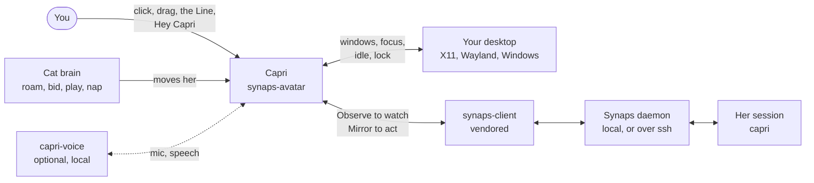

<h1 align="center">
  
</h1>

<p align="center">
  <b>A living desktop companion with a real agent's brain.</b><br>
  <sub>She perches on your windows, naps when you're away, and talks back when you say her name.</sub>
</p>

> [!IMPORTANT]
> **An unofficial fan project.** Capri is a character from *Cyberpunk: Edgerunners 2*. capri-syn isn't
> affiliated with or endorsed by CD PROJEKT RED, Studio Trigger or Netflix. **None of the art is ours:**
> it's borrowed from other Capri projects, [CapriCore](https://github.com/CapriChooms/CapriCore) (her
> sprites) and [Capri](https://github.com/lachydotmcg/capri-desktop) by lachydotmcg (her animations),
> and her app icon is a frame from the show. Credits and terms: [Credits & legal](#credits--legal).

<p align="center">
  
  
  
  
  <a href="#credits--legal"></a>
  <a href="https://github.com/HaseebKhalid1507/SynapsCLI"></a>
</p>

<p align="center">
  <a href="#she-lives-here">Tour</a> ·
  <a href="#talk-to-her">Talk to her</a> ·
  <a href="#settings">Settings</a> ·
  <a href="#get-her">Install</a> ·
  <a href="#whats-running-her">Under the hood</a> ·
  <a href="#controls">Controls</a> ·
  <a href="#platforms">Platforms</a> ·
  <a href="#credits--legal">Credits</a>
</p>

<p align="center">
  
  <br>
  <sub>Strikes in on a red bolt. Picks a window. Makes herself at home.</sub>
</p>

**Capri lives on your desktop.** She sits on your windows, wanders off when she's bored, naps when you're
away and comes to find you when she wants attention. Nobody scripts her day.

**And she talks back.** Say *"Hey Capri"*, or tap a key and type. She answers out loud, gets things done
on your machine, and comes over when she needs a yes from you. Her brain is the real thing: an agent
session on [Synaps](https://github.com/HaseebKhalid1507/SynapsCLI). The installer brings it.

**And she's free.** Sign her in with a free ChatGPT account: no API key, no card, no GPU.

**Linux and Windows.** She's click-through, so your windows stay yours. She just sits on them.

<p align="center"></p>

## She lives here

Two drives run in the background, one for wandering and one for attention. She acts when one of them wins.

<table>
  <tr>
    <td width="50%" align="center"><br><b>Window tops</b><br><sub>Her favourite seat. Close it and she bolts to the next.</sub></td>
    <td width="50%" align="center"><br><b>Perch</b><br><sub>Rides your windows. Lies down when it's quiet.</sub></td>
  </tr>
  <tr>
    <td width="50%" align="center"><br><b>Attention bids</b><br><sub>Ignored too long? She'll cling to your window for it.</sub></td>
    <td width="50%" align="center"><br><b>Summon</b><br><sub>Your agent needs a yes? She comes to you.</sub></td>
  </tr>
  <tr>
    <td width="50%" align="center"><br><b>Naps</b><br><sub>Lock the screen, she sleeps. Come back, she waves.</sub></td>
    <td width="50%" align="center"><br><b>Day and night</b><br><sub>Lively by day. Low-key after dark.</sub></td>
  </tr>
</table>

<details>
<summary><b>How her day works</b></summary>

- **Roam.** Every 45 seconds to 3 minutes she picks a spot: a window's top edge (her favourite), the
  floor or a corner, usually on the monitor you're using. Small hops in between.
- **React.** Switch windows and now and then she hops over. Switch workspace and she follows. Close the
  window she's on and, a bit over half the time, she bolts to another; otherwise she falls.
- **Restless.** She doesn't stand still for long: a blink, a look, a lean, a gesture every few seconds, and
  now and then a glance at the pointer or at a window that came forward. Held a while perched or standing, she
  turns to another way of sitting or standing every 8 to 25 seconds. Ignore her and the gestures come more
  often. She keeps still while her session works, and while the Line, a prompt or her menu is open.
- **Outfits.** About every 45 to 120 minutes she changes between her jacket and her no-jacket look, at a
  moment you can't see: in a teleport's bolt, or as she wakes. She keeps the one she's in across restarts.
- **Bid.** Leave her alone 8 to 15 minutes and she comes over: hanging from the bar above your window,
  clinging to its side, peeking round a corner. Ignore her and she sulks with her back to you.
- **Summon.** When her session needs you (a prompt, a finished turn, an error) she comes straight to the
  window you're in. The one move that isn't her idea.
- **Sleep follows you.** She naps 10 minutes after your last input (5 at night), and at once when the
  screen locks. Back from a while away, she greets you, a few times a day at most.
- **Manners.** At most 45 moves an hour. She stays put while a bubble, the Line or her menu is open, hides
  when a window goes fullscreen, and takes `DND 1 HOUR` from her menu.

</details>

<p align="center"></p>

## Hands on

<table>
  <tr>
    <td width="50%" align="center"><br><b>Headpats</b><br><sub>Supported. Hearts are not optional.</sub></td>
    <td width="50%" align="center"><br><b>Ragdoll</b><br><sub>Grab her, shake her, fling her. She lands it.</sub></td>
  </tr>
  <tr>
    <td width="50%" align="center"><br><b>Cursor games</b><br><sub>Wiggle the pointer near her. She will pounce.</sub></td>
    <td width="50%" align="center"><br><b>Sulks</b><br><sub>Ignore her and she sulks. A headpat fixes it.</sub></td>
  </tr>
  <tr>
    <td width="50%" align="center"><br><b>Music</b><br><sub>Something's playing? Headphones on, or a keytar on a window top. Sometimes she dances.</sub></td>
    <td width="50%" align="center"><br><b>Walks</b><br><sub>Sometimes she just strolls over.</sub></td>
  </tr>
</table>

<p align="center"></p>

## Talk to her

She has her own Synaps session, named `capri`. **The Line** is how you reach it without leaving what
you're doing: tap <kbd>$mod</kbd>+<kbd>c</kbd> and it opens right beside her, wherever she is. On
Windows it's <kbd>Win</kbd>+<kbd>Alt</kbd>+<kbd>C</kbd>; on GNOME and stock Hyprland it's
<kbd>Super</kbd>+<kbd>Alt</kbd>+<kbd>C</kbd>, which the installer offers there.

<p align="center">
  
  <br><b>The Line</b><br>
  <sub>Tap the key. Type. She relays it to her session.</sub>
</p>

<p align="center">
  
  <br><b>Hold to allow</b><br>
  <sub>Risky tool call? Hold <kbd>A</kbd>. A tap does nothing.</sub>
</p>

<p align="center">
  
  <br><b>Reader</b><br>
  <sub>Long reply? It opens in a reader, not a bubble.</sub>
</p>

- **The thread stays open.** <kbd>Enter</kbd> sends, or steers a turn that's already running.
  <kbd>Esc</kbd> closes and keeps your draft. <kbd>Esc</kbd> <kbd>Esc</kbd> aborts the turn.
- **A reply you missed waits for you** as a one-line strip on her tag.
- **She's a real agent. Treat her like one.** Her session can run commands and edit files as you. A
  prompt appears only when something asks for one, and it isn't a sandbox.
  [What she can touch](docs/UNDER-THE-HOOD.md#what-she-can-touch).

<p align="center"></p>

## Hey Capri

<p align="center">
  
  <br><b>Hands-free</b><br>
  <sub>Say her name. Talk. She answers aloud.</sub>
</p>

- **A conversation, not a command.** "Hey Capri" opens it: each pause sends, she answers aloud, and after
  a minute of quiet she goes back to waiting for her name. Prefer a key? Tap the toggle chord, talk,
  and pause when you're done. On Linux you can also just hold the key.
- **Her voice** is a bright blend of Kokoro's stock voices, pitched up a little.
- **Local.** Speech-to-text is whisper.cpp and her voice is Kokoro, both on your CPU. Audio stays in
  memory; nothing is written to disk. While her mic is open, her tag shows it.
- **She minds the room.** Other audio dips while she listens or speaks, then comes back.
- **Your call.** Voice is a choice at install: `--voice` on Linux, the "Her voice" page in her Windows
  installer (ticked when you have a mic). All of it: [docs/VOICE.md](docs/VOICE.md).

## Settings

No config file required. Click the cog beside the Line's field (or <kbd>Ctrl</kbd>+<kbd>,</kbd>), or pick
SETTINGS from her right-click menu. A change is written the moment you make it.

<p align="center">
  
  <br><b>Settings</b> · <sub>Her brain, her attention, her name.</sub>
</p>

<p align="center">
  
  <br><b>Settings ▸ Brain</b> · <sub>Pick what she thinks with.</sub>
</p>

- **BRAIN:** her model and its login. Three ways in, none first: SIGN IN with an account you have
  (ChatGPT, Claude, Copilot, Gemini, Grok, Kimi, Muse; she runs the sign-in and your browser opens on
  it), an API KEY, or RUN LOCAL. Then MODEL: a menu of every model your logins and your local server
  have.
- **ATTENTION:** how she asks for it: a mix of bids, hanging only, or off.
- **"HEY CAPRI":** her wake word, on or off.
- **ABOUT:** her version, one click to copy for a bug report.

<p align="center">
  
  
  <br><sub>On Windows she's in the tray too. Click for the Line, right-click for her menu.</sub>
</p>

## Requirements

| | Minimum | Recommended |
|---|---|---|
| **OS** | Windows 11 x64, or Linux x86_64 with glibc 2.35+ (Ubuntu 22.04, Debian 12, Fedora 36, Arch) on X11, Hyprland 0.40+, or GNOME, KDE or sway through XWayland. Windows 10 (1809+) and Windows 11 on Arm: untested ([Platforms](#platforms)) | X11 with a compositor, or Windows 11 |
| **Graphics** | Linux: a Vulkan 1.1+ driver (OpenGL ES is GPUI's fallback). Windows: Direct3D 11, feature level 10.1, with compute shaders and structured buffers | A GPU with its driver. CI and the Windows VM run on software rendering (WARP): fine for layout, not for colour or timing |
| **Tools** (Linux) | `curl` and Python 3 with `venv` (`python3-venv` on Debian and Ubuntu), for her art pack; the installer fetches what's missing, asking first | |
| **CPU, RAM, disk** | x86_64. RAM: about 84 MB idle on Linux, measured once during development (on 1.0); Windows not measured. Disk: about 160 MB for her and her art on Linux (binary 43 MB, built art pack 115 MB); Windows: a 10 MB setup, installed size not measured | CPU speed: not measured |
| **Her brain** | [Synaps](https://github.com/HaseebKhalid1507/SynapsCLI) 0.11.0 or newer (the installers fetch 0.12.0) and one of: an account (ChatGPT, Claude, Copilot, Gemini, Grok, Kimi, Muse; Gemini needs Synaps' Google client, and Grok can't be signed in on Windows yet), an API key, or a local model: Ollama or LM Studio, with tool calling and a 16k+ context (`qwen3:8b`: ~5 GB) | A GPU for a local model; without one it is slow |
| **Voice** (optional) | A microphone. Linux: PipeWire's `pw-record` and `pw-play`, and Python 3.10 to 3.13 (yours, else uv fetches 3.13: 105 MB more); ~540 MB (venv 169 MB, models 375 MB). Windows: Python comes with it; a 40 MB installer, 143 MB installed, 375 MB of models | Runs on the CPU, no GPU; speed not measured |
| **Network** | To install (Synaps, her release, ~120 MB of art, the voice models) and for an account or an API key | A local model needs none once installed |

"Untested" means the installers accept it but she has never run there; "not measured" means nobody has measured it.
Older glibc builds her from source (`install.sh` does it).

## Get her

**🐧 Linux.** One line, run as yourself:

```sh
curl -fsSL https://raw.githubusercontent.com/HaseebKhalid1507/capri-syn/main/install.sh | bash
```

It asks before anything needs sudo, and `--dry-run` prints every step without doing one.

**🪟 Windows 11.** **[⬇ capri-syn setup](https://github.com/HaseebKhalid1507/capri-syn/releases/latest/download/capri-syn-setup-x86_64.exe)**,
then double-click it. Per user, no admin. It's unsigned for now, so SmartScreen asks first.

Rather a terminal?

```powershell
irm https://raw.githubusercontent.com/HaseebKhalid1507/capri-syn/main/install.ps1 | iex
```

Both do the same steps, and a rerun is an upgrade:

1. **Synaps**, her brain's runtime (open source), if you don't have it. Named, and asked first.
2. **Her**, and **her art pack**, which is built on your machine: the art isn't in this repository.
3. **Her daemon and session, a summon key, autostart.** Then she drops in.

**First words.** If she has no brain yet, she says so:

<p align="center">
  
</p>

`SET ME UP ▸` opens **Settings ▸ Brain**: sign in to an account (she runs the sign-in, your browser
opens on it), add an API key or run a local model. Her installers ask first: an account, a model on
your PC, an API key, or later.

**Free:** pick ChatGPT and sign in with a ChatGPT account, a free one too: a free account runs her
on GPT-5.6 Terra (Luna works too); the bigger models need a paid plan. No API key, no card, no GPU.
Free accounts have usage limits: when hers is used up she says she's hit her model's limit (her tag
flashes AT THE LIMIT). Wait for it to reset, or pick another brain in Settings ▸ Brain. No account
at all? [Run a local model](docs/UNDER-THE-HOOD.md#her-brain). Without a brain she still perches,
naps and plays.

<details>
<summary><b>Flags, voice, uninstalling, the manual route</b></summary>

- **Voice** on Linux:

  ```sh
  curl -fsSL https://raw.githubusercontent.com/HaseebKhalid1507/capri-syn/main/install.sh | bash -s -- --voice
  ```

  On Windows, setup's "Her voice" page (mic, "Hey Capri", replies aloud).
- **Uninstall:** on Linux, the same line with `--uninstall` removes what it added, and says where
  Synaps is (it stays: other clients may use its daemon). On Windows: Settings ▸ Apps ▸ capri-syn.
- **Every step and flag**, prebuilt or from source: [docs/INSTALL.md](docs/INSTALL.md). Windows in
  depth: [docs/WINDOWS.md](docs/WINDOWS.md).
- **Release assets:** `synaps-avatar-x86_64-unknown-linux-gnu.tar.gz`, `capri-syn-setup-x86_64.exe`
  and `capri-syn-voice-setup-x86_64.exe`, each with a `.sha256`. Without a release, the installers build her from source.
- **Her art** is assembled on your machine from [CapriCore](https://github.com/CapriChooms/CapriCore)
  and [lachydotmcg/capri-desktop](https://github.com/lachydotmcg/capri-desktop)
  (see [Credits](#credits--legal)).

</details>

## What's running her

[Synaps](https://github.com/HaseebKhalid1507/SynapsCLI). An open-source agent runtime in Rust: one
background daemon owns every session, hers included. She's a client of it, the same as a terminal
would be. So:

- `synaps --attach capri` opens her thread in a terminal. Type in either one.
- `synaps send --session capri "tea's ready"` and she comes over to tell you. Any script can do that.
- MODEL in Settings ▸ Brain (or `[session] model`) picks her brain: any model Synaps can reach.
- `synaps` on its own starts a session that's yours, not hers.

<p align="center">
  
  <br><b>One thread, two windows</b><br>
  <sub>Too big for a bubble? Take it to a terminal. Same thread.</sub>
</p>

The longer tour, and what she can and can't touch: [docs/UNDER-THE-HOOD.md](docs/UNDER-THE-HOOD.md).

## How it works



One process: a transparent GPUI window plus a client of the Synaps daemon, which can be on this machine
or [on another one](docs/REFERENCE.md#a-daemon-on-another-machine). The client is vendored, so the
repository builds on its own.

<details>
<summary><b>Observe, Mirror, and her own session</b></summary>

- **She watches, and only steps in to act.** She attaches to her session in `Observe`. A `Mirror` attach
  would keep the session from parking and cost tokens in keep-warm pings, so she takes one only to send,
  answer a prompt or abort, and drops back to `Observe` 3 seconds after the turn ends.
- **Her own session.** With no `--session` flag she uses one named after her pack's character
  (`capri`): attached if it's live, resumed if she remembers it, created otherwise. She refuses the one
  named `subconscious`.
- **Her mood is the session's:** thinking, working (with the tool's name), done, annoyed after an abort
  or an error, needs-you while a prompt waits, away when the daemon is gone. Sleep is yours, not the
  session's.

The session rules, flags, packs and the dev control: [docs/REFERENCE.md](docs/REFERENCE.md).

</details>

## Controls

| You | She |
|---|---|
| Click her head | Headpat |
| Drag her, fling her | Ragdoll. Drop her on a window edge to perch her there |
| Right-click | Her menu |
| <kbd>$mod</kbd>+<kbd>c</kbd> tap · GNOME, stock Hyprland: <kbd>Super</kbd>+<kbd>Alt</kbd>+<kbd>C</kbd> (the installer offers it) · Windows: <kbd>Win</kbd>+<kbd>Alt</kbd>+<kbd>C</kbd> | The Line, beside her |
| "Hey Capri" | A hands-free conversation (voice on) |
| <kbd>Ctrl</kbd>+<kbd>,</kbd> in the Line | Settings |

<details>
<summary><b>Every key</b></summary>

| You | She |
|---|---|
| Click her body | Reacts, and opens a quick text field |
| Keep poking her | Gets annoyed |
| Right-click | RESET POSITION, DND 1 HOUR, ATTENTION, HANDS-FREE TALK, COPY LAST REPLY, HIDE, SETTINGS (SET UP MY BRAIN with no brain), QUIT (asks twice) |
| <kbd>$mod</kbd>+<kbd>c</kbd>, hold | Push-to-talk (Linux, voice on). Release sends |
| <kbd>$mod</kbd>+<kbd>Ctrl</kbd>+<kbd>c</kbd> · Windows: <kbd>Win</kbd>+<kbd>Alt</kbd>+<kbd>Ctrl</kbd>+<kbd>C</kbd> | Toggle talk: your pause sends. Double-tap for hands-free |
| <kbd>Enter</kbd> | Send, or steer a running turn |
| <kbd>Shift</kbd>+<kbd>Enter</kbd> | New line |
| <kbd>↑</kbd> <kbd>↓</kbd> | Recall what you sent |
| <kbd>PgUp</kbd> <kbd>PgDn</kbd> | Scroll the thread |
| <kbd>Ctrl</kbd>+<kbd>Y</kbd> | Copy her last reply |
| <kbd>Ctrl</kbd>+<kbd>O</kbd> | Open the last link in it |
| <kbd>Esc</kbd> | Close the Line (draft kept). While she speaks: hush. While she listens: cancel |
| <kbd>Esc</kbd> <kbd>Esc</kbd> | Abort the running turn |
| <kbd>A</kbd> / hold <kbd>A</kbd> | Allow a prompt / allow a risky one (about half a second) |
| <kbd>D</kbd> | Deny |
| <kbd>Tab</kbd> | Answer in words instead |

On Linux the app grabs no global keys; the installer binds them for i3, sway and Hyprland (with your
consent). On Hyprland it searches for `hyprland.lua` in `$XDG_CONFIG_HOME/hypr`,
`~/.config/hypr`, `$XDG_CONFIG_DIRS` and `/etc/xdg/hypr`, then legacy `hyprland.conf`
(Hyprland 0.57+ ignores `.conf`, so it warns). Lua gets literal `hl.bind` press/release
bindings, tagged `description = "synaps-avatar summon"` so live checks recognize them on reinstall.
Super+C taken? It offers Super+Alt+C; `--voice` adds Ctrl for the mic toggle and checks that
chord too. Both move to the Alt pair if either is taken; if that pair is occupied, nothing is added.
It checks live `hyprctl binds -j` first, including helper/import-generated keys. Offline, it
scans literal keys and stock `mainMod` concatenation; unresolved helpers, aliases, loops or imports
are shown for manual setup, never assumed free. It backs up first and checks with `luac -p`
when that compiler can parse the original config (restoring on a new syntax failure), and removes
only its marked blocks on uninstall.

By hand, in i3:

```
bindsym $mod+c             exec --no-startup-id avatarctl talk press
bindsym --release $mod+c   exec --no-startup-id avatarctl talk release
bindsym $mod+Ctrl+c        exec --no-startup-id avatarctl talk toggle
```

On Windows she registers her two keys herself.

</details>

## Configure

Settings covers the everyday. Everything else is one file, every key optional:
`~/.config/synaps-avatar/settings.toml` (Windows: `%APPDATA%\synaps-avatar\settings.toml`).

<details>
<summary><b>The common keys, with their defaults</b></summary>

```toml
[brain]
enabled = true
attention = "mix"            # "mix" | "hang_only" | "off"  (also in Settings and her menu)
fullscreen = "hide"          # "hide" | "stay"
monitor = "follow"           # "follow" the monitor you work on | "any"
passive_every_min = [0.75, 3] # minutes between her own roams (small hops in between)
bid_every_min = [8, 15]      # minutes between attention bids
max_moves_per_hour = 45      # a small hop counts a quarter
no_repeat = 2                # avoid her last N entrances

[brain.approaches]           # how she shows up for a bid; weights, 0 turns one off
hang = 2
hang_upside_down = 1
cling = 3
sit_edge = 3
peek = 1
beside = 1

[brain.arrivals]             # how she gets there (hop = 0: no hops at all)
hop = 4
teleport = 2
drop_in = 2
glitch = 1

[ragdoll]
strength = 0.5               # 0 = rigid, 1 = full floppy

[mirror]
drag_facing = "back"         # dragged, she looks "back" where she came from, or "forward"

[display]
composited = "auto"          # "auto" | "on" (alpha) | "off" (X shape, no compositor needed)

[music]
detect = true                # headphones on (now and then a dance) while an MPRIS player plays
ignore = ["discord", "vesktop"]

[session]
# model = "anthropic/claude-opus-5"   # her brain; MODEL in Settings ▸ Brain writes this

[voice]
enabled = false              # talk to her and hear her answer, through capri-voice
wake_word = true             # "Hey Capri" (with voice on): one mic stream, always shown on her tag
duck = "duck"                # other audio while she listens or speaks: "duck" | "pause" | "off"
```

An unknown key makes her reject the whole file and keep the previous values, so check spelling. Edited
by hand? `avatarctl settings reload` on Linux; restart her on Windows.

</details>

Every setting and flag: [docs/REFERENCE.md](docs/REFERENCE.md#every-setting). Voice in depth:
[docs/VOICE.md](docs/VOICE.md). Optional event hooks (a line into her session when something on your
machine needs a look): [docs/WATCH.md](docs/WATCH.md).

## Platforms

| Where | How she runs |
|---|---|
| **Linux, X11** | Her home. Used daily on i3, with or without a compositor. |
| **Linux, Hyprland** | Native Wayland: perching, drag and fling, effects, several monitors. Tested in a nested rig, not yet daily-driven. No idle time there yet, so typing alone for 5 minutes reads as away. |
| **Linux, GNOME, KDE, sway** | Through XWayland, which she picks herself. She perches on X apps only, and may nap while you type in native Wayland ones ([limits](docs/INSTALL.md#gnome-kde-and-other-wayland-desktops)). Untested on a real GNOME or KDE session. |
| **Windows 11** | Her installer, her tray, her own keys, her voice. Checked by hand in a Windows 11 VM ([the VM day](docs/WINDOWS.md#the-vm-day-2026-11-18)); live audio is still to check on real hardware. CI runs her installers end to end on every pull request. |
| **Windows 10, Windows 11 on Arm** | Both installers get through (Windows 10 1809 or newer; Arm through x64 emulation), but she has never been run on either. Untested, so not supported yet. |
| **macOS** | Planned. Being scoped now, to be tested on a real Mac before anything ships. No build yet. |

- **Names.** The repository and the Windows installers are `capri-syn`. The crate, the binary and the
  config and state paths are still `synaps-avatar`.
- **One character.** The code ships no character ids. Everything Capri-specific is in her pack's
  `moods.json`, so another pack is possible. Capri is the only one that exists.

## Credits & legal

- **The art.** Capri's sprite art comes from
  [CapriCore](https://github.com/CapriChooms/CapriCore). It is not included in this repository:
  `tools/make-pack` assembles the pack on your machine from your own CapriCore checkout.
- **Desktop art.** Her perch, sleep, walk, dance, dangle and transition animations come from Capri,
  [lachydotmcg/capri-desktop](https://github.com/lachydotmcg/capri-desktop), under the
  [PolyForm Noncommercial License 1.0.0](https://polyformproject.org/licenses/noncommercial/1.0.0).
  They are not included in this repository either: `tools/make-pack --lachy` adds them to your local pack.
  Window perch and music perch animations: her artist, who prefers to stay private. Click effect: mixmix312352.
  Transformation animation and emotes: Qewiw (mix_qewiw1412_86144).

  > Required Notice: Copyright 2026 Lachy (https://github.com/lachydotmcg)
  >
  > Required Notice: Anyone who uses Capri's code, art, animations or any of its other assets must credit the Capri project (https://github.com/lachydotmcg/capri-desktop). Capri's art and animations are by her artist, who prefers to stay private. Parts made by others keep their own licences, listed in its README.
- **Unofficial.** This is a fan project. It is not affiliated with or endorsed by CD PROJEKT RED,
  R. Talsorian Games, Studio Trigger or Netflix. All trademarks belong to their owners.
- **Her voice.** Speech uses stock Kokoro voices, blended, with light DSP.
- **Built on** [Synaps](https://github.com/HaseebKhalid1507/SynapsCLI) and
  [GPUI](https://www.gpui.rs/).

**Licence.** capri-syn's own code, tools, data and docs are released under the MIT License (see
[`LICENSE`](LICENSE)), © 2026 Haseeb Khalid. MIT covers only what was written for this project. These
paths are excluded and keep their own terms:

- `vendor/gpui-pre-linux/`, `vendor/gpui-pre-windows/`: GPUI by Zed Industries, Apache-2.0 (each folder's
  `LICENSE-APACHE`; our changes, listed in its `PATCHES.md`, are under the same licence).
- `crates/synaps-client/`: MIT, except the portions named in its
  [`NOTICE`](crates/synaps-client/NOTICE), which are Apache-2.0.
- `docs/media/`, except `card-*.png` (original type and motifs, MIT): the banner, screenshots and
  recordings of the app showing third-party character art: Capri's sprites
  from [CapriCore](https://github.com/CapriChooms/CapriCore), for which no licence is granted (see its
  `docs/character-assets.md`), and Capri's desktop art from
  [lachydotmcg/capri-desktop](https://github.com/lachydotmcg/capri-desktop) under the
  [PolyForm Noncommercial License 1.0.0](https://polyformproject.org/licenses/noncommercial/1.0.0) with
  the Required Notices above (parts by Qewiw and mixmix312352). Not under MIT; no commercial use. See
  [`docs/media/NOTICE.md`](docs/media/NOTICE.md).
- `assets/icon/`: a crop of Capri's face from a still of *Cyberpunk: Edgerunners 2*; its rights belong to
  their owners (see [`assets/icon/NOTICE`](assets/icon/NOTICE)). Not under MIT; no licence of any kind is
  granted for it. It is also built into the release binaries and the installer, where the same applies.
- `tools/wake/hey-capri-v1.npz`: a wake-word model trained on openWakeWord features (its models are
  CC BY-NC-SA 4.0) and LibriSpeech dev-clean (CC BY 4.0); distributed under CC BY-NC-SA 4.0 (see
  [`tools/wake/NOTICE`](tools/wake/NOTICE)).

Two MIT files carry a note: `packs/capri/moods.json` holds frame timings, anchor points, visible bounds
and sha256s taken from CapriCore (`docs/media/NOTICE.md` says which), and `tools/upscale_art.py` follows
Real-ESRGAN's network (BSD-3-Clause; its licence text is in the file). Release binaries also contain
third-party crates under their own licences (mostly MIT/Apache-2.0), and the Windows voice installer
bundles Python and third-party Python packages under their own licences (espeak-ng's GPL-3.0 among them).
Every release artifact carries their texts in its `licenses/` folder. espeak-ng's source (with sonic's,
which its build compiles in) is attached to every release beside the voice installer, and its
`licenses/SOURCE.txt` says where the GPL parts' source is ([docs/INSTALL.md](docs/INSTALL.md#releases)).

<p align="center">
  <sub>Capri runs on <a href="https://github.com/HaseebKhalid1507/SynapsCLI">Synaps</a>. Synaps is built with Synaps.</sub>
</p>
