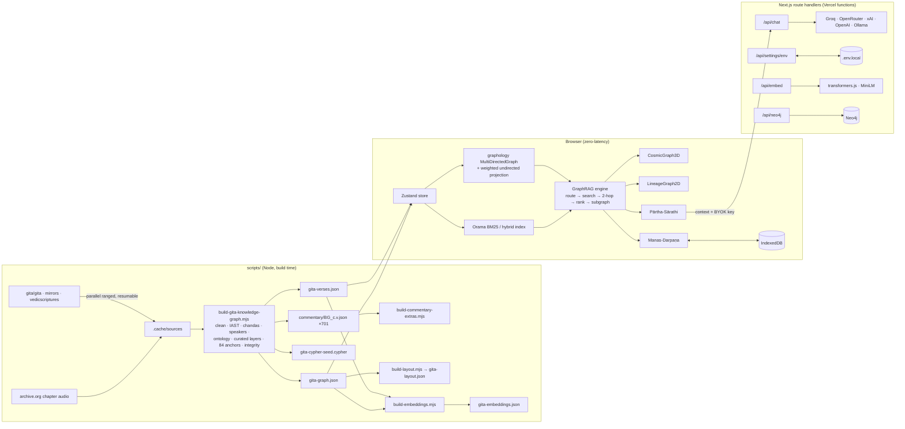

<div align="center">


# GitaViśva · गीताविश्व

**The Bhagavad Gita as a living knowledge graph.**

Explore all 701 verses in 3D, follow how one idea leads to another, read 20 commentaries from six traditions side by side,<br />
listen to the chant, and ask questions that are answered from the text itself.

[**Open GitaViśva**](https://gitaviswa.vercel.app) &nbsp;·&nbsp; [Run it on your computer](#run-it-on-your-own-computer) &nbsp;·&nbsp; [Get a free API key](#connect-a-language-model) &nbsp;·&nbsp; [How it works](#architecture)

[](https://gitaviswa.vercel.app)


<a href="https://gitaviswa.vercel.app"></a>

</div>

## A quick tour

### Explore: the whole Gita as one graph


The 18 chapters are the amber hubs, each surrounded by its verses. Concepts, states of mind and life situations sit in the middle, where the teaching connects. Click any point to light up everything it touches, or find the path between two ideas.

### Ask: answers that show where they come from


Ask in your own words. GitaViśva finds the verses and ideas that fit, lights them up in the graph, and, if you connect a free API key, writes an answer that cites them. Without a key it answers from the graph alone.

### Lineage: what leads to a verse and what follows


Who speaks a verse and to whom, the dilemma it answers, the verses that echo it, the states of mind it heals and the concepts it defines, with Devanagari, IAST and word-by-word meanings alongside.

### Read: one verse, many readings


Read chapter by chapter in Devanagari, IAST or seven regional scripts. Every verse opens commentaries from six traditions (Advaita, Viśiṣṭādvaita, Dvaita, Śuddhādvaita, Kashmir Śaiva and modern teachers) in English, Hindi and Sanskrit. Compare up to four side by side, or follow a single word through all of them.

### On your phone

<p align="center">
  
  &nbsp;&nbsp;
  
</p>

Your thoughts in **Reflect** stay on your device. Everything except AI-written answers works without an account, a key or, once visited, an internet connection.

---

## Contents

- [A quick tour](#a-quick-tour)
- [What it is](#what-it-is)
- [Run it on your own computer](#run-it-on-your-own-computer) (step by step, no coding needed)
- [Connect a language model](#connect-a-language-model) (optional: where to get a free API key)
- [Put it online](#put-it-online) (hosting a public copy)
- [For developers](#for-developers)
- [Works with zero keys, fully offline](#works-with-zero-keys-fully-offline)
- [Architecture](#architecture)
- [The knowledge graph](#the-knowledge-graph)
- [Data pipeline](#data-pipeline)
- [Hybrid GraphRAG](#hybrid-graphrag)
- [BYOK and `.env` dual persistence](#byok-and-env-dual-persistence)
- [Audio, scripts and languages](#audio-scripts-and-languages)
- [Neo4j](#neo4j)
- [HTTP API](#http-api)
- [Project structure](#project-structure)
- [Implementation notes and deviations](#implementation-notes-and-deviations)
- [Known limitations](#known-limitations)
- [Credits and licences](#credits-and-licences)

## What it is

| View | Name | What you can do |
| --- | --- | --- |
| Front page | **Home** | What GitaViśva is, told through the Gita's own arc in Pahari-style paintings: the chariot between the armies, Arjuna's *fight or flight* moment with life situations to start from, BG 2.47 and other well-known verses (with recitation), a live 2D preview of the real graph, three chapter scenes, and a door into each tool. It lives at `/` and paints before the verse data loads; the tools keep their `?view=` links, and older `/?node=…` links still open Explore. |
| 3D | **Explore** (*Viśvarūpa*) | The 18 chapters as amber hubs on a ring, every verse clustered around its chapter, and concepts, states of mind, characters and life situations drawn inward. The legend doubles as the filter; **Display** colours by type, chapter or Louvain community and toggles relationship families; **Find a path** traces the weighted shortest path between any two nodes (or a curated thematic thread). Hovering or selecting a node lights its neighbourhood; labels appear as you move closer. |
| 2D | **Lineage** (*Darśana*) | A focused diagram for any node: what leads to it on the left (the question or dilemma that triggered a verse, its speaker, the preceding verse), the focus card in the centre, and what follows on the right (answers, echoes, culminations, states it heals, concepts it defines), grouped under relation headings. On narrow screens it becomes a vertical list. Includes a causal-chain mode (e.g. the 2.62-63 *ladder of fall*). |
| Reader | **Read** (*Adhyayana*) | Chapter-by-chapter reading plus a verse panel: Devanagari / IAST / phonetic / seven regional scripts, five English and two Hindi translations, guru–laghu scansion, and word-by-word padaccheda. **Commentaries** are presented as perspectives: 20 commentaries (4 English, 3 Hindi, 13 Sanskrit) from six traditions (Advaita, Viśiṣṭādvaita, Dvaita, Śuddhādvaita, Kashmir Śaivism and modern teachers), filtered by language and tradition, each school with a one-line account of how it reads the Gita. *One word, many readings* follows a word of the verse through every commentary; up to four can be compared side by side; English and Hindi ones can be read aloud by the device's voice, or after every verse while listening; Sanskrit-only ones can be translated by your LLM (labelled as an AI draft). Hovering a word lights up every verse that shares its stem. |
| Companion | **Ask** (*Pārtha-Sārathi*) | Available from every view. Ask philosophy, comparisons, or what is on your heart. Retrieval runs in the browser in tens of milliseconds and the exact subgraph used for the answer is highlighted on the canvas. Citations such as `[BG 2.47]`, `[Concept: …]` and `[Emotion: …]` are clickable. |
| Journal | **Reflect** (*Manas-Darpaṇa*) | Keep any thought in your own words — saved on this device (IndexedDB), with drafts that survive view changes and reloads. Connections to verses, concepts, states or other thoughts are optional: suggestions explain themselves and only the ones you keep are saved (with status and provenance). Thoughts can be edited (earlier wording kept), answered later, searched, restored from Recently deleted, seen on a small personal map, and exported or imported. |
| Player | **Listen** (*Śravaṇa*) | Recitation player that appears once you press Listen: per-verse chanting, whole-chapter recordings, auto-advance, speed control, Media Session support. The 3D camera and the reader glide along with the chant. |

**Design system.** Tokens, type roles, the radius and z-index scales and component classes are documented at the top of `src/app/globals.css`; node-kind colours and shapes live in `src/lib/graph/palette.ts` (three categorical hues validated for colour-blind separation in both themes, with shape and size as secondary channels). The interface follows the system theme unless you pin one.

## Run it on your own computer

Just want to use it? Open **[gitaviswa.vercel.app](https://gitaviswa.vercel.app)**. There is nothing to install. The steps below are for running your own copy on your computer.

You don't need to know how to code. It takes about 15 minutes, most of it waiting for downloads. You need a Windows, macOS or Linux computer, about 2 GB of free disk space and an internet connection for the first setup. After that, GitaViśva runs on your computer and most of it works offline.

### 1. Install Node.js (once)

Node.js is the free program that runs GitaViśva. Go to [nodejs.org](https://nodejs.org), download the version marked **LTS**, run the installer and accept the defaults.

### 2. Download GitaViśva (once)

- **Easiest:** on [this project's GitHub page](https://github.com/HimanshuMohanty-Git24/gitaviswa), click the green **Code** button, then **Download ZIP**. Unzip it somewhere easy to find, such as your Documents folder.
- **With Git:** run `git clone https://github.com/HimanshuMohanty-Git24/gitaviswa.git`. With Git, getting updates later takes one command.

### 3. Open a terminal in the GitaViśva folder

A terminal is a window where you type commands. Open it inside the folder that contains `package.json`:

- **Windows:** open the folder in File Explorer, click the address bar, type `cmd` and press Enter.
- **macOS:** open the **Terminal** app, type `cd` followed by a space, drag the folder into the Terminal window and press Enter.
- **Linux:** right-click inside the folder and choose **Open in Terminal**.

To check that Node.js is ready, type `node -v` and press Enter. You should see a version number of `v20` or higher.

### 4. Install (once, a few minutes)

```bash
npm install
```

Wait until you can type again. Lines that start with `npm warn` are normal. If it stops with a network error, run the same command again.

### 5. Build and start

```bash
npm run build
npm start
```

`npm run build` prepares the app. It takes one to three minutes, and you run it once, then again after each update. `npm start` runs the app. When the terminal shows `Ready`, open **<http://localhost:3000>** in your browser.

Keep the terminal open while you use GitaViśva. To stop it, click in the terminal and press **Ctrl + C**, or close the window.

### Next time

Open a terminal in the folder (step 3), run `npm start` and open <http://localhost:3000>.

### Getting updates

- **If you used Git:** run `git pull`, then `npm install`, then `npm run build`.
- **If you downloaded the ZIP:** download it again, unzip it to a new folder and repeat steps 3 to 5.

Your saved thoughts, settings and API key are kept in your browser, not in the folder, so they carry over as long as you use the same browser and the same address (`localhost:3000`).

### If something goes wrong

| What you see | What to do |
| --- | --- |
| `'node' is not recognized` or `command not found: npm` | Node.js is not installed, or the terminal was opened before you installed it. Install Node.js (step 1), close the terminal and open a new one. |
| `EADDRINUSE` or `address already in use` | Another program is using port 3000. Run `npm start -- -p 3001` and open <http://localhost:3001>. Thoughts saved at `localhost:3000` will not appear there, because the browser treats each address separately. |
| `npm install` stops with `ECONNRESET` or `ETIMEDOUT` | The connection dropped. Run `npm install` again. |
| The page is blank or keeps loading | Refresh the page. If you have just updated, run `npm run build` again before `npm start`. |

## Connect a language model

This step is optional. Without it, everything except AI-written text still works: the graph, the reader, commentaries, recitation, search, Reflect, and Ask, which then puts its answer together directly from the graph. Connecting a language model adds written answers in Ask, explanations of paths, AI translations of Sanskrit-only commentaries, and verse meanings in more Indian languages.

To connect one you need an **API key**: a password-like code that lets GitaViśva use an AI service on your behalf. You create it on the service's website and paste it into GitaViśva.

| Service | Cost | Get a key at | The key starts with |
| --- | --- | --- | --- |
| **Groq** (recommended) | Free plan with daily limits | [console.groq.com/keys](https://console.groq.com/keys) | `gsk_` |
| **OpenRouter** | Free models (names ending in `:free`): 50 requests a day, or 1,000 a day after a one-time purchase of $10 of credit | [openrouter.ai/keys](https://openrouter.ai/keys) | `sk-or-` |
| **Ollama** | Free, runs on your own computer, no key. Needs a fairly powerful computer and works only when GitaViśva runs on the same computer. | [ollama.com/download](https://ollama.com/download) | no key |
| **OpenAI** | Paid, pay as you go | [platform.openai.com/api-keys](https://platform.openai.com/api-keys) | `sk-` |
| **xAI** (Grok) | Paid | [console.x.ai](https://console.x.ai) | `xai-` |

### Get a free Groq key (about 2 minutes)

1. Open [console.groq.com/keys](https://console.groq.com/keys) and sign in with Google, GitHub or your email.
2. Click **Create API Key**, give it any name (for example `GitaViswa`) and confirm.
3. Copy the key, which starts with `gsk_`. It is shown only once. If you lose it, delete it and create a new one.

For **OpenRouter**, sign in at [openrouter.ai](https://openrouter.ai), open [openrouter.ai/keys](https://openrouter.ai/keys), create a key and copy it. Then, in GitaViśva, pick one of the models listed under **Free models**.

For **Ollama**, install it from [ollama.com/download](https://ollama.com/download), run `ollama pull llama3.1` in a terminal, then choose **Local Ollama** in GitaViśva.

### Paste the key into GitaViśva

1. Click the gear icon at the top right. Settings opens on **Language model**.
2. Under **Provider**, choose the service (for example **Groq**).
3. Paste your key into **API key**.
4. Click **Test connection**, then **Save and use**.

The key is saved in this browser. If you use another browser or device, paste it there too. (If you run GitaViśva with `npm run dev`, it is also written to a file named `.env.local` in the project folder. You can also create that file yourself: copy `.env.example` to `.env.local` and put your key after `GROQ_API_KEY=`.)

### Keep your key safe

- Treat it like a password: don't share it or post it online.
- If you think someone else has it, delete it on the service's website and create a new one.
- On paid services, set a monthly spending limit in the service's billing settings.
- On a public copy of GitaViśva, your key stays in your browser. Each time you ask something it is sent over HTTPS to that site's server, which passes it to the AI service and does not store it.

## Put it online

This section is for anyone hosting a public copy of GitaViśva.

### Recommended: Vercel

[Vercel](https://vercel.com) makes Next.js, the framework GitaViśva is built on, so it runs the app without changes. It builds the app on its own servers, serves the files from a worldwide network with HTTPS, redeploys every time you push to GitHub, and can roll back to any earlier version in one click.

1. **Fork this repository** to your personal GitHub account with the **Fork** button at the top of [its GitHub page](https://github.com/HimanshuMohanty-Git24/gitaviswa). Vercel's free plan can't connect to repositories owned by a GitHub organisation.

2. **Sign up** at [vercel.com](https://vercel.com) with your GitHub account and choose the **Hobby** plan.
3. Choose **Add New → Project** and import the repository. Vercel detects Next.js; leave the build settings as they are.
4. Under **Environment Variables**, optionally add `ONNXRUNTIME_NODE_INSTALL` with the value `skip`. This skips downloading a GPU library the site never uses, so builds are faster. **Do not add any API keys** (see below).
5. Click **Deploy**. A few minutes later the site is live at `https://<project>.vercel.app`.
6. Optionally, connect your own domain under **Settings → Domains**. Link previews pick it up automatically.

**Visitors bring their own keys.** Keys in the server's environment (`.env`, `.env.local` or the host's settings) are used only for requests made on the server's own machine, so visitors can never spend yours, even if you add one by mistake. If you deliberately want every visitor to use your key, set `GITAVISWA_SHARE_SERVER_KEYS=true`; all visitors then share that key's rate limits, and you pay for their use.

**Visitor counts.** The public site counts page views with [Vercel Web Analytics](https://vercel.com/docs/analytics), which uses no cookies and collects no personal data. It runs only on Vercel deployments, so a copy you run on your own computer sends nothing. To turn it on for your own deployment, open the project's **Analytics** tab in Vercel and click **Enable**. The free Hobby plan counts 50,000 page views a month (about 1,600 a day). Past that, counting pauses until the next month, and the site itself keeps working.

### How much traffic it handles

The graph, search, retrieval and your saved thoughts all run in the visitor's browser, and the AI answer is paid for by the visitor's own key, so the server mostly sends files and relays answers. A first visit downloads about 2 MB in about 40 requests. Returning visitors load almost everything from the offline cache. These are estimates for new visitors:

| New visitors per day | Vercel plan | Cost |
| --- | --- | --- |
| Up to about 800 | Hobby (1M requests and 100 GB a month) | Free |
| Up to about 8,000 | Pro (10M requests and 1 TB a month) | $20 a month |
| About 10,000 | Pro, plus extra requests at $2 per million | About $25 a month |

- The Hobby plan is for **non-commercial use only**. Asking for donations is allowed; ads and paid features are not.
- If a Hobby project keeps going over its allowance, Vercel can pause it, and visitors see an error until you upgrade. While traffic grows, check **Usage** in the Vercel dashboard each week, and move to Pro before you reach the limit.
- Recitations stream from holy-bhagavad-gita.org and archive.org, not from your host. If those sites are slow or unavailable, GitaViśva falls back to the device's own voice.

### Updating the live site

- Push to `main` and Vercel redeploys. Visitors get the new version on their next visit.
- If you change files in `public/data/` or `public/images/`, also change `VERSION` in `public/sw.js` (for example, from `gitaviswa-v2` to `gitaviswa-v3`). Visitors' browsers keep those files for offline use and fetch new copies only when that name changes.

### Other hosts

Any host that runs Node.js 20 or newer works: run `npm install`, `npm run build` and `npm start`. The app listens on port 3000, or on the port set in `PORT`. Set `NEXT_PUBLIC_SITE_URL` to the site's address so link previews work. Put a CDN such as Cloudflare in front to cache `/_next/static`, `/data` and `/images`. Avoid free plans that put the app to sleep when it is idle, because the first visitor after a pause then waits up to a minute.

## For developers

```bash
npm install          # Node ≥ 20 (developed on Node 26)
npm run data         # download open data → compile & verify the graph, then precompute the 3D layout
npm run dev          # http://localhost:3000
npm test             # behavioural checks for saving, migration, search, Ask rules and key handling
```

Optional:

```bash
npm run data:embeddings   # adds 384-d vectors → hybrid BM25 + vector search (downloads a ~23 MB model once)
npm run data:verify       # re-run integrity checks on public/data
cp .env.example .env.local   # or use Settings (gear icon, top right) in the app
```

`npm run data` is idempotent. Sources are cached in `.cache/sources/`, so later runs (or `npm run data:offline`) need no network. The compiled artefacts in `public/data/` are committed, so a fresh clone can skip straight to `npm run dev`.

## Works with zero keys, fully offline

With no API key, everything except LLM-written prose still works: the 2D/3D graph, path finding, Louvain colouring, reader, all scripts, commentaries, search, the Reflect mapping, and Ask itself. Without a key it composes **deterministic answers from the retrieved subgraph**: the matched state or situation, the most relevant verses with the reason each was retrieved, any causal chain involved, and a contemplation. In production builds a service worker caches the app shell and data once visited; commentaries and recordings that were never opened need a connection, and recitation falls back to the platform speech engine. Your saved thoughts never depend on the network.

## Architecture

Open data is compiled once at build time into a verified knowledge graph and served as static files. Everything else (graph, search, retrieval, your journal) runs in your browser. The server only relays AI answers, using your own key.

<a href="docs/diagrams/system-architecture.webp"></a>

The diagrams in this README are made with [eraser.io](https://www.eraser.io). Their editable sources are in [`docs/diagrams/`](docs/diagrams/); paste one into eraser.io (Diagram as code) to view or change it. Click any diagram to open it full size.

<details>
<summary>Text version (Mermaid)</summary>



</details>

## The knowledge graph

**857 nodes · 5,350 relationships · 0 integrity errors**

<a href="docs/diagrams/knowledge-graph.webp"></a>

| Label | Count | Notes |
| --- | ---: | --- |
| `Chapter` | 18 | Sanskrit name, yoga title, meaning, summaries (EN/HI), chapter recordings |
| `Verse` | 701 | 700 canonical + 13.1 (see [numbering](#implementation-notes-and-deviations)) |
| `Character` | 16 | speakers (Krishna 574 · Arjuna 86 · Sañjaya 31 · Duryodhana 9 · Dhṛtarāṣṭra 1) and persons named, including the lineage of the teaching (Vivasvān → Manu → Ikṣvāku, 4.1) |
| `SanskritConcept` | 67 | Dharma, Niṣkāma-karma, Ātman, Brahman, Māyā, Prakṛti/Puruṣa, the guṇas, Sthitaprajña, Samatva, Abhyāsa, Vairāgya, Śaraṇāgati… in eight categories |
| `Emotion` | 33 | 22 afflictive (Viṣāda, Moha, Bhaya, Krodha, Kāma, Lobha, Ahaṅkāra…) and 11 healing (Śānti, Abhaya, Śraddhā, Karuṇā, Prasāda, Dhṛti…), each with a modern parallel and an everyday lexicon |
| `LifeDilemma` | 22 | Duty vs. attachment, outcome anxiety, burnout, bereavement, imposter syndrome, toxic people, restless mind, leadership ethics, svadharma, addiction, guilt, loneliness… |
| `PersonalThought` | yours | client-side only; connections as `CONNECTS_TO`, `ASKS_ABOUT`, `QUESTIONS`, `REMINDS_OF`, `RESPONDS_TO` (suggested ones drawn faint). Never used to rank public retrieval and never included in a model's context. |

Relations (count): `MENTIONS_CONCEPT` 1221 · `BELONGS_TO` 701 · `SPOKE` 701 · `NEXT_VERSE` 700 · `MENTIONS_STATE` 403 · `DEFINES_CONCEPT` 359 · `MENTIONS_CHARACTER` 229 · `ANSWERS_QUESTION_IN` 197 · `ADDRESSES_DILEMMA` 150 · `HEALS` 115 · `DEPICTS_STATE` 92 · `CULTIVATES` 67 · `RESOLVED_THROUGH` 65 · `EXPOUNDS` 64 · `ECHOES_VERSE` 64 · `CULMINATES_IN` 63 · `EVOKES_STATE` 51 · `ANTIDOTE_TO` 44 · `CAUSES_STATE` 32 · `NEXT_CHAPTER` 17 · `NARRATED` 10 · `ADDRESSES` 5.

### Curated layers (in `scripts/ontology/`)

- **Dialogues** (`ANSWERS_QUESTION_IN`): 20 question→answer arcs, e.g. Arjuna's collapse 1.28–46 → 2.11–30; *sthitaprajña* 2.54 → 2.55–72; action vs knowledge 3.1–2 → 3.3–9; the restless mind 6.33–34 → 6.35–36; beyond the guṇas 14.21 → 14.22–27. It closes with 18.73 resolving 2.7.
- **Causal chains** (`CAUSES_STATE`): the 2.62–63 ladder of fall (*viṣaya-dhyāna → saṅga → kāma → krodha → sammoha → smṛti-vibhrama → buddhi-nāśa → praṇāśa*), the 2.64–66 ladder of ascent, 3.37, the threefold gate of 16.21, 14.17, 4.39, 4.40, 12.12, Arjuna's collapse, and 18.53–54.
- **Sūtra threads** (`ECHOES_VERSE`, `CULMINATES_IN`): 14 thematic progressions, e.g. 2.47 → 3.19 → 5.10 → 18.48 → 18.66.
- **Antidotes** (`ANTIDOTE_TO`): 44 healer→affliction links, each grounded in a verse.

## Data pipeline

<a href="docs/diagrams/data-pipeline.webp"></a>

`scripts/build-gita-knowledge-graph.mjs` (about 1.5 s once sources are cached):

1. **Resilient fetching** (`scripts/lib/net.mjs`). Mirrors are tried in order: raw.githubusercontent → github.com/raw → jsDelivr → `praneshp1org/Bhagavad-Gita-JSON-data` → per-śloka `vedicscriptures/bhagavad-gita`. Small files use gzip. Large files (`commentary.json`, 27 MB) use 16 parallel HTTP-Range streams, and each chunk is length-checked and persisted, so interrupted runs resume. Every payload must parse and validate before it is cached.
2. **Cleaning.** Speaker headings are separated (including fused `श्रीभगवानुवाच`; narration such as `तमुवाच` in 2.10 is not a heading). Source encoding quirks are repaired (an i-mātrā typed after the virāma, e.g. `भक्ितयोगेन` → `भक्तियोगेन`). Daṇḍas are normalised per line.
3. **Linguistics.** Strict **IAST** is generated from Devanagari alongside the source's phonetic transliteration. **Chandas** comes from guru–laghu scansion of every pāda: 646 Anuṣṭubh and 55 Triṣṭubh/Jagatī (Upajāti, Indravajrā, Upendravajrā), which matches the traditional 645 + 55 once the extra 13.1 is counted. **Padaccheda** chips carry approximate stems for shared-root lookup.
4. **Speakers.** Uvāca headings carry forward. Curated overrides cover Duryodhana's speech (1.3–11, narrated by Sañjaya) and the shared verse 1.21.
5. **Ontology matching.** Sandhi-aware Devanagari patterns with lookbehinds for false friends (`उभय` "both" ≠ `भय` "fear"; `कन्दर्प` ≠ `दर्प`; `परन्तप` ≠ `तपस्`), word-level padaccheda matchers for vowel-initial words hidden by sandhi, and gloss checks for homographs (*veda* "knows" vs *Veda*).
6. **Integrity.** The build will not write output unless all of these hold: 84 textual **anchor assertions** (every curated reference must contain the expected Sanskrit, which catches numbering drift); no dangling edges; exactly one `SPOKE` per verse; 18 chapters; per-chapter verse counts; no isolated ontology node; every dilemma with ≥ 4 verses.

`scripts/build-commentary-extras.mjs` (run by `npm run data`, or alone with `npm run data:commentary`) then adds, from the per-śloka `vedicscriptures/bhagavad-gita` dataset (cached in `.cache/sources/vedicscriptures/` by `scripts/fetch-vedicscriptures.mjs`): Śaṅkara's bhāṣya in English (tr. Swami Gambirananda) and Hindi (tr. Harikrishnadas Goenka), Rāmānuja's in English (tr. Swami Adidevananda) and Abhinavagupta's Gītārtha-saṅgraha in English (tr. Dr. S. Sankaranarayan). It completes commentaries that gita/gita truncates (Swami Ramsukhdas in 381 verses) only where the existing text is an exact prefix of the longer one, fills missing verses, and tags the datasets' placeholders ("did not comment on this sloka") and cross-references ("See Comment under 10.42") so the reader can name and link them.

## Hybrid GraphRAG

`src/lib/graphrag/engine.ts` is isomorphic: the browser runs it for zero-latency highlighting, and `/api/chat` and `/api/graphrag` run it server-side for API clients.

1. **Seeding.**
   - Deterministic semantic routing (`router.ts`): curated lexicons map everyday language onto Emotion, LifeDilemma, Concept and Character nodes, and verse references such as "2.47" or "2.55-72" are detected.
   - Orama BM25 runs over ASCII-folded IAST, three English translations, padaccheda glosses and every entity description. When embeddings exist it switches to hybrid BM25 + cosine. A query containing Devanagari is matched by direct scan.
2. **2-hop traversal.** `graphology-traversal` BFS over the weighted projection. Hubs are reached but not expanded, and each node is credited by its strongest relation (`HEALS` and `ANTIDOTE_TO` outweigh lexical mentions), damped by depth and degree.
3. **Ranking and subgraph.** The engine selects the top verses, concepts, states and dilemmas, plus the causal chains and dialogues that touch them, then extracts the induced subgraph. That subgraph is what the canvas lights up and what the LLM is allowed to cite.

Measured on the dev server: BM25 search takes 0.3–2 ms and full retrieval 7–45 ms. For example, *"I feel overwhelmed by expectations at work…"* → Viṣāda, Cintā, Bhaya; Duty vs. Attachment; BG 18.66, 2.40, 2.47, 2.48, 2.31, 2.50; chain *Arjuna's Collapse*.

**Care:** crisis language (self-harm, suicide) is detected in both the companion and the journal, and helplines are shown first (India: Tele-MANAS 14416; worldwide: findahelpline.com). Pārtha-Sārathi is a contemplative companion, not a substitute for professional care.

## BYOK and `.env` dual persistence

Open **Settings** (the gear icon in the top bar; its dot shows whether a model is connected) and choose **Language model**.

- **Detected automatically:** keys in `.env.local`, `.env` or the environment show a green **"Connected via .env"** badge (masked, e.g. `gsk_…abcd`) when the app is opened on the same machine. You never type them.
- **Saved twice:** a key entered in the modal is stored in `localStorage` and POSTed to `/api/settings/env`, which upserts `.env.local` (preserving other lines, written atomically) and updates `process.env` live. It survives restarts and cleared browsers.
- **Providers:** Groq (`openai/gpt-oss-120b`, `openai/gpt-oss-20b`, `qwen/qwen3.8-27b`), OpenRouter (one-click **free** presets: `meta-llama/llama-3.3-70b-instruct:free`, `google/gemma-3-27b-it:free`, `deepseek/deepseek-r1:free`), xAI (`grok-2-latest`), OpenAI (`gpt-4o-mini` / `gpt-4o`), and local **Ollama** (`http://localhost:11434`). Any model id can be typed; the modal lists the models your key can actually use (live from the provider's `/models`), flags unavailable ones, and **Test** does a live round-trip.
- **Retired models never strand you:** providers retire models (Groq dropped the Llama 3.x line in 2026). If the configured model is gone, the server picks the best available one, remembers the substitution, reports it in an `X-GitaViswa-Model-Fallback` header, and the companion shows a note and adopts the working model in the browser.
- **Security model:**
  - Writes only from loopback with a same-origin `Origin` header (CSRF guard), and only in `next dev` unless `GITAVISWA_ALLOW_ENV_WRITE=true`.
  - Only whitelisted variable names are accepted, and values with whitespace, quotes or `$` are refused (no newline injection). Keys are never returned to the browser.
  - Custom LLM base URLs and Neo4j credentials are honoured only for local requests, so a deployment cannot be used as an open relay.
  - Keys in the server's environment serve only local requests, so a deployment's visitors neither see nor spend them. `GITAVISWA_SHARE_SERVER_KEYS=true` deliberately shares them with every visitor.
  - `.gitignore` excludes `.env` and `.env.local`; `.env.example` is provided.

## Audio, scripts and languages

- **Recitation:** per-verse Sanskrit chanting streams from holy-bhagavad-gita.org (`/media/audios/CCC_VVV.mp3`, same 701 numbering). Whole-chapter recordings come from archive.org (two collections, used as fallback mirrors). In chapter mode the active verse is estimated from syllable-proportional offsets and marked "≈ synced". When offline or on error, the platform's Sanskrit/Hindi speech voice is used.
- **Scripts (offline, instant):** Devanagari, IAST, phonetic, and transliteration into Bengali, Gujarati, Odia, Tamil (with Grantha-style superscripts for aspirates), Telugu, Kannada and Malayalam.
- **Translations:** five English and two Hindi translations ship with the data. Marathi, Odia, Bengali, Gujarati, Tamil, Telugu, Kannada and Malayalam meanings are generated on demand by your LLM and cached in IndexedDB.

## Neo4j

- `public/data/gita-cypher-seed.cypher` contains constraints plus batched `UNWIND … MERGE` statements. Run it in Neo4j Browser, or with `cypher-shell -f public/data/gita-cypher-seed.cypher`.
- **One-click sync:** Settings → Data → Sync now (or `POST /api/neo4j`) merges the whole graph through `neo4j-driver` with parameterised batches. Set `NEO4J_URI`, `NEO4J_USER` and `NEO4J_PASSWORD`, or enter them in the modal.

```cypher
// The ladder of fall, with its grounding verses
MATCH p = (:Emotion {id:'emotion:vishaya-dhyana'})-[:CAUSES_STATE*]->(:Emotion {id:'emotion:pranasha'}) RETURN p;
// Verses that heal anxiety and the concepts they define
MATCH (v:Verse)-[:HEALS]->(:Emotion {id:'emotion:bhaya'}), (v)-[:DEFINES_CONCEPT]->(c) RETURN v.label, v.translation_en, collect(c.label);
```

## HTTP API

| Route | Purpose |
| --- | --- |
| `POST /api/chat` | Streaming completion for `{mode: chat \| bridge \| translate \| analyze, provider, model?, question, context?, history?}`. The key comes from the `x-gitaviswa-key` header (BYOK) or, for local requests, `.env`. Without `context`, retrieval runs server-side. Errors return JSON `{error, code}`. |
| `GET /api/graphrag?q=` | Keyless retrieval: ranked nodes, subgraph size, LLM-ready context and the offline answer. |
| `GET/POST/DELETE /api/settings/env` | Provider status (masked), write or remove keys in `.env.local`. |
| `POST /api/settings/test` | Live provider round-trip. |
| `GET /api/settings/models?provider=` | Chat models available to the key, plus a recommended pick. |
| `POST /api/embed` | Local MiniLM sentence embeddings (503 if unavailable). |
| `POST /api/neo4j` | One-click graph sync. |

Deep links: `/?view=darshana&node=BG_2.47`, `/?view=adhyayana&chapter=2`, `/?ask=How%20do%20I%20handle%20anger%3F`.

## Project structure

```text
docs/                   screenshots/ (used by this README) · diagrams/ (eraser.io sources)
public/data/            gita-verses.json · gita-graph.json · gita-cypher-seed.cypher · commentary/ · (gita-embeddings.json)
public/sw.js            offline service worker
scripts/
  build-gita-knowledge-graph.mjs   fetch → compile → verify → write
  build-embeddings.mjs · verify-graph.mjs · prefetch-sources.mjs
  lib/       net.mjs (resilient fetch) · sanskrit.mjs (IAST, chandas, padaccheda) · sources.mjs · verify.mjs
  ontology/  concepts · emotions (+ chains, antidotes) · dilemmas · characters · curated (dialogues, threads, anchors)
src/
  app/                 layout (fonts) · page (workspace) · globals.css (sacred tokens) · api/{chat,graphrag,settings/env,settings/test,embed,neo4j}
  components/
    sacred/            the brand mark (18-petal lotus within the Sudarshana chakra)
    ui/                shared primitives: NodeGlyph · PanelHeader · SectionLabel · EmptyState · Notice
    graph/             CosmicGraph3D · LineageGraph2D · SutraPathFinder · LensPanel · NodeInspector · NodePicker · GraphHud
    reader/            VerseExplorer · PadacchedaLexicon · ChapterReader · AudioDock
    chat/              GraphRagChatbot · SubgraphCitationChips · RichText
    manas/             PersonalMindMapper
    settings/          ByokSettingsModal
    layout/            TopNav + MobileTabBar · views (names & purposes) · SidePanel (RightDock: details / Ask) · CommandPalette (⌘K, /) · Welcome guide
  lib/
    graph/             graphStore (graphology) · pathfinder (Dijkstra) · communities (Louvain) · relations
    graphrag/          engine · search (Orama) · router · citations · prompts · safety · text
    llm/               providers · client (server, SSE) · browser
    store/             useGitaStore · settingsStore · audioStore · personalStore (IndexedDB)
    indic/             regional-script transliteration
    server/            data cache · .env.local writer · localhost guard
```

## Implementation notes and deviations

- **Numbering:** the source dataset has **701** entries. It includes 13.1 (*prakṛtiṃ puruṣaṃ caiva…*, Arjuna's question), which some recensions print and the traditional count of 700 omits. It is kept as `BG_13.1` with `canonical: false`, and chapter 13 follows this numbering (Gita Press 13.n = here 13.n+1), as the per-verse audio does. Speaker totals therefore read Arjuna 86 (85 + 13.1) and Sañjaya 31 + 10 narrated. 1.21 is credited to Arjuna with Sañjaya's half-line recorded as `NARRATED`.
- **Fallback repositories:** the two fallback URLs in the brief (`kashyap07/…`, `praneshp1org/…/bhagavad_gita.json`) return 404. Working mirrors of the same dataset (`praneshp1org/Bhagavad-Gita-JSON-data/{verse,translation,commentary,chapters}.json`) and the per-verse `vedicscriptures/bhagavad-gita` are used instead.
- **Audio URL:** the pattern `/public/audio/{c}_{v}.mp3` from the brief returns 404 and the IITK URLs return HTML. The verified endpoint is `https://www.holy-bhagavad-gita.org/media/audios/CCC_VVV.mp3`.
- **Embeddings:** `@huggingface/transformers` (the official successor of `@xenova/transformers`, same `pipeline` API) is used as an optional dependency. `@xenova/transformers` pins `sharp@0.32`, whose install script must download libvips from GitHub, and that is blocked by npm 12's default install-script policy and was unreliable on the build network.
- **Security override:** `package.json` overrides Next 15's bundled `postcss` to `^8.5.32` to clear GHSA-6g55-p6wh-862q, GHSA-r28c-9q8g-f849, GHSA-fxqj-rqcc-2cmp and GHSA-qx2v-qp2m-jg93 without moving to Next 16 (`npm audit`: 0 vulnerabilities).
- The **React Flow attribution** is kept visible (styled quietly), per its licence request.

## Known limitations

- Lexical concept and emotion edges are heuristic (precision-tuned, not exhaustive). The curated `DEFINES`, `HEALS`, `DEPICTS`, dialogue and thread edges are the authoritative layer.
- Padaccheda stems are approximate (suffix stripping on the source transliteration), labelled "stem" and not "dhātu".
- Chapter-recording sync is estimated, and the two archive.org recordings differ in pacing.
- 11.19 has no word-by-word glosses in the source.
- Per-verse audio is streamed from a third-party site and needs network access (speech synthesis is the offline fallback).
- Reflect suggestions use English lexicons; Hindi and Hinglish writing is saved normally but rarely receives suggestions yet.
- The "Start here" lesson explanation and example are editorial drafts awaiting expert review.
- Thoughts stay in one browser on one device; there is no sync (use Export / Import to move them).

## Credits and licences

- Text, transliteration, word meanings, translations and commentaries: [The Gita Initiative — gita/gita](https://github.com/gita/gita) (Unlicense), mirrored by [praneshp1org/Bhagavad-Gita-JSON-data](https://github.com/praneshp1org/Bhagavad-Gita-JSON-data); supplemental source [vedicscriptures/bhagavad-gita](https://github.com/vedicscriptures/bhagavad-gita) (GPL-3.0).
- Recitations: [holy-bhagavad-gita.org](https://www.holy-bhagavad-gita.org) (streamed, not redistributed) and the Internet Archive's *[Bhagavad Gita Chanting](https://archive.org/details/bhagavad-gita-chanting)* collections.
- Translators and commentators retain their respective rights; see each item in the dataset. English and Hindi translations of the classical commentaries (Gambirananda, Adidevananda, Sankaranarayan, Goenka) come from `vedicscriptures/bhagavad-gita`, the same corpus as the IIT Kanpur Gita Supersite. A.C. Bhaktivedanta Swami Prabhupada's purports are in that dataset too but are deliberately not bundled: the Bhaktivedanta Book Trust actively enforces its copyright.
- Home-page paintings (`public/images/home`): made with AI image generation in the manner of Pahari miniature painting, and credited as such on the page.
- Code: MIT.

<div align="center"><sub>ॐ पूर्णमदः पूर्णमिदम् — composed with reverence.</sub></div>
