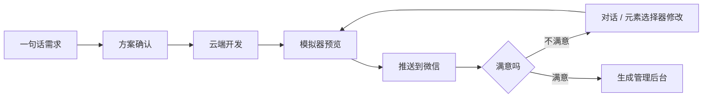

<div align="center">


# WeChat Minitool Playbook

**微信「做个小工具」实战手册**

一句话在微信里做个应用 · 提示词、约束边界、界面设计、制作记录，复制即用

[](LICENSE)
[](#-6-个小工具)
[](#-几条提醒)
[](https://github.com/Hiwoniu/wechat-minitool-playbook/stargazers)
[](https://my.feishu.cn/wiki/Eq6twbgv5irYgikOa8Pc2fHfnKg)

[申请内测](#-怎么申请内测) · [6 个小工具](#-6-个小工具) · [客户端一图看懂](#-客户端一图看懂) · [制作流程](docs/01-制作流程.md) · [提示词技巧](docs/03-提示词技巧.md) · [为什么是小工具](docs/04-为什么是小工具.md) · [交流群](#-交流群)

</div>

<br>

> [!NOTE]
> 小工具跑在微信里，没有能放在本地的源码。**所以这个仓库收的是能复现的东西：提示词、边界规则、界面规格、验收清单，和真实的制作记录。**

微信内测了一个桌面端 AI Agent，叫「做个小工具」。你描述需求，它在云端做出一个小工具，直接在微信「小微」里打开，还能发给朋友一起用。不用注册、备案、审核。

<p align="center">
  
  <br><sub>这 6 个都是一句话做出来的，自带插画、空状态页和统一配色</sub>
</p>

> **小程序解决的是「开发者给大众做应用」，小工具解决的是「普通人用 AI 给自己和身边人做应用」。**

## 🎫 怎么申请内测

目前是报名制内测，客户端是 Beta 版。

1. 打开官网 **[minitool.weixin.qq.com](https://minitool.weixin.qq.com)**。
2. 点右上角「**报名入口**」，用微信扫弹出的二维码报名。
3. 在官网下载客户端：默认是 macOS（Apple 芯片），点「其他系统版本」可选 **macOS · Intel 芯片** 和 **Windows · 64 位**。
4. 打开客户端，用微信登录，在对话框里说需求就能开始做。

<p align="center">
  
  <br><sub>官网首页，右上角是报名入口。2026-11-22 查看时最新版本是 v0.01.2611202（2026-11-21 发布）</sub>
</p>

> [!TIP]
> 报名后多久能用，以官方通知为准。官网链接也可以从 `mp.weixin.qq.com/wiki/minitool` 跳转过去。

## 🧰 6 个小工具

<table>
  <tr>
    <td width="33%" valign="top">
      <h3>📝 <a href="tools/01-随口记/">随口记</a></h3>
      <sub>我和对象 · 室友</sub><br><br>
      聊天里随口答应的事，3 秒记下，自动按「明天 / 周六」归好日期<br><br>
      
    </td>
    <td width="33%" valign="top">
      <h3>🎒 <a href="tools/02-放学打卡/">放学打卡</a></h3>
      <sub>家长 · 孩子</sub><br><br>
      放学后事项三态打卡，全家共用一份，按天按周回看<br><br>
      
    </td>
    <td width="33%" valign="top">
      <h3>💊 <a href="tools/03-爸妈用药记录/">爸妈用药记录</a></h3>
      <sub>子女 · 父母</sub><br><br>
      老人大字号一键打卡，子女远程看有没有漏服<br><br>
      
    </td>
  </tr>
  <tr>
    <td width="33%" valign="top">
      <h3>🍻 <a href="tools/04-聚会AA账本/">聚会 AA 账本</a></h3>
      <sub>一起出游的朋友</sub><br><br>
      多人一起记账，自动算出转账次数最少的结算方案<br><br>
      
    </td>
    <td width="33%" valign="top">
      <h3>🛒 <a href="tools/05-社区团购接龙/">社区团购接龙</a></h3>
      <sub>团长 · 邻居</sub><br><br>
      下单校验库存、自动汇总，门牌只有团长能看到<br><br>
      
    </td>
    <td width="33%" valign="top">
      <h3>🏃 <a href="tools/06-搭子减脂榜/">搭子减脂榜</a></h3>
      <sub>几个减肥的朋友</sub><br><br>
      按减重百分比排行，具体体重默认只有自己可见<br><br>
      
    </td>
  </tr>
</table>

### 📸 实际做出来的样子

<table>
  <tr>
    <td align="center"><br><sub>速记待办</sub></td>
    <td align="center"><br><sub>放学后打卡</sub></td>
    <td align="center"><br><sub>家庭用药打卡 · 老人端</sub></td>
  </tr>
  <tr>
    <td align="center"><br><sub>AA 记账</sub></td>
    <td align="center"><br><sub>团购接龙</sub></td>
    <td align="center"><br><sub>减脂打卡</sub></td>
  </tr>
</table>

一次成型约 6–10 分钟，自带插画和配色。客户端一次只能做一个，并行提交的会排队，需要回一句「继续」。

<details>
<summary><b>展开看每个工具的完整界面和制作过程</b></summary>

<br>

**📝 速记待办**：排队后回了一句「继续」，6 分钟左右做好，算上排队约 24 分钟。追加语音输入后，它自己截图发现麦克风按钮没出来，翻源码看日志又修了一次。


**🎒 放学后打卡**：6 个里最顺的，一次成型，约 6 分钟。


**💊 家庭用药打卡**：开工前先反问身份怎么分；做完自己截图检查，把「我是老人」从一行小字改成整行大按钮。


**🍻 AA 记账**：制作本身 7 分钟，前面排队卡了两个多小时。


**🛒 社区团购接龙**：第一次把需求拆成两步提交，失败了；合成一句完整的话重提，约 10 分钟做好。


**🏃 减脂打卡**：界面最好看。第一次说做好了，其实作品没绑定上，回「继续」又补了 10 分钟。


</details>

每个文件夹都是同一套结构：

```text
tools/01-随口记/
├── README.md     定位 · 角色权限 · 核心功能 · 约束边界 · 界面设计 · 管理后台 · 验收清单
├── prompt.md     可直接粘贴的完整提示词 + 2–3 条迭代指令
└── 制作记录.md    实测过程、耗时、踩坑和真实感受
```

为什么选这 6 个？标准只有一条：**这个需求放在微信里，是不是比放在别处更合适。** 详见 [选题思路](docs/02-选题思路.md)。

## 🔄 制作流程



改坏了随时版本回退。完整 9 步见 [制作流程](docs/01-制作流程.md)。

## 🖥️ 客户端一图看懂


<table>
  <tr>
    <td width="40%" align="center"><br><sub>右上角：自动预览、后台管理、模拟器开关、账号</sub></td>
    <td width="60%" align="center"><br><sub>输入框：附件、权限、发送 · 模拟器：切换身份、刷新、元素选择器</sub></td>
  </tr>
</table>

- **没有模型可选**，用的是微信自研的大模型。
- **先确认再开工**：它会把理解到的功能列出来让你确认，其中一项是「使用范围」，比如能不能邀请朋友。
- **云端开发**，本地不用装任何环境；做好后右侧模拟器可以直接点着用。
- **改界面**：直接在对话框里说，或者用「元素选择器」点中某个按钮再说怎么改。

## 📲 做好之后

点预览，工具会推送到电脑和手机微信的「小微」里，还可以分享给朋友一起用。


<sub>左：客户端里做好的 6 个小工具 · 中：手机微信「最近使用的小程序」里，红框里的 5 个就是做好的小工具 · 右：以卡片形式分享给朋友（隐私已打码）</sub>

## 💡 实测下来的几条经验

- **一次只提交一个需求。** 同时提交会排队，AA 记账就排了两个多小时。
- **它说做好了，自己要看一眼。** 减脂打卡第一次「做好」其实没绑定上，回一句「继续」就会接着做。
- **需求写成一句完整的话。** 团购接龙拆成两步提交失败了，合成一句就成功了。
- **它会自己截图检查。** 用药打卡做完，它自己把老人入口改成了大按钮，还清掉了演示数据。
- **它不读聊天记录。** 速记待办是手动记录的工具，不会自动从聊天里抓待办。

为什么这个需求放在微信里更合适、微信为什么要做小工具，见 [选题思路](docs/02-选题思路.md) 和 [为什么是小工具](docs/04-为什么是小工具.md)。

## 🚀 怎么用

1. 按 [怎么申请内测](#-怎么申请内测) 报名，安装桌面客户端（macOS / Windows）。
2. 打开想做的工具文件夹，复制 `prompt.md` 里的完整提示词。
3. 粘贴到客户端对话框，确认方案后等它在云端做完。
4. 对照 `README.md` 里的验收清单，在模拟器里切换身份逐项测。

## 📚 文档

| | 内容 | 解决什么问题 |
|:-:|---|---|
| 01 | [制作流程](docs/01-制作流程.md) | 从登录到生成管理后台的 9 步，第一次用照着走 |
| 02 | [选题思路](docs/02-选题思路.md) | 什么需求适合做成小工具，以及更多可做的方向 |
| 03 | [提示词技巧](docs/03-提示词技巧.md) | 怎么写才能一次做对，怎么改才不越改越乱 |
| 04 | [为什么是小工具](docs/04-为什么是小工具.md) | 微信为什么用小程序底座做这件事：个人观察 |

## ⚠️ 几条提醒

> [!IMPORTANT]
> **6 个工具已于 2026-11-20 全部做出来**，耗时、踩坑和截图见各自的 `制作记录.md`。身份权限隔离、结算算法、提醒、真机分享等标【需实测】的能力还没验证，以你自己试出来的为准。

- **内测阶段**：Beta 版，需要内测资格和桌面客户端，功能入口随时会变。
- **别存敏感信息**：数据在云端，密码、证件号、病历、银行卡别往里写。
- **「完全访问权限」不要随手开**：做小工具用不到。

## 🗺️ 后续更新

- [x] 6 个小工具全部做出，补齐制作记录和首页截图
- [ ] 逐项验证身份隔离、结算、隐私等功能，补真机截图
- [ ] 读者许愿：留言里点赞最高的需求，做出来放进来
- [ ] 同一个需求，不同写法的提示词效果对比

## 💬 交流群

用「做个小工具」做出了好玩的东西，或者踩了坑，欢迎来群里聊。

<a href="https://my.feishu.cn/wiki/Eq6twbgv5irYgikOa8Pc2fHfnKg"></a>

## 🤝 投稿

做出了新的小工具，欢迎提 PR：复制 [templates/新工具模板.md](templates/新工具模板.md)，在 `tools/` 下新建一个文件夹。需要有完整提示词和至少一次实测记录，截图请打码。

<div align="center">

<br>

觉得有用的话，点个 ⭐ **Star**，更新了能第一时间看到。

</div>

---

## 👤 作者

<table>
  <tr>
    <td valign="top">
      <b>向明</b><br><br>
      平时在开发里找好用的 Agent、Agent 产品、Agent 技巧和提示词，拿来给工作和生活提效。<br><br>
      GitHub：<a href="https://github.com/Hiwoniu">@Hiwoniu</a><br>
      X：<a href="https://x.com/woniu20758393">@woniu20758393</a><br><br>
      <b>扫码关注公众号</b>，新的小工具和实测复盘会先发在这里 👉
    </td>
    <td width="200" align="center">
      
    </td>
  </tr>
</table>

## 📄 License

内容采用 [CC BY 4.0](LICENSE) 协议：可以自由复制、修改、商用，转载请注明出处并附上本仓库链接。
