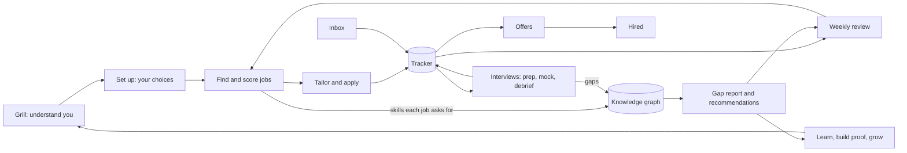

# until-hired

[](https://github.com/Hrutin-Suriya-Kotni/until-hired/actions/workflows/test.yml)
  

**An AI job-search coach that gets to know you, applies honestly, tracks everything, learns what the market wants, and keeps going until you're hired.**

until-hired is a set of [Agent Skills](https://agentskills.io) for AI agents such as Claude Code, the Claude app and Google Antigravity. It isn't a mass auto-apply bot: automatic submission exists only per platform, where the site allows it, and only if you turn it on. It runs the whole loop a good career coach and a disciplined job seeker would:



## Why it's different
- **It grills you first.** A frank 60–90 minute intake builds your verified facts, separates what you can *prove* from what you only *claim*, and records what you must never claim. Everything it writes later comes only from those facts.
- **Your choices, not its defaults.** Which platforms, how much automation per platform (`discover`, `prepare` or `submit`), inbox, notifications, limits, schedule: you pick each one.
- **The tracker is the heart.** Every job, status change (with evidence), interview, debrief and follow-up, in plain CSV files you own, plus a funnel that shows which sources, tracks and scores actually lead to interviews.
- **It learns the market.** Every job description it scores feeds a market map. Every interview debrief feeds a gap list. Together they produce a ranked skill-gap report and concrete recommendations: what to learn, which small proof project to build, what to lead with, where to stop applying.
- **It knows its own limits.** It checks whether your agent can run subagents in parallel, what browser tools exist and how much your laptop can take, then recommends team, sequential or solo mode.
- **It stays honest.** No invented experience, no guessed answers, no passwords, no CAPTCHA tricks, no cold-email blasts or lead lists. Messages are drafts you send.

## Install
### Claude Code (recommended: includes the guard hook)
```bash
claude plugin marketplace add Hrutin-Suriya-Kotni/until-hired
claude plugin install until-hired@until-hired
```
Open Claude Code in a private folder for your search and say: **"start my job search"**.
To stay on a fixed release instead of following `main`, clone a tag and add it as a local marketplace: `git clone --branch v1.0.0 https://github.com/Hrutin-Suriya-Kotni/until-hired && claude plugin marketplace add ./until-hired`.

### Google Antigravity
The tools and file layout are tested; a recorded live session in Antigravity is still to come ([help wanted](docs/live-run-2026-11.md)).
```bash
agy plugin install https://github.com/Hrutin-Suriya-Kotni/until-hired
```
or, without the plugin manager:
```bash
git clone --branch v1.0.0 https://github.com/Hrutin-Suriya-Kotni/until-hired
python3 until-hired/install.py --agent antigravity --target ~/my-job-search
cd ~/my-job-search && agy
```
Then say **"start my job search"**.

### Codex (experimental) and other agents that read SKILL.md folders
```bash
python3 until-hired/install.py --agent codex   --target ~/my-job-search
python3 until-hired/install.py --agent generic --target ~/my-job-search   # plain skills/ and agents/ folders
```
Codex can also add the repository as a plugin marketplace (`.agents/plugins/marketplace.json`); this path is not yet tested end to end.

### Claude app
Upload the folders in `skills/` as custom skills (if your plan supports it), or paste `skills/until-hired/SKILL.md` into a project's instructions. Connectors such as Gmail and Google Sheets can act as the inbox and a tracker mirror.

What happens next: [GUIDE.md](GUIDE.md). What you need first: [PREREQUISITES.md](PREREQUISITES.md).

## The skills
| Skill | What it does |
|---|---|
| `until-hired` | Entry point. Routes to setup and intake, runs the daily session and the weekly review, and keeps going until you're hired |
| `agent-setup` | Creates your workspace, checks the machine and the agent (subagents, parallel, browser, inbox, notifications), asks for every choice |
| `candidate-intake` | The grill: goals, targets, every role and project with numbers, proof per skill, gaps, history, constraints. Writes your facts files |
| `job-tracker` | Jobs, interviews, contacts, evidence, follow-ups, duplicate checks, funnel, dashboard |
| `job-discovery` | Finds jobs on your chosen sources, applies your hard filters, scores 0–100 with your weights, feeds the market map |
| `application-kit` | Tailored resume, form answers and (if asked) a short cover note, from verified facts in your voice |
| `apply-assist` | Fills applications in a browser in each platform's mode; hands off logins, CAPTCHAs and unknown questions |
| `inbox-sync` | Keeps the tracker true from email, including applications you made yourself |
| `interview-coach` | Prep sheets, realistic mock interviews, same-day debriefs that become tracked gaps |
| `growth-engine` | Knowledge graph, market map, gap report, proof projects, recommendations, weekly review |
| `offer-coach` | Offer comparison, honest negotiation prep, deadlines, wrap-up after you accept |
| `self-improve` | Learns from every session; proposes skill changes you approve |
| `networking` | Optional, off by default: conversation-first notes you send yourself. No cold email, no lead lists |

Subagents (used when your agent supports them): `scout`, `applicant`, `inbox-keeper`, `researcher`, `reviewer`.

## Your workspace
Everything lives in plain files you own (default `career/`):
```
career/
├── config.json            your choices
├── profile/               PROFILE, FACTS (verified), DO_NOT_CLAIM, PREFERENCES, STORIES, ANSWERS (private)
├── tracker/               jobs.csv, interviews.csv, contacts.csv, events.jsonl, DASHBOARD.md
├── config.local.json      secrets (ntfy topic, mirror id): never committed
├── knowledge/             graph.json, market.json, GAPS.md, LEARNINGS.md (lessons you approved), reviews/
├── materials/<id>-<co>/   job description, tailored resume, answers, research, prep sheets
├── proposals/             skill changes the agent suggests
├── .inbox/                short-lived input files for the tools (deleted after use)
└── bin/                   tracker.py, knowledge.py, notify.py, check_system.py, uhlib.py (standard-library Python)
```

What the tools print:
```
$ python3 career/bin/tracker.py funnel
jobs tracked: 64   applied: 31   median days to first response: 6
by source:  applied | response | positive | interview | offer
  company-site            12 |      58% |      42% |       33% |   8%
  startup-board           11 |      36% |      18% |        9% |   0%
  job-board                8 |      13% |       0% |        0% |   0%

$ python3 career/bin/knowledge.py gaps
based on 64 job descriptions
skill                              class      in JDs  must intvw
python                             STRENGTH      81%    38     0
system design                      INTERVIEW      0%     0     3
kubernetes                         MISSING       47%    12     1
fastapi                            UNPROVEN      34%     6     0
```
(Illustrative numbers.)

## Safety, privacy and security
Read [SAFETY.md](SAFETY.md). In short:
- **Honest:** facts only from your verified file; nothing you can't prove is claimed; unknown questions are asked, never guessed.
- **Your consent:** every submission mode and every message is your choice; no passwords, CAPTCHAs or verification codes are ever handled for you.
- **Your data stays yours:** one private folder on your computer, git-ignored by default. Private answers are typed only into forms on known hiring systems (or sites you add), sensitive ones only with your yes. Notifications carry counts, not company names, unless you choose otherwise. What does leave your computer (your AI provider, the job sites, optional notifications and mirrors) is listed in SAFETY.md.
- **Hardened tools:** text from job posts and emails never goes on a command line; CSV cells can't become spreadsheet formulas; parallel agents can't overwrite each other; on Claude Code a guard hook enforces this before any command runs.

The design and its independent reviews are in [docs/design](docs/design). Found a vulnerability? See [SECURITY.md](SECURITY.md).

## Contributing
Platform tips, better interview banks, translations, and support for more agents are all welcome: [CONTRIBUTING.md](CONTRIBUTING.md). Run `python3 -m unittest discover -s tests -v` before a pull request.

## Credits
Built by [Hrutin Suriya Kotni](https://github.com/Hrutin-Suriya-Kotni) from the multi-agent setup he used in his own job search. Version 1.0 was designed and reviewed with the [Elephant Goldfish Model](https://egm.dev/) (one author with full context, nine independent reviewers without it). Ideas from the open-source [JobPilot](https://github.com/suxrobGM/jobpilot) project and the [humanizer](https://github.com/blader/humanizer) skill shaped the interview-prep and writing-voice guidance.

MIT licensed. Not affiliated with any job platform or AI company.
