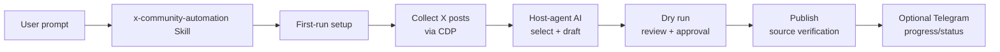

# X Community Automation

[English](README.md) | [简体中文](README.zh-CN.md)

[](https://x.com/)
[](#features)
[](#cdp-and-safety)
[](https://remote-browser.dev)
[](#requirements)
[](https://playwright.dev/)
[](#install)
[](#cdp-and-safety)
[](#telegram-notifications)


Guarded X community workflows for any host agent. Connect an already authenticated browser over Chrome DevTools Protocol (CDP), let the invoking agent handle reasoning, review a dry run, then opt into verified replies, reposts, quote-posts, original posts, and thread interactions.

## Contents

- [Status](#status)
- [Install](#install)
- [Quick Start](#quick-start)
- [Visual Overview](#visual-overview)
- [Commands](#commands)
- [Features](#features)
- [Runtime Architecture](#runtime-architecture)
- [Configuration](#configuration)
- [Telegram Notifications](#telegram-notifications)
- [CDP and Safety](#cdp-and-safety)
- [Requirements](#requirements)
- [Troubleshooting](#troubleshooting)
- [Portability and Distribution](#portability-and-distribution)

## Status

- Workflow surface: X Home/Search collection, guarded replies, reposts, quote-posts, original posts, and source-level verification.
- Agent boundary: `agent` mode is the default; no separate model is required.
- Platforms: choose Codex, Claude, Hermes, or OpenClaw at install time; no platform is assumed by default.
- Live actions: opt-in after a dry run; failed verification blocks success.
- Notifications: optional Telegram progress and terminal states, plus optional legacy Slack reporting.

## Install

### One-Line Install

The installer downloads the complete bundle, asks which platform to use, copies it to that platform's Skill directory, runs `npm install`, and removes its temporary download directory.

```bash
curl -fsSL https://raw.githubusercontent.com/HuberTRoy/x-automation/main/install.sh \
  | bash
```

The interactive prompt offers `codex`, `claude`, `hermes`, and `openclaw`. CI and other headless environments must pass `--platform` or `--dest`, for example `bash -s -- --platform codex`.

### Review Before Installing

From a cloned or extracted bundle, inspect the files and run:

```bash
bash install.sh
```

Without `--platform`, the installer prompts for a target platform. For a non-interactive install, pass it explicitly, for example:

```bash
bash install.sh --platform codex
```

The installer also accepts a custom destination:

```bash
bash install.sh --dest "$HOME/.local/share/x-skills/x-community-automation"
```

### Installer Behavior

| Platform | Default root | Optional override |
| --- | --- | --- |
| Codex | `~/.codex/skills` | `CODEX_HOME` |
| Claude | `~/.claude/skills` | `CLAUDE_HOME` |
| Hermes | `~/.hermes/skills` | `HERMES_HOME` |
| OpenClaw | `~/.openclaw/skills` | `OPENCLAW_HOME` |

The installer automatically installs Node dependencies and skips Playwright browser downloads because this Skill attaches to an existing CDP browser. Use `--skip-npm-install` for an offline file-only install; dependencies must then be installed before running scripts directly. Use `--force` to overlay bundle files in an existing destination without deleting unrelated files.

After installation, invoke the Skill from the selected platform. You do not need to change into the installed directory. If the host caches installed Skills, restart or reload it once.

## Quick Start

Invoke the Skill naturally; a slash command is not required.

1. Call `x-community-automation` from Codex, Claude, Hermes, or OpenClaw.
2. On first use, answer the conversational setup questions:
   - Which local or remote CDP endpoint to use.
   - What the account should pay attention to.
   - Include, exclude, and manual-review signals, or permission to derive them from the focus.
   - Allowed actions, language, reach limits, and risk limits.
   - Optional Telegram Bot token, chat ID, and notification level.
3. Confirm the masked settings. The agent writes the local runtime and topic configuration for you; no environment-variable editing is required.
4. Run the requested workflow as a dry run. Inspect the account identity, source posts, selected actions, and proposed text.
5. Authorize live actions only after reviewing the dry-run result. Each published action must be verified under the exact source post.

Example requests to the host agent:

```text
Use the X community automation Skill to collect relevant X posts for my configured focus and run a dry run showing the candidate posts and proposed replies.
```

```text
After I approve the X dry run, publish only the selected replies through my authenticated CDP browser, verify each reply under its source X post, and send the final status to Telegram.
```

To change a setting later, say “change my focus”, “change the risk limit”, “switch CDP”, or “change Telegram notifications”. The agent should update only the requested setting and reuse the rest.

## Visual Overview

The Skill is a routing layer: the user asks in natural language, the host agent configures and reasons, deterministic scripts collect and publish through CDP, and every live action ends with source-level verification.



## Commands

All live commands should be preceded by their dry-run equivalent.

| Entry point | Purpose |
| --- | --- |
| `node scripts/pipeline/collect_x_home_feed_cdp.js --dry-run` | Collect candidates from the X Home timeline. |
| `node scripts/pipeline/collect_x_search_cdp.js --dry-run` | Collect candidates from configured X searches. |
| `node scripts/pipeline/decide_x_hotspots.js --ai-mode dry-run --input collected.jsonl` | Apply the configured focus and decision policy. |
| `node scripts/x/x_execute_decisions_cdp.js --dry-run --input decisions.jsonl` | Preview guarded replies, reposts, quotes, or posts. |
| `node scripts/pipeline/telegram_notify.js --event test --workflow x-automation --status completed --message "Telegram notifications enabled"` | Send a notifier configuration check. |

Scheduler wrappers:

```bash
bash scripts/x-community-daily.sh
bash scripts/x-interactions.sh
bash scripts/run_x_random_once.sh
```

The wrappers load the local environment file, keep a per-workflow lock, send configured progress/terminal notifications, and preserve the underlying command's exit code.

## Features

### Agent-Owned Reasoning

All generation and selection passes through one `agent_ai.js` method boundary. The invoking agent can produce replies, choose hotspots, draft quote comments, and write original posts without silently invoking a second model.

### Configurable Decisions

Each user can define focus, include/exclude/review signals, preferred and allowed actions, language, reach thresholds, risk limits, content lengths, promotion rules, and source-anchor requirements.

### Guarded Publishing

Collection, selection, dry-run preview, authorization, scoped controls, conservative batching, deduplication, and source-level verification are separate gates. A click or generic X URL is never treated as proof of publication.

### Portable Installation

The same bundle can be installed for Codex, Claude, Hermes, or OpenClaw. Platform selection is interactive by default, while explicit flags and destination overrides support CI and automation.

### Notifications and Reports

Telegram can report progress and terminal states through one notifier. The report entry point also retains optional legacy Slack delivery.

## Runtime Architecture

The repository keeps host-agent instructions, deterministic runtime code, configuration, and safety references separate:

- `skill/SKILL.md`: host-agent routing, first-use setup, workflow gates, and safety contract.
- `skill/references/`: CDP connection, initialization, AI handoff, decision schema, publishing verification, recovery, and reporting details.
- `scripts/pipeline/`: collection, topic loading, agent-AI handoff, decision processing, and Telegram notifications.
- `scripts/x/`: CDP execution and source-scoped reply, repost, quote, follow, and post operations.
- `config/` and `templates/`: bundled topic defaults, local configuration conventions, and the environment template.

Scripts resolve the bundle root from their own location rather than from the caller's working directory.

## Configuration

### Conversational Setup

First-run Skill initialization normally asks for the CDP endpoint, decision focus, action and safety limits, language, and optional Telegram settings. It writes `scripts/.env` and `config/community-topics.local.json` inside the installed bundle. Say what to change later; do not edit environment variables by hand unless you are running the scripts directly.

### Manual Environment Setup

Use the manual path only for direct CLI use or integration with an existing scheduler.

From the bundle root:

```bash
cp templates/.env.example scripts/.env
```

A minimal setup looks like this:

```dotenv
# AI boundary: agent is the default and keeps reasoning in the invoking agent.
X_AI_MODE=agent

# Complete local or remote CDP endpoint. Pass it to Playwright unchanged.
X_CDP_URL=http://127.0.0.1:9222

# Used by interaction workflows that scan the account's own posts.
X_ACCOUNT_HANDLE=

# Optional topic and promotion settings.
X_BRAND_NAME=
X_BRAND_URL=
X_BRAND_LANE=none
COMMUNITY_TOPICS=rpc

# Optional Telegram progress notifications.
X_TELEGRAM_BOT_TOKEN=
X_TELEGRAM_CHAT_ID=
X_TELEGRAM_NOTIFY_LEVEL=completion

# Optional legacy report destination.
SLACK_WEBHOOK_URL=
```

### Core Variables

| Variable | Required | Purpose |
| --- | --- | --- |
| `X_CDP_URL` | For live browser work | Local HTTP or remote HTTP/WebSocket CDP endpoint. Do not append account selectors or rewrite provider parameters. |
| `X_AI_MODE` | No | `agent` (default), `external`, or `dry-run`. |
| `X_AGENT_AI_REQUEST_FILE`, `X_AGENT_AI_RESPONSE_FILE` | No | Optional fixed paths for the host-agent AI handoff envelopes. |
| `X_ACCOUNT_HANDLE` | Interaction workflows | Authenticated account handle, with or without `@`. |
| `X_ENV_FILE` | No | Alternate environment-file path for direct CLI or scheduler use. |
| `COMMUNITY_TOPICS` / `COMMUNITY_TOPIC` | No | Comma-separated topic keys for one run. |
| `COMMUNITY_TOPICS_FILE` | No | Alternate topic JSON file. The local user file is auto-discovered when present. |
| `X_BRAND_NAME`, `X_BRAND_URL`, `X_BRAND_LANE` | No | Optional bounded product or brand lane. |
| `RPC_ASSISTANT_DAILY_SCRIPT` | Article lane only | Path to an external article-publisher script used by the daily wrapper. |
| `X_TELEGRAM_BOT_TOKEN`, `X_TELEGRAM_CHAT_ID` | Telegram only | Bot credential and destination chat. Store them only in the local environment file. |
| `X_TELEGRAM_NOTIFY_LEVEL` | No | `off`, `errors`, `completion`, `progress`, or `all`; defaults to `completion` when Telegram is configured. |
| `X_TELEGRAM_API_BASE_URL` | No | Optional compatible Bot API proxy or local test server. |
| `SLACK_WEBHOOK_URL` | No | Optional legacy destination for the report script. |

Installer-only overrides are `X_SKILL_PLATFORM`, `X_SKILL_INSTALL_DIR`, and `X_SKILL_SOURCE_URL`; command-line flags take precedence when both are provided.

### Decision Overrides

Topic policy belongs in `config/community-topics.json` or the auto-discovered local override. The following variables are optional per-run overrides:

```dotenv
X_REPLY_MIN_IMPRESSIONS=1000
X_REPLY_MAX_RISK=0.49
X_REPLY_NO_PROMO=0
X_REPLY_LINK_PROBABILITY=
X_QUOTE_TOPICS=
X_SEARCH_TOPICS=
```

Useful topic decision fields include `focus`, `includeSignals`, `excludeSignals`, `reviewSignals`, `preferredActions`, `allowedActions`, `language`, `minImpressions`, `maxRiskScore`, `maxReplyCharacters`, `maxQuoteCharacters`, `strictSourceMatch`, and source-anchor word limits.

Example custom topic:

```json
{
  "defaultTopic": "observability",
  "topics": {
    "observability": {
      "description": "Production observability and incident response",
      "collect": { "xQueries": ["observability", "incident response"] },
      "decision": {
        "focus": "Production observability and incident response",
        "includeSignals": ["observability", "incident response", "tracing"],
        "excludeSignals": ["giveaway", "investment advice"],
        "preferredActions": ["reply"],
        "allowedActions": ["reply", "skip"]
      }
    }
  }
}
```

Keep user-specific settings in `config/community-topics.local.json`; it is ignored by version control and takes precedence over the bundled defaults.

### AI Modes

The default `agent` mode writes a request envelope, pauses with exit code `75`, and lets the invoking agent produce the JSON response. Re-run the same command with that response file. This is expected pending work, not a publish failure.

The explicit `external` mode is an advanced compatibility option:

```dotenv
X_AI_MODE=external
AI_API_URL=https://example.invalid/v1/chat/completions
AI_API_KEY=
AI_MODEL=
AI_TEMPERATURE=0.35
```

Do not enable external mode when the host agent is expected to do the reasoning.

## Telegram Notifications

Telegram is optional. During first-run setup, give the agent the Bot token and chat ID and choose a level:

- `completion`: completed, skipped, pending, and failed states only (default).
- `progress`: start and stage messages plus terminal states.
- `errors`: failures only.
- `off`: disabled.

The daily, interaction, reply-batch, and report entry points use one notifier. It truncates long messages, redacts CDP URLs and token-like values, and never prints the Bot API response body. Notification failures are best-effort and do not change the X workflow result.

The direct configuration check is:

```bash
node scripts/pipeline/telegram_notify.js \
  --event test \
  --workflow x-automation \
  --status completed \
  --message "Telegram notifications enabled"
```

The optional `X_TELEGRAM_API_BASE_URL` variable can point to a compatible proxy or local test server. Keep the Bot token in the local environment file and never commit it.

## CDP and Safety

- `X_CDP_URL` may be a local endpoint such as `http://127.0.0.1:9222` or a configured remote HTTP/WebSocket endpoint. For remote CDP, [Remote Browser](https://remote-browser.dev) is the recommended option.
- The endpoint is passed to Playwright unchanged. A successful connection is not proof that the intended X account is rendered.
- Before live actions, verify the visible account identity, login state, target article, composer, and scoped action control.
- Count an action as successful only after exact source-level verification, not merely after a click or a generic X URL.
- Do not close the user's persistent browser; close only pages created by the workflow.
- Never put CDP endpoints, cookies, Bot tokens, API keys, raw environment values, or AI handoff secrets in logs, reports, Telegram messages, or committed files.
- Respect X rate limits, platform rules, content safety requirements, and local law.

## Requirements

- Bash, `curl`, and `tar` for pipe installation.
- Node.js 20 or newer with npm.
- An X browser session that is already authenticated and exposes a local or remote CDP endpoint.
- Permission to write to the selected platform's Skill directory.

The Skill does not manage browser login, create accounts, or close the user's persistent browser.

## Troubleshooting

- **`npm install` cannot reach the registry:** fix Node/npm network access and rerun the installer with `--force`, or use `--skip-npm-install` for a file-only copy and install dependencies later.
- **The workflow pauses with exit code `75`:** read the generated AI request envelope, let the invoking agent write the matching response envelope, then re-run with the same inputs.
- **The account is wrong or X shows a login page:** stop the run, open the intended authenticated browser session, and update the CDP setting through the Skill conversation.
- **No candidates are selected:** review the configured topic focus, include/exclude signals, reach threshold, risk limit, and source-anchor requirement before changing any safety gate.

## Portability and Distribution

Scripts resolve the bundle root from their own location rather than from the caller's working directory. The installer never copies real `.env` files, local topic overrides, browser state, AI handoff artifacts, decision state, publish state, or logs into a new installation.
