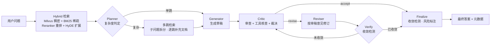

<div align="center">

# DeepReason — Multi-Agent 自纠错推理引擎

**Agentic RAG · 3-Agent 审查-修订闭环 · 多跳检索 · Guardrails · 可复现评测**


</div>

基于 LangGraph 状态机编排的 **Agentic RAG 推理引擎**：检索链（Planner）驱动多跳证据收集，3-Agent 审查-修订闭环（Generator / Critic / Reviser）迭代收敛答案，配备 MCP 风格工具核查与 Guardrails（收敛检测、安全标注、超时、reject 回退）。

## 核心特性

- **3-Agent 自纠错闭环** — Critic 逐条审查并裁决（accept / revise / reject），Reviser 按审稿意见修订，Verify 收敛检测提前终止；reject 时回退初稿而非输出劣化答案
- **多跳检索** — Planner 按问题复杂度判定检索模式，复杂问题拆分为子问题逐跳补充证据链，单跳问题直通生成
- **工具核查** — Critic 调用 MCP 风格 4 工具（`paper_search` / `concept_query` / `framework_doc_search` / `compare`）对答案断言做实证核查
- **Guardrails** — 收敛检测（修订前后相似度 ≥ 阈值即停）、运行时限制强制执行、风险标注、低置信度标注（标注只进元数据，不污染答案文本）
- **可复现评测** — LLM-as-Judge 逐条分类判定 + 程序化加权评分，三组对照（Baseline / Draft / Full），30 题分层题目集
- **Web 可视化** — SSE 流式展示各节点执行过程，历史评测结果浏览器

## 架构



## 项目结构

```
DeepReason/
├── src/
│   ├── agents/          # Generator / Critic / Reviser / Planner
│   ├── graph/           # LangGraph 状态机（节点 / 条件路由 / 状态）
│   ├── guardrails/      # 收敛检测 / 运行时限制 / 安全标注
│   ├── retrieval/       # 稠密+稀疏混合检索 / 重排 / HyDE / Parent-Child Chunk
│   ├── mcp_server/      # MCP 风格 4 工具
│   └── memory/          # 对话记忆
├── eval/                # 评测：30 题集 + 三组对照 + LLM-as-Judge
├── web/                 # FastAPI + SSE 可视化界面（原生单页前端）
├── scripts/             # 数据采集 / 索引构建 / 冒烟测试 / CLI 演示
├── tests/               # pytest 回归测试（无需 Milvus / API 即可运行）
└── config/              # 集中配置（环境变量驱动）
```

## 快速开始

```bash
# 1. 依赖
pip install -r requirements.txt

# 2. 创建 .env（API Key / Milvus / 模型，见下方）

# 3. 启动 Milvus（Docker Standalone）
docker compose -f scripts/milvus-standalone-docker-compose.yml up -d

# 4. 构建知识库索引（arXiv 论文 + 框架文档 + 博客）
python scripts/collect_papers.py        # 可选：采集数据
python scripts/build_index.py           # 切块 + Embedding + 建索引

# 5. 冒烟测试
pytest tests/                           # 回归测试（无需外部依赖）
python scripts/test_retrieval.py        # 检索链路
python scripts/test_tools.py            # MCP 工具 + Critic 断言核查
python scripts/test_graph.py            # 推理图端到端

# 6. CLI 交互问答
python scripts/demo.py                  # 或 echo "什么是RAG？" | python scripts/demo.py --once
```

`.env` 关键配置：

```ini
DEEPSEEK_API_KEY=sk-xxx
# 各 Agent 模型（API 仅支持 deepseek-v4-pro / deepseek-v4-flash）
GENERATOR_MODEL=deepseek-v4-flash
CRITIC_MODEL=deepseek-v4-flash
REVISER_MODEL=deepseek-v4-flash
PLANNER_MODEL=deepseek-v4-flash
# Milvus
MILVUS_HOST=localhost
MILVUS_PORT=19530
```

## 评估

```bash
# 三组对照评估（Baseline / Draft / Full），结果写入 eval/results/
python eval/run_eval_debate.py --limit 3     # 冒烟（前 3 题）
python eval/run_eval_debate.py               # 全量 30 题
```

## 评估结果

**评测口径**（2026-08 修正后固定）：
- LLM-as-Judge 逐条分类判定，score 由程序按比率计算（非自由打分，可复现）
- 综合分加权：Faithfulness 0.40 / Relevancy 0.25 / Precision 0.25 / Recall 0.10（忠实度为答案质量第一红线，权重最高；召回率主要由检索链路负责，权重最低）
- Baseline 的 faithfulness 对照「外层单跳检索集」评估；Draft/Full 对照「引擎内部实际使用的检索文档集」（含多跳合并）评估
- 题目集：30 题分层配额（论文 23 / 框架文档 5 / 技术博客 2），覆盖多跳推理、工具使用、辩论机制等 Agent 核心课题

**迭代演进**（`eval/results/` 可复现）：

| 日期 | 生成模型 | Baseline | Draft | Full | 备注 |
|---|---|---|---|---|---|
| 07-23 | pro | 0.671 | 0.638 | 0.542 | 早期：裁决链路不稳定，3/10 非 accept |
| 07-24 | pro | 0.784 | 0.779 | 0.791 | 链路稳定，Full 整体 ≥ Draft |
| 07-25 | pro | 0.723 | 0.759 | 0.757 | 评测口径修正后，Draft 稳定超越 Baseline |
| 07-27 | pro | 0.768 | 0.761 | 0.762 | 全量首轮通过 |
| 08-01 | flash | 0.781 | **0.794** | 0.794 | 最佳成绩：Draft 全维度超越 Baseline |
| 08-02 | pro | 0.761 | 0.716 | 0.718 | 审查-修订首次大规模触发（4/10 revise）；修订 3/4 在忠实度上正向改进；收敛检测在相似度 0.93 时提前终止 |
| 08-15 | flash | 0.814 | 0.819 | **0.820** | 题目集扩至 30 题 + 加权评分口径；29/30 accept，修订题目零退化（degradation 0.0）；新增多跳检索门槛，收敛阈值收紧至 0.95 |

> 说明：
> - 08-15 起题目集由 10 题扩至 30 题、评分由等权均值改为加权，与前期行不可直接数值对比。
> - 08-02 分数回落源于生成模型切换（pro 在该问题集上弱于 flash 正式版）。触发修订的题目均未被改坏——机制有效性（修订正确率、收敛检测、工具核查）以过程数据为准，而非仅看综合分。

## Web 界面

可视化推理全过程（流式展示各节点执行）与历史 eval 结果：

```bash
uvicorn web.app:app --port 8010
# 打开 http://127.0.0.1:8010
```

- **推理演示**：输入问题 → SSE 实时推送 retrieve / plan / generator / critic（issues、工具核查）/ reviser（收敛检测）/ verify 各节点 → 最终答案
- **Eval 结果**：历史运行列表、逐题四指标（Faithfulness / Relevancy / Precision / Recall）、verdict 分布、修订轨迹，点击行展开答案对比

## 技术栈

| 层 | 选型 |
|---|---|
| 编排 | LangGraph（状态机 + 条件路由 + 检查点） |
| LLM | DeepSeek（deepseek-v4-pro / flash，OpenAI 兼容 SDK） |
| 检索 | Milvus + BGE-M3 稠密检索 + BM25 稀疏检索 + bge-reranker 重排 + HyDE/Multi-HyDE 查询扩展 |
| 结构 | Parent-Child 双层 Chunk |
| 工具 | MCP 风格 4 工具（paper_search / concept_query / framework_doc_search / compare），Critic 断言核查 |
| 评测 | LLM-as-Judge 逐条判定（faithfulness / relevancy / precision / recall） |
| Web | FastAPI + SSE + 原生单页前端 |

## License

[MIT](LICENSE) © 2026 IceSugar93
