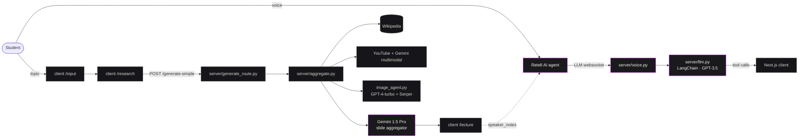
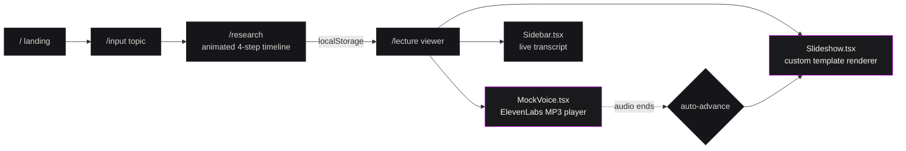

<!-- AdaptEd · README · v.2026 ----------------------------------------------- -->

<div align="center">

<picture>
  <source media="(prefers-color-scheme: dark)" srcset=".github/assets/hero.svg" />
  <source media="(prefers-color-scheme: light)" srcset=".github/assets/hero.svg" />
  
</picture>

<br/>

<p>
  <a href="https://www.youtube.com/watch?v=8o1YJUFBcAw"><strong>Demo reel&nbsp;↗</strong></a>
  &nbsp;·&nbsp;
  <a href="https://devpost.com/software/teachme-3p7bw1"><strong>Devpost&nbsp;↗</strong></a>
  &nbsp;·&nbsp;
  <a href="#-watch-it-run">Watch</a>
  &nbsp;·&nbsp;
  <a href="#-the-three-loops">Three loops</a>
  &nbsp;·&nbsp;
  <a href="#-architecture">Architecture</a>
  &nbsp;·&nbsp;
  <a href="#-run-the-showcase">Run it</a>
</p>

<p>
  <a href="https://devpost.com/software/teachme-3p7bw1"></a>
  <a href="https://devpost.com/software/teachme-3p7bw1"></a>
  <a href="LICENSE"></a>
</p>

<p>
  
  
  
  
  
  
  
  
  
  
  
  
</p>

</div>

<br/>

> [!NOTE]
> **AdaptEd is a hackathon winner first, a portfolio piece second** — and this repo is both.
> The production-style frontend you can `npm run dev` lives in [`client/`](client). The
> original FastAPI / LangChain / Retell AI / Gemini stack that won the awards at
> **LA Hacks 2024** is preserved verbatim in [`server/`](server) as a reference
> artifact. Nothing in `server/` is invoked at runtime — the showcase mocks every
> backend interaction in the browser.

---

## ▌ Watch it run

<div align="center">

<a href="https://www.youtube.com/watch?v=8o1YJUFBcAw" title="AdaptEd · LA Hacks 2024 demo (3 minutes)">
  
</a>

<sub><strong>3 minutes&nbsp;·&nbsp;LA Hacks 2024 finals&nbsp;·&nbsp;UCLA Pauley Pavilion</strong></sub>

</div>

<br/>

> [!TIP]
> Prefer to drive it yourself? The frontend showcase ships with a fully scripted
> "Red-Black Trees" lecture (pre-rendered ElevenLabs narration, scripted prompts,
> animated research timeline) — see [Run the showcase](#-run-the-showcase).

---

## ▌ Why it exists

> _Of 16 million U.S. university students, half fall behind on static, one-sided
> lectures while fewer than three percent have access to quality tutoring programs.
> So we built a lecturer that talks back._
>
> <sub>— from the original [Devpost writeup](https://devpost.com/software/teachme-3p7bw1)</sub>

The thesis was a single inversion: **instead of students adapting to the system,
the AI lecturer adapts to students.** That meant three feedback loops running
in parallel.

## ▌ The three loops

<div align="center">

<picture>
  <source media="(prefers-color-scheme: dark)" srcset=".github/assets/three-loops.svg" />
  
</picture>

</div>

| | Loop | What it does | What it unlocks |
| :-: | :-- | :-- | :-- |
| **01** | **Voice** | Retell AI captures speech with end-of-turn detection and streams to a LangChain GPT-3.5 agent that exposes three slide-control tools. | The lecturer can be cut off, asked to repeat, or told to skip — and pick up gracefully like a human tutor. |
| **02** | **Content** | Wikipedia · YouTube transcripts (Gemini multimodal) · Serper image search → Gemini 1.5 Pro slide aggregator with the `templates.py` taxonomy. | Slides regenerate live from verbal cues, not from a fixed deck. |
| **03** | **Attention** | Webcam emotion side-channel (Hume on Intel Dev Cloud) signals confusion / disengagement back to the planner. | The pace bends to the student, not the other way around. |

---

## ▌ Architecture

<details open>
<summary><strong>The original LA Hacks build</strong> &nbsp;<sub><code>server/</code> + <code>client/</code></sub></summary>

<br/>



</details>

<details>
<summary><strong>This frontend showcase</strong> &nbsp;<sub>browser-only · zero backend</sub></summary>

<br/>



</details>

<details>
<summary><strong>What lives in <code>server/</code></strong> &nbsp;<sub>preserved, not invoked</sub></summary>

<br/>

| File | Role |
| :-- | :-- |
| [`server/main.py`](server/main.py) | FastAPI app, WebSocket manager, MongoDB connection. |
| [`server/aggregate.py`](server/aggregate.py) | Multi-source slide pipeline driven by Gemini 1.5 Pro with Wikipedia, YouTube audio+frames, and image search. Cycled a list of `GEMINI_API_KEYS` to dodge free-tier quotas. |
| [`server/voice.py`](server/voice.py) | Two websockets per call: Retell's Custom LLM URL + a sidecar "data" socket the client used to push speaker notes and receive `next_slide` / `prev_slide` / `goto_slide` tool calls. |
| [`server/llm.py`](server/llm.py) | LangChain `create_openai_tools_agent` over GPT-3.5-turbo-0613, three slide-control tools. |
| [`server/google_agent.py`](server/google_agent.py) · [`server/mermaid_agent.py`](server/mermaid_agent.py) | Fetch.ai `uagents` experiments for the whiteboard. |
| [`intel_dev_cloud/fine_tune.ipynb`](intel_dev_cloud/fine_tune.ipynb) | LoRA / PEFT fine-tuning attempt on Intel GPUs via `bigdl-llm[xpu]`. |

</details>

---

## ▌ Run the showcase

```bash
git clone https://github.com/IdkwhatImD0ing/AdaptEd.git
cd AdaptEd/client
npm install
npm run dev
```

Then open <http://localhost:3000>. Four routes ship as static pages:

<div align="center">

| Route | Purpose |
| :-- | :-- |
| <kbd>/</kbd> | Landing — hero, demo embed, feature triptych, origin spec sheet |
| <kbd>/input</kbd> | Topic entry, pre-filled with `Red-Black Trees` |
| <kbd>/research</kbd> | Mocked four-step research timeline (Wikipedia → YouTube → images → drafting) |
| <kbd>/lecture</kbd> | Slideshow + voice dock + live transcript |

</div>

> [!IMPORTANT]
> No `.env` is needed at runtime. Every voice clip is pre-rendered to MP3 and
> shipped in [`client/public/audio/`](client/public/audio). The lecturer
> auto-advances when each clip ends and offers scripted prompt chips
> (<kbd>Explain that again</kbd>, <kbd>Skip ahead</kbd>) to demo the
> conversational interrupt feature.

<details>
<summary><strong>Regenerate the narration</strong> &nbsp;<sub>optional · requires an ElevenLabs API key</sub></summary>

<br/>

Slide narration and scripted prompt responses are produced once by
[`scripts/generate-audio.mjs`](client/scripts/generate-audio.mjs) using the
"Sarah" library voice on `eleven_multilingual_v2`. Re-run after editing slide
copy:

```bash
cd client
ELEVENLABS_API_KEY=sk_… node scripts/generate-audio.mjs
# add --force to overwrite existing files
```

</details>

---

## ▌ Map of the repo

```text
AdaptEd/
├─ client/                       # The frontend showcase ──────────────────
│  ├─ app/
│  │  ├─ page.tsx                Landing — hero, embed, features, origin
│  │  ├─ layout.tsx              Fonts (Fraunces · Instrument Sans · JetBrains Mono)
│  │  ├─ globals.css             Theme tokens, mesh & grain, utility classes
│  │  ├─ icon.tsx                Generated 64×64 brand favicon (Fraunces "Ed")
│  │  ├─ apple-icon.tsx          Generated 180×180 apple-touch-icon
│  │  ├─ opengraph-image.tsx     Generated 1200×630 OG card
│  │  ├─ input/page.tsx          Topic entry
│  │  ├─ research/page.tsx       Mocked 4-step research timeline
│  │  ├─ lecture/page.tsx        Stage + voice dock + transcript
│  │  ├─ components/
│  │  │  ├─ NavBar.tsx           Top navigation (landing & lecture variants)
│  │  │  ├─ Slideshow.tsx        Custom renderer for templates 0/1/2/4/8/9/10/11
│  │  │  ├─ Diagrams.tsx         Inline animated SVG diagrams (Red-Black Trees)
│  │  │  ├─ MockVoice.tsx        ElevenLabs MP3 player + scripted chips
│  │  │  ├─ Sidebar.tsx          Live transcript pane
│  │  │  ├─ YouTubeEmbed.tsx     Lazy, privacy-enhanced demo embed
│  │  │  └─ Typewriter.tsx       Tiny TS rewrite of react-type-animation
│  │  └─ lib/
│  │     ├─ types.ts             Lecture · Slide · TranscriptEntry types
│  │     ├─ mockLecture.ts       The canned Red-Black Trees lecture
│  │     └─ mockTranscript.ts    Scripted prompts for the conversational interrupt
│  ├─ public/audio/              Pre-rendered ElevenLabs narration MP3s
│  ├─ scripts/generate-audio.mjs Renders public/audio/*.mp3 from copy
│  ├─ tailwind.config.ts         Brand tokens, font variables, custom keyframes
│  └─ next.config.mjs            Allow remote images for slide assets
│
├─ server/                       # The original LA Hacks backend (preserved)
│  ├─ main.py                    FastAPI app + WebSocket manager
│  ├─ voice.py                   Retell AI Custom LLM URL + data sidecar
│  ├─ llm.py                     LangChain GPT-3.5 agent with slide tools
│  ├─ aggregate.py               Gemini 1.5 Pro multi-source slide pipeline
│  ├─ image_agent.py             GPT-4-turbo + Serper image picker
│  ├─ google_agent.py            Fetch.ai uagent — Gemini call
│  └─ mermaid_agent.py           Fetch.ai uagent — whiteboard
│
└─ intel_dev_cloud/
   └─ fine_tune.ipynb            LoRA/PEFT fine-tune on Intel GPUs
```

---

## ▌ What changed from the original

<div align="center">

| | LA Hacks 2024 build | This showcase |
| :-- | :-- | :-- |
| **Frontend framework** | Next.js 14.2 + React 18 | Next.js 15 + React 19 |
| **Slideshow** | Spectacle 10 + BroadcastChannel sync | Custom `<Slideshow />` component |
| **Voice** | Retell AI + GPT-3.5 + ngrok | Pre-rendered ElevenLabs MP3s |
| **Animation** | `react-reveal` (React 16 era) | `motion` (Framer Motion successor) |
| **Diagrams** | External Wikipedia images | Inline animated SVGs (`Diagrams.tsx`) |
| **Auth** | Auth0 (never wired) | Removed |
| **Typography** | Inter | Fraunces · Instrument Sans · JetBrains Mono |
| **Styling** | SCSS (`global.sass`) + Tailwind | Tailwind + CSS variables |
| **Build deps** | 18 prod / 9 dev | 6 prod / 9 dev |

</div>

---

## ▌ Spec sheet

<table align="center">
  <tr>
    <td align="center"><sub>EVENT</sub><br/><strong>LA Hacks 2024</strong></td>
    <td align="center"><sub>DATES</sub><br/><strong>Apr 19–21, 2024</strong></td>
    <td align="center"><sub>VENUE</sub><br/><strong>Pauley Pavilion · UCLA</strong></td>
    <td align="center"><sub>HACKERS</sub><br/><strong>704</strong></td>
    <td align="center"><sub>TEAMS</sub><br/><strong>142</strong></td>
  </tr>
  <tr>
    <td align="center"><sub>AWARDS</sub><br/><strong>Google · Fetch.ai</strong></td>
    <td align="center"><sub>TEAM SIZE</sub><br/><strong>4</strong></td>
    <td align="center"><sub>BUILD TIME</sub><br/><strong>36 hrs</strong></td>
    <td align="center"><sub>SLEEP</sub><br/><strong>≈ 4 hrs</strong></td>
    <td align="center"><sub>WORKING NAME</sub><br/><strong>"TeachMe"</strong></td>
  </tr>
</table>

---

## ▌ Credits

<table align="center">
  <tr>
    <td align="center" width="220">
      <a href="https://github.com/IdkwhatImD0ing">
        
      </a>
      <br/>
      <strong><a href="https://github.com/IdkwhatImD0ing">Bill Zhang</a></strong>
      <br/>
      <sub>Voice loop · Frontend</sub>
      <br/>
      <sub><a href="https://github.com/IdkwhatImD0ing">@IdkwhatImD0ing</a></sub>
    </td>
    <td align="center" width="220">
      <a href="https://github.com/spikecodes">
        
      </a>
      <br/>
      <strong><a href="https://github.com/spikecodes">Spike O'Carroll</a></strong>
      <br/>
      <sub>Backend · Agents</sub>
      <br/>
      <sub><a href="https://github.com/spikecodes">@spikecodes</a> · <a href="https://www.linkedin.com/in/spike-ocarroll">LinkedIn</a></sub>
    </td>
    <td align="center" width="220">
      <a href="https://github.com/jotalis">
        
      </a>
      <br/>
      <strong><a href="https://github.com/jotalis">Jay Wu</a></strong>
      <br/>
      <sub>Slide pipeline · Gemini</sub>
      <br/>
      <sub><a href="https://github.com/jotalis">@jotalis</a> · <a href="https://www.linkedin.com/in/jayqw">LinkedIn</a></sub>
    </td>
    <td align="center" width="220">
      <a href="https://github.com/Jaslavie">
        
      </a>
      <br/>
      <strong><a href="https://github.com/Jaslavie">Jasmine Wu</a></strong>
      <br/>
      <sub>Frontend · UX</sub>
      <br/>
      <sub><a href="https://github.com/Jaslavie">@Jaslavie</a> · <a href="https://www.linkedin.com/in/jaslavie">LinkedIn</a></sub>
    </td>
  </tr>
</table>

<div align="center">

<sub>Built in 36 hours under the rafters of Pauley Pavilion · originally branded "TeachMe" during the build, renamed to <strong>AdaptEd</strong> for submission.</sub>

</div>

---

## ▌ License

[MIT](LICENSE).

<details>
<summary><strong>Footnotes & sources</strong></summary>

<br/>

- LA Hacks 2024 — <https://la-hacks-2024.devpost.com/>
- Devpost project page — <https://devpost.com/software/teachme-3p7bw1>
- Demo reel — <https://www.youtube.com/watch?v=8o1YJUFBcAw>
- Stats (704 hackers, 142 teams) sourced from the LA Hacks 2024 Devpost listing.
- "16 million students / fewer than three percent have quality tutoring" framing
  is verbatim from the original Devpost writeup.
- All branding marks belong to their respective owners; this repo's brand work
  ("AdaptEd" wordmark, violet gradient identity) is part of the showcase
  redesign and is MIT-licensed alongside the code.

</details>

<div align="center">
  <sub>
    <a href="#"><strong>↑ back to top</strong></a>
  </sub>
</div>
